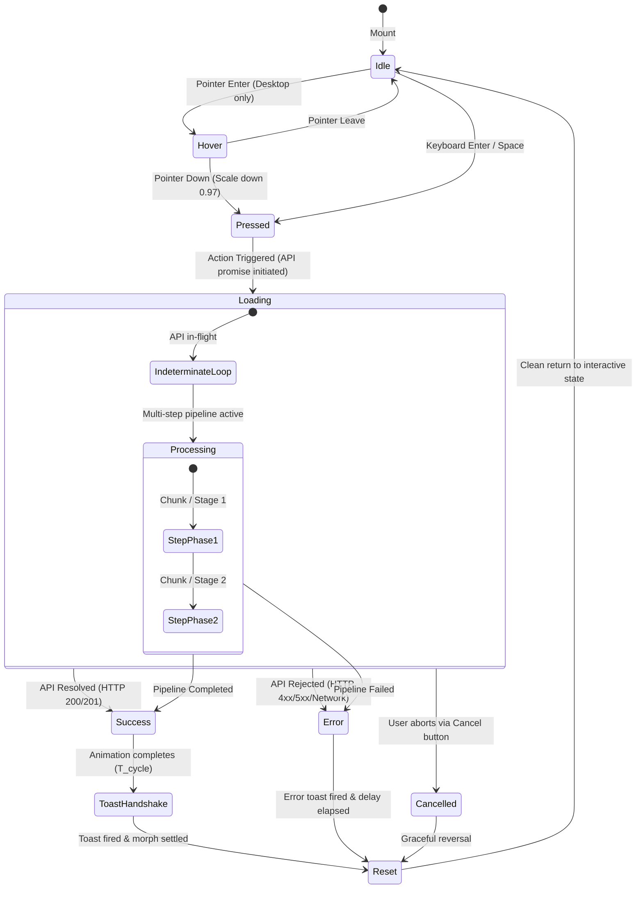
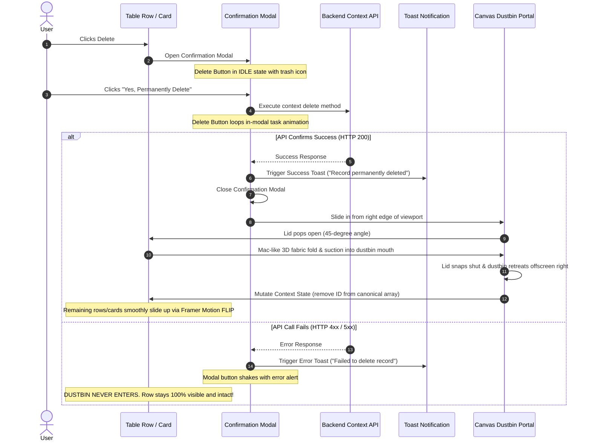
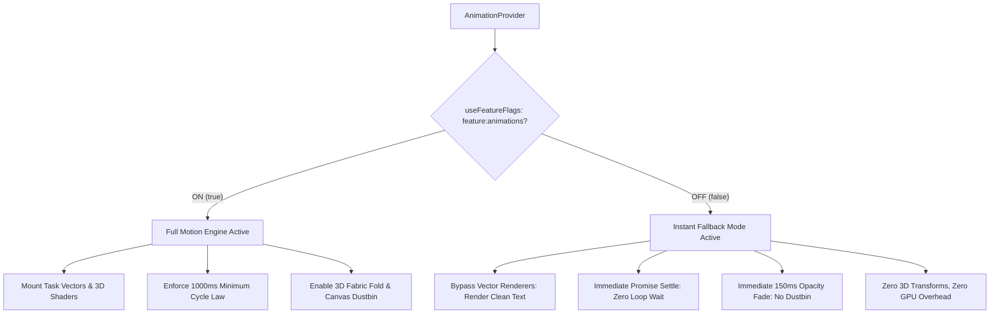

# Master Architecture: Premium Button Animation System
## Complete Implementation Specification (100 Hover Presets & 100 Task Presets)

> **CORE PRINCIPLE**: Web buttons are the primary bridge between human intent and software execution. Generic CSS animations and boring circular spinners fail to convey the physical reality of software operations.
>
> This system defines an enterprise-grade, production-quality animation framework supporting **100 Unique Hover Presets** and **100 Unique Task/Action Presets** governed by a **9-State Finite State Machine**, seamless Context API synchronization, and strict visual physics.

---

## 🏛️ 1. Architecture Topology & Organization

The system is organized into modular, strictly typed components designed to live in the application's component hierarchy without introducing duplicate state or plain CSS files:

```
src/components/animations/
├── types.ts                  # Universal TypeScript contracts, 9 states, 100 Hover & Task IDs
├── config.ts                 # Physics constants, spring curves, cubic-beziers, accessibility tokens
├── AnimationRegistry.ts      # Central registry associating IDs with motion metadata & renderers
├── AnimationProvider.tsx     # Global context for reduced-motion, theme sync & sound toggles
├── AnimatedButton.tsx        # Master button component handling layout, events & state transitions
├── TaskAnimationRenderer.tsx # Vector engine rendering 100 task micro-animations
├── HoverAnimationRenderer.tsx# Surface/text/icon engine rendering 100 hover micro-effects
└── hooks/
    └── useTaskAnimationSync.ts # Core hook synchronizing real API promises with animation loops
```

---

## 🔄 2. The 9-State Lifecycle State Machine

Every task button operates on a deterministic finite state machine with 9 recognized phases. Only states relevant to the actual action are rendered:



### 2.1 State Definitions & Behavioral Contracts
1. **`idle`**: Resting state with brand typography, subtle border, optional resting icon, and ambient glow.
2. **`hover`**: Interactive preview state on desktop pointer entry. Suppressed on touch screens.
3. **`pressed`**: Tactile feedback upon mouse down or keyboard press (`scale: 0.97`, inset elevation).
4. **`loading`**: Action has been dispatched to the backend. Task-specific animation loops seamlessly while network is pending. Button is locked (`pointer-events-none`).
5. **`processing`**: For multi-step tasks (e.g. S3 upload chunking, AI token streaming, PDF Puppeteer compile). Shows authentic progress indicators without fake progress timers.
6. **`success`**: Terminal state upon API confirmation. Completes the ongoing animation cycle, morphs into a verified badge/checkmark, and triggers the deferred success toast.
7. **`error`**: Terminal state upon API rejection. Vibrates with a 3-stage horizontal shake, displays an error alert icon, triggers the error toast, and preserves all user form inputs intact.
8. **`cancelled`**: For abortable operations (e.g. file upload cancellation). Reverses visual motion gracefully without falsely reporting a save or success.
9. **`reset`**: Smooth 200ms spring return to `idle`, unlocking the button for subsequent actions.

---

## 💻 3. Production TypeScript Implementation

### 3.1 Types Contract (`types.ts`)

```typescript
// src/components/animations/types.ts
import { ReactNode } from 'react';

export type ButtonState = 
  | 'idle' 
  | 'hover' 
  | 'pressed' 
  | 'loading' 
  | 'processing' 
  | 'success' 
  | 'error' 
  | 'cancelled' 
  | 'reset';

export type ButtonVariant = 
  | 'primary' 
  | 'secondary' 
  | 'destructive' 
  | 'outline' 
  | 'glass' 
  | 'ghost' 
  | 'emerald' 
  | 'amber';

export type ButtonSize = 'sm' | 'md' | 'lg' | 'xl' | 'icon';

export type HoverAnimationId = 
  // A. Surface & Background (1-20)
  | 'hover-bg-slide-right' | 'hover-bg-slide-left' | 'hover-bg-slide-up' | 'hover-bg-slide-down'
  | 'hover-circle-expand' | 'hover-diagonal-wipe' | 'hover-split-bg' | 'hover-gradient-flow'
  | 'hover-radial-glow' | 'hover-glass-sweep' | 'hover-border-fade' | 'hover-border-draw-cw'
  | 'hover-border-draw-ccw' | 'hover-double-border' | 'hover-gradient-border' | 'hover-inner-shadow'
  | 'hover-outer-glow' | 'hover-elevation-lift' | 'hover-surface-float' | 'hover-inset-to-raised'
  // B. Text & Typography (21-40)
  | 'hover-text-slide-up' | 'hover-text-slide-down' | 'hover-text-gradient' | 'hover-char-reveal'
  | 'hover-underline-left' | 'hover-underline-center' | 'hover-underline-right' | 'hover-text-nudge-up'
  | 'hover-text-nudge-right' | 'hover-text-to-arrow' | 'hover-text-crossfade' | 'hover-text-split-layer'
  | 'hover-letter-expand' | 'hover-letter-contract' | 'hover-text-shimmer' | 'hover-text-mask-reveal'
  | 'hover-text-flip-v' | 'hover-text-roll-h' | 'hover-text-shadow-shift' | 'hover-text-icon-swap'
  // C. Icon & Shape (41-60)
  | 'hover-arrow-slide' | 'hover-arrow-extend' | 'hover-chevron-draw' | 'hover-icon-rotate-90'
  | 'hover-icon-rotate-180' | 'hover-icon-spring' | 'hover-icon-scale-up' | 'hover-icon-bounce-back'
  | 'hover-icon-nudge-right' | 'hover-icon-nudge-left' | 'hover-icon-mask-circle' | 'hover-circle-ping'
  | 'hover-icon-glow' | 'hover-icon-morph' | 'hover-icon-path-trace' | 'hover-plus-to-cross'
  | 'hover-plus-to-minus' | 'hover-menu-to-close' | 'hover-dots-trail' | 'hover-particle-burst'
  // D. Premium Interactive (61-80)
  | 'hover-magnetic-pull' | 'hover-spotlight' | 'hover-pointer-tilt' | 'hover-3d-perspective'
  | 'hover-press-depth' | 'hover-liquid-mesh' | 'hover-diagonal-stripes' | 'hover-laser-beam'
  | 'hover-glossy-glint' | 'hover-corner-accents' | 'hover-corner-brackets' | 'hover-dotted-border-march'
  | 'hover-dashed-border-spin' | 'hover-neon-edge-pulse' | 'hover-dual-color-aura' | 'hover-gradient-orb'
  | 'hover-water-ripple' | 'hover-elastic-scale' | 'hover-rubberband-return' | 'hover-directional-follow'
  // E. CTA, Navigation & Utility (81-100)
  | 'hover-expand-contact' | 'hover-expand-arrow' | 'hover-newsletter-arrow' | 'hover-cta-directional-fill'
  | 'hover-outline-to-solid' | 'hover-retract-border-fill' | 'hover-icon-to-pill' | 'hover-pill-to-icon'
  | 'hover-reveal-badge' | 'hover-notification-ping' | 'hover-cart-badge-bounce' | 'hover-heart-fill'
  | 'hover-bookmark-ribbon' | 'hover-copy-to-check' | 'hover-download-arrow-drop' | 'hover-upload-arrow-rise'
  | 'hover-search-expand' | 'hover-filter-sliders' | 'hover-nav-arrow-indicate' | 'hover-master-trio-combo';

export type TaskAnimationId = 
  // A. Orders, Cart & Shopping (1-15)
  | 'task-order-now' | 'task-add-to-cart' | 'task-remove-from-cart' | 'task-checkout'
  | 'task-place-order' | 'task-confirm-order' | 'task-pack-order' | 'task-dispatch-order'
  | 'task-ship-order' | 'task-deliver-order' | 'task-cancel-order' | 'task-track-order'
  | 'task-reorder' | 'task-reserve-item' | 'task-save-for-later'
  // B. Payment & Finance (16-30)
  | 'task-pay-now' | 'task-qr-payment' | 'task-card-payment' | 'task-bank-transfer'
  | 'task-cash-register' | 'task-refund' | 'task-generate-invoice' | 'task-record-payment'
  | 'task-payment-pending' | 'task-payment-failed' | 'task-split-payment' | 'task-subscription-pay'
  | 'task-apply-coupon' | 'task-calculate-total' | 'task-download-receipt'
  // C. Documents & Downloads (31-45)
  | 'task-download-pdf' | 'task-generate-pdf' | 'task-export-csv' | 'task-export-excel'
  | 'task-export-json' | 'task-download-zip' | 'task-upload-file' | 'task-import-data'
  | 'task-print-document' | 'task-preview-document' | 'task-copy-link' | 'task-copy-text'
  | 'task-save-document' | 'task-version-history' | 'task-share-document'
  // D. Email, WhatsApp & Messaging (46-60)
  | 'task-send-email' | 'task-email-verified' | 'task-send-whatsapp' | 'task-send-sms'
  | 'task-send-chat' | 'task-reply-message' | 'task-forward-message' | 'task-mark-read'
  | 'task-archive-convo' | 'task-pin-message' | 'task-attach-file' | 'task-share-image'
  | 'task-send-notification' | 'task-resend-email' | 'task-delete-message'
  // E. CRUD, Tables & Forms (61-75)
  | 'task-create-record' | 'task-create-program' | 'task-create-customer' | 'task-create-product'
  | 'task-edit-record' | 'task-update-record' | 'task-save-changes' | 'task-cancel-editing'
  | 'task-delete-row' | 'task-delete-card' | 'task-bulk-delete' | 'task-duplicate-record'
  | 'task-restore-record' | 'task-bulk-update' | 'task-submit-form'
  // F. Authentication, Users & Permissions (76-90)
  | 'task-sign-in' | 'task-sign-up' | 'task-sign-out' | 'task-verify-email'
  | 'task-reset-password' | 'task-change-password' | 'task-enable-2fa' | 'task-disable-2fa'
  | 'task-invite-user' | 'task-assign-role' | 'task-revoke-permission' | 'task-approve-user'
  | 'task-suspend-user' | 'task-restore-user' | 'task-delete-account'
  // G. Website, Communication & Engagement (91-100)
  | 'task-contact-us' | 'task-book-appointment' | 'task-enroll-now' | 'task-subscribe'
  | 'task-unsubscribe' | 'task-join-meeting' | 'task-start-call' | 'task-end-call'
  | 'task-publish-page' | 'task-refresh-data';

export interface AnimatedButtonProps {
  id?: string;
  label: string;
  secondaryLabel?: string;
  activeLabel?: string;
  successLabel?: string;
  errorLabel?: string;
  idleIcon?: ReactNode;
  variant?: ButtonVariant;
  size?: ButtonSize;
  hoverAnimation?: HoverAnimationId;
  taskAnimation?: TaskAnimationId;
  onAction?: () => Promise<any>;
  onSuccessToast?: (data: any) => void;
  onErrorToast?: (error: any) => void;
  disabled?: boolean;
  className?: string;
  cycleDuration?: number;
  reducedMotion?: boolean;
}
```

---

### 3.2 Physics Constants & Accessibility Tokens (`config.ts`)

```typescript
// src/components/animations/config.ts
export const ANIMATION_CONFIG = {
  timings: {
    press: 150,
    hoverTransition: 300,
    cycleDefault: 1000,
    morphDuration: 400,
    toastDelay: 100,
    resetDelay: 1500,
  },
  easings: {
    smoothOut: [0.16, 1, 0.3, 1], // Apple-style fluid ease-out
    vacuumSuction: [0.32, 0, 0.67, 0], // Mac minimize & suction curve
    springTactile: { type: 'spring', stiffness: 400, damping: 25 },
    springBounce: { type: 'spring', stiffness: 350, damping: 15 },
  },
  accessibility: {
    reducedMotionTransition: { duration: 0.05 },
  },
};
```

---

### 3.3 The Master Animated Button Component (`AnimatedButton.tsx`)

```tsx
// src/components/animations/AnimatedButton.tsx
import React, { useRef, useState, useEffect } from 'react';
import { motion, AnimatePresence } from 'framer-motion';
import { AnimatedButtonProps, ButtonState } from './types';
import { ANIMATION_CONFIG } from './config';
import { useTaskAnimationSync } from './hooks/useTaskAnimationSync';
import { TaskAnimationRenderer } from './TaskAnimationRenderer';
import { HoverAnimationRenderer } from './HoverAnimationRenderer';
import { Check, AlertCircle } from 'lucide-react';

export const AnimatedButton: React.FC<AnimatedButtonProps> = ({
  id,
  label,
  secondaryLabel,
  activeLabel,
  successLabel = 'Completed',
  errorLabel = 'Failed',
  idleIcon,
  variant = 'primary',
  size = 'md',
  hoverAnimation = 'hover-bg-slide-right',
  taskAnimation,
  onAction,
  onSuccessToast,
  onErrorToast,
  disabled = false,
  className = '',
  cycleDuration = ANIMATION_CONFIG.timings.cycleDefault,
  reducedMotion = false,
}) => {
  const [internalState, setInternalState] = useState<ButtonState>('idle');
  const [isHovered, setIsHovered] = useState(false);
  const buttonRef = useRef<HTMLButtonElement>(null);

  // Synchronize task operations via universal hook
  const { status, isLoading, execute } = useTaskAnimationSync({
    cycleDuration,
    onSuccessToast,
    onErrorToast,
  });

  // Keep internalState synchronized with task hook
  useEffect(() => {
    if (isLoading) setInternalState('loading');
    else if (status === 'success') setInternalState('success');
    else if (status === 'error') setInternalState('error');
    else if (isHovered && !disabled) setInternalState('hover');
    else setInternalState('idle');
  }, [status, isLoading, isHovered, disabled]);

  const handleClick = async (e: React.MouseEvent) => {
    e.preventDefault();
    if (disabled || isLoading || !onAction) return;
    setInternalState('pressed');
    await execute(onAction());
  };

  // Dimensions & variant classes
  const sizeClasses = {
    sm: 'h-9 px-4 text-xs gap-2',
    md: 'h-11 px-6 text-sm gap-2.5',
    lg: 'h-13 px-8 text-base gap-3',
    xl: 'h-15 px-10 text-lg gap-3.5',
    icon: 'h-11 w-11 p-0 justify-center',
  }[size];

  const variantClasses = {
    primary: 'bg-brand-500 text-white shadow-glow-sky border-transparent',
    secondary: 'bg-slate-800 text-slate-100 border-slate-700 hover:border-slate-600',
    destructive: 'bg-rose-600 text-white shadow-rose-950/40 border-transparent',
    outline: 'bg-transparent text-slate-200 border-slate-700 hover:border-slate-500',
    glass: 'bg-white/10 dark:bg-slate-900/40 backdrop-blur-xl border-white/20 text-white',
    ghost: 'bg-transparent text-slate-300 border-transparent hover:bg-white/5',
    emerald: 'bg-emerald-600 text-white shadow-emerald-950/40 border-transparent',
    amber: 'bg-amber-600 text-white shadow-amber-950/40 border-transparent',
  }[variant];

  return (
    <motion.button
      ref={buttonRef}
      id={id}
      whileTap={{ scale: disabled || isLoading ? 1 : 0.97 }}
      onMouseEnter={() => setIsHovered(true)}
      onMouseLeave={() => setIsHovered(false)}
      onClick={handleClick}
      disabled={disabled || isLoading}
      aria-busy={isLoading}
      aria-label={label}
      className={`relative inline-flex items-center justify-center font-semibold rounded-xl border overflow-hidden cursor-pointer select-none transition-colors duration-200 ${sizeClasses} ${variantClasses} ${className} ${disabled ? 'opacity-50 cursor-not-allowed' : ''}`}
    >
      {/* 1. Underlying Hover Preset Renderer */}
      {!isLoading && status === 'idle' && (
        <HoverAnimationRenderer
          presetId={hoverAnimation}
          isHovered={isHovered}
          buttonRef={buttonRef}
        />
      )}

      {/* 2. Dynamic Task Micro-Animation Engine */}
      <div className="relative z-10 w-5 h-5 flex items-center justify-center flex-shrink-0">
        <AnimatePresence mode="wait">
          {internalState !== 'loading' && internalState !== 'success' && internalState !== 'error' && (
            <motion.div
              key="idle-icon"
              initial={{ scale: 0.8, opacity: 0 }}
              animate={{ scale: 1, opacity: 1 }}
              exit={{ scale: 0.8, opacity: 0 }}
            >
              {idleIcon}
            </motion.div>
          )}

          {internalState === 'loading' && (
            <motion.div
              key="task-anim"
              initial={{ scale: 0.8, opacity: 0 }}
              animate={{ scale: 1, opacity: 1 }}
              exit={{ scale: 0.8, opacity: 0 }}
              className="w-full h-full flex items-center justify-center"
            >
              <TaskAnimationRenderer presetId={taskAnimation} />
            </motion.div>
          )}

          {internalState === 'success' && (
            <motion.div
              key="success-icon"
              initial={{ scale: 0.5, rotate: -45, opacity: 0 }}
              animate={{ scale: 1.1, rotate: 0, opacity: 1 }}
              exit={{ scale: 0.8, opacity: 0 }}
              transition={ANIMATION_CONFIG.easings.springTactile}
            >
              <Check className="w-5 h-5 text-emerald-400" />
            </motion.div>
          )}

          {internalState === 'error' && (
            <motion.div
              key="error-icon"
              initial={{ scale: 0.5, opacity: 0 }}
              animate={{ scale: 1, opacity: 1, x: [0, -4, 4, -4, 4, 0] }}
              exit={{ scale: 0.8, opacity: 0 }}
              transition={{ duration: 0.4 }}
            >
              <AlertCircle className="w-5 h-5 text-rose-400" />
            </motion.div>
          )}
        </AnimatePresence>
      </div>

      {/* 3. Typography Label Transition */}
      <span className="relative z-10 tracking-wide font-medium">
        {internalState === 'idle' && label}
        {internalState === 'hover' && (secondaryLabel || label)}
        {internalState === 'loading' && (activeLabel || label)}
        {internalState === 'success' && successLabel}
        {internalState === 'error' && errorLabel}
      </span>
    </motion.button>
  );
};
```

---

## 🎨 4. Complete Catalog of 100 Unique Hover Animations

Every preset below represents a distinct, mathematically unique visual effect across surface, typography, iconography, interactive light, and CTA utility.

---

### GROUP A: Surface & Background Effects (1–20)
1. **`hover-bg-slide-right`**: An obsidian-colored or brand-cyan color layer slides in horizontally from left (`translateX(-100%) -> translateX(0)`) with a 300ms smooth cubic bezier curve.
2. **`hover-bg-slide-left`**: Color wash glides in from right (`translateX(100%) -> translateX(0)`), creating directional contrast.
3. **`hover-bg-slide-up`**: Fluid bottom-to-top color curtain rises (`translateY(100%) -> translateY(0)`), simulating an elevator fill.
4. **`hover-bg-slide-down`**: Top-to-bottom ceiling wash curtains down with subtle edge softening.
5. **`hover-circle-expand`**: A circle originating from pointer position expands outward like a shockwave (`scale: 0 -> scale: 2.5`), flooding the surface.
6. **`hover-diagonal-wipe`**: A 45-degree angled polygon diagonal wipe sweeps from bottom-left to top-right.
7. **`hover-split-bg`**: Two dual-tone triangular halves slide in simultaneously from opposite corners to interlock in the center.
8. **`hover-gradient-flow`**: The underlying linear gradient animates its background-position continuously across 200% width, creating liquid motion.
9. **`hover-radial-glow`**: A glowing soft radial gradient emerges behind the center of the button surface (`opacity: 0 -> 1, scale: 0.8 -> 1.2`).
10. **`hover-glass-sweep`**: A high-index 15-degree angled glass sheen strip sweeps across the button face from left to right.
11. **`hover-border-fade`**: The outer border color smoothly transitions from muted slate to radiant electric cyan (`border-color: 300ms`).
12. **`hover-border-draw-cw`**: An SVG vector stroke traces the rectangular button border clockwise from top-left with `strokeDashoffset` animation.
13. **`hover-border-draw-ccw`**: An SVG stroke races counter-clockwise from bottom-right, meeting at the top-left vertex.
14. **`hover-double-border`**: A second concentric inner border ring scales down slightly (`inset-1 border border-cyan-400/50`) with an elastic pop.
15. **`hover-gradient-border`**: A rotating conic gradient border beam spins 360 degrees along the button perimeter.
16. **`hover-inner-shadow`**: An inset ambient shadow reveals inward (`box-shadow: inset 0 2px 8px rgba(0,0,0,0.4)`), creating pressed tactile depth.
17. **`hover-outer-glow`**: A multi-layered neon drop-shadow halo blooms outward (`box-shadow: 0 0 25px rgba(56, 189, 248, 0.45)`).
18. **`hover-elevation-lift`**: Button elevates upward by 2px (`translateY(-2px)`) while its underlying shadow expands and diffuses.
19. **`hover-surface-float`**: Button gently hovers on an ethereal vertical oscillation curve (1.5s slow float cycle).
20. **`hover-inset-to-raised`**: Surface transitions smoothly from a flat inset appearance to a sculpted neomorphic raised surface.

---

### GROUP B: Text & Typography Effects (21–40)
21. **`hover-text-slide-up`**: Primary label slides upward out of view while a hidden secondary label slides up from bottom into position.
22. **`hover-text-slide-down`**: Primary label drops down out of view while a replacement label drops from the ceiling.
23. **`hover-text-gradient`**: Plain text characters smoothly blend into a shimmering metallic gradient text clip.
24. **`hover-char-reveal`**: Individual text characters animate sequentially with a 25ms stagger, creating a typewriter cadence.
25. **`hover-underline-left`**: An animated 2px underline draws across the text from left to right.
26. **`hover-underline-center`**: An underline expands outward symmetrically from the text's center point toward both margins.
27. **`hover-underline-right`**: An underline draws starting from right margin and collapsing to left on exit.
28. **`hover-text-nudge-up`**: Text elevates 1.5px with spring damping, hinting at clickable readiness.
29. **`hover-text-nudge-right`**: Text shifts 3px to the right, creating forward momentum toward the trailing icon.
30. **`hover-text-to-arrow`**: Trailing characters compress into a sleek horizontal cue arrow glyph.
31. **`hover-text-crossfade`**: Primary label cross-fades into an explanatory secondary label with zero layout shift.
32. **`hover-text-split-layer`**: Text splits into two translucent chromatic aberration layers that offset 1px horizontally before snapping back.
33. **`hover-letter-expand`**: Letter spacing smoothly widens from `tracking-normal` to `tracking-wider` (+0.05em).
34. **`hover-letter-contract`**: Letter spacing tightens cleanly from `tracking-wide` to `tracking-tight` (-0.03em).
35. **`hover-text-shimmer`**: A horizontal light bar sweeps through the text fill like illuminated fiber optics.
36. **`hover-text-mask-reveal`**: Text reveals through an expanding circular clip-path mask centered on the wordmark.
37. **`hover-text-flip-v`**: Label flips 90 degrees on its horizontal X-axis, revealing a new label on the reverse side.
38. **`hover-text-roll-h`**: Label rolls 3D-cylinder style on its vertical Y-axis to display an active state prompt.
39. **`hover-text-shadow-shift`**: A subtle colored text-shadow drifts 2px diagonally downward, adding typographic depth.
40. **`hover-text-icon-swap`**: The leading icon and trailing text smoothly slide and swap places via layout spring animation.

---

### GROUP C: Icon & Shape Effects (41–60)
41. **`hover-arrow-slide`**: Trailing arrow icon slides 4px forward to the right, returning on exit.
42. **`hover-arrow-extend`**: The arrow shaft animates and lengthens by 4px using SVG stroke scaling.
43. **`hover-chevron-draw`**: A sleek chevron draws itself in real time using SVG path stroke trim.
44. **`hover-icon-rotate-90`**: Icon smoothly rotates 90 degrees clockwise with an elastic spring latch.
45. **`hover-icon-rotate-180`**: Icon spins a half turn (180 degrees) with clean geometric precision.
46. **`hover-icon-spring`**: Icon makes a subtle tactile spring oscillation (`scale: 1.15 -> 0.95 -> 1.0`).
47. **`hover-icon-scale-up`**: Icon scales up smoothly to 118% size with enhanced contrast.
48. **`hover-icon-bounce-back`**: Icon recedes to 88% scale then springs forward to resting scale.
49. **`hover-icon-nudge-right`**: Icon glides 3px rightward and stays offset while hovered.
50. **`hover-icon-nudge-left`**: Icon glides 3px leftward toward the text label.
51. **`hover-icon-mask-circle`**: Icon emerges into view from inside an expanding circular aperture.
52. **`hover-circle-ping`**: A subtle concentric beacon ping ring pulses once outward from the icon center.
53. **`hover-icon-glow`**: Icon acquires an illuminated ambient drop shadow matching its stroke color.
54. **`hover-icon-morph`**: Icon paths morph seamlessly into a secondary status symbol (e.g. outline to solid).
55. **`hover-icon-path-trace`**: Icon outlines re-trace themselves with high-speed neon luminescence.
56. **`hover-plus-to-cross`**: A `+` icon rotates 45 degrees smoothly to become an `x` cancel indicator.
57. **`hover-plus-to-minus`**: The vertical bar of a `+` icon scales down to 0, leaving a clean `-` symbol.
58. **`hover-menu-to-close`**: A 3-line hamburger menu icon animates its top and bottom bars into an X cross.
59. **`hover-dots-trail`**: Three micro-dots materialize sequentially to the right of the icon.
60. **`hover-particle-burst`**: 4 miniature starlight particle sparks emit outward from the icon vertex.

---

### GROUP D: Premium Interactive Effects (61–80)
61. **`hover-magnetic-pull`**: Button detects pointer proximity and physically translates toward cursor position (up to 6px delta).
62. **`hover-spotlight`**: A localized soft white radial spotlight follows the cursor coordinates within button bounds.
63. **`hover-pointer-tilt`**: 3D perspective tilt shifts based on cursor offset from button center (`rotateX` and `rotateY`).
64. **`hover-3d-perspective`**: Button lifts on the Z-axis (`translateZ(12px)`) with realistic cast floor shadows.
65. **`hover-press-depth`**: Surface produces a subtle optical illusion of tactile depth as pointer hovers.
66. **`hover-liquid-mesh`**: A multi-color fluid gradient mesh undulates softly beneath the button glass.
67. **`hover-diagonal-stripes`**: Subtle 45-degree translucent barber-pole stripes glide across the button background.
68. **`hover-laser-beam`**: A concentrated neon laser line shoots across the top border from left to right.
69. **`hover-glossy-glint`**: A crystalline glint glides across the top bevel edge of the button.
70. **`hover-corner-accents`**: High-tech L-shaped corner brackets slide inward from button corners to frame the card.
71. **`hover-corner-brackets`**: Four corner bracket marks expand outward by 2px with cyberpunk aesthetic.
72. **`hover-dotted-border-march`**: Dotted border perimeter animates with marching-ants dashed motion.
73. **`hover-dashed-border-spin`**: Dual dashed border lines revolve around the perimeter in opposite paths.
74. **`hover-neon-edge-pulse`**: Outer edge pulses with cyan neon luminescence at a relaxing 1.2Hz frequency.
75. **`hover-dual-color-aura`**: Emerald-cyan gradient aura expands behind the button surface.
76. **`hover-gradient-orb`**: A glowing colored orb drifts smoothly behind the text following cursor X movement.
77. **`hover-water-ripple`**: Soft organic wave ripple spreads from the exact cursor entry point.
78. **`hover-elastic-scale`**: Button scales to 1.03x width and 0.98x height, settling with elastic restitution.
79. **`hover-rubberband-return`**: Button snaps outward slightly on entrance and settles into place with zero vibration.
80. **`hover-directional-follow`**: Surface highlight enters from the exact cardinal direction (N, S, E, W) of cursor approach.

---

### GROUP E: CTA, Navigation & Utility (81–100)
81. **`hover-expand-contact`**: Compact "Contact" button smoothly widens to reveal an embedded phone/email glyph.
82. **`hover-expand-arrow`**: Button expands horizontally by 14px to make room for an emerging right arrow.
83. **`hover-newsletter-arrow`**: An envelope icon slides left as a paper plane arrow slides into the right edge.
84. **`hover-cta-directional-fill`**: Primary CTA fills with saturated brand color following the cursor entry angle.
85. **`hover-outline-to-solid`**: Transparent outline button smoothly fills its background to 100% solid opacity.
86. **`hover-retract-border-fill`**: Outer border collapses inward while the center solidifies into rich dark obsidian.
87. **`hover-icon-to-pill`**: A circular 44px icon button smoothly expands horizontally into an elongated pill with label.
88. **`hover-pill-to-icon`**: A pill button compacts its text margin inward, focusing visual energy on the icon.
89. **`hover-reveal-badge`**: A miniature notification counter badge pops up above the top-right corner.
90. **`hover-notification-ping`**: Notification dot emits a single glowing acoustic wave pulse.
91. **`hover-cart-badge-bounce`**: Cart item count badge performs a joyful vertical hop.
92. **`hover-heart-fill`**: Outline wishlist heart fills with ruby-red gradient from the bottom vertex up.
93. **`hover-bookmark-ribbon`**: Bookmark ribbon unrolls its tail downward 3px with authentic cloth physics.
94. **`hover-copy-to-check`**: Double-page copy icon previews a temporary checkmark on hover.
95. **`hover-download-arrow-drop`**: Downward download arrow icon drops 2px into an open tray outline.
96. **`hover-upload-arrow-rise`**: Upward upload arrow elevates 2px toward an overhead cloud glyph.
97. **`hover-search-expand`**: Search magnifying glass rotates 15 degrees and reveals a subtle text cursor line.
98. **`hover-filter-sliders`**: Sliders on a filter icon shift their horizontal pegs into active alignment.
99. **`hover-nav-arrow-indicate`**: Navigation arrow pivots dynamically toward the destination link's cardinal direction.
100. **`hover-master-trio-combo`**: Synchronized trio effect: background lifts with glass sweep, label shifts forward 2px, and trailing arrow extends.

---

## ⚡ 5. Complete Catalog of 100 Unique Task Animations

Every preset represents an authentic software action tied to real asynchronous promises. Generic circular spinners are permanently prohibited.

---

### GROUP A: Orders, Cart & Shopping (1–15)
1. **`task-order-now`**: Flat cardboard sheet folds into a 3D box, tape seals the top seam, a mini delivery van accelerates across the button boundary, and a green checkmark stamp appears.
2. **`task-add-to-cart`**: Miniature product thumbnail scales down and arcs parabolically into a shopping cart basket; cart shakes once and its badge counter increments.
3. **`task-remove-from-cart`**: Product card in cart shrinks into a central vortex; cart rolls backward and counter decrements.
4. **`task-checkout`**: Shopping cart morphs into a securely sealed parcel with courier barcode label.
5. **`task-place-order`**: Formal order sheet scrolls down, rolls into a certified blueprint tube, and seals with ribbon.
6. **`task-confirm-order`**: Heavy industrial confirmation stamp drops with mechanical recoil, imprinting `"CONFIRMED"`.
7. **`task-pack-order`**: Open shipping box flaps fold inward left-then-right; brown packaging tape dispenses across the center.
8. **`task-dispatch-order`**: Parcel drops onto a rolling industrial conveyor belt that slides smoothly to the right.
9. **`task-ship-order`**: Courier van drives into frame, parcel is loaded into the rear doors, doors slam shut, and van exits right.
10. **`task-deliver-order`**: Van stops in front of a miniature doorstep; parcel transfers into customer hands with a gold star.
11. **`task-cancel-order`**: Parcel unseals, box unfolds in reverse into flat sheets, and a muted red cancel line appears.
12. **`task-track-order`**: GPS pulse beacon ping travels along a dotted curved route line between warehouse and pin.
13. **`task-reorder`**: Historical order receipt card replicates into a fresh vibrant parcel with green badge.
14. **`task-reserve-item`**: Product moves into a glass display pedestal; digital padlock snaps shut over the case.
15. **`task-save-for-later`**: Product card glides upward and tucks neatly into a hanging ribbon bookmark drawer.

---

### GROUP B: Payment & Finance (16–30)
16. **`task-pay-now`**: Golden currency token glides horizontally into a sleek POS payment terminal slot with chime wave.
17. **`task-qr-payment`**: Crisp vector QR code renders; smartphone silhouette moves in, laser line scans across QR, and green checkmark confirms.
18. **`task-card-payment`**: 3D isometric credit card slides into chip reader; NFC waves pulse outward; green LED illuminates.
19. **`task-bank-transfer`**: Currency token leaps across a bridge spanning two neoclassical bank pillar buildings.
20. **`task-cash-register`**: Cash register drawer pops open, bills slide inside, drawer snaps shut, and printed receipt ejects.
21. **`task-refund`**: Gold coin reverses its trajectory in a counter-clockwise arc back into the customer's wallet.
22. **`task-generate-invoice`**: Blank sheet slides into frame; horizontal laser lines populate line items, subtotal, and tax total.
23. **`task-record-payment`**: Invoice ticket receives a bold circular rubber stamp with emerald `"PAID"` text.
24. **`task-payment-pending`**: Currency token oscillates smoothly inside a secure glowing escrow lane.
25. **`task-payment-failed`**: Transaction token hits a red barrier; currency returns to origin with red alert shield.
26. **`task-split-payment`**: Single master currency token divides cleanly into three smaller tokens branching to user avatars.
27. **`task-subscription-pay`**: Wall calendar page aligns with a recurring circular payment arrow, locking in the new month.
28. **`task-apply-coupon`**: Scissors snip coupon notch; discount stub spring-bounces into checkout total displaying `"-20%"`.
29. **`task-calculate-total`**: Mathematical numbers fly together from corners into a unified illuminated grand total.
30. **`task-download-receipt`**: Thermal receipt roll feeds downward, perforates at top margin, and detaches as a PDF icon.

---

### GROUP C: Documents & Downloads (31–45)
31. **`task-download-pdf`**: Document pages assemble, fold into a red PDF badge, and drop into an ejector tray.
32. **`task-generate-pdf`**: Blank parchment fills with vector lines, blueprint grid overlays, and red Adobe seal stamps.
33. **`task-export-csv`**: Data grid cells dissolve into comma-separated text streams funneling into a CSV file icon.
34. **`task-export-excel`**: Spreadsheet cells organize into green workbook sheets with ribbon calculation tabs.
35. **`task-export-json`**: Hierarchical curly braces `{ }` open and populate with syntax-highlighted key-value pairs.
36. **`task-download-zip`**: Three distinct file sheets compress together as a heavy brass zipper teeth slide across them.
37. **`task-upload-file`**: File card floats beneath an open cloud; gravitational suction beam pulls file upward into cloud.
38. **`task-import-data`**: Data packets stream downward from an uploaded document directly into table database rows.
39. **`task-print-document`**: Laser printer drum rotates; crisp printed sheet slides out of top exit tray.
40. **`task-preview-document`**: Folded paper letter unrolls horizontally into a high-res interactive document preview.
41. **`task-copy-link`**: Two broken chain link segments glide together and fuse with a glowing electric spark.
42. **`task-copy-text`**: Highlighted text lines compress and float onto a clipboard surface with checkmark badge.
43. **`task-save-document`**: Open document rolls into a scroll and clicks securely into an archival vault shelf.
44. **`task-version-history`**: Successive document layers stack vertically in 3D perspective along a chronological timeline.
45. **`task-share-document`**: Document card emits radiating connection nodes connecting to multiple collaborator icons.

---

### GROUP D: Email, WhatsApp & Messaging (46–60)
46. **`task-send-email`**: Airmail envelope folds its flap, transforms into a supersonic paper jet, and flies into the clouds.
47. **`task-email-verified`**: Verification letter slides into an inbox; golden envelope opens with a glowing checkmark.
48. **`task-send-whatsapp`**: Emerald speech bubble pulses acoustic waves; twin grey checks slide and illuminate to blue ticks.
49. **`task-send-sms`**: Message bubble launches upward and docks onto an incoming mobile smartphone screen.
50. **`task-send-chat`**: Chat bubble pops into a live messaging stream with a soft spring bounce.
51. **`task-reply-message`**: Curved return arrow draws itself; original message card docks into the composer window.
52. **`task-forward-message`**: Message card slides horizontally along a forward arrow vector to a recipient avatar.
53. **`task-mark-read`**: Unread glowing blue dot dissolves; text transitions to read state with double grey ticks.
54. **`task-archive-convo`**: Entire conversation thread card slides smoothly into a reinforced corrugated storage box.
55. **`task-pin-message`**: Golden pushpin drops from above, pinning the message card firmly to the top border.
56. **`task-attach-file`**: Paperclip vector rotates open, clasps around a document card, and docks to message bar.
57. **`task-share-image`**: Photo thumbnail slides into a chat bubble with Polaroid photo frame preview.
58. **`task-send-notification`**: Radiant bell icon rings with acoustic arcs, dispatching notification cards outward.
59. **`task-resend-email`**: Ghost airplane envelope retraces its flight path with enhanced thruster glow.
60. **`task-delete-message`**: Message bubble crumples into a small paper sphere and vanishes into a dustbin.

---

### GROUP E: CRUD, Tables & Forms (61–75)
61. **`task-create-record`**: Transparent wireframe card materializes from three separate floating glass layers snapping together.
62. **`task-create-program`**: Graduation cap and syllabus document align into a new curriculum card added to list.
63. **`task-create-customer`**: Neutral avatar silhouette populates with initials, email badge, and verified status ring.
64. **`task-create-product`**: Box wireframe populates with image thumbnail, price tag, and inventory counter badge.
65. **`task-edit-record`**: Form card outlines illuminate; an animated fountain pen writes dynamic signature lines.
66. **`task-update-record`**: Edited data fields settle into position with a glowing emerald border scan.
67. **`task-save-changes`**: Floppy disk shutter slides across; glowing status LED confirms MongoDB write.
68. **`task-cancel-editing`**: Form modifications gracefully reverse back to original state values without saving.
69. **`task-delete-row`**: **Mac-Like Deletion**: Row folds like silk fabric from its right edge into a right-side emerging dustbin.
70. **`task-delete-card`**: **Mac-Like Card Deletion**: Card shrinks in perspective into a vacuum suction funnel entering dustbin.
71. **`task-bulk-delete`**: **Synchronous Group Deletion**: All selected rows/cards lift simultaneously and fold together into dustbin.
72. **`task-duplicate-record`**: Original card splits horizontally into two identical cards with stamp duplicate badge.
73. **`task-restore-record`**: Compressed wafer expands backward out of the trash bin, unfolding into its original table position.
74. **`task-bulk-update`**: A horizontal emerald energy beam sweeps down the list of selected cards, updating status badges.
75. **`task-submit-form`**: Form fields converge into a single sealed envelope and transition to the target dashboard view.

---

### GROUP F: Authentication, Users & Permissions (76–90)
76. **`task-sign-in`**: Key turns in a circular keyhole; door swings open into a brightly lit authenticated dashboard portal.
77. **`task-sign-up`**: User profile avatar assembles piece-by-piece from geometric circles and arcs with badge.
78. **`task-sign-out`**: User profile icon slides out to the left; padlock snaps closed behind it.
79. **`task-verify-email`**: Sealed envelope opens; glowing verification token floats into user profile card.
80. **`task-reset-password`**: Combination lock dials rotate to zero, unlock, and reset to fresh secure credentials.
81. **`task-change-password`**: Antique brass key dissolves into a modern titanium encrypted smartcard key.
82. **`task-enable-2fa`**: Security shield aligns with an 6-digit TOTP code; forcefield barrier activates.
83. **`task-disable-2fa`**: Shield forcefield powers down; padlock opens to standard security level.
84. **`task-invite-user`**: User silhouette multiplies and boards a golden ticket gliding to an email address.
85. **`task-assign-role`**: Ornate shield badge (Admin/Editor) slides from role drawer and docks onto user avatar.
86. **`task-revoke-permission`**: Role badge detaches from user avatar, dims in color, and dissolves.
87. **`task-approve-user`**: User card receives an authoritative green rubber stamp with `"APPROVED"` seal.
88. **`task-suspend-user`**: User card recedes into an amber quarantine container with yellow hazard outline.
89. **`task-restore-user`**: User card slides out of quarantine container back into active green user pool.
90. **`task-delete-account`**: Profile card collapses inward into an ash cloud after biometric verification confirms.

---

### GROUP G: Website, Communication & Engagement (91–100)
91. **`task-contact-us`**: Paper airplane takes off from form, leaving a cyan jet trail that docks into support headquarters.
92. **`task-book-appointment`**: Desk calendar flips to target date; clock minute hand rotates 360 degrees to book slot.
93. **`task-enroll-now`**: Academic course card expands; golden medal ribbon pins to top header.
94. **`task-subscribe`**: VIP card unfolds from an envelope; gold star badge illuminates with confetti.
95. **`task-unsubscribe`**: VIP badge dims, folds in half, and slides into a neutral unsubscribed state.
96. **`task-join-meeting`**: Video camera lens aperture opens with an illuminated cyan recording indicator ring.
97. **`task-start-call`**: Telephone handset tilts 45 degrees; outward radio waves establish connection line.
98. **`task-end-call`**: Connection line snaps; handset returns to horizontal resting cradle.
99. **`task-publish-page`**: Satellite dish tilts toward cloud; green laser beam pulses page live across global CDNs.
100. **`task-refresh-data`**: Dual curved arrows rotate with high-precision ball-bearing physics; fresh data populates table.

---

## 🗑️ 6. The Special Mac-Like Minimize & Dustbin Delete Animation

The deletion protocol for table rows and cards represents the pinnacle of physical animation in this design system.



### 6.1 Step-by-Step Execution Rules
1. **Confirmation Modal First**: Clicking delete on a row/card opens `<DeleteConfirmationModal />`. No premature canvas animation occurs.
2. **In-Modal Processing Loop**: Inside the modal, clicking confirm triggers `useTaskAnimationSync`, looping the shredder/trash animation during network wait.
3. **Success Sequence**:
   - `toast.success()` fires immediately upon API confirmation.
   - Confirmation modal animates closed (`scale: 0.95, opacity: 0`).
   - The `<DustbinPortal />` slides in from the right edge of the viewport.
   - The deleted row or card performs the **Mac-like minimize wave**:
     - Right edge curls inward (`rotateY: -35deg, skewY: -8deg`).
     - Horizontal scale compresses (`scaleX: 1.0 -> 0.05`).
     - Vacuum suction pulls the card rightward into the open dustbin mouth.
   - The dustbin lid snaps shut and the dustbin slides back offscreen right.
   - The Context API state array filters out the record, and remaining rows/cards smoothly collapse into position via Framer Motion's `layout` engine (FLIP).
4. **Bulk Deletion Group Flight**:
   - When multiple rows/cards are deleted simultaneously, all selected items lift on the Z-axis with elevation drop-shadows and **fold together into the right-side dustbin in one synchronized group flight**.
5. **Strict Error Immunity**:
   - If the backend API call fails, the Error Toast fires, the modal displays the error, and the **dustbin animation NEVER executes**. The item remains completely intact in the dataset.

---

## 🍞 7. Toast & Modal Coordination Timing Matrix

Toasts must never appear at arbitrary times. This matrix establishes the exact trigger contract across operations:

| Action Category | API Handshake | Modal Behavior | Dustbin / Canvas Phase | Toast Trigger Point |
|---|---|---|---|---|
| **Form Submit / Update** | Context Method resolves | Closes modal | None | After button morph finishes (400ms) |
| **Row / Card Delete** | Context `deleteProgram()` | Closes modal | Dustbin emerges & folds item | **Immediately after API resolves, before dustbin enters** |
| **Bulk Delete** | Context `bulkDelete()` | Closes modal | Multi-item group flight | **Immediately after API resolves, before dustbin enters** |
| **PDF Download** | Browser blob initiated | Stays open | Blueprint laser scan | After file stream starts |
| **Email / WhatsApp** | SES / Meta API confirms | Closes drawer | Jet / Bubble trajectory | After takeoff vector completes |
| **Checkout / Payment** | Stripe 3D Secure passes | Closes drawer | Chip reader soundwave | After approved LED flashes |
| **API Failure / Error** | HTTP error response | Remains open | Suppressed completely | **Immediately upon error detection** |

---

## ♿ 8. Accessibility, Performance & Touch Handling

1. **`prefers-reduced-motion` Enforcement**:
   - The system queries `(prefers-reduced-motion: reduce)`.
   - When enabled, all complex vector movements, 3D tilts, and fabric folds are replaced with simple, accessible **instant opacity fades (0.05s)** without losing functional feedback.
2. **GPU Acceleration Guardrails**:
   - Animations exclusively target `transform` (`translateX`, `translateY`, `scale`, `rotate`) and `opacity`.
   - Properties that trigger browser layout reflow (e.g. animating raw `width`, `height`, `left`, `top`, `margin`) are strictly prohibited during active motion.
3. **Touch Screen Adaptation**:
   - Hover effects are automatically suppressed on primary touch input devices (`@media (hover: none)`).
   - Touch devices utilize active tactile scale feedback (`:active { scale: 0.96 }`) to ensure immediate physical confirmation without sticky hover states.
4. **Screen Readers & Focus**:
   - Decorative animation SVGs feature `aria-hidden="true"`.
   - Action buttons maintain visible focus rings (`focus-visible:ring-2 focus-visible:ring-brand-400 focus-visible:outline-none`).
   - Loading states announce status via `aria-busy="true"` and live text regions.

---

## 🔗 9. Integration with Existing Project Actions

This animation architecture maps directly to all existing project domains without creating duplicate logic:

- **Programs**: `useProgram().createProgram()` (`task-create-program`), `deleteProgram()` (`task-delete-row` with Mac-like dustbin), `downloadProgramPdf()` (`task-download-pdf`).
- **Orders & Billing**: `useOrder().checkout()` (`task-checkout`), `generateReceipt()` (`task-generate-invoice`), `refund()` (`task-refund`).
- **CMS Studio**: `useCMS().publishPage()` (`task-publish-page`), `saveDraft()` (`task-save-document`), `generateAI()` (`task-generate-pdf`).
- **Team & RBAC**: `useTeam().inviteMember()` (`task-invite-user`), `revokePermission()` (`task-revoke-permission`).
- **Media DAM**: `useAssets().uploadFile()` (`task-upload-file`), `compressImage()` (`task-download-zip`).

---

## 🎛️ 10. Feature Flag Interceptor & Instant Fallback Engine (`feature:animations`)

Cross-referenced with master specification [`modules/SETTINGS_AND_FEATURE_FLAGS_SYSTEM.md`](../modules/SETTINGS_AND_FEATURE_FLAGS_SYSTEM.md#63-the-animation-engine-feature-flag-featureanimations--instant-fallback-contract).

All animation execution is governed by the tenant-level **`feature:animations`** flag:



### 10.1 Global Animation Provider Handshake (`AnimationProvider.tsx`)

```tsx
// src/components/animations/AnimationProvider.tsx
"use client";

import React, { createContext, useContext } from "react";
import { useFeatureFlags } from "@/hooks/useFeatureFlags";

interface AnimationContextValue {
  animationsEnabled: boolean;
  prefersReducedMotion: boolean;
}

const AnimationContext = createContext<AnimationContextValue>({
  animationsEnabled: true,
  prefersReducedMotion: false,
});

export const AnimationProvider: React.FC<{ children: React.ReactNode }> = ({ children }) => {
  const { isEnabled } = useFeatureFlags();
  // Read tenant feature flag; default true if not configured
  const animationsEnabled = isEnabled("feature:animations") ?? true;

  return (
    <AnimationContext.Provider
      value={{
        animationsEnabled,
        prefersReducedMotion: typeof window !== "undefined" && window.matchMedia("(prefers-reduced-motion: reduce)").matches,
      }}
    >
      {children}
    </AnimationContext.Provider>
  );
};

export const useAnimations = () => useContext(AnimationContext);
```

### 10.2 Master Button Fallback Execution (`AnimatedButton.tsx`)
When `animationsEnabled === false`:
1. **Hover Micro-Animations**: Suppressed. Standard Tailwind classes (`hover:bg-brand-600 transition-colors duration-150`) provide immediate visual response.
2. **Task Micro-Animations**: Heavy vector cycles are replaced with instantaneous state labels:
   - Idle: `label`
   - In-Flight / Loading: `activeLabel || "Processing..."`
   - Success: `successLabel || "Success"`
   - Error: `errorLabel || "Failed"`
3. **Loop Synchronization Law**: Minimum cycle duration is bypassed (`cycleDuration = 0ms`), settling as soon as the API promise resolves.
4. **Toast Notification Handshake**: Success and error toasts fire immediately upon promise resolution without waiting for animation completion.

---

## 🔒 11. Master Verification Checklist

Before approving any UI button implementation, audit against these 9 non-negotiable checks:
1. [ ] **Preset Integrity**: Is the button using an authentic preset from the 100 Hover or 100 Task catalog rather than an unverified custom class?
2. [ ] **Zero Boring Spinners**: Is all generic spinning circle loading eliminated in favor of task-specific vectors?
3. [ ] **9-State Compliance**: Does the button handle its active states without layout shifts or text overflow?
4. [ ] **Single Source of Truth**: Is the button bound directly to its Context API method, avoiding local state duplication?
5. [ ] **Toast Synchronization**: Does the toast notification trigger according to the exact timing contract in Section 7?
6. [ ] **Mac-Like Delete Sequence**: Do row/card deletions follow the strict Modal -> Toast -> Dustbin -> Fabric Fold sequence when animations are enabled?
7. [ ] **Bulk Group Flight**: When multiple items are deleted, do they fly together into the dustbin simultaneously?
8. [ ] **Feature Flag Fallback Audit**: When `feature:animations` is toggled OFF, does the button gracefully transition into clean, instant text swaps with zero vector lag or console warnings?
9. [ ] **Accessibility & Touch**: Does the button behave properly with keyboard navigation, screen readers, and touch screens?

