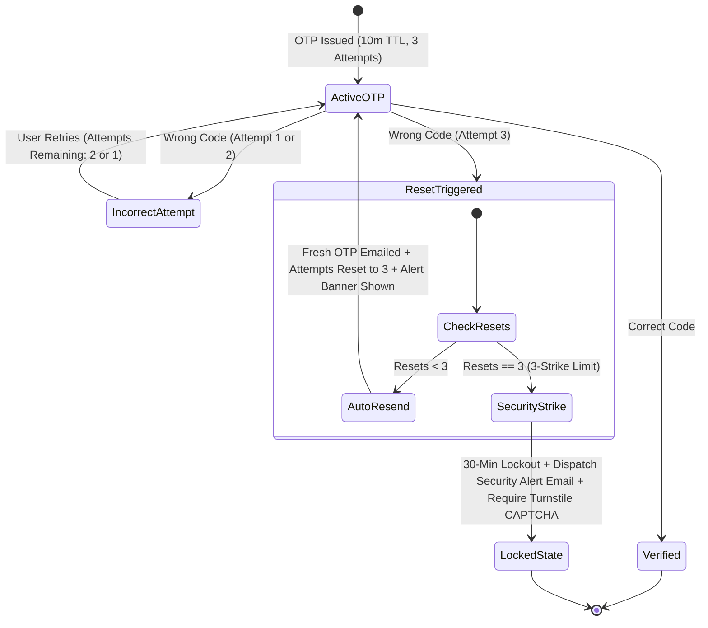

# Module Specification: Master Authentication, Custom AI Facelock & Multi-Account Engine

> **PURPOSE**: Defines the enterprise-grade authentication ecosystem combining standard credentials (Email/Password), **Custom Client-Side Face Recognition AI Models (128-d Vector Embeddings & Silent Background Detection - NO WEBAUTHN / NO PASSKEYS)**, **Multi-Account Switching without re-login**, **Anti-Enumeration Signup with 6-box Auto-Verifying OTP**, **Timing Attack Protection via Constant-Time Dummy Hashing**, **Multi-Tier Dual-Key Redis Rate Limiting with Dynamic Turnstile CAPTCHA & 10-Attempt Lockout**, **3-Attempt OTP Failure Auto-Reset with Fresh OTP & Attempt Restoral**, **60s Resend Cooldown**, **3-Strike Global Reset Security Alert Emails with 30-Minute Lockout**, and **Strong Password Governance**.

---

## 🚫 Hard Architectural Mandate: Custom AI Models Only (Zero Passkeys / No WebAuthn)

> **CRITICAL ARCHITECTURAL DIRECTIVE**:  
> - **NO WebAuthn / NO Hardware Passkeys**: Do not use browser `navigator.credentials.create()`, `PublicKeyCredential`, or OS hardware passkeys.
> - **Self-Contained Custom Face AI Models**: The facelock system MUST use our own lightweight face recognition pipeline:
>   1. **Client-side Landmark Detection**: Extracts face keypoints and aligns the face bounding box via lightweight computer vision models (e.g. MediaPipe Face Mesh, MobileFaceNet, or face-api.js).
>   2. **128-Dimensional Vector Embedding**: Generates a standardized 128-d (or 512-d) float32 face descriptor vector representing facial geometry.
>   3. **Anti-Spoofing & Liveness Check**: Multi-frame micro-motion / blink verification to prevent static photo or screen spoofing.
>   4. **Backend Vector Matching**: Vector distance computation (Euclidean distance `< 0.45` or Cosine Similarity `> 0.88`) against stored face embeddings in the database (MongoDB 128-dimensional float array in `User` documents).
>   5. **Cross-Platform & Universal**: Works identically across all desktop webcams, laptops, Android, iOS, and kiosk browsers without hardware biometric limitations.

---

## 🔐 1. End-to-End Authentication Architecture

```
┌────────────────────────────────────────────────────────────────────────────────────────┐
│                               MASTER AUTHENTICATION GATEWAY                            │
└───────────────────────────────────────────┬────────────────────────────────────────────┘
                                            │
        ┌───────────────────────────────────┼────────────────────────────────────┐
        ▼                                   ▼                                    ▼
┌───────────────────────┐       ┌───────────────────────┐            ┌───────────────────────┐
│     LOGIN PAGE        │       │      SIGNUP FLOW      │            │    FORGOT PASSWORD    │
│ • Email + Password    │       │ • Email-Only Step 1   │            │ • Email input         │
│ • Silent Custom Face  │       │ • No Enumeration      │            │ • ?token=..           │
│   (128-d Vector Probe)│       │ • ?token=..&option=otp│            │ • 6-box OTP Auto-Check│
│ • Manual Face Modal   │       │ • 6-box OTP Auto-Check│            │ • /reset-password     │
│ • Multi-Face Conflict │       │ • ?option=registration│            │ • Strong Pwd Enforced │
│ • Generic Error Msg   │       │   or Redirect to Login│            └───────────────────────┘
│ • Dummy Hash Bcrypt   │       └───────────────────────┘
└───────────────────────┘
        │
        ▼
┌────────────────────────────────────────────────────────┐
│             MULTI-ACCOUNT SESSION ENGINE               │
│ • Active Account: `active_account_id` cookie           │
│ • Authenticated Vault: Multi-session encrypted store   │
│ • Topbar Switcher: Instant switch (Zero password re-ask│
│ • "Add Account" route to login without sign-out        │
└────────────────────────────────────────────────────────┘
```

---

## 👤 2. Login Page & Silent Facelock Architecture

### 2.1 The Two-Tier Facelock Strategy (Custom Face Model Engine)
If enabled in the project plan (`PLAN.md`), the Login page offers both standard email/password authentication and Custom AI Face Biometric login:

1. **Tier 1: Silent Background Detection (Zero Camera UI)**:
   - On page mount, the system automatically initializes a hidden background face detection scan once using an off-screen hidden `<video>` element.
   - **No video preview, no visible camera stream, and no intrusive popups** are presented to the user during this background attempt.
   - The custom model captures a single clean frame, extracts the 128-dimensional embedding vector, and transmits it to `/api/auth/facelock/verify-silent`.
   - If the user's face vector matches an enrolled profile in the database (Euclidean distance `< 0.45`):
     - The user is logged in automatically.
   - If face detection fails, times out (e.g. 2.5 seconds), or camera permission is not yet granted:
     - The system gracefully falls back without any jarring errors.
     - The manual **"Sign in with Face Biometric"** button becomes prominently active.

2. **Tier 2: Manual Face Biometric Trigger**:
   - Clicking **"Sign in with Face Biometric"** opens an explicit visual modal with camera stream feedback, face alignment circle, real-time liveness feedback, and status indicators.

### 2.2 Multi-Account Conflict Resolution (Same Face on Multiple Accounts)
In multi-tenant or enterprise environments, a single individual (e.g. a Manager) may possess multiple distinct user accounts (e.g. `alex.admin@company.com`, `alex.personal@company.com`, `alex.support@company.com`):

1. When the face biometric matches **2 or more accounts**:
   - The backend returns an ambiguous biometric verification token along with a list of matched account profiles (Avatar, Display Name, Masked Email, Role Badge).
   - The UI presents the **`<FaceAccountSelectionModal />`**:
     > *"Biometric scan matched 3 accounts on this device. Select which account you want to open:"*
2. The user clicks their desired account:
   - That account becomes the **Active Account**.
   - The other matched accounts are simultaneously registered into the **Multi-Session Store** so the user can switch between them instantly from the topbar without re-authenticating!

```tsx
// components/auth/FaceAccountSelectionModal.tsx
"use client";

import React from "react";
import { motion, AnimatePresence } from "framer-motion";
import { CheckCircle2, Shield, User } from "lucide-react";

interface MatchedAccount {
  id: string;
  name: string;
  email: string;
  role: string;
  avatarUrl?: string;
}

export const FaceAccountSelectionModal: React.FC<{
  isOpen: boolean;
  accounts: MatchedAccount[];
  onSelect: (account: MatchedAccount) => void;
}> = ({ isOpen, accounts, onSelect }) => {
  if (!isOpen) return null;

  return (
    <div className="fixed inset-0 z-50 flex items-center justify-center p-4 bg-black/70 backdrop-blur-md">
      <motion.div
        initial={{ opacity: 0, scale: 0.95, y: 10 }}
        animate={{ opacity: 1, scale: 1, y: 0 }}
        exit={{ opacity: 0, scale: 0.95 }}
        className="w-full max-w-md p-6 rounded-3xl bg-surface-light dark:bg-surface-dark border border-slate-200 dark:border-white/10 shadow-2xl"
      >
        <div className="flex items-center gap-3 mb-4">
          <div className="p-2.5 rounded-2xl bg-sky-500/10 text-sky-500">
            <Shield className="w-6 h-6" />
          </div>
          <div>
            <h3 className="text-lg font-bold text-slate-900 dark:text-white">Multiple Accounts Detected</h3>
            <p className="text-xs text-slate-500 dark:text-slate-400">Select which profile to activate</p>
          </div>
        </div>

        <div className="space-y-2.5 my-4">
          {accounts.map((acc) => (
            <button
              key={acc.id}
              onClick={() => onSelect(acc)}
              className="w-full flex items-center justify-between p-3.5 rounded-2xl border border-slate-200 dark:border-white/10 bg-slate-50 dark:bg-slate-800/40 hover:border-sky-500/50 hover:bg-sky-500/5 transition-all text-left cursor-pointer group"
            >
              <div className="flex items-center gap-3">
                <div className="w-10 h-10 rounded-xl bg-slate-200 dark:bg-slate-700 flex items-center justify-center font-bold text-slate-700 dark:text-slate-200">
                  {acc.avatarUrl ?  : acc.name.charAt(0)}
                </div>
                <div>
                  <h4 className="text-sm font-semibold text-slate-900 dark:text-white group-hover:text-sky-400 transition-colors">
                    {acc.name}
                  </h4>
                  <p className="text-xs text-slate-500 dark:text-slate-400">{acc.email}</p>
                </div>
              </div>
              <span className="text-[11px] font-semibold px-2 py-0.5 rounded-full bg-slate-200 dark:bg-slate-700 text-slate-700 dark:text-slate-300">
                {acc.role}
              </span>
            </button>
          ))}
        </div>
      </motion.div>
    </div>
  );
};
```

---

### 2.3 Custom Face Recognition AI Pipeline (Client Descriptor & Backend Vector Matching)

```
┌────────────────────────────────────────────────────────────────────────┐
│                    CLIENT-SIDE FACE AI PIPELINE                        │
│ 1. Hidden / Visual Camera Capture (Canvas Frame)                       │
│ 2. Facial Landmark Mesh Alignment (68 / 468 Keypoints)                 │
│ 3. Deep Feature Extraction (128-dimensional Float32 Embedding Vector)  │
│ 4. Anti-Spoofing Check (Blink / Micro-Motion Variance)                 │
└───────────────────────────────────┬────────────────────────────────────┘
                                    │ Transmit: `face_descriptor: float[128]`
                                    ▼
┌────────────────────────────────────────────────────────────────────────┐
│                   BACKEND VECTOR MATCHING ENGINE                       │
│ 1. Query registered face vectors from MongoDB (users collection)       │
│ 2. Calculate Euclidean Distance: D = || v_candidate - v_stored ||      │
│ 3. Verification Gate: Match if Distance < 0.45                         │
│ 4. If 1 match: Authenticate | If 2+ matches: Return Conflict Modal     │
└────────────────────────────────────────────────────────────────────────┘
```

#### Client-Side Embedding Extraction (`lib/faceModel.ts`):
```typescript
/**
 * Client-Side Face Feature Extractor using Custom Landmark AI Model
 * NO WebAuthn / NO Passkeys used.
 */

export interface FaceAuthResult {
  success: boolean;
  descriptor?: number[]; // 128-d vector
  error?: string;
}

// 1. Silent Background Scan (Off-screen video, zero UI)
export async function scanFaceSilently(): Promise<number[] | null> {
  let stream: MediaStream | null = null;
  let hiddenVideo: HTMLVideoElement | null = null;

  try {
    // Request webcam stream with minimal dimensions for performance
    stream = await navigator.mediaDevices.getUserMedia({
      video: { width: 320, height: 240, facingMode: "user" },
    });

    hiddenVideo = document.createElement("video");
    hiddenVideo.srcObject = stream;
    hiddenVideo.setAttribute("playsinline", "true");
    hiddenVideo.muted = true;
    hiddenVideo.style.position = "absolute";
    hiddenVideo.style.opacity = "0";
    hiddenVideo.style.pointerEvents = "none";
    document.body.appendChild(hiddenVideo);

    await hiddenVideo.play();

    // Wait 400ms for camera auto-exposure stabilization
    await new Promise((r) => setTimeout(r, 400));

    // Extract 128-d descriptor vector from video frame
    const descriptor = await extractFaceDescriptorFromVideo(hiddenVideo);
    return descriptor;
  } catch (err) {
    // Silent fail without popping up error dialogs
    return null;
  } finally {
    // Clean up camera stream and DOM element immediately
    if (stream) stream.getTracks().forEach((track) => track.stop());
    if (hiddenVideo && hiddenVideo.parentNode) hiddenVideo.parentNode.removeChild(hiddenVideo);
  }
}

// 2. Helper to compute 128-d vector from video frame
export async function extractFaceDescriptorFromVideo(video: HTMLVideoElement): Promise<number[] | null> {
  const canvas = document.createElement("canvas");
  canvas.width = video.videoWidth || 320;
  canvas.height = video.videoHeight || 240;
  const ctx = canvas.getContext("2d");
  if (!ctx) return null;

  ctx.drawImage(video, 0, 0, canvas.width, canvas.height);

  // Invoke loaded lightweight model (e.g. face-api.js or custom ONNX MobileFaceNet runtime)
  if (typeof (window as any).customFaceModel?.extractEmbedding === "function") {
    const rawVector = await (window as any).customFaceModel.extractEmbedding(canvas);
    return Array.from(rawVector); // 128-d float array
  }

  return null;
}
```

#### Backend Vector Matching Engine (`app/services/face_auth_service.py` & Next.js):
```python
# app/services/face_auth_service.py (FastAPI / Motor Async MongoDB)
import math
from typing import List, Dict, Any, Optional
from motor.motor_asyncio import AsyncIOMotorDatabase
from bson import ObjectId

MATCH_DISTANCE_THRESHOLD = 0.45  # Standard threshold: lower distance = closer match

def calculate_euclidean_distance(vec1: List[float], vec2: List[float]) -> float:
    """Calculates L2 Euclidean distance between two 128-dimensional face embedding vectors."""
    if len(vec1) != len(vec2):
        return 999.0
    return math.sqrt(sum((a - b) ** 2 for a, b in zip(vec1, vec2)))

async def match_face_biometric(
    db: AsyncIOMotorDatabase,
    candidate_vector: List[float],
    company_id: Optional[str] = None
) -> List[Dict[str, Any]]:
    """
    Scans candidate face vector against all enrolled users in the tenant.
    Returns: List of matching User documents from MongoDB (supports 1 user or multi-account conflict resolution).
    """
    query: Dict[str, Any] = {
        "faceEmbedding": {"$exists": True, "$ne": None},
        "isActive": True
    }
    if company_id:
        try:
            query["companyId"] = ObjectId(company_id)
        except Exception:
            pass

    cursor = db.users.find(query)
    enrolled_users = await cursor.to_list(length=1000)
    matched_users = []

    for user in enrolled_users:
        stored_vector = user.get("faceEmbedding", [])  # 128-d float list stored in MongoDB
        distance = calculate_euclidean_distance(candidate_vector, stored_vector)
        
        if distance < MATCH_DISTANCE_THRESHOLD:
            matched_users.append(user)

    return matched_users
```

```typescript
// lib/faceAuthService.ts (Next.js App Router / Mongoose)
import { User, IUser } from "@/models/User";

export async function matchFaceBiometricNext(
  candidateVector: number[],
  companyId?: string
): Promise<IUser[]> {
  const query: any = {
    faceEmbedding: { $exists: true, $ne: null },
    isActive: true,
  };
  if (companyId) query.companyId = companyId;

  const enrolledUsers = await User.find(query).lean();
  return enrolledUsers.filter((user) => {
    const distance = calculateEuclideanDistance(candidateVector, user.faceEmbedding || []);
    return distance < MATCH_DISTANCE_THRESHOLD;
  });
}
```

---

## 🔄 3. Multi-Account Management & Account Switching ("Switch Account")

### 3.1 Session Architecture
To allow seamless multi-account workflows without logging out:
1. **`active_account_id` Cookie**: Holds the ID/token of the currently active session (`HttpOnly; SameSite=Lax; Secure`).
2. **`auth_sessions` Vault**: Encrypted HttpOnly cookie or secure server-side session registry containing the active JWTs/refresh tokens of all currently signed-in accounts on this device.
3. **Switching Logic**:
   - Switching accounts updates `active_account_id` to the target user's session.
   - **ZERO PASSWORD RE-PROMPT**: The user is already authenticated. The page reloads state instantaneously.
4. **Adding an Account**:
   - User clicks **"Add Another Account"**: Routed to `/login?mode=add_account`.
   - Logging in with new credentials appends the new session to the `auth_sessions` vault and sets it as the active account without clearing existing sessions.
5. **Zero Additional Account Fallback**:
   - If only 1 account is signed in, clicking "Switch Account" in the user dropdown automatically redirects directly to `/login?mode=add_account`.

### 3.2 Topbar User Dropdown UI with Switcher (`UserAccountDropdown.tsx`)

```tsx
"use client";

import React, { useState } from "react";
import { motion, AnimatePresence } from "framer-motion";
import { User, Users, Plus, LogOut, Check, ChevronDown } from "lucide-react";

interface LoggedInAccount {
  id: string;
  name: string;
  email: string;
  role: string;
  isActive: boolean;
}

export const UserAccountDropdown: React.FC<{
  accounts: LoggedInAccount[];
  onSwitch: (id: string) => void;
  onAddAccount: () => void;
  onLogout: () => void;
}> = ({ accounts, onSwitch, onAddAccount, onLogout }) => {
  const [isOpen, setIsOpen] = useState(false);
  const activeAccount = accounts.find((a) => a.isActive) || accounts[0];

  const handleSwitchClick = () => {
    if (accounts.length <= 1) {
      onAddAccount(); // If no second account exists, direct to login
    }
  };

  return (
    <div className="relative">
      <button
        onClick={() => setIsOpen(!isOpen)}
        className="flex items-center gap-2.5 p-1.5 pr-3 rounded-2xl hover:bg-slate-100 dark:hover:bg-slate-800/60 transition cursor-pointer"
      >
        <div className="w-8 h-8 rounded-xl bg-gradient-to-tr from-sky-500 to-indigo-600 flex items-center justify-center font-bold text-white text-xs shadow-glow-sky">
          {activeAccount.name.charAt(0)}
        </div>
        <div className="hidden md:block text-left">
          <p className="text-xs font-bold text-slate-800 dark:text-slate-100 truncate max-w-[120px]">
            {activeAccount.name}
          </p>
          <p className="text-[10px] text-slate-500 dark:text-slate-400 capitalize">{activeAccount.role}</p>
        </div>
        <ChevronDown className="w-3.5 h-3.5 text-slate-400" />
      </button>

      <AnimatePresence>
        {isOpen && (
          <motion.div
            initial={{ opacity: 0, y: 10, scale: 0.95 }}
            animate={{ opacity: 1, y: 0, scale: 1 }}
            exit={{ opacity: 0, y: 10, scale: 0.95 }}
            className="absolute right-0 mt-2 w-72 p-2 rounded-3xl bg-surface-light dark:bg-surface-dark border border-slate-200 dark:border-white/10 shadow-2xl backdrop-blur-2xl z-50"
          >
            {/* Active Account Header */}
            <div className="px-3 py-2.5 border-b border-slate-200 dark:border-slate-800">
              <span className="text-[10px] font-bold uppercase tracking-wider text-slate-400">Signed In As</span>
              <p className="text-sm font-bold text-slate-900 dark:text-white">{activeAccount.name}</p>
              <p className="text-xs text-slate-500 truncate">{activeAccount.email}</p>
            </div>

            {/* Switch Account Section */}
            <div className="py-2 border-b border-slate-200 dark:border-slate-800">
              <div className="flex items-center justify-between px-3 pb-1.5">
                <span className="text-[11px] font-semibold text-slate-400 flex items-center gap-1.5">
                  <Users className="w-3.5 h-3.5" />
                  Switch Account
                </span>
              </div>

              <div className="space-y-1">
                {accounts.map((acc) => (
                  <button
                    key={acc.id}
                    onClick={() => {
                      if (!acc.isActive) onSwitch(acc.id);
                      setIsOpen(false);
                    }}
                    className={`w-full flex items-center justify-between px-3 py-2 rounded-xl text-xs font-medium transition cursor-pointer ${
                      acc.isActive
                        ? "bg-sky-500/10 text-sky-500 font-bold"
                        : "hover:bg-slate-100 dark:hover:bg-slate-800 text-slate-700 dark:text-slate-300"
                    }`}
                  >
                    <div className="flex items-center gap-2 truncate">
                      <div className="w-6 h-6 rounded-lg bg-slate-200 dark:bg-slate-700 flex items-center justify-center text-[10px] font-bold">
                        {acc.name.charAt(0)}
                      </div>
                      <span className="truncate">{acc.email}</span>
                    </div>
                    {acc.isActive && <Check className="w-4 h-4 text-sky-500 flex-shrink-0" />}
                  </button>
                ))}

                {/* Add Another Account */}
                <button
                  onClick={() => {
                    setIsOpen(false);
                    onAddAccount();
                  }}
                  className="w-full flex items-center gap-2 px-3 py-2 rounded-xl text-xs font-semibold text-slate-600 dark:text-slate-300 hover:text-sky-500 hover:bg-slate-100 dark:hover:bg-slate-800 transition cursor-pointer"
                >
                  <Plus className="w-4 h-4" />
                  <span>Add another account</span>
                </button>
              </div>
            </div>

            {/* Logout */}
            <button
              onClick={() => {
                setIsOpen(false);
                onLogout();
              }}
              className="w-full flex items-center gap-2 px-3 py-2 rounded-xl text-xs font-semibold text-rose-500 hover:bg-rose-500/10 transition cursor-pointer mt-1"
            >
              <LogOut className="w-4 h-4" />
              <span>Sign out current account</span>
            </button>
          </motion.div>
        )}
      </AnimatePresence>
    </div>
  );
};
```

---

## 🛡️ 4. Login API Security: Generic Errors & Constant-Time Dummy Hash

### 4.1 Strict Anti-Enumeration Rule
- **NEVER** return: `"Email not found"` or `"Incorrect password"`.
- **ALWAYS** return: `"Invalid email or password"`.
- Status Code: Always HTTP `401 Unauthorized`.

### 4.2 Timing Attack Defense via Bcrypt Dummy Hash
Attackers use precision timing to see if an API responds faster when an email doesn't exist (because password hashing is skipped). **To eliminate this vulnerability**:
- If the email does **not** exist in the database, the backend **MUST execute a dummy `bcrypt.compare()`** against a fixed pre-computed hash.
- This ensures that every login request takes the exact same computation time (~80-120ms) regardless of whether the email exists.

```python
# app/services/auth_service.py
import bcrypt
from fastapi import HTTPException, status
from app.core.config import settings

# Pre-computed dummy bcrypt hash (cost 12) for constant-time comparison
DUMMY_BCRYPT_HASH = "$2b$12$e8uq0wNq1X3Z.z7uR6Cg2.1vG4yJ9nO5zB2c8X0mR3pL9kW1qD2uS".encode("utf-8")

def authenticate_user(db, email: str, password: str):
    user = db.query(User).filter(User.email == email.lower().strip()).first()

    if not user:
        # TIMING ATTACK MITIGATION: Run real bcrypt check against dummy hash
        bcrypt.checkpw(password.encode("utf-8"), DUMMY_BCRYPT_HASH)
        raise HTTPException(
            status_code=status.HTTP_401_UNAUTHORIZED,
            detail="Invalid email or password"
        )

    # Verify real user password
    is_valid = bcrypt.checkpw(password.encode("utf-8"), user.password_hash.encode("utf-8"))
    if not is_valid:
        raise HTTPException(
            status_code=status.HTTP_401_UNAUTHORIZED,
            detail="Invalid email or password"
        )

    return user
```

### 4.3 Multi-Tier Redis Rate Limiting & Brute-Force Defense Architecture

All authentication endpoints are guarded by an enterprise-grade, distributed **Redis Sliding Window Rate Limiter** with dual-key tracking to mitigate both single-IP brute force and distributed credential-stuffing botnets.

```
┌───────────────────────────────────────────────────────────────────────────────────┐
│                     LOGIN RATE LIMITING & LOCKOUT PIPELINE                        │
└─────────────────────────────────────────┬─────────────────────────────────────────┘
                                          │
            ┌─────────────────────────────┴─────────────────────────────┐
            ▼                                                           ▼
┌───────────────────────────────────────┐   ┌───────────────────────────────────────┐
│ IP TRACKING KEY                       │   │ ACCOUNT TRACKING KEY                  │
│ `ratelimit:login:ip:{client_ip}`      │   │ `ratelimit:login:account:{email}`     │
│ Window: 15 Minutes | Limit: 30 Req    │   │ Window: 15 Minutes | Limit: 10 Req    │
└───────────────────┬───────────────────┘   └───────────────────┬───────────────────┘
                    └─────────────────────┬─────────────────────┘
                                          │
                                          ▼
                         ┌─────────────────────────────────┐
                         │   FAILED ATTEMPTS EVALUATOR     │
                         └────────────────┬────────────────┘
                                          │
         ┌────────────────────────────────┼────────────────────────────────┐
         ▼ (Attempts 1 - 2)               ▼ (Attempts 3 - 9)               ▼ (Attempt 10+)
┌─────────────────────────┐   ┌─────────────────────────┐   ┌─────────────────────────┐
│ TIER 1: STANDARD ERROR  │   │ TIER 2: CAPTCHA GATE    │   │ TIER 3: HARD LOCKOUT    │
│ • Generic 401 error     │   │ • Cloudflare Turnstile  │   │ • HTTP 429 Locked       │
│ • Constant-time dummy   │   │   verification required │   │ • 15-min freeze window  │
│   bcrypt execution      │   │ • Rejects raw requests  │   │ • Constant-time dummy   │
│ • No enumeration leak   │   │ • Counter persists      │   │   bcrypt still run!     │
└─────────────────────────┘   └─────────────────────────┘   └─────────────────────────┘
```

#### 4.3.1 Dual-Key Sliding Window Architecture
1. **IP-Level Key (`ratelimit:login:ip:{client_ip}`)**:
   - Window: 15 Minutes (900 seconds)
   - Max Threshold: 30 requests per IP
   - Purpose: Blocks rapid dictionary attacks, brute-force bots, and denial-of-service across arbitrary email targets.
2. **Account-Level Key (`ratelimit:login:account:{normalized_email}`)**:
   - Window: 15 Minutes (900 seconds)
   - Max Threshold: 10 failed login attempts per email
   - Purpose: Blocks distributed botnets spraying requests across rotating proxy IPs targeting a single high-value executive or admin account.

#### 4.3.2 3-Tier Progressive Defense & Lockout Policy
- **Tier 1 (Attempts 1–2)**:
  - The API responds with standard HTTP `401 Unauthorized`: `{"detail": "Invalid email or password"}`.
  - If the user record does not exist in the database, the backend **must still execute constant-time dummy bcrypt hashing** (`DUMMY_BCRYPT_HASH`) to ensure absolute timing uniformity (~80–120ms).
- **Tier 2 (Attempts 3–9) — Dynamic CAPTCHA Gate**:
  - Once an account or IP records **3 failed attempts**, the API returns HTTP `403 Forbidden` with header `X-Auth-Challenge: turnstile-required` and response:
    ```json
    {
      "detail": "Additional security verification required.",
      "requiresCaptcha": true,
      "failedAttempts": 3
    }
    ```
  - The client `<LoginForm />` dynamically mounts the **Cloudflare Turnstile** widget.
  - Subsequent login requests **MUST** include a valid `turnstileToken`. If the token is absent or fails validation against the Cloudflare verification endpoint (`https://challenges.cloudflare.com/turnstile/v0/siteverify`), the request is rejected immediately before password evaluation.
- **Tier 3 (Attempt 10+) — Hard Lockout**:
  - If failed attempts reach **10 within the 15-minute window**:
    - The backend sets a lock key: `lockout:login:{normalized_email}` with TTL of `900` seconds (15 minutes).
    - API returns HTTP `429 Too Many Requests` with header `Retry-After: 900`:
      ```json
      {
        "detail": "Too many failed login attempts. This account is temporarily locked for 15 minutes.",
        "retryAfter": 900
      }
      ```
    - **Anti-Enumeration Guarantee**: Even when an account is in locked state, if an attacker queries with a non-existent email, the backend executes the dummy bcrypt comparison before returning 429, completely preventing timing-based user enumeration.

#### 4.3.3 Production Redis Sliding Window Rate Limiter (`lib/rateLimiter.ts`)

```typescript
// lib/rateLimiter.ts (Next.js / Node.js with ioredis)
import Redis from "ioredis";

const redis = new Redis(process.env.REDIS_URL || "redis://localhost:6379");

export interface RateLimitResult {
  allowed: boolean;
  currentAttempts: number;
  remaining: number;
  resetSeconds: number;
  requiresCaptcha: boolean;
  isLocked: boolean;
}

export async function checkLoginRateLimit(
  clientIp: string,
  email: string
): Promise<RateLimitResult> {
  const normalizedEmail = email.toLowerCase().trim();
  const now = Date.now();
  const windowMs = 15 * 60 * 1000; // 15 minutes
  const windowSec = 15 * 60;
  const windowStart = now - windowMs;

  const accountKey = `ratelimit:login:account:${normalizedEmail}`;
  const ipKey = `ratelimit:login:ip:${clientIp}`;
  const lockKey = `lockout:login:${normalizedEmail}`;

  // 1. Check if account is in hard lockout
  const isLocked = await redis.exists(lockKey);
  if (isLocked) {
    const ttl = await redis.ttl(lockKey);
    return {
      allowed: false,
      currentAttempts: 10,
      remaining: 0,
      resetSeconds: ttl > 0 ? ttl : windowSec,
      requiresCaptcha: true,
      isLocked: true,
    };
  }

  // 2. Sliding window atomic transaction using Redis Sorted Sets
  const multi = redis.multi();

  // Clear expired entries outside window
  multi.zremrangebyscore(accountKey, 0, windowStart);
  multi.zremrangebyscore(ipKey, 0, windowStart);

  // Count active failures in window
  multi.zcard(accountKey);
  multi.zcard(ipKey);

  const results = await multi.exec();
  const accountFailures = (results?.[2]?.[1] as number) || 0;
  const ipFailures = (results?.[3]?.[1] as number) || 0;

  // Max thresholds
  const MAX_ACCOUNT_ATTEMPTS = 10;
  const MAX_IP_ATTEMPTS = 30;

  if (accountFailures >= MAX_ACCOUNT_ATTEMPTS) {
    // Impose 15-minute lock
    await redis.set(lockKey, "locked", "EX", windowSec);
    return {
      allowed: false,
      currentAttempts: accountFailures,
      remaining: 0,
      resetSeconds: windowSec,
      requiresCaptcha: true,
      isLocked: true,
    };
  }

  if (ipFailures >= MAX_IP_ATTEMPTS) {
    return {
      allowed: false,
      currentAttempts: ipFailures,
      remaining: 0,
      resetSeconds: windowSec,
      requiresCaptcha: true,
      isLocked: true,
    };
  }

  return {
    allowed: true,
    currentAttempts: accountFailures,
    remaining: MAX_ACCOUNT_ATTEMPTS - accountFailures,
    resetSeconds: windowSec,
    requiresCaptcha: accountFailures >= 3,
    isLocked: false,
  };
}

export async function recordLoginFailure(clientIp: string, email: string): Promise<void> {
  const normalizedEmail = email.toLowerCase().trim();
  const now = Date.now();
  const windowSec = 15 * 60;

  const accountKey = `ratelimit:login:account:${normalizedEmail}`;
  const ipKey = `ratelimit:login:ip:${clientIp}`;

  const multi = redis.multi();
  multi.zadd(accountKey, now, `${now}-${Math.random()}`);
  multi.expire(accountKey, windowSec);
  multi.zadd(ipKey, now, `${now}-${Math.random()}`);
  multi.expire(ipKey, windowSec);
  await multi.exec();
}

export async function clearLoginFailures(clientIp: string, email: string): Promise<void> {
  const normalizedEmail = email.toLowerCase().trim();
  await redis.del(
    `ratelimit:login:account:${normalizedEmail}`,
    `lockout:login:${normalizedEmail}`
  );
}
```

#### 4.3.4 Python FastAPI Implementation (`app/core/rate_limiter.py`)

```python
# app/core/rate_limiter.py (FastAPI / Redis Async)
import time
import uuid
from typing import Tuple
from redis.asyncio import Redis

LOGIN_WINDOW_SEC = 900       # 15 minutes
MAX_ACCOUNT_ATTEMPTS = 10
MAX_IP_ATTEMPTS = 30
CAPTCHA_THRESHOLD = 3

async def check_login_rate_limit(redis: Redis, client_ip: str, email: str) -> Tuple[bool, bool, bool, int]:
    """
    Returns: (is_allowed, requires_captcha, is_locked, retry_after)
    """
    normalized_email = email.lower().strip()
    lock_key = f"lockout:login:{normalized_email}"
    account_key = f"ratelimit:login:account:{normalized_email}"
    ip_key = f"ratelimit:login:ip:{client_ip}"
    now = time.time()
    window_start = now - LOGIN_WINDOW_SEC

    # Check hard lockout
    ttl = await redis.ttl(lock_key)
    if ttl > 0:
        return False, True, True, ttl

    async with redis.pipeline(transaction=True) as pipe:
        pipe.zremrangebyscore(account_key, 0, window_start)
        pipe.zremrangebyscore(ip_key, 0, window_start)
        pipe.zcard(account_key)
        pipe.zcard(ip_key)
        _, _, account_count, ip_count = await pipe.execute()

    if account_count >= MAX_ACCOUNT_ATTEMPTS:
        await redis.set(lock_key, "locked", ex=LOGIN_WINDOW_SEC)
        return False, True, True, LOGIN_WINDOW_SEC

    if ip_count >= MAX_IP_ATTEMPTS:
        return False, True, True, LOGIN_WINDOW_SEC

    requires_captcha = account_count >= CAPTCHA_THRESHOLD
    return True, requires_captcha, False, 0
```

### 4.4 Multi-Account Fast-Switcher & Profile Button Double-Tap Mechanics
The authentication engine features a dual-mode fast account switcher designed for high productivity:

#### 1. Single-Tap: Account Switcher Dropdown (`<AccountSwitcherDropdown />`)
- Tapping or clicking the user's profile avatar in the navigation bar opens the sleek frosted glass user menu:
  - **Active Profile Card**: Displays current avatar, full name, email, and active role badge (e.g. `Owner`, `Staff`, `Student`).
  - **Enrolled Accounts List**: Lists all authenticated accounts currently stored in the device's secure multi-session vault.
  - **One-Tap Switch**: Clicking any account switches identity in `< 50ms` by updating the `active_account_id` cookie and re-evaluating route permissions with zero password re-prompts.
  - **"Add Another Account" Action**: Routes user to `/login?mode=add_account` to authenticate an additional identity without terminating current active sessions.

#### 2. Double-Tap: Instant Fast-Shift Gesture (`useDoubleTapAccountShift`)
- **Interaction Law**: Double-tapping the profile avatar within **300ms** (on desktop or mobile) intercepts dropdown opening and triggers an instantaneous account shift:
  1. **Animation**: Avatar executes a tactile **360° spin and scale bounce** (`ANIM-50`).
  2. **Circular Rotation**: Shifts immediately to the next enrolled account in circular FIFO order ($0 \to 1 \to 2 \to 0$).
  3. **Edge Cookie Swap**: Updates `active_account_id` cookie synchronously.
  4. **Cache Neutralization**: Automatically calls `queryClient.clear()` to prevent data bleeding between accounts.
  5. **Role Route Verification**: If switching to an account with a different role portal (e.g. Student ➔ Instructor), seamlessly navigates to the target role's dashboard.
  6. **Single Account Guard**: If only 1 account exists, double-tapping displays an unobtrusive toast: *"No other accounts enrolled. Tap to add account."*

```tsx
// hooks/useDoubleTapAccountShift.ts
"use client";

import { useRef, useCallback } from "react";
import { useRouter } from "next/navigation";
import { useQueryClient } from "@tanstack/react-query";

interface EnrolledAccount {
  userId: string;
  name: string;
  email: string;
  role: string;
  portalUrl: string;
}

export function useDoubleTapAccountShift(
  accounts: EnrolledAccount[],
  currentAccountId: string,
  onSingleTap: () => void
) {
  const router = useRouter();
  const queryClient = useQueryClient();
  const lastTapRef = useRef<number>(0);
  const clickTimeoutRef = useRef<NodeJS.Timeout | null>(null);

  const handleProfileTap = useCallback(() => {
    const now = Date.now();
    const timeSinceLastTap = now - lastTapRef.current;

    if (timeSinceLastTap < 300) {
      // DOUBLE TAP DETECTED!
      if (clickTimeoutRef.current) {
        clearTimeout(clickTimeoutRef.current);
        clickTimeoutRef.current = null;
      }
      lastTapRef.current = 0;

      if (accounts.length <= 1) {
        // Show tooltip/toast
        return;
      }

      // Find current index and calculate next account in circular order
      const currentIndex = accounts.findIndex((a) => a.userId === currentAccountId);
      const nextIndex = (currentIndex + 1) % accounts.length;
      const nextAccount = accounts[nextIndex];

      // Update active account cookie
      document.cookie = `active_account_id=${nextAccount.userId}; path=/; SameSite=Lax; Secure`;

      // Wipe client cache to prevent cross-account leak
      queryClient.clear();

      // Navigate to target portal
      router.push(nextAccount.portalUrl);
      router.refresh();
    } else {
      // First tap: delay single tap to wait for potential double tap
      lastTapRef.current = now;
      clickTimeoutRef.current = setTimeout(() => {
        onSingleTap();
      }, 300);
    }
  }, [accounts, currentAccountId, onSingleTap, queryClient, router]);

  return { handleProfileTap };
}
```

---

## 📝 5. Signup Flow: Multi-Step Verification & Hardened OTP Security Lifecycle

### 5.1 Step-by-Step State Progression (Zero Enumeration)

```
[ Step 1: /signup ] ── User enters Email ONLY 
         │
         ▼
[ Backend Check ]
         ├── Email DOES NOT exist ──► Issue signed token & send OTP
         └── Email ALREADY exists ──► Issue signed token & send OTP (Zero error leakage!)
         │
         ▼
[ Step 2: /signup?token=<jwt>&option=otp ]
         │── 1. Page verifies `token` validity
         │── 2. User enters 6-digit OTP in auto-verifying boxes
         │── 3. Live badge shows "3 attempts remaining"
         ▼
[ Step 3: Backend OTP Verify ]
         │
         ├── Valid OTP:
         │   ├── If NEW Email ──► Redirect to `/signup?token=<verified_token>&option=registration`
         │   └── If EXISTING Email ──► Redirect to `/login?email=<encoded_email>`
         │
         ├── Incorrect OTP (Attempts 1 - 2):
         │   └── Decrement counter ──► Return "Incorrect code. X attempts remaining."
         │
         ├── Incorrect OTP (Attempt 3 — Auto-Reset Trigger):
         │   ├── Invalidate current OTP in Redis
         │   ├── Check global reset counter (`otp:resets:{email}`)
         │   │
         │   ├── If Resets < 3:
         │   │   ├── Increment reset counter ($1 \to 2$)
         │   │   ├── Generate & email fresh OTP
         │   │   ├── Reset attempt counter to 3 fresh attempts!
         │   │   └── Return notice: "Security Notice: Incorrect code 3 times. New OTP sent."
         │   │
         │   └── If Resets >= 3 (3-Strike Rule):
         │       ├── Set 30-minute lockout on email (`lockout:otp:{email}`)
         │       ├── Dispatch Security Alert Email to user immediately
         │       ├── Require Cloudflare Turnstile CAPTCHA confirmation
         │       └── Return locked state: "Verification locked for 30 minutes."
```

---

### 5.2 Hardened OTP Lifecycle & Failure-Resilience State Machine

To prevent brute-force attacks against 6-digit security codes while maintaining a frictionless user experience, the OTP subsystem enforces strict automated reset thresholds:



#### 5.2.1 Attempt Counter Policy (3 Attempts per OTP)
1. **Per-Code Attempt Quota**: Every generated OTP code starts with exactly **3 allowed attempts** tracked in Redis (`otp:attempts:{tokenId}`).
2. **Real-Time Visual Countdown**: The UI dynamically updates an attempt badge below the 6 input boxes:
   - 1st Failure: *"Incorrect code. 2 attempts remaining."* (Yellow alert).
   - 2nd Failure: *"Incorrect code. 1 attempt remaining. Next failure will invalidate this code."* (Amber alert).
3. **Automatic Invalidation & Resend on 3rd Failure**:
   - On the 3rd consecutive incorrect entry, the backend **instantly invalidates** the current OTP.
   - The backend mints a **brand new cryptographic 6-digit OTP** and sends it to the user's email.
   - **Crucial Reset Law**: The allowed attempts counter for this new OTP **resets back to 3 fresh attempts**.
   - The UI displays an explicit alert banner:
     > 🛡️ **Security Notice**: *You entered an incorrect code 3 times. For your security, this code was invalidated and a fresh OTP has been sent to your email.*

---

### 5.3 Manual Resend Rate Limiting & Cooldown

To prevent email-bombing and abuse of the manual "Resend Code" trigger:
1. **60-Second Visual Cooldown Timer**:
   - Upon page mount or code generation, the **"Resend OTP"** button is disabled with a running countdown (`Resend code in 00:59`).
   - The button becomes active only after 60 seconds have elapsed.
2. **Hard Hourly Cap (5 Resends per Hour)**:
   - Redis key `ratelimit:otp:resend:{email}` restricts manual resend requests to a maximum of **5 per hour per email/IP**.
   - Attempting to exceed this threshold returns HTTP `429 Too Many Requests`: *"Resend limit reached. Please wait before requesting another code."*
3. **Resend Invalidation**:
   - Clicking manual resend invalidates the previous code, emits a new OTP, and resets the attempt counter to 3 fresh attempts.

---

### 5.4 The 3-Strike Global Reset & Security Warning Email

If an automated script or persistent attacker causes **3 OTP resets** (meaning the code had to be re-issued 3 consecutive times due to repeated failed entries or excessive regenerations):

1. **Immediate 30-Minute Cooldown Lockout**:
   - The backend writes key `lockout:otp:{normalized_email}` in Redis with a TTL of `1800` seconds (30 minutes).
   - All verification requests for this email return HTTP `423 Locked`.
2. **Mandatory CAPTCHA Re-verification**:
   - When the 30-minute lockout expires, the user must complete a **Cloudflare Turnstile CAPTCHA challenge** before they can request or enter a new OTP.
3. **Immediate Security Alert Email Dispatch**:
   - The background mailer immediately dispatches an urgent security notification to the user's registered email address.

#### 5.4.1 Security Alert Email Specification & Template

- **Sender**: `security@yourdomain.com`
- **Subject**: `⚠️ Security Alert: Multiple failed verification attempts on your account`
- **Content Payload**:

```html
<!-- Security Alert Email HTML Template -->
<div style="font-family: -apple-system, BlinkMacSystemFont, 'Segoe UI', Roboto, sans-serif; max-width: 580px; margin: 0 auto; padding: 32px 24px; background: #ffffff; border-radius: 16px; border: 1px solid #e2e8f0;">
  <div style="margin-bottom: 24px;">
    <span style="background: #fee2e2; color: #b91c1c; font-weight: 700; font-size: 12px; padding: 4px 12px; border-radius: 9999px; text-transform: uppercase; letter-spacing: 0.05em;">Security Notice</span>
    <h2 style="font-size: 20px; font-weight: 800; color: #0f172a; margin-top: 12px; margin-bottom: 8px;">Suspicious Verification Activity Detected</h2>
    <p style="font-size: 14px; color: #475569; line-height: 1.6;">
      We detected multiple repeated incorrect verification attempts on your account. For your security, verification for your email has been temporarily locked for <strong>30 minutes</strong>.
    </p>
  </div>

  <div style="background: #f8fafc; border: 1px solid #e2e8f0; border-radius: 12px; padding: 16px; margin-bottom: 24px;">
    <h4 style="margin: 0 0 12px 0; font-size: 12px; font-weight: 700; text-transform: uppercase; color: #64748b; letter-spacing: 0.05em;">Incident Metadata</h4>
    <table style="width: 100%; font-size: 13px; color: #334155; line-height: 1.8;">
      <tr><td style="color: #64748b; width: 120px;">IP Address:</td><td><strong>{{client_ip}}</strong></td></tr>
      <tr><td style="color: #64748b;">Device / Browser:</td><td><strong>{{user_agent}}</strong></td></tr>
      <tr><td style="color: #64748b;">Timestamp:</td><td><strong>{{timestamp_utc}} UTC</strong></td></tr>
      <tr><td style="color: #64748b;">Account Target:</td><td><strong>{{masked_email}}</strong></td></tr>
    </table>
  </div>

  <p style="font-size: 13px; color: #64748b; line-height: 1.6;">
    <strong>If this was you:</strong> Please wait 30 minutes before trying again and ensure you are entering the most recent code sent to your inbox.<br/>
    <strong>If this wasn't you:</strong> Someone else may be attempting to access or register with your email address. You do not need to take any action; your account remains protected.
  </p>

  <div style="margin-top: 24px; padding-top: 20px; border-top: 1px solid #e2e8f0; text-align: center;">
    <a href="{{security_report_url}}" style="display: inline-block; background: #0f172a; color: #ffffff; text-decoration: none; font-size: 13px; font-weight: 600; padding: 10px 20px; border-radius: 8px;">Review Account Security</a>
  </div>
</div>
```

---

### 5.5 Backend OTP Verification Engine Implementation (`lib/otpService.ts`)

```typescript
// lib/otpService.ts (Next.js / Node.js with ioredis & Resend / Nodemailer)
import Redis from "ioredis";
import crypto from "crypto";
import { sendEmail } from "@/lib/mailer";

const redis = new Redis(process.env.REDIS_URL || "redis://localhost:6379");

export interface OtpVerifyResult {
  status: "SUCCESS" | "INCORRECT" | "RESET_TRIGGERED" | "LOCKED";
  attemptsRemaining?: number;
  message: string;
  cooldownSeconds?: number;
  requiresCaptcha?: boolean;
}

export async function verifyOtpCode(
  signupToken: string,
  email: string,
  submittedCode: string,
  clientIp: string,
  userAgent: string
): Promise<OtpVerifyResult> {
  const normalizedEmail = email.toLowerCase().trim();
  const lockKey = `lockout:otp:${normalizedEmail}`;
  const otpKey = `otp:code:${signupToken}`;
  const attemptsKey = `otp:attempts:${signupToken}`;
  const resetsKey = `otp:resets:${normalizedEmail}`;

  // 1. Check if email is currently in 30-minute cooldown lockout
  const isLocked = await redis.exists(lockKey);
  if (isLocked) {
    const ttl = await redis.ttl(lockKey);
    return {
      status: "LOCKED",
      cooldownSeconds: ttl > 0 ? ttl : 1800,
      requiresCaptcha: true,
      message: `Account is temporarily locked due to security limits. Try again in ${Math.ceil(ttl / 60)} minutes.`,
    };
  }

  // 2. Fetch active stored OTP
  const storedOtp = await redis.get(otpKey);
  if (!storedOtp) {
    return {
      status: "INCORRECT",
      message: "Security code expired or invalid. Please request a new code.",
    };
  }

  // 3. Verify OTP code match
  if (storedOtp === submittedCode.trim()) {
    // SUCCESS: Clear OTP and attempt records
    await redis.del(otpKey, attemptsKey, resetsKey);
    return {
      status: "SUCCESS",
      message: "Code verified successfully.",
    };
  }

  // 4. Incorrect code entered: Increment attempt counter
  const currentAttempts = await redis.incr(attemptsKey);
  await redis.expire(attemptsKey, 600); // 10 minutes TTL

  const attemptsLeft = 3 - currentAttempts;

  if (attemptsLeft > 0) {
    return {
      status: "INCORRECT",
      attemptsRemaining: attemptsLeft,
      message: `Incorrect code. ${attemptsLeft} attempt${attemptsLeft === 1 ? "" : "s"} remaining.`,
    };
  }

  // 5. 3rd Failed Attempt Reached -> INITIATE AUTO-RESET
  await redis.del(otpKey); // Invalidate the old OTP immediately

  const totalResets = await redis.incr(resetsKey);
  await redis.expire(resetsKey, 3600); // 1 hour sliding window

  // Check 3-Strike Threshold
  if (totalResets >= 3) {
    // ENFORCE 30-MINUTE LOCKOUT
    await redis.set(lockKey, "locked", "EX", 1800);

    // Dispatch Security Alert Email
    await sendEmail({
      to: normalizedEmail,
      subject: "⚠️ Security Alert: Multiple failed verification attempts on your account",
      template: "security_alert_failed_otp",
      data: {
        client_ip: clientIp,
        user_agent: userAgent,
        timestamp_utc: new Date().toISOString(),
        masked_email: maskEmail(normalizedEmail),
        security_report_url: `${process.env.NEXT_PUBLIC_APP_URL}/security/report`,
      },
    });

    return {
      status: "LOCKED",
      cooldownSeconds: 1800,
      requiresCaptcha: true,
      message: "Verification locked for 30 minutes due to repeated security failures. A security notice has been sent to your email.",
    };
  }

  // UNDER 3-STRIKE: Generate & email fresh OTP with 3 fresh attempts!
  const newOtp = crypto.randomInt(100000, 999999).toString();
  await redis.set(otpKey, newOtp, "EX", 600); // 10 minutes
  await redis.set(attemptsKey, "0", "EX", 600); // Reset attempts back to 3!

  await sendEmail({
    to: normalizedEmail,
    subject: "Your New Security Verification Code",
    template: "new_otp_code",
    data: { otp: newOtp },
  });

  return {
    status: "RESET_TRIGGERED",
    attemptsRemaining: 3,
    message: "Security Notice: You entered an incorrect code 3 times. We have invalidated it and sent a fresh OTP to your email.",
  };
}

function maskEmail(email: string): string {
  const [user, domain] = email.split("@");
  if (!user || !domain) return email;
  const visible = user.slice(0, 2);
  return `${visible}***@${domain}`;
}
```

---

## 🔢 6. The 6-Digit Auto-Verifying OTP Component (`OtpInputGroup.tsx`)

### 6.1 Mechanical Specifications
- **6 Separate Text Boxes**: Uses `type="text"`, `inputMode="numeric"`, `maxLength={1}`.
- **`Ctrl + V` Paste Listener**: Automatically parses pasted 6-digit string, fills all 6 boxes, and focuses the 6th box.
- **Auto-Verification**: When all 6 digits are populated, it invokes `onComplete(otpCode)` automatically **without any "Verify" button**.
- **Keyboard Navigation**: Typing advances to next box; `Backspace` deletes and returns to previous box.

```tsx
// components/auth/OtpInputGroup.tsx
"use client";

import React, { useRef, useState, useEffect, useCallback } from "react";
import { motion, AnimatePresence } from "framer-motion";
import { Loader2, AlertTriangle, ShieldCheck, RefreshCw, Lock, ShieldAlert } from "lucide-react";

interface OtpInputGroupProps {
  length?: number;
  isLoading?: boolean;
  attemptsRemaining?: number;      // e.g. 3, 2, 1
  resetNotice?: string | null;      // Alert banner message if OTP was invalidated & auto-resent
  isLocked?: boolean;              // True if 30-min lockout is active
  lockoutSeconds?: number;         // Remaining cooldown seconds
  onComplete: (otp: string) => void;
  onResend: () => Promise<void>;
}

export const OtpInputGroup: React.FC<OtpInputGroupProps> = ({
  length = 6,
  isLoading = false,
  attemptsRemaining = 3,
  resetNotice = null,
  isLocked = false,
  lockoutSeconds = 0,
  onComplete,
  onResend,
}) => {
  const [digits, setDigits] = useState<string[]>(Array(length).fill(""));
  const [cooldown, setCooldown] = useState<number>(60);
  const [isResending, setIsResending] = useState<boolean>(false);
  const inputRefs = useRef<(HTMLInputElement | null)[]>([]);

  // 1. Resend Countdown Timer (60s cooldown)
  useEffect(() => {
    if (cooldown <= 0) return;
    const timer = setInterval(() => {
      setCooldown((prev) => (prev > 0 ? prev - 1 : 0));
    }, 1000);
    return () => clearInterval(timer);
  }, [cooldown]);

  // 2. Focus first input on mount or reset
  useEffect(() => {
    if (!isLocked) {
      inputRefs.current[0]?.focus();
    }
  }, [isLocked, resetNotice]);

  // 3. Clear boxes when reset notice appears (new OTP dispatched)
  useEffect(() => {
    if (resetNotice) {
      setDigits(Array(length).fill(""));
      setCooldown(60); // Reset the 60s cooldown on new OTP dispatch
    }
  }, [resetNotice, length]);

  const handleChange = (index: number, value: string) => {
    if (isLocked) return;
    const cleaned = value.replace(/\D/g, "");
    const char = cleaned.slice(-1);

    const nextDigits = [...digits];
    nextDigits[index] = char;
    setDigits(nextDigits);

    if (char && index < length - 1) {
      inputRefs.current[index + 1]?.focus();
    }

    // Auto-verify on 6th digit populated
    if (nextDigits.every((d) => d !== "") && nextDigits.join("").length === length) {
      onComplete(nextDigits.join(""));
    }
  };

  const handleKeyDown = (index: number, e: React.KeyboardEvent<HTMLInputElement>) => {
    if (e.key === "Backspace" && !digits[index] && index > 0) {
      inputRefs.current[index - 1]?.focus();
    }
  };

  const handlePaste = (e: React.ClipboardEvent<HTMLInputElement>) => {
    if (isLocked) return;
    e.preventDefault();
    const pasted = e.clipboardData.getData("text").replace(/\D/g, "").slice(0, length);
    if (!pasted) return;

    const nextDigits = [...digits];
    for (let i = 0; i < pasted.length; i++) {
      nextDigits[i] = pasted[i];
    }
    setDigits(nextDigits);

    const focusIndex = Math.min(pasted.length, length - 1);
    inputRefs.current[focusIndex]?.focus();

    if (pasted.length === length) {
      onComplete(pasted);
    }
  };

  const handleManualResend = async () => {
    if (cooldown > 0 || isResending || isLocked) return;
    setIsResending(true);
    try {
      await onResend();
      setDigits(Array(length).fill(""));
      setCooldown(60);
      inputRefs.current[0]?.focus();
    } finally {
      setIsResending(false);
    }
  };

  // If in 30-Minute Cooldown Lockout
  if (isLocked) {
    const minutesLeft = Math.ceil((lockoutSeconds || 1800) / 60);
    return (
      <div className="w-full p-6 rounded-3xl bg-rose-500/10 border border-rose-500/20 text-center space-y-4">
        <div className="w-12 h-12 rounded-2xl bg-rose-500/20 text-rose-500 mx-auto flex items-center justify-center">
          <Lock className="w-6 h-6" />
        </div>
        <div>
          <h3 className="text-base font-bold text-rose-600 dark:text-rose-400">Verification Temporarily Locked</h3>
          <p className="text-xs text-slate-600 dark:text-slate-300 mt-1">
            Too many failed security attempts. A security warning email was dispatched to your inbox.
          </p>
        </div>
        <div className="inline-flex items-center gap-2 px-3 py-1.5 rounded-xl bg-rose-500/15 text-rose-600 dark:text-rose-300 text-xs font-mono font-semibold">
          <span>Cooldown: ~{minutesLeft} min remaining</span>
        </div>
      </div>
    );
  }

  return (
    <div className="flex flex-col items-center gap-5 w-full">
      {/* Auto-Reset Alert Banner */}
      <AnimatePresence>
        {resetNotice && (
          <motion.div
            initial={{ opacity: 0, y: -8 }}
            animate={{ opacity: 1, y: 0 }}
            exit={{ opacity: 0, y: -8 }}
            className="w-full p-3.5 rounded-2xl bg-amber-500/10 border border-amber-500/30 flex items-start gap-2.5 text-left text-xs text-amber-700 dark:text-amber-300 shadow-sm"
          >
            <ShieldAlert className="w-4 h-4 text-amber-500 flex-shrink-0 mt-0.5" />
            <div className="leading-snug">
              <span className="font-bold">Code Invalidated: </span>
              {resetNotice}
            </div>
          </motion.div>
        )}
      </AnimatePresence>

      {/* 6 Digit Input Group */}
      <div className="flex items-center justify-center gap-2 sm:gap-3 w-full">
        {digits.map((digit, index) => (
          <input
            key={index}
            ref={(el) => { inputRefs.current[index] = el; }}
            type="text"
            inputMode="numeric"
            pattern="[0-9]*"
            maxLength={1}
            value={digit}
            onChange={(e) => handleChange(index, e.target.value)}
            onKeyDown={(e) => handleKeyDown(index, e)}
            onPaste={handlePaste}
            disabled={isLoading || isLocked}
            className={`w-11 h-14 sm:w-12 sm:h-16 text-center text-xl font-extrabold rounded-2xl border-2 transition-all shadow-sm ${
              attemptsRemaining === 1
                ? "border-amber-400/60 dark:border-amber-400/40 bg-amber-50/50 dark:bg-amber-950/20"
                : "border-slate-200 dark:border-white/10 bg-slate-100 dark:bg-slate-800/80"
            } text-slate-900 dark:text-white focus:outline-none focus:border-sky-500 focus:ring-4 focus:ring-sky-500/10`}
          />
        ))}
      </div>

      {/* Dynamic Attempts Countdown Badge */}
      <div className="flex items-center justify-between w-full max-w-[340px] px-1 text-xs">
        <div className="flex items-center gap-1.5 font-medium">
          {attemptsRemaining === 3 ? (
            <span className="text-slate-400 flex items-center gap-1">
              <ShieldCheck className="w-3.5 h-3.5 text-emerald-500" />
              3 attempts remaining
            </span>
          ) : attemptsRemaining === 2 ? (
            <span className="text-amber-500 flex items-center gap-1 font-semibold">
              <AlertTriangle className="w-3.5 h-3.5" />
              2 attempts remaining
            </span>
          ) : (
            <span className="text-rose-500 flex items-center gap-1 font-bold animate-pulse">
              <AlertTriangle className="w-3.5 h-3.5" />
              1 attempt left (auto-resets next)
            </span>
          )}
        </div>

        {/* Resend OTP with 60s Cooldown Countdown */}
        <button
          type="button"
          onClick={handleManualResend}
          disabled={cooldown > 0 || isResending || isLoading}
          className={`text-xs font-semibold flex items-center gap-1 transition ${
            cooldown > 0
              ? "text-slate-400 cursor-not-allowed"
              : "text-sky-500 hover:text-sky-400 cursor-pointer"
          }`}
        >
          {isResending ? (
            <>
              <Loader2 className="w-3 h-3 animate-spin" />
              <span>Resending...</span>
            </>
          ) : cooldown > 0 ? (
            <span>Resend in {cooldown}s</span>
          ) : (
            <>
              <RefreshCw className="w-3 h-3" />
              <span>Resend Code</span>
            </>
          )}
        </button>
      </div>

      {/* Verification In-Progress Indicator */}
      {isLoading && (
        <div className="flex items-center gap-2 text-xs font-semibold text-sky-500 animate-pulse">
          <Loader2 className="w-4 h-4 animate-spin" />
          <span>Verifying security code...</span>
        </div>
      )}
    </div>
  );
};
```

---

## 🔑 7. Forgot Password Flow: Hardened OTP Security & Rate-Limited Lifecycle

The Forgot Password subsystem mirrors the enterprise security architecture of Signup, ensuring that password-reset endpoints cannot be exploited for account enumeration, SMS/Email bombing, or brute-force code attacks.

```
[ Step 1: /forgot-password ] ── User enters Email
         │
         ▼
[ Anti-Enumeration Check ]
         ├── Email DOES NOT exist ──► Run dummy bcrypt hash (80-120ms constant time)
         │                            Return generic: "If this email is registered, a reset code was sent."
         └── Email EXISTS ──────────► Issue short-lived reset token & send 6-digit OTP
         │
         ▼
[ Step 2: /forgot-password?token=<reset_jwt>&option=otp ]
         │── 1. Page verifies `token` validity
         │── 2. User enters 6-digit OTP in auto-verifying boxes
         │── 3. Live badge shows "3 attempts remaining"
         │── 4. Submit & Resend buttons enforce client-side pre-flight timer guards
         ▼
[ Step 3: Backend Reset OTP Verify ]
         │
         ├── Valid OTP:
         │   └── Redirect to `/reset-password?token=<verified_ticket>`
         │       └── User sets new password compliant with Strong Password Policy
         │
         ├── Incorrect OTP (Attempts 1 - 2):
         │   └── Decrement counter ──► Return "Incorrect code. X attempts remaining."
         │
         ├── Incorrect OTP (Attempt 3 — Auto-Reset Trigger):
         │   ├── Invalidate current reset OTP in Redis
         │   ├── Check global reset counter (`otp:pwd_reset:resets:{email}`)
         │   │
         │   ├── If Resets < 3:
         │   │   ├── Increment reset counter ($1 \to 2$)
         │   │   ├── Generate & email fresh reset OTP
         │   │   ├── Reset attempt counter to 3 fresh attempts!
         │   │   └── Return notice: "Security Notice: Code entered incorrectly 3 times. A new reset OTP was sent."
         │   │
         │   └── If Resets >= 3 (3-Strike Rule):
         │       ├── Set 30-minute lockout on password resets (`lockout:pwd_reset:{email}`)
         │       ├── Dispatch Urgent Security Alert Email immediately to account owner
         │       ├── Require Cloudflare Turnstile CAPTCHA confirmation
         │       └── Return locked state: "Password reset locked for 30 minutes due to security limits."
```

### 7.1 Anti-Enumeration & Timing Defense on Password Reset
- **Generic Feedback**: The response for non-existent emails is identical in status code (`200 OK`) and body to valid accounts: `"If the email address is associated with an account, you will receive a 6-digit verification code shortly."`
- **Constant-Time Dummy Bcrypt Execution**: If the email is not registered in MongoDB, the backend runs `bcrypt.checkpw(b"dummy_probe", DUMMY_BCRYPT_HASH)` to consume identical CPU cycles and defeat timing analysis.

### 7.2 Forgot Password OTP Auto-Reset & 3-Strike Security Alert

1. **3 Attempts per Reset OTP**:
   - Tracked in Redis key `otp:pwd_reset:attempts:{tokenId}` (TTL: 600s).
   - Each incorrect submission decrements the live attempt badge ($3 \to 2 \to 1$).
2. **Auto-Reset on 3rd Failure**:
   - On the 3rd wrong entry, the current reset OTP is deleted immediately.
   - A fresh 6-digit OTP is automatically generated and emailed to the user.
   - The allowed attempts counter **resets to 3 fresh attempts** for the new code.
   - The UI displays an explicit alert banner informing the user that their prior code was invalidated.
3. **3-Strike Global Lockout & Email Alert**:
   - If 3 resets occur (9 wrong attempts total or 3 invalidations):
     - Redis sets `lockout:pwd_reset:{normalized_email}` (TTL: 1800s / 30 minutes).
     - All password reset requests for this email return HTTP `423 Locked`.
     - An urgent **Security Alert Email** is sent:
       - **Subject**: `⚠️ Urgent Security Alert: Multiple unauthorized password reset attempts on your account`
       - **Details**: Client IP, User-Agent, UTC Timestamp, and explicit instruction to secure account if unauthorized.
     - Once the 30-minute lockout expires, a **Cloudflare Turnstile CAPTCHA challenge** is strictly required before issuing any new password reset token.

### 7.3 Pre-Flight Rate-Limited Buttons & 60s Resend Cooldown
- Both the **"Submit Reset Code"** and **"Resend Code"** buttons integrate the master `<RateLimitedButton />`:
  - Enforce a 60-second visual countdown cooldown between resends (max 5 resends/hour).
  - While cooldown is running, the button turns **amber/yellow**, displays the ticking countdown, and **blocks all API requests at the client level** (zero network packets sent).
  - Clicking the disabled button displays an animated bottom tooltip indicating seconds remaining, auto-fading after 2 seconds.

---

## 🔒 8. Strong Password Policy & Validation Engine

### 8.1 Required Conditions
All passwords must satisfy 5 strict rules:
1. **Length**: Minimum 8 characters (Recommended 10+).
2. **Uppercase Letter**: At least one `[A-Z]`.
3. **Lowercase Letter**: At least one `[a-z]`.
4. **Number**: At least one digit `[0-9]`.
5. **Special Symbol**: At least one symbol `[!@#$%^&*()_+\-=\[\]{};':"\\|,.<>\/?]`.

### 8.2 Password Strength Component (`PasswordStrengthMeter.tsx`)

```tsx
"use client";

import React, { useMemo } from "react";
import { Check, X } from "lucide-react";

export const PasswordStrengthMeter: React.FC<{ password: string }> = ({ password }) => {
  const criteria = useMemo(() => [
    { label: "At least 8 characters", met: password.length >= 8 },
    { label: "Uppercase letter (A-Z)", met: /[A-Z]/.test(password) },
    { label: "Lowercase letter (a-z)", met: /[a-z]/.test(password) },
    { label: "Number (0-9)", met: /[0-9]/.test(password) },
    { label: "Special symbol (!@#$%^&*)", met: /[^A-Za-z0-9]/.test(password) },
  ], [password]);

  const score = criteria.filter((c) => c.met).length;

  const strengthColor =
    score <= 2 ? "bg-rose-500" : score <= 4 ? "bg-amber-500" : "bg-emerald-500";
  const strengthText =
    score <= 2 ? "Weak" : score <= 4 ? "Moderate" : "Strong";

  return (
    <div className="space-y-3 mt-3">
      {/* Strength Bar */}
      <div>
        <div className="flex justify-between items-center text-[11px] font-bold mb-1">
          <span className="text-slate-400">Password Strength:</span>
          <span className={score === 5 ? "text-emerald-400" : "text-slate-400"}>{strengthText}</span>
        </div>
        <div className="w-full h-1.5 bg-slate-200 dark:bg-slate-800 rounded-full overflow-hidden flex gap-1">
          {[1, 2, 3, 4, 5].map((lvl) => (
            <div
              key={lvl}
              className={`h-full flex-1 transition-all duration-300 ${lvl <= score ? strengthColor : "bg-transparent"}`}
            />
          ))}
        </div>
      </div>

      {/* Checklist */}
      <div className="grid grid-cols-1 sm:grid-cols-2 gap-1.5">
        {criteria.map((c, i) => (
          <div key={i} className="flex items-center gap-1.5 text-xs">
            {c.met ? (
              <Check className="w-3.5 h-3.5 text-emerald-500 flex-shrink-0" />
            ) : (
              <X className="w-3.5 h-3.5 text-slate-400 flex-shrink-0" />
            )}
            <span className={c.met ? "text-slate-800 dark:text-slate-200 font-medium" : "text-slate-400"}>
              {c.label}
            </span>
          </div>
        ))}
      </div>
    </div>
  );
};
```

---

## 🔄 9. Mandatory Login & Logout Proxy Synchronization & Cache Invalidation

Cross-referenced with [`modules/ROUTE_PROXY_AND_PROTECTION_SYSTEM.md`](./ROUTE_PROXY_AND_PROTECTION_SYSTEM.md).

> **THE ROUTE CAPABILITY FRESHNESS LAW**:  
> Every change in authentication status (Login, Logout, Account Switch) **MUST immediately invalidate the Edge Proxy session and re-evaluate protected routes from scratch.**

### 9.1 Login Synchronization Protocol:
1. **Invalidate Stale Cache**: Before writing new tokens, execute `queryClient.clear()` to purge data belonging to prior sessions.
2. **Mint Fresh Edge Session Cookie**: Set HTTP-only, Secure cookie `auth_session` containing current user identity, role, permissions, and tenant ID.
3. **Recompute Route Whitelist**: Edge Middleware and client `RouteGuard` calculate the user's fresh accessible routes matrix.
4. **Role-Driven Navigation**: Perform a clean redirection to the role landing portal (Developer ➔ `/system-console`, Owner ➔ `/dashboard`, Staff ➔ `/orders`, Customer ➔ `/portal`).

### 9.2 Logout Invalidation & Anti-Cache Protocol:
1. **Server-Side Token Revocation**: Dispatch `POST /api/v1/auth/logout` to terminate refresh tokens.
2. **Clear Session Cookies**: Immediately expire `auth_session` and `active_account_id` (`Max-Age=0`).
3. **Wipe Client Application Memory**:
   - `queryClient.clear()`
   - `useAuthStore.getState().logout()`
   - Remove tokens from `localStorage` & `sessionStorage`.
4. **Browser History & Back-Button Protection**: All protected views serve `Cache-Control: no-store, no-cache, must-revalidate` to prevent cached view restoration upon browser Back button clicks.
5. **Toast Feedback**: Display confirmation toast and redirect to `/login`.

---

## 🛡️ 10. Verification & Best Practice Checklist

- [ ] **Silent Facelock Verified**: Automatically attempts face detection once on load without showing visible camera UI; falls back to manual button if unverified.
- [ ] **Multi-Account Conflict Modal Verified**: Prompts user when 1 face matches multiple accounts, and loads remaining accounts into session vault.
- [ ] **Switch Account Verified**: Switches between logged-in accounts via topbar dropdown with zero password re-prompts; clicking "Switch Account" when only 1 exists redirects to login.
- [ ] **Anti-Enumeration & Constant-Time Bcrypt Verified**: Login returns generic `"Invalid email or password"`; non-existent emails strictly execute `bcrypt.checkpw()` against `DUMMY_BCRYPT_HASH` (~80-120ms constant time).
- [ ] **Redis Sliding Window Dual-Key Rate Limiting Verified**: All login attempts track both `ratelimit:login:ip:{client_ip}` (30/15m) and `ratelimit:login:account:{email}` (10/15m) via atomic Redis Sorted Sets.
- [ ] **Dynamic Turnstile CAPTCHA Gate Verified**: Triggers automatically on the 3rd failed login attempt; rejects raw requests lacking verified Cloudflare token.
- [ ] **10-Attempt Hard Lockout Verified**: Triggers a 15-minute freeze window returning HTTP 429 with `Retry-After: 900` while preserving dummy bcrypt timing.
- [ ] **3-Attempt OTP Failure Auto-Reset Verified**: 3 consecutive wrong OTP entries immediately invalidate the code in Redis, auto-generate & email a fresh 6-digit code, clear input boxes, display a security alert banner, and reset attempts to 3 fresh attempts for the new code.
- [ ] **60s Resend Cooldown & 5/hr Rate Limit Verified**: Visual 60-second running countdown on "Resend Code" button with a strict maximum cap of 5 resends per hour per email/IP.
- [ ] **3-Strike Global Reset & Security Warning Email Verified**: If OTP resets 3 times, backend enforces an immediate 30-minute lockout (`HTTP 423 Locked`), dispatches an urgent Security Alert Email with incident metadata (IP, user-agent, UTC timestamp), and mandates CAPTCHA completion.
- [ ] **6-Box OTP Verified**: Text type with numeric mode, `Ctrl+V` paste support, live attempt badge, and auto-verification on 6th digit.
- [ ] **Strong Password Policy Verified**: Min 8 chars, uppercase, lowercase, digit, and symbol with real-time UI feedback.
- [ ] **Proxy Cache Invalidation Verified**: On login, fresh roles and permissions are written to the proxy session; on logout, cookies and React Query caches are wiped immediately and browser Back-button redirects to `/login`.

---

## 🎨 11. CMS-Driven Dynamic Auth Layout & Theme Customization

Cross-referenced with [`modules/CMS_ENGINE.md`](./CMS_ENGINE.md#24-auth-pages-theme--layout-management-studio).

All authentication views (`/login`, `/signup`, `/forgot-password`, `/reset-password`, `/verify-otp`) are dynamic consumers of the tenant's **`CmsAuthThemeConfig`** governed by the CMS Auth Theme Customizer Studio:

> **Reference image not included in the supplied ZIP:** `auth_pages_theme_studio_1792416954752.jpg` — Auth Pages Theme Studio UI Mockup. Restore the image into `design-system/assets/reference-images/` and update this note to a relative image link.

### 11.1 Dynamic Runtime Shell Architecture
When a user navigates to any auth route, the parent `<AuthLayoutWrapper>` hydrates the tenant's configuration via Server Component or edge hook:

```tsx
// components/auth/AuthLayoutWrapper.tsx
import React from "react";
import { getTenantAuthThemeConfig } from "@/lib/cms/authTheme";
import { AuthMediaSection } from "./AuthMediaSection";

export const AuthLayoutWrapper = async ({
  pageKey,
  children,
}: {
  pageKey: "login" | "signup" | "forgotPassword" | "resetPassword" | "otpVerification";
  children: React.ReactNode;
}) => {
  const config = await getTenantAuthThemeConfig();
  const pageConfig = config.pages[pageKey] || { layoutMode: config.defaultLayout };
  const layout = pageConfig.layoutMode;

  const isSplitLeft = layout === "SPLIT_LEFT_FORM_RIGHT_MEDIA";
  const isSplitRight = layout === "SPLIT_RIGHT_FORM_LEFT_MEDIA";
  const isCentered = layout === "CENTERED_CARD_WITH_BG";

  return (
    <div className={`min-h-screen w-full flex relative overflow-hidden transition-colors duration-300 ${
      isCentered ? "items-center justify-center p-4 sm:p-6" : ""
    }`}>
      {/* Split Right Media (if layout is Left Form / Right Media) */}
      {isSplitRight && <AuthMediaSection pageConfig={pageConfig} className="hidden md:flex md:w-1/2 lg:w-3/5" />}

      {/* Main Auth Form Container (Anti-Compression Guaranteed) */}
      <main className={`w-full flex items-center justify-center p-6 sm:p-10 ${
        (isSplitLeft || isSplitRight) ? "md:w-1/2 lg:w-2/5 min-h-screen" : "max-w-[480px]"
      }`}>
        <div className="w-full max-w-[440px] flex flex-col justify-center">
          {children}
        </div>
      </main>

      {/* Split Left Media (if layout is Right Form / Left Media) */}
      {isSplitLeft && <AuthMediaSection pageConfig={pageConfig} className="hidden md:flex md:w-1/2 lg:w-3/5" />}
    </div>
  );
};
```

### 11.2 Dual-Mode Theme Application
1. **Light / Dark Theme Synchronicity**:
   - The auth forms automatically honor the user's active theme (`light` or `dark`), drawing token variables from `CmsLayoutConfig` or page-level overrides (`customLightColors`, `customDarkColors`).
   - Surfaces render with frosted glass (`backdrop-filter: blur(14px)`), subtle borders (`rgba(255,255,255,0.08)` in dark; `rgba(0,0,0,0.08)` in light), and vibrant brand button gradients.
2. **Button & Input Styling**:
   - Buttons inherit primary accent colors with interactive hover animations (`GLOW`, `SHINE`, `SCALE_UP`).
   - Input borders display focused electric rings (cyan or violet) matching the brand palette.

### 11.3 Strict Mobile Anti-Compression Guarantee
> 📱 **THE MOBILE FORM EXPANSION RULE**:
> - On mobile viewports (`< 768px`), all split layouts automatically collapse into a full-width (`100%`) single column.
> - The auth form container **never shrinks below 100% available viewport width minus standard outer padding (`p-4` or `p-6`)**.
> - Inputs enforce a minimum tap target height of **48px (`h-12`)** and **16px base font size** to completely eliminate iOS Safari page-zooming artifacts.
> - The 6-box OTP container dynamically adapts on small viewports, ensuring each digit box has sufficient touch margin (`gap-2`) without clipping or horizontal overflow.


