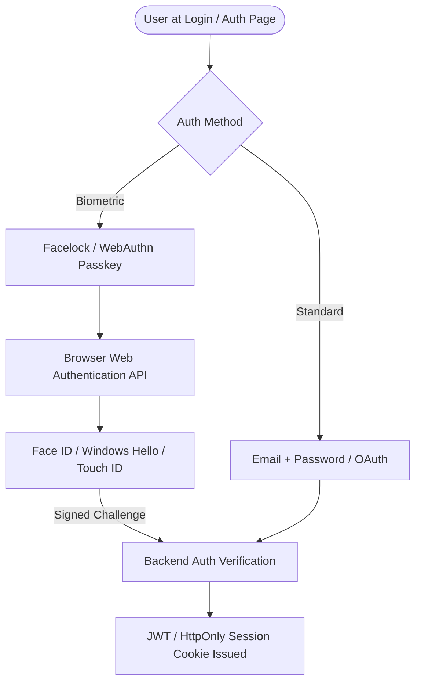

# Module Specification: Authentication & Biometric Facelock Engine

> **PURPOSE**: Combines industry-standard authentication (Email/Password, OAuth, Magic Links) with cutting-edge **WebAuthn Biometric Passkeys (Windows Hello Face / Apple Face ID / Touch ID)** and client-side Face Detection for high-security actions.

---

## 🔐 1. Authentication Architecture Overview



---

## 👁️ 2. Facelock & Biometrics: Two Implementation Tiers

### Tier 1: Hardware WebAuthn Passkeys (Recommended for Enterprise)
Uses browser-native `navigator.credentials.create()` and `navigator.credentials.get()`.
- **Supported Sensors**: Windows Hello (Face camera), Apple Face ID, Touch ID, Android Biometrics, YubiKey.
- **Benefits**: Zero password vulnerabilities, phish-proof cryptographic public-key signatures, zero face image storage on server.

### Tier 2: WebRTC Face Verification (Kiosk / Staff Punch-in)
Uses the device webcam via WebRTC and client-side landmark models (e.g., MediaPipe Face Mesh / face-api.js).
- **Best for**: Employee clock-in terminal or kiosk storefront order verification.

---

## 💻 3. WebAuthn Facelock Frontend Implementation

```typescript
// lib/facelock.ts
export async function registerBiometricPasskey(userId: string, email: string) {
  if (!window.PublicKeyCredential) {
    throw new Error("Biometric authentication is not supported on this device/browser.");
  }

  // 1. Get registration challenge from backend
  const res = await fetch("/api/auth/webauthn/register-challenge", { method: "POST" });
  const { challenge, rp } = await res.json();

  // 2. Invoke device biometric sensor (Face ID / Windows Hello)
  const credential = (await navigator.credentials.create({
    publicKey: {
      challenge: Uint8Array.from(atob(challenge), (c) => c.charCodeAt(0)),
      rp: { name: rp.name, id: window.location.hostname },
      user: {
        id: Uint8Array.from(userId, (c) => c.charCodeAt(0)),
        name: email,
        displayName: email.split("@")[0],
      },
      pubKeyCredParams: [
        { alg: -7, type: "public-key" },  // ES256
        { alg: -257, type: "public-key" } // RS256
      ],
      authenticatorSelection: {
        authenticatorAttachment: "platform", // Enforces built-in sensor (Face/Fingerprint)
        userVerification: "required",
      },
      timeout: 60000,
    },
  })) as PublicKeyCredential;

  // 3. Send public key credential back to backend to store
  return fetch("/api/auth/webauthn/register-verify", {
    method: "POST",
    headers: { "Content-Type": "application/json" },
    body: JSON.stringify({ credential }),
  });
}

export async function loginWithBiometrics() {
  // 1. Get login challenge
  const res = await fetch("/api/auth/webauthn/login-challenge", { method: "POST" });
  const { challenge } = await res.json();

  // 2. Trigger Face Scan / Biometric prompt
  const assertion = await navigator.credentials.get({
    publicKey: {
      challenge: Uint8Array.from(atob(challenge), (c) => c.charCodeAt(0)),
      timeout: 60000,
      userVerification: "required",
    },
  });

  // 3. Verify signature with backend
  const verifyRes = await fetch("/api/auth/webauthn/login-verify", {
    method: "POST",
    headers: { "Content-Type": "application/json" },
    body: JSON.stringify({ assertion }),
  });

  return verifyRes.json();
}
```

---

## 🎨 4. Facelock Login Button UI (`FacelockButton.tsx`)

```tsx
import React, { useState } from "react";
import { loginWithBiometrics } from "@/lib/facelock";
import styles from "./FacelockButton.module.css";

export const FacelockButton: React.FC<{ onSuccess: () => void }> = ({ onSuccess }) => {
  const [scanning, setScanning] = useState(false);
  const [error, setError] = useState<string | null>(null);

  const handleFaceScan = async () => {
    try {
      setScanning(true);
      setError(null);
      await loginWithBiometrics();
      onSuccess();
    } catch (err: any) {
      setError(err.message || "Face recognition verification failed.");
    } finally {
      setScanning(false);
    }
  };

  return (
    <div className={styles.container}>
      <button
        id="facelock-biometric-login-btn"
        className={`${styles.faceBtn} ${scanning ? styles.scanningPulse : ""}`}
        onClick={handleFaceScan}
        disabled={scanning}
      >
        <span className={styles.faceIcon}>👤</span>
        {scanning ? "Scanning Face / Biometrics..." : "Sign in with Face ID / Windows Hello"}
      </button>
      {error && <p className={styles.errorText}>{error}</p>}
    </div>
  );
};
```

---

## 🛡️ 5. Step-Up Verification for Sensitive Actions

Biometric verification can also be triggered as a **modal confirmation** when an Owner or Admin attempts high-risk operations:
- Overriding high-value order discounts.
- Issuing customer refunds.
- Exporting complete company customer databases.
