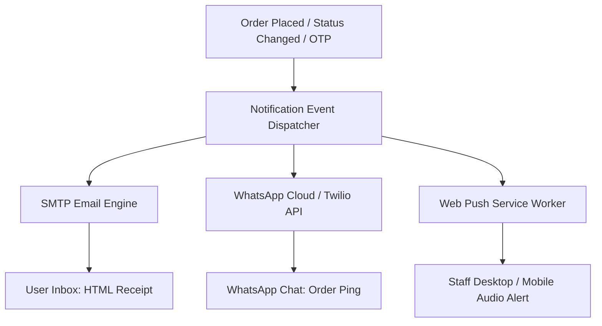

# Module Specification: Automations, Notifications & CI/CD Pipelines

> **PURPOSE**: Standardizes transactional email delivery (SMTP), WhatsApp Business automations, real-time Web Push alerts, and automated GitHub Actions CI/CD workflows.

---

## 📡 1. Multi-Channel Notification Hub



---

## ✉️ 2. Channel 1: SMTP Transactional Email

### 2.1 Backend Dispatcher (FastAPI Python Example)
```python
import aiosmtplib
from email.message import EmailMessage
import os

async def send_transactional_email(to_email: str, subject: str, html_body: str):
    message = EmailMessage()
    message["From"] = os.getenv("SMTP_FROM_EMAIL", "notifications@platform.com")
    message["To"] = to_email
    message["Subject"] = subject
    message.set_content(html_body, subtype="html")

    await aiosmtplib.send(
        message,
        hostname=os.getenv("SMTP_HOST", "smtp.resend.com"),
        port=int(os.getenv("SMTP_PORT", 465)),
        username=os.getenv("SMTP_USERNAME"),
        password=os.getenv("SMTP_PASSWORD"),
        use_tls=True
    )
```

---

## 💬 3. Channel 2: WhatsApp Business Automation

### 3.1 Use Cases:
- Instant notification when customer places an order.
- Status update ping when Staff marks order as "Shipped" or "Out for Delivery".
- Low-stock alert sent directly to the Owner's WhatsApp.

### 3.2 WhatsApp Cloud API Dispatcher (TypeScript / Node)
```typescript
export async function sendWhatsAppMessage(toPhone: string, messageText: string) {
  const token = process.env.WHATSAPP_API_TOKEN;
  const phoneNumberId = process.env.WHATSAPP_PHONE_NUMBER_ID;

  if (!token || !phoneNumberId) {
    console.warn("WhatsApp credentials missing; skipping message dispatch.");
    return;
  }

  const url = `https://graph.facebook.com/v18.0/${phoneNumberId}/messages`;
  
  const response = await fetch(url, {
    method: "POST",
    headers: {
      Authorization: `Bearer ${token}`,
      "Content-Type": "application/json",
    },
    body: JSON.stringify({
      messaging_product: "whatsapp",
      recipient_type: "individual",
      to: toPhone.replace(/[^0-9]/g, ""),
      type: "text",
      text: { preview_url: false, body: messageText },
    }),
  });

  return response.json();
}
```

---

## 🔔 4. Channel 3: Real-Time Web Push Alerts

Allows kitchen or warehouse staff to receive desktop sound alerts even when the browser tab is in the background:
- Registers a Service Worker (`sw.js`).
- Subscribes via VAPID public key.
- Dispatches push payload with audio chime on incoming order.

---

## 🚀 5. Automated GitHub Actions CI/CD Architecture

> **MANDATORY AUTOMATION STANDARD**:  
> All project builds, linting, type checking, automated testing, and deployments **MUST be driven via GitHub Actions workflows**. The pipeline must accommodate both Single Monoliths and Dual-Project setups (`frontend/` + `backend/`).

### 5.1 Comprehensive Multi-Stage Pipeline (`.github/workflows/ci-cd.yml`)

```yaml
name: CI/CD Master Pipeline (Lint, Test, Build & Deploy)

on:
  push:
    branches: [ main, develop ]
  pull_request:
    branches: [ main ]
  workflow_dispatch:

concurrency:
  group: ${{ github.workflow }}-${{ github.ref }}
  cancel-in-progress: true

jobs:
  # =========================================================================
  # 1. FRONTEND WORKFLOW (Next.js Application)
  # =========================================================================
  frontend-check:
    name: Frontend (Next.js) - Lint, Typecheck & Test
    runs-on: ubuntu-latest
    defaults:
      run:
        working-directory: ${{ hashFiles('frontend/package.json') != '' && 'frontend' || '.' }}

    steps:
      - name: Checkout Repository
        uses: actions/checkout@v4

      - name: Setup Node.js Runtime
        uses: actions/setup-node@v4
        with:
          node-version: 20
          cache: 'npm'
          cache-dependency-path: ${{ hashFiles('frontend/package-lock.json') != '' && 'frontend/package-lock.json' || 'package-lock.json' }}

      - name: Install Node Dependencies
        run: npm ci

      - name: ESLint & Code Formatting
        run: npm run lint

      - name: TypeScript Static Typecheck
        run: npx tsc --noEmit

      - name: Run Frontend Unit & Component Tests
        run: npm test --if-present

      - name: Next.js Production Build Validation
        env:
          NEXT_PUBLIC_API_URL: ${{ secrets.NEXT_PUBLIC_API_URL || 'https://api.example.com' }}
        run: npm run build

  # =========================================================================
  # 2. BACKEND WORKFLOW (Dedicated Next.js API or Python FastAPI)
  # =========================================================================
  backend-check:
    name: Backend API - Quality & Test Gate
    runs-on: ubuntu-latest

    steps:
      - name: Checkout Repository
        uses: actions/checkout@v4

      # --- Case A: Dedicated Next.js Backend ---
      - name: Setup Node for Backend (if Next.js Backend)
        if: hashFiles('backend/package.json') != ''
        uses: actions/setup-node@v4
        with:
          node-version: 20
          cache: 'npm'
          cache-dependency-path: backend/package-lock.json

      - name: Install Backend Node Dependencies
        if: hashFiles('backend/package.json') != ''
        working-directory: backend
        run: npm ci

      - name: Backend Typecheck & Build (if Next.js Backend)
        if: hashFiles('backend/package.json') != ''
        working-directory: backend
        run: |
          npx tsc --noEmit
          npm run build

      # --- Case B: Python FastAPI Backend ---
      - name: Setup Python Runtime (if FastAPI Backend)
        if: hashFiles('backend/requirements.txt') != ''
        uses: actions/setup-python@v5
        with:
          python-version: '3.11'
          cache: 'pip'
          cache-dependency-path: backend/requirements.txt

      - name: Install Python Dependencies
        if: hashFiles('backend/requirements.txt') != ''
        run: |
          python -m pip install --upgrade pip
          pip install -r backend/requirements.txt
          pip install pytest ruff

      - name: Python Linting (Ruff)
        if: hashFiles('backend/requirements.txt') != ''
        run: ruff check backend/

      - name: Run Pytest Suite
        if: hashFiles('backend/requirements.txt') != ''
        run: pytest backend/tests

  # =========================================================================
  # 3. SECURITY & DEPENDENCY AUDIT
  # =========================================================================
  security-audit:
    name: Security & Vulnerability Scan
    runs-on: ubuntu-latest
    steps:
      - name: Checkout Repository
        uses: actions/checkout@v4

      - name: Node Security Audit
        run: npm audit --audit-level=high || true

  # =========================================================================
  # 4. DEPLOYMENT GATE (Triggers only when main branch & tests pass)
  # =========================================================================
  deploy:
    name: Production Deployment Gate
    needs: [ frontend-check, backend-check, security-audit ]
    if: github.ref == 'refs/heads/main' && github.event_name == 'push'
    runs-on: ubuntu-latest

    steps:
      - name: Checkout Code
        uses: actions/checkout@v4

      - name: Deployment Trigger
        run: |
          echo "All automated tests and security gates passed successfully."
          echo "Triggering automated production deployment..."
```

---

## 🛡️ 6. Verification & Best Practices

1. [ ] **GitHub Actions Tested**: Pipelines trigger on PR and push to `main` without manual interventions.
2. [ ] **Dual-Project Matrix Verified**: Both `frontend/` and `backend/` jobs execute in parallel with proper dependency caching.
3. [ ] **Secrets Safeguarded**: All production API tokens (`WHATSAPP_API_TOKEN`, `SMTP_PASSWORD`) are loaded strictly via GitHub Secrets (`${{ secrets.VAR }}`), never hardcoded.

