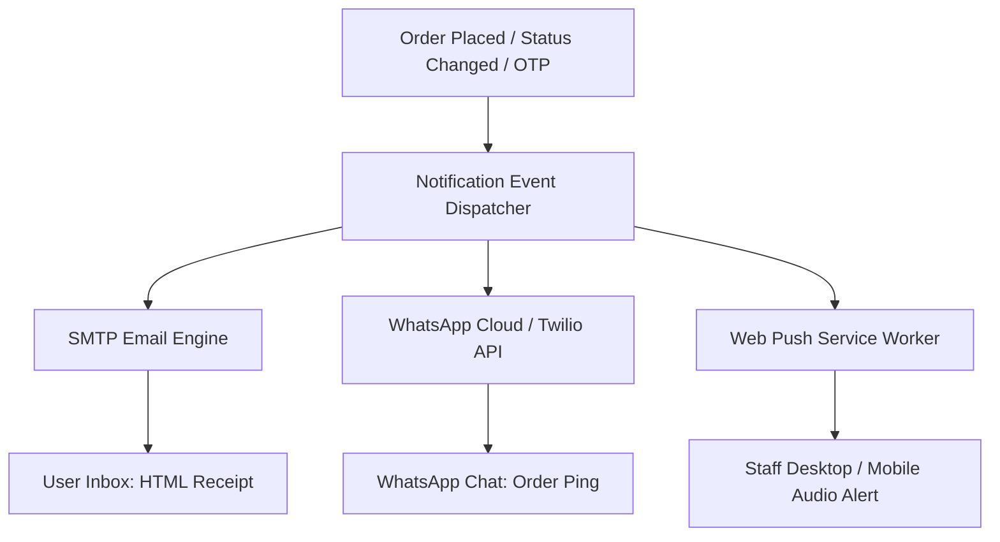

# Module Specification: Automations, Notifications & CI/CD Pipelines

> **PURPOSE**: Standardizes transactional email delivery (SMTP), WhatsApp Business automations, real-time Web Push alerts, and automated GitHub Actions CI/CD workflows.

---

## 📡 1. Multi-Channel Notification Hub



---

## ✉️ 2. Channel 1: SMTP Transactional Email

### 2.1 Backend Dispatcher (FastAPI Python Example)
```python
import aiosmtplib
from email.message import EmailMessage
import os

async def send_transactional_email(to_email: str, subject: str, html_body: str):
    message = EmailMessage()
    message["From"] = os.getenv("SMTP_FROM_EMAIL", "notifications@platform.com")
    message["To"] = to_email
    message["Subject"] = subject
    message.set_content(html_body, subtype="html")

    await aiosmtplib.send(
        message,
        hostname=os.getenv("SMTP_HOST", "smtp.resend.com"),
        port=int(os.getenv("SMTP_PORT", 465)),
        username=os.getenv("SMTP_USERNAME"),
        password=os.getenv("SMTP_PASSWORD"),
        use_tls=True
    )
```

---

## 💬 3. Channel 2: WhatsApp Business Automation

### 3.1 Use Cases:
- Instant notification when customer places an order.
- Status update ping when Staff marks order as "Shipped" or "Out for Delivery".
- Low-stock alert sent directly to the Owner's WhatsApp.

### 3.2 WhatsApp Cloud API Dispatcher (TypeScript / Node)
```typescript
export async function sendWhatsAppMessage(toPhone: string, messageText: string) {
  const token = process.env.WHATSAPP_API_TOKEN;
  const phoneNumberId = process.env.WHATSAPP_PHONE_NUMBER_ID;

  if (!token || !phoneNumberId) {
    console.warn("WhatsApp credentials missing; skipping message dispatch.");
    return;
  }

  const url = `https://graph.facebook.com/v18.0/${phoneNumberId}/messages`;
  
  const response = await fetch(url, {
    method: "POST",
    headers: {
      Authorization: `Bearer ${token}`,
      "Content-Type": "application/json",
    },
    body: JSON.stringify({
      messaging_product: "whatsapp",
      recipient_type: "individual",
      to: toPhone.replace(/[^0-9]/g, ""),
      type: "text",
      text: { preview_url: false, body: messageText },
    }),
  });

  return response.json();
}
```

---

## 🔔 4. Channel 3: Real-Time Web Push Alerts

Allows kitchen or warehouse staff to receive desktop sound alerts even when the browser tab is in the background:
- Registers a Service Worker (`sw.js`).
- Subscribes via VAPID public key.
- Dispatches push payload with audio chime on incoming order.

---

## 🚀 5. Automated GitHub Actions CI/CD Pipeline

Place inside `.github/workflows/deploy.yml`:

```yaml
name: Test, Build & Deploy Pipeline

on:
  push:
    branches: [ main ]
  pull_request:
    branches: [ main ]

jobs:
  validate:
    name: Lint & Build Validation
    runs-on: ubuntu-latest

    steps:
      - name: Checkout Code
        uses: actions/checkout@v4

      - name: Setup Node.js
        uses: actions/setup-node@v4
        with:
          node-version: 20
          cache: 'npm'

      - name: Install Dependencies
        run: npm ci

      - name: Type Check & Lint
        run: npm run build

      - name: Backend Tests (if Python)
        if: hashFiles('backend/requirements.txt') != ''
        run: |
          python -m pip install --upgrade pip
          pip install -r backend/requirements.txt
          pytest backend/tests
```
