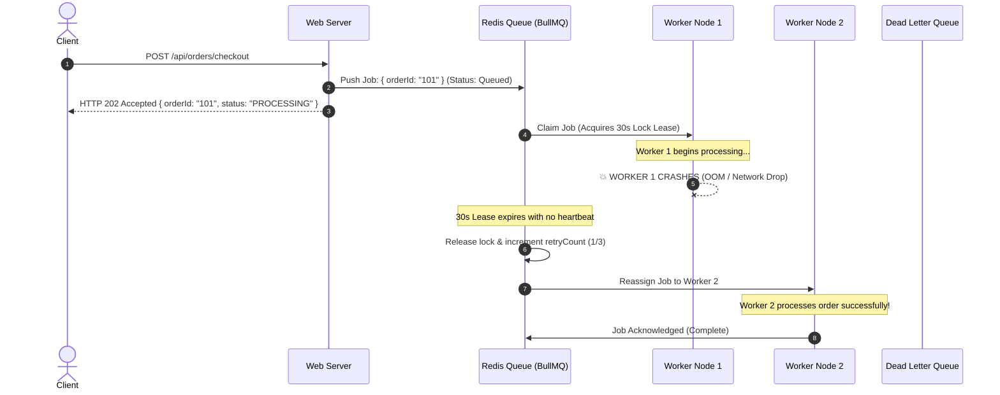
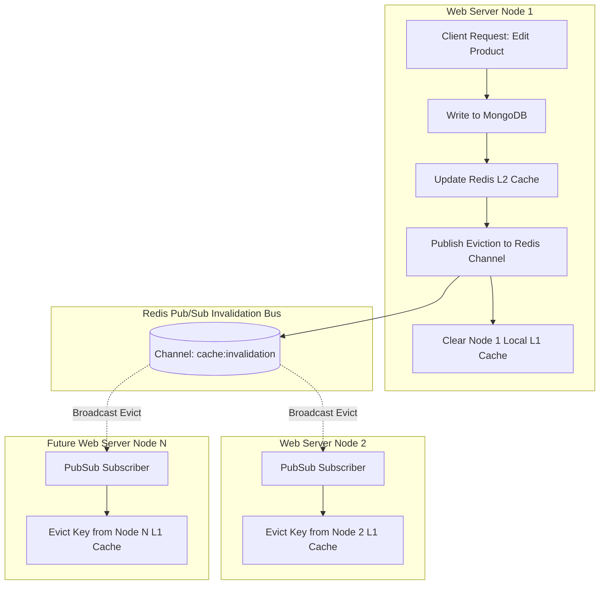

# Module Specification: Enterprise Backend Scaling, Worker Queue Failover & Circuit Breaker Architecture

> **PURPOSE**: Defines the definitive, production-grade backend engineering blueprint for capacity planning, horizontal scaling, worker queue crash recovery, multi-server distributed cache invalidation, and payment circuit breaker resilience. Built to scale incrementally from an MVP (<10k users) to millions of concurrent requests without over-engineering or single points of failure.

---

## 🏛️ 1. Master System Topology & Data Flow

```
                                  [ INTERNET TRAFFIC ]
                                            │
                                            ▼
                           ┌─────────────────────────────────┐
                           │      EDGE & LOAD BALANCER       │
                           │   • Cloudflare WAF / SSL        │
                           │   • AWS ALB / Nginx Reverse     │
                           │   • Round-Robin / Health Probes │
                           └────────────────┬────────────────┘
                                            │
                 ┌──────────────────────────┴──────────────────────────┐
                 ▼                                                     ▼
   ┌──────────────────────────┐                          ┌──────────────────────────┐
   │    WEB SERVER NODE 1     │                          │    WEB SERVER NODE 2     │
   │ • Next.js App / FastAPI  │                          │ • Next.js App / FastAPI  │
   │ • L1 In-Memory LRU Cache │                          │ • L1 In-Memory LRU Cache │
   │ • Circuit Breakers       │                          │ • Circuit Breakers       │
   └─────────────┬────────────┘                          └─────────────┬────────────┘
                 │                                                     │
                 └──────────────────────────┬──────────────────────────┘
                                            │
               ┌────────────────────────────┼────────────────────────────┐
               ▼                            ▼                            ▼
┌─────────────────────────────┐ ┌───────────────────────┐ ┌─────────────────────────────┐
│    DISTRIBUTED L2 CACHE     │ │     WORKER QUEUE      │ │      DATABASE LAYER       │
│ • Redis Cluster             │ │ • BullMQ / Streams    │ │ • MongoDB Atlas Cluster   │
│ • Pub/Sub Invalidation Bus  │ │ • 30s Heartbeat Lease │ │ • Primary Write Node      │
│ • Session & Rate-Limit Keys │ │ • Auto-Failover Lease │ │ • Read Replicas (Tier 3)  │
└─────────────────────────────┘ └───────────┬───────────┘ └─────────────────────────────┘
                                            │
                                            ▼
                               ┌─────────────────────────┐
                               │   WORKER POOL CLUSTER   │
                               │ • Worker 1 (Active)     │
                               │ • Worker 2 (Active)     │
                               │ • Dead Letter Queue     │
                               └─────────────────────────┘
```

---

## 📊 2. The 3-Tier Progressive Capacity & User Sizing Matrix

To prevent premature optimization at launch while ensuring zero architectural rewrites when traffic explodes, all infrastructure is governed by 3 distinct scale tiers:

| Scale Metric | **Tier 1: Launch / Startup** | **Tier 2: Growth / Scale** | **Tier 3: Enterprise / Peak** |
| :--- | :--- | :--- | :--- |
| **Active Users** | `< 10,000` registered users | `10,000 – 100,000` users | `100,000 – 1,000,000+` users |
| **Throughput** | `< 100 Requests/Sec (RPS)` | `100 – 1,000 RPS` | `1,000 – 10,000+ RPS` |
| **Load Balancing** | Direct DNS / Vercel Edge | Single ALB / Nginx (Multi-AZ) | Multi-Region Anycast DNS + ALB Pool |
| **Compute Nodes** | 1–2 Web Instances (Auto-heal) | 2–6 Auto-scaling Web Nodes | 10–50+ Web Instances / ECS / K8s |
| **Caching Layer** | L1 In-Memory (Node LRU) only | L1 Memory + Single Redis (L2) | L1 Memory + Redis Cluster (Pub/Sub) |
| **Background Tasks**| In-Process Async Worker Pool | BullMQ (Redis) + 2 Dedicated Workers | Auto-scaling Worker Pool + DLQ + Alert |
| **Database** | MongoDB Single Replica Set | MongoDB 3-Node Replica Set | Sharded MongoDB / Read Replicas |
| **Circuit Breakers**| In-Memory Circuit Breaker | Shared Redis Circuit Breaker | Distributed Adaptive Circuit Breaker |

### 2.1 Scale Transition Rules:
1. **Tier 1 ➔ Tier 2 Trigger**: When sustained throughput exceeds `80 RPS` or concurrent background tasks exceed 5 concurrent threads, enable `REDIS_URL` in `.env` and spin up independent worker processes.
2. **Tier 2 ➔ Tier 3 Trigger**: When CPU utilization on Redis exceeds `65%` or single-node database reads throttle write transactions, transition Redis to Redis Cluster mode and configure read preferences to secondary nodes (`readPreference=secondaryPreferred`).

---

## ⚙️ 3. BullMQ Worker Queue & Automated Worker Crash Recovery

When servers experience high load or compute-heavy tasks (order processing, invoice PDF rendering, email dispatch, video transcodes), tasks **must never execute inside HTTP request-response cycles**.

### 3.1 The 30-Second Heartbeat Lease & Failover Reassignment
If Worker A experiences an Out-Of-Memory (OOM) crash, physical server reboot, or drops connection mid-execution:
1. **Heartbeat Lease**: When Worker A claims a job, it acquires a **30-second lease** in Redis.
2. **Periodic Heartbeat**: While running, Worker A renews the lease every 10 seconds via `job.progress()`.
3. **Automated Failover Release**:
   - If Worker A crashes, its heartbeat stops.
   - After 30 seconds, the Redis lock expires automatically.
   - The BullMQ queue supervisor recognizes the abandoned task, marks Worker A as dead, and **instantly returns the job to the active queue**.
   - Worker B claims the task and resumes execution without data loss.
4. **Retry & Dead-Letter Queue (DLQ)**:
   - Max Retries: **3 attempts** with exponential backoff (`2s, 8s, 32s`).
   - If a poisonous job crashes 3 consecutive workers, it is automatically quarantined into the **Dead Letter Queue (`orders-dlq`)** and dispatches an alert to developers.



### 3.2 Production Queue & Worker Implementation (`lib/queue/orderQueue.ts`)

```typescript
// lib/queue/orderQueue.ts
import { Queue, Worker, QueueEvents, Job } from "bullmq";
import Redis from "ioredis";

const redisConnection = new Redis(process.env.REDIS_URL || "redis://localhost:6379", {
  maxRetriesPerRequest: null,
  enableReadyCheck: false,
});

export const ORDER_QUEUE_NAME = "order-processing-queue";

// 1. The Producer Queue
export const orderQueue = new Queue(ORDER_QUEUE_NAME, {
  connection: redisConnection,
  defaultJobOptions: {
    attempts: 3, // Retry up to 3 times on worker crash
    backoff: {
      type: "exponential",
      delay: 2000, // 2s, 4s, 8s
    },
    removeOnComplete: { age: 3600, count: 1000 }, // Keep last 1000 for audit
    removeOnFail: false, // Keep in failed state for DLQ audit
  },
});

// 2. The Fail-Safe Worker Engine
export function startOrderWorker() {
  const worker = new Worker(
    ORDER_QUEUE_NAME,
    async (job: Job) => {
      console.log(`[Worker] Processing Job ${job.id} for Order ${job.data.orderId}`);

      // Emit heartbeat every 10s to maintain the 30s lock lease
      const heartbeatInterval = setInterval(async () => {
        await job.updateProgress({ timestamp: Date.now(), status: "HEALTHY" });
      }, 10000);

      try {
        // Execute real business task
        const result = await processOrderBusinessLogic(job.data);
        return result;
      } finally {
        clearInterval(heartbeatInterval);
      }
    },
    {
      connection: redisConnection,
      concurrency: 5,               // 5 concurrent jobs per worker thread
      lockDuration: 30000,          // 30-second heartbeat lease
      stalledInterval: 15000,       // Check for crashed workers every 15s
      maxStalledCount: 3,           // If stalled 3 times, fail to DLQ
    }
  );

  worker.on("failed", (job, err) => {
    console.error(`[Worker Alert] Job ${job?.id} failed on attempt ${job?.attemptsMade}: ${err.message}`);
    if (job && job.attemptsMade >= 3) {
      console.error(`[DLQ CRITICAL] Job ${job.id} routed to Dead Letter Queue! Notify On-Call.`);
    }
  });

  return worker;
}

async function processOrderBusinessLogic(data: { orderId: string; userId: string; items: any[] }) {
  // Simulate order stock reservation and payment handshake
  return { success: true, processedAt: new Date().toISOString() };
}
```

---

## 🚀 4. Multi-Server Distributed Caching & Invalidation Architecture

In multi-server deployments (Tier 2 & 3), querying databases repeatedly creates bottlenecks. However, caching data locally in memory on individual servers causes **Stale Cache Inconsistencies** (e.g. Server 1 updates a product price, but Server 2 still serves the old price to users).

### 4.1 The Two-Tier (L1 + L2) Cache Topology with Pub/Sub Invalidation
- **L1 Cache (Local In-Memory LRU on each Node)**:
  - Latency: `< 0.1ms` (zero network latency).
  - Max Size: 50MB (5,000 hot keys per web node).
- **L2 Cache (Centralized Redis Cluster)**:
  - Latency: `1–3ms`.
  - Shared across all web nodes.
- **The Invalidation Bus (`cache:invalidation:channel`)**:
  - When Server 1 mutates an entity (e.g. `order:update` or `product:update`), Server 1 writes to MongoDB, updates L2 Redis, and **broadcasts an eviction event** to the Redis Pub/Sub channel.
  - All existing nodes (Server 2, Server 3, Server N) receive the message and purge the key from their local L1 memory in `< 5ms`.
  - When a new server node spins up, it starts with a clean cold L1 cache, fetches fresh records from L2 Redis on demand, and subscribes to the invalidation channel. **Zero peer-to-peer data copying needed.**



### 4.2 Production Two-Tier Synchronized Cache (`lib/cache/twoTierCache.ts`)

```typescript
// lib/cache/twoTierCache.ts
import Redis from "ioredis";

const redisClient = new Redis(process.env.REDIS_URL || "redis://localhost:6379");
const pubClient = new Redis(process.env.REDIS_URL || "redis://localhost:6379");
const subClient = new Redis(process.env.REDIS_URL || "redis://localhost:6379");

const CHANNEL_NAME = "cache:invalidation:channel";

// 1. Local Node In-Memory L1 Cache
class LocalL1Cache {
  private store = new Map<string, { value: any; expiresAt: number }>();

  get(key: string): any | null {
    const item = this.store.get(key);
    if (!item) return null;
    if (Date.now() > item.expiresAt) {
      this.store.delete(key);
      return null;
    }
    return item.value;
  }

  set(key: string, value: any, ttlSec: number): void {
    if (this.store.size > 5000) {
      // LRU Eviction: delete oldest key
      const oldestKey = this.store.keys().next().value;
      if (oldestKey) this.store.delete(oldestKey);
    }
    this.store.set(key, { value, expiresAt: Date.now() + ttlSec * 1000 });
  }

  delete(key: string): void {
    this.store.delete(key);
  }
}

const localL1 = new LocalL1Cache();

// 2. Initialize Invalidation Bus Subscriber
if (typeof window === "undefined") {
  subClient.subscribe(CHANNEL_NAME, (err) => {
    if (err) console.error("[CacheBus] Subscribe error:", err);
  });

  subClient.on("message", (channel, message) => {
    if (channel === CHANNEL_NAME) {
      try {
        const { key } = JSON.parse(message);
        localL1.delete(key); // Evict from local memory immediately!
      } catch (err) {}
    }
  });
}

// 3. The Unified Multi-Tier Cache API
export const twoTierCache = {
  async get<T>(key: string): Promise<T | null> {
    // Check L1 In-Memory (<0.1ms)
    const l1Result = localL1.get(key);
    if (l1Result !== null) return l1Result as T;

    // Check L2 Redis (1-3ms)
    const l2Raw = await redisClient.get(key);
    if (l2Raw) {
      try {
        const parsed = JSON.parse(l2Raw);
        localL1.set(key, parsed, 60); // Populate L1 for 60s
        return parsed as T;
      } catch {
        return null;
      }
    }

    return null;
  },

  async set(key: string, value: any, ttlSec: number = 300): Promise<void> {
    const payload = JSON.stringify(value);
    // Write to L2 Redis
    await redisClient.set(key, payload, "EX", ttlSec);
    // Write to local L1
    localL1.set(key, value, Math.min(ttlSec, 60));
    // Broadcast invalidation to all other server nodes
    await pubClient.publish(CHANNEL_NAME, JSON.stringify({ key }));
  },

  async invalidate(key: string): Promise<void> {
    await redisClient.del(key);
    localL1.delete(key);
    await pubClient.publish(CHANNEL_NAME, JSON.stringify({ key }));
  },
};
```

---

## ⚡ 5. E-Commerce Order-to-Payment Circuit Breaker Architecture

In an e-commerce platform, when an external payment gateway (Stripe, PayPal, Bank API) experiences an outage, slow database locks, or high latency:
- **The Problem Without Circuit Breaker**: Hundreds of checkout requests pile up, holding web threads open for 15–30 seconds until server memory is exhausted, bringing down the entire website. Users receive frightening `"Payment Failed"` messages even though their card wasn't charged.
- **The Solution With Circuit Breaker**: The system trips to **OPEN** in `< 2ms`, fast-fails gracefully, holds the order in a safe `PENDING_PAYMENT_RETRY` state, and presents a reassuring user notice:
  > *"Payment service is temporarily experiencing high traffic. Your order is safely reserved; please try completing payment in a few moments."*

### 5.1 The 3-State Circuit Breaker State Machine

```mermaid
stateDiagram-v2
    [*] --> Closed: Initial State (Normal Traffic)
    
    Closed --> Open: 50% Failures over 10 Requests OR 3 Consecutive Timeouts
    Note over Open: Fast-Fail in <2ms. Preserves order in PENDING_RETRY. No external calls!
    
    Open --> HalfOpen: 30-Second Cooldown Elapsed
    
    state HalfOpen {
        [*] --> CanaryProbe: Send 1 Trial Request to Gateway
        CanaryProbe --> CanarySuccess: Trial Call Succeeded
        CanaryProbe --> CanaryFail: Trial Call Failed / Timed Out
    }
    
    CanarySuccess --> Closed: Circuit Resets to Normal
    CanaryFail --> Open: Circuit Trips Back to Open (30s Cooldown)
```

### 5.2 Production Circuit Breaker Implementation (`lib/resilience/circuitBreaker.ts`)

```typescript
// lib/resilience/circuitBreaker.ts
export type CircuitState = "CLOSED" | "OPEN" | "HALF_OPEN";

interface CircuitBreakerOptions {
  failureThresholdPercentage?: number; // e.g. 50%
  minRequests?: number;                 // Min samples before evaluating (e.g. 10)
  timeoutMs?: number;                   // Execution timeout (e.g. 8000ms)
  cooldownPeriodMs?: number;            // Time to stay OPEN before HALF_OPEN (e.g. 30000ms)
}

export class CircuitBreaker {
  private state: CircuitState = "CLOSED";
  private failureCount: number = 0;
  private totalRequests: number = 0;
  private nextAttemptAt: number = 0;

  constructor(
    private serviceName: string,
    private options: CircuitBreakerOptions = {}
  ) {
    this.options.failureThresholdPercentage = options.failureThresholdPercentage ?? 50;
    this.options.minRequests = options.minRequests ?? 10;
    this.options.timeoutMs = options.timeoutMs ?? 8000;
    this.options.cooldownPeriodMs = options.cooldownPeriodMs ?? 30000;
  }

  getState(): CircuitState {
    if (this.state === "OPEN" && Date.now() >= this.nextAttemptAt) {
      this.state = "HALF_OPEN";
    }
    return this.state;
  }

  async execute<T>(action: () => Promise<T>, fallback: (error: any) => Promise<T>): Promise<T> {
    const currentState = this.getState();

    // 1. OPEN STATE: Fast-fail immediately without network calls
    if (currentState === "OPEN") {
      const waitSeconds = Math.ceil((this.nextAttemptAt - Date.now()) / 1000);
      const circuitError = new Error(
        `Payment service is temporarily degraded. Auto-recovering in ${waitSeconds}s.`
      );
      (circuitError as any).isCircuitOpen = true;
      (circuitError as any).retryAfter = waitSeconds;
      return await fallback(circuitError);
    }

    // 2. CLOSED or HALF_OPEN: Execute with timeout guard
    try {
      const timeoutPromise = new Promise<never>((_, reject) =>
        setTimeout(() => reject(new Error("Gateway call timed out")), this.options.timeoutMs)
      );

      const result = await Promise.race([action(), timeoutPromise]);
      this.onSuccess();
      return result;
    } catch (err) {
      this.onFailure();
      return await fallback(err);
    }
  }

  private onSuccess() {
    this.failureCount = 0;
    this.totalRequests = 0;
    this.state = "CLOSED";
  }

  private onFailure() {
    this.failureCount++;
    this.totalRequests++;

    if (this.state === "HALF_OPEN") {
      // Canary failed: Trip back to OPEN immediately
      this.tripOpen();
      return;
    }

    if (this.totalRequests >= this.options.minRequests!) {
      const failureRate = (this.failureCount / this.totalRequests) * 100;
      if (failureRate >= this.options.failureThresholdPercentage!) {
        this.tripOpen();
      }
    }
  }

  private tripOpen() {
    this.state = "OPEN";
    this.nextAttemptAt = Date.now() + this.options.cooldownPeriodMs!;
    console.warn(`[CircuitBreaker] Circuit for ${this.serviceName} TRIPPED to OPEN until ${new Date(this.nextAttemptAt).toISOString()}`);
  }
}
```

### 5.3 Order Processing with Circuit Breaker Integration (`app/api/orders/pay/route.ts`)

```typescript
// app/api/orders/pay/route.ts
import { NextResponse } from "next/server";
import { CircuitBreaker } from "@/lib/resilience/circuitBreaker";

const paymentCircuit = new CircuitBreaker("StripePaymentGateway", {
  failureThresholdPercentage: 50,
  minRequests: 5,
  timeoutMs: 6000,
  cooldownPeriodMs: 30000, // 30s cooldown
});

export async function POST(req: Request) {
  const { orderId, amount, customerEmail } = await req.json();

  const response = await paymentCircuit.execute(
    // 1. Primary Action: Call External Gateway
    async () => {
      const paymentResult = await callStripeApi(orderId, amount);
      return NextResponse.json({ success: true, payment: paymentResult });
    },

    // 2. Graceful Fallback: Circuit Breaker Open or Gateway Down
    async (error: any) => {
      // Preserve Order in Safe Held State (Zero Cart Loss)
      await updateOrderStatusInDb(orderId, "PENDING_PAYMENT_RETRY");

      return NextResponse.json(
        {
          success: false,
          isDegraded: true,
          code: "PAYMENT_GATEWAY_DEGRADED",
          retryAfter: error?.retryAfter || 30,
          message:
            "Payment service is temporarily experiencing high demand. Your order items have been securely reserved. Please try completing payment in a few moments.",
        },
        { status: 503 }
      );
    }
  );

  return response;
}

async function callStripeApi(orderId: string, amount: number) {
  // Real gateway fetch logic here
  return { transactionId: "txn_918231", status: "PAID" };
}

async function updateOrderStatusInDb(orderId: string, status: string) {
  // DB update logic
}
```

---

## 🔌 6. The "Safe Add / Safe Remove" Extensibility Protocol

To ensure that adding new features (e.g. adding Crypto payments, WhatsApp notifications, or an AI recommendation engine) or removing decommissioned modules **never breaks existing functionality**:

### 6.1 The Pluggable Service Contract (Interface Segregation & Adapter Pattern)
Every core capability is abstracted behind a typed interface. Code never imports vendor SDKs directly into business routes:

```typescript
// types/providers.ts
export interface IPaymentProvider {
  name: string;
  createPaymentIntent(orderId: string, amount: number): Promise<{ clientSecret: string }>;
  verifyWebhook(signature: string, payload: any): Promise<boolean>;
  refund(transactionId: string): Promise<boolean>;
}

// lib/providers/StripeAdapter.ts
export class StripeAdapter implements IPaymentProvider {
  name = "stripe";
  async createPaymentIntent(orderId: string, amount: number) { /* Stripe SDK */ return { clientSecret: "pi_..." }; }
  async verifyWebhook(signature: string, payload: any) { return true; }
  async refund(transactionId: string) { return true; }
}

// lib/providers/PayPalAdapter.ts (Future Add: Zero edits to Stripe code!)
export class PayPalAdapter implements IPaymentProvider {
  name = "paypal";
  async createPaymentIntent(orderId: string, amount: number) { /* PayPal SDK */ return { clientSecret: "order_..." }; }
  async verifyWebhook(signature: string, payload: any) { return true; }
  async refund(transactionId: string) { return true; }
}
```

### 6.2 The Safe Addition Runbook (Adding New Modules)
1. **Define Contract First**: Create interface in `types/` defining method signatures and expected payloads.
2. **Build Self-Contained Adapter**: Implement the adapter in `lib/providers/` without touching other modules.
3. **Register in Factory**: Add the adapter to the dependency injection factory (`PaymentProviderFactory.getProvider(type)`).
4. **Wrap in Feature Flag**: Guard the new route/action with a feature flag (`isEnabled("feature:module_name")`).
5. **Dry-Run Audit**: Verify that if the new module throws an exception, the host application continues running cleanly.

### 6.3 The Safe Removal Runbook (Decommissioning Modules)
1. **Audit Dependency Graph**: Grep codebase to verify that no core business logic imports from the module's private files.
2. **Toggle Feature Flag to `false`**: Deactivate the module in System Settings; confirm UI elements unmount cleanly (Zero-Leak Guarantee).
3. **Swap with No-Op Fallback**: If other code requires a return type, install a `NullProvider` returning `{ success: false, disabled: true }`.
4. **Prune Route Handlers**: Unmount API routes.
5. **Archive Module Directory**: Delete module files without leaving dangling references or orphan variables.

---

## 🛡️ 7. Master Backend Verification Checklist

- [ ] **Capacity Tier Verified**: Active stack strictly matches user volume (Tier 1, 2, or 3) with zero unnecessary infra overhead.
- [ ] **Load Balancer Health Check Verified**: Web nodes expose `GET /api/health` returning `200 OK` in `< 10ms`.
- [ ] **BullMQ 30s Heartbeat Verified**: In-flight jobs renew lease every 10s; simulating a worker SIGKILL causes job to reassign to a surviving worker within 30s.
- [ ] **DLQ Quarantining Verified**: Jobs failing 3 times route to Dead Letter Queue without stalling active workers.
- [ ] **L1/L2 Pub/Sub Eviction Verified**: Updating an item on Server 1 publishes an eviction event that purges local L1 memory on Server 2 within 5ms.
- [ ] **Circuit Breaker Fast-Fail Verified**: Under 50% simulated gateway failures, circuit trips to OPEN; requests return HTTP 503 in `< 2ms`.
- [ ] **User-Friendly Degradation Verified**: Tripped circuit preserves order in `PENDING_PAYMENT_RETRY` and displays "Try again shortly" instead of "Payment Failed".
- [ ] **Pluggable Adapter Verified**: Payment/Notification providers implement interfaces, allowing new providers to be added or old ones removed with zero changes to checkout logic.
