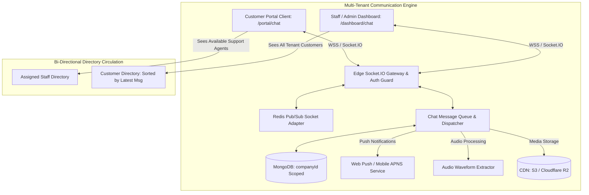

# Module Specification: Real-Time Omni-Chat & Customer Portal Communication Engine

> **PURPOSE**: Establishes the complete enterprise-grade, real-time messaging architecture connecting Customers (via Customer Portal) and Internal Team Members (Staff, Support, Account Managers, Admins) via WebSockets (Socket.IO). Enforces WhatsApp-style delivery states, real-time audio waveform voice notes, in-chat bespoke media viewers (with YouTube-style shortcuts and inline PDF inspection), contextual emoji reactions, message starring/editing/deletion, and zero-bloat micro-layout aesthetics.

---

## 🏛️ 1. Architecture & Real-Time Topology

The Chat System operates as a high-concurrency, event-driven communications hub. State and history persist in **MongoDB** collections strictly scoped to the tenant (`companyId: mongoose.Types.ObjectId`), while active live events stream over persistent WebSocket connections managed by **Socket.IO** (with Redis adapter for multi-instance scaling).



### 1.1 Multi-Tenant Room Partitioning
To guarantee zero data leaks between companies, rooms are dynamically keyed and cryptographically verified upon socket connection:
- **Conversation Room Key**: `room:chat:{companyId}:{conversationId}`
- **User Presence Room Key**: `room:presence:{companyId}:{userId}`
- **Tenant Broadcast Channel**: `channel:tenant:{companyId}`

---

## 🗄️ 2. Data Models & MongoDB Schemas

### 2.1 Conversation Thread Schema (`models/ChatConversation.ts`)
```typescript
import mongoose, { Schema, Document } from "mongoose";

export interface IChatConversation extends Document {
  companyId: mongoose.Types.ObjectId;
  customerId: mongoose.Types.ObjectId; // Reference to Customer
  assignedStaffIds: mongoose.Types.ObjectId[]; // Authorized staff assigned to this customer
  
  // Latest Message Metadata (Used for high-speed directory sorting)
  lastMessage: {
    messageId?: mongoose.Types.ObjectId;
    senderId: mongoose.Types.ObjectId;
    senderRole: "CUSTOMER" | "STAFF" | "ADMIN" | "OWNER" | "SYSTEM";
    contentPreview: string; // Truncated text or "[Voice Note 0:34]", "[Video]", "[Document]"
    messageType: "TEXT" | "VOICE" | "VIDEO" | "IMAGE" | "PDF" | "AUDIO" | "SYSTEM";
    timestamp: Date;
    status: "PENDING" | "SENT" | "DELIVERED" | "READ";
  };

  // Unread Badges per Participant
  unreadCounts: Map<string, number>; // Key: userId string -> Count of unread messages

  isArchived: boolean;
  isPinnedByStaff: mongoose.Types.ObjectId[]; // Staff IDs who pinned this conversation
  isStarredByUsers: mongoose.Types.ObjectId[];

  createdAt: Date;
  updatedAt: Date;
}

const ChatConversationSchema = new Schema<IChatConversation>(
  {
    companyId: { type: Schema.Types.ObjectId, ref: "Company", required: true, index: true },
    customerId: { type: Schema.Types.ObjectId, ref: "Customer", required: true, index: true },
    assignedStaffIds: [{ type: Schema.Types.ObjectId, ref: "User", index: true }],
    lastMessage: {
      messageId: { type: Schema.Types.ObjectId, ref: "ChatMessage" },
      senderId: { type: Schema.Types.ObjectId, required: true },
      senderRole: { 
        type: String, 
        enum: ["CUSTOMER", "STAFF", "ADMIN", "OWNER", "SYSTEM"], 
        required: true 
      },
      contentPreview: { type: String, default: "" },
      messageType: { 
        type: String, 
        enum: ["TEXT", "VOICE", "VIDEO", "IMAGE", "PDF", "AUDIO", "SYSTEM"], 
        default: "TEXT" 
      },
      timestamp: { type: Date, default: Date.now },
      status: { 
        type: String, 
        enum: ["PENDING", "SENT", "DELIVERED", "READ"], 
        default: "SENT" 
      },
    },
    unreadCounts: { type: Map, of: Number, default: {} },
    isArchived: { type: Boolean, default: false },
    isPinnedByStaff: [{ type: Schema.Types.ObjectId, ref: "User" }],
    isStarredByUsers: [{ type: Schema.Types.ObjectId }],
  },
  { timestamps: true }
);

// High-speed index for instant "Top of List" directory sorting
ChatConversationSchema.index({ companyId: 1, "lastMessage.timestamp": -1 });
ChatConversationSchema.index({ companyId: 1, customerId: 1 });
ChatConversationSchema.index({ companyId: 1, assignedStaffIds: 1 });

export const ChatConversation =
  mongoose.models.ChatConversation ||
  mongoose.model<IChatConversation>("ChatConversation", ChatConversationSchema);
```

---

### 2.2 Chat Message Schema (`models/ChatMessage.ts`)
```typescript
import mongoose, { Schema, Document } from "mongoose";

export interface IChatMessage extends Document {
  companyId: mongoose.Types.ObjectId;
  conversationId: mongoose.Types.ObjectId;
  
  senderId: mongoose.Types.ObjectId;
  senderRole: "CUSTOMER" | "STAFF" | "ADMIN" | "OWNER" | "SYSTEM";
  senderName: string;
  senderAvatarUrl?: string;

  recipientId?: mongoose.Types.ObjectId; // Target user or null for room broadcast

  messageType: "TEXT" | "VOICE" | "VIDEO" | "IMAGE" | "PDF" | "AUDIO" | "SYSTEM";
  content?: string; // Text content or caption

  // Media Attachment Specifications
  media?: {
    url: string; // Storage CDN URL
    fileName: string;
    fileSizeBytes: number;
    mimeType: string;
    dimensions?: { width: number; height: number }; // For image / video
    durationSeconds?: number; // For voice / video / audio
    thumbnailUrl?: string;
    
    // Voice Waveform Data Points (Array of normalized heights 0.0 - 1.0 for rendering)
    audioWaveform?: number[]; // e.g. [0.1, 0.4, 0.8, 0.6, 0.9, 0.3, ...]
  };

  // WhatsApp-Style Delivery Ticks
  status: "PENDING" | "SENT" | "DELIVERED" | "READ";
  sentAt: Date;
  deliveredAt?: Date;
  readAt?: Date;
  readBy: Array<{ userId: mongoose.Types.ObjectId; readAt: Date }>;

  // Contextual Reactions (Emoji Bar)
  reactions: Array<{
    userId: mongoose.Types.ObjectId;
    userRole: string;
    emoji: string; // e.g. "❤️", "👍", "😂", "😮", "😢", "🙏"
    createdAt: Date;
  }>;

  // Starred / Bookmarked
  starredBy: mongoose.Types.ObjectId[];

  // Message Moderation & Edits
  isEdited: boolean;
  editedAt?: Date;
  isDeletedForEveryone: boolean;
  deletedForUsers: mongoose.Types.ObjectId[]; // Soft-deleted for specific users

  createdAt: Date;
  updatedAt: Date;
}

const ChatMessageSchema = new Schema<IChatMessage>(
  {
    companyId: { type: Schema.Types.ObjectId, ref: "Company", required: true, index: true },
    conversationId: { type: Schema.Types.ObjectId, ref: "ChatConversation", required: true, index: true },
    senderId: { type: Schema.Types.ObjectId, required: true, index: true },
    senderRole: { 
      type: String, 
      enum: ["CUSTOMER", "STAFF", "ADMIN", "OWNER", "SYSTEM"], 
      required: true 
    },
    senderName: { type: String, required: true },
    senderAvatarUrl: String,
    recipientId: { type: Schema.Types.ObjectId },
    messageType: { 
      type: String, 
      enum: ["TEXT", "VOICE", "VIDEO", "IMAGE", "PDF", "AUDIO", "SYSTEM"], 
      default: "TEXT" 
    },
    content: { type: String, trim: true },
    media: {
      url: String,
      fileName: String,
      fileSizeBytes: Number,
      mimeType: String,
      dimensions: { width: Number, height: Number },
      durationSeconds: Number,
      thumbnailUrl: String,
      audioWaveform: [Number],
    },
    status: { 
      type: String, 
      enum: ["PENDING", "SENT", "DELIVERED", "READ"], 
      default: "SENT",
      index: true 
    },
    sentAt: { type: Date, default: Date.now },
    deliveredAt: Date,
    readAt: Date,
    readBy: [
      {
        userId: { type: Schema.Types.ObjectId, required: true },
        readAt: { type: Date, default: Date.now },
      },
    ],
    reactions: [
      {
        userId: { type: Schema.Types.ObjectId, required: true },
        userRole: String,
        emoji: { type: String, required: true },
        createdAt: { type: Date, default: Date.now },
      },
    ],
    starredBy: [{ type: Schema.Types.ObjectId }],
    isEdited: { type: Boolean, default: false },
    editedAt: Date,
    isDeletedForEveryone: { type: Boolean, default: false },
    deletedForUsers: [{ type: Schema.Types.ObjectId }],
  },
  { timestamps: true }
);

// High-speed conversation timeline query index
ChatMessageSchema.index({ companyId: 1, conversationId: 1, createdAt: -1 });

export const ChatMessage =
  mongoose.models.ChatMessage ||
  mongoose.model<IChatMessage>("ChatMessage", ChatMessageSchema);
```

---

## 🛡️ 3. RBAC Governance & Bi-Directional Directory Circulation

### 3.1 Owner Role Delegation (`chat:access`)
Under the tenant RBAC system ([`modules/RBAC_SYSTEM.md`](./RBAC_SYSTEM.md) & [`rules/RBAC_SECURITY_RULES.md`](../rules/RBAC_SECURITY_RULES.md)), the `Owner` possesses sovereign authority to delegate chat capabilities:
1. **Permission Keys**:
   - `chat:access`: Grants access to the chat workspace.
   - `chat:assign_staff`: Allows assigning specific staff members to customer accounts.
   - `chat:delete_everyone`: Grants authority to retract messages for everyone.
   - `chat:view_all`: Platform developer and Owner can inspect all conversations for quality assurance and compliance.
2. **Selective Role Provisioning**:
   - The Owner can restrict chat to specific customer tiers (e.g., VIP, Enterprise, or Active Subscribers) and assign them directly to designated account reps.

### 3.2 The Bi-Directional Directory Paradigm
The interface adapts intelligently based on the user's authenticated portal:

| User Perspective | Left Directory View | Main Conversation Canvas | Sorting & Badges |
| :--- | :--- | :--- | :--- |
| **Customer Portal (`/portal/chat`)** | Lists assigned Support Agents, Sales Reps, and Help Desk contacts. | 1-on-1 private messaging with selected company staff member. | Unread message badges, online presence indicators. |
| **Staff / Admin Dashboard (`/dashboard/chat`)** | Lists all customers belonging to the tenant company. | Customer message stream, order history slide drawer, CRM data. | **Dynamic Latest Timestamp**: The customer who messaged most recently floats to the top instantly. |

### 3.3 Mobile Sliding Navigation Law (The WhatsApp Pattern)
> 📱 **CRITICAL MOBILE UX DIRECTIVE**:  
> On mobile viewports (`< 768px`), the conversation list and active chat room **MUST NEVER render simultaneously as a squished dual-column**.

1. **State A: Directory List View**: The screen fills 100% of the mobile viewport with the conversation threads list.
2. **State B: Active Chat Slide-In**: Tapping any conversation triggers an instantaneous slide-over animation (`x: 0 -> 100vw`).
3. **Dedicated Mobile Back Header**:
   - Features a tactile back button: `[ ← Back to Conversations ]`.
   - Displays avatar, name, and live status (`"Online"` / `"typing..."`).
   - Tapping `←` or pressing browser back returns cleanly to State A without page reloads.

---

## ⏱️ 4. WhatsApp-Style Status State Machine & Delivery Ticks

Every message tracks its precise lifecycle through four deterministic states with tactile visual feedback:

```
┌────────────────────────────────────────────────────────────────────────────────────────┐
│                        MESSAGE DELIVERY LIFECYCLE STATE MACHINE                        │
├────────────────────┬────────────────────┬───────────────────────┬──────────────────────┤
│  1. PENDING (🕒)   │   2. SENT (✓)      │   3. DELIVERED (✓✓)   │     4. READ (✓✓)     │
│  Waiting for socket│  Persisted to DB & │  Delivered to active  │  Opened & viewed in  │
│  ack or offline sync│  dispatched to edge│  recipient device     │  recipient viewport  │
├────────────────────┼────────────────────┼───────────────────────┼──────────────────────┤
│ Clock Icon         │ Single Gray Tick   │ Double Gray Tick      │ Double Cyan/Blue Tick│
│ Neutral Muted Text │ `#94a3b8` (Slate)  │ `#94a3b8` (Slate)     │ `#00a884` / Cyan-400 │
└────────────────────┴────────────────────┴───────────────────────┴──────────────────────┘
```

### 4.1 Real-Time Tick Event Handshake
1. **Client Dispatches Message**:
   - UI paints message optimistically with a subtle clock icon (🕒) and local temporary ID.
2. **Server Acknowledges (`message:ack`)**:
   - Backend saves to MongoDB, assigns permanent `_id`, and emits ack.
   - Clock morphs into single gray tick (✓) with exact timestamp (`10:42 PM`).
3. **Socket Delivers to Recipient (`message:delivered`)**:
   - If recipient's socket is connected, server emits event.
   - Sender's tick updates to double gray tick (✓✓).
4. **Recipient Views Conversation (`message:read`)**:
   - When message enters recipient's active viewport (via `IntersectionObserver`), client emits `message:read`.
   - Double tick instantly transitions into **Double Blue / Cyan Tick** (`✓✓`).

---

## 🎙️ 5. Voice Notes Engine & Real-Time Audio Waveform Visualization

High-grade voice notes eliminate boring static progress bars. The system provides live voice wave capture during recording and interactive scrubbable waveforms during playback.

### 5.1 Real-Time Audio Capture & Live Waveform (Web Audio API)
During microphone recording:
1. `navigator.mediaDevices.getUserMedia({ audio: true })` initializes the audio stream.
2. An `AudioContext` and `AnalyserNode` process real-time frequency data at 60 FPS:
   ```typescript
   // hooks/useAudioRecorder.ts
   const audioCtx = new AudioContext();
   const analyser = audioCtx.createAnalyser();
   analyser.fftSize = 64;
   const dataArray = new Uint8Array(analyser.frequencyBinCount);

   // Extract volume energy and append normalized height (0.1 to 1.0)
   analyser.getByteFrequencyData(dataArray);
   const averageVolume = dataArray.reduce((a, b) => a + b, 0) / dataArray.length;
   const normalizedHeight = Math.max(0.15, averageVolume / 128);
   ```
3. The recording bar renders **animated, pulsing purple/cyan waveform bars** matching the user's voice intensity in real time.
4. **Mobile Slide-to-Cancel**: Dragging thumb left cancels and discards the recording; releasing sends immediately.

### 5.2 Interactive Voice Note Bubble Playback
When rendered in the chat stream:
1. **Visual Waveform Display**: Renders 35–50 sleek vertical bars (`audioWaveform` array).
2. **Scrubbable Progress Fill**: As playback advances, played bars illuminate in active cyan while unplayed bars remain frosted slate.
3. **Speed Multiplier Pill**: One-tap toggle switching between **`1x`**, **`1.5x`**, and **`2x`** playback speed with pitch preservation.
4. **Live Timecode**: Displays elapsed vs total audio duration (`0:34 / 1:12`).

---

## 🎬 6. In-Chat Bespoke Media Viewers & Player Controls

Browser native media tags look clunky and force annoying downloads. All media in the chat stream renders within custom, in-house frosted glass viewers:

### 6.1 Custom In-Chat Video Player (`<ChatVideoPlayer />`)
- **Frosted Glass Floating HUD**: Deep dark glassmorphism (`backdrop-blur-md bg-black/60`).
- **Speed Multiplier**: Quick-toggle pill for `0.5x`, `1.0x`, `1.5x`, and `2.0x`.
- **Desktop YouTube-Style Keyboard Shortcuts**:
  - `Space` / `K`: Play / Pause.
  - `F`: Native Fullscreen toggle.
  - `M`: Mute / Unmute audio.
  - `J` / `L`: Seek backward 10s / Seek forward 10s.
  - `ArrowLeft` / `ArrowRight`: Step backward 5s / Step forward 5s.
  - `ArrowUp` / `ArrowDown`: Volume Up / Volume Down.
  - `>` / `<` (`Shift + .` / `Shift + ,`): Increase / decrease playback speed.
- **Mobile Touch Gestures**:
  - Double-tap right side: Skip forward 10 seconds.
  - Double-tap left side: Rewind 10 seconds.
  - Hold anywhere on video: Temporarily speed up playback to `2x`.

### 6.2 In-Chat Inline PDF Document Viewer (`<ChatPdfViewer />`)
- **Direct In-Chat Document Reading**: Renders the complete PDF canvas directly inside the chat message bubble! Users can read contracts, invoices, or specifications without leaving the conversation.
- **Precision Document Controls**:
  - Page-by-page virtualized navigation (`Page 1 of 4`).
  - Zoom Slider (`75%` to `200%`) and "Fit to Width".
  - Sleek action buttons: `[ 🔍 Fullscreen Preview ]` and `[ ⬇️ Download Document ]`.

### 6.3 In-Chat Audio & Music Player (`<ChatAudioPlayer />`)
- Compact waveform bar player for MP3, WAV, AAC, and FLAC files.
- Track metadata: File name, bit rate, file size, duration, and `2x` speed button.

### 6.4 High-Definition Image Lightbox (`<ChatImageLightbox />`)
- Inline thumbnail with rounded corners and subtle border glow.
- Single-click opens the high-definition frosted glass lightbox with pinch-to-zoom, pan, pixel dimensions, and download action.

---

## 💬 7. Message Interactions, Gestures & Moderation

Every message supports rich contextual actions accessible via **Long-Press on Mobile** or **Right-Click on Desktop**:

### 7.1 Floating Quick Emoji Reaction Bar
- Triggering context opens a floating frosted pill directly above the message bubble:
  - Default preset emojis: `❤️` (Heart), `👍` (Thumbs Up), `😂` (Laugh), `😮` (Surprised), `😢` (Sad), `🙏` (Thanks/Pray).
  - Plus button (`+`) opening the full system emoji picker.
- Reactions appear as sleek micro-badges docked to the bottom-right corner of the message bubble with user count tooltips.

### 7.2 Starred & Bookmarked Messages
- Users can click **`[ ⭐ Star Message ]`** to bookmark critical requirements, transaction receipts, or address details.
- A dedicated **Starred Messages Drawer** in the conversation header lists all saved items for instant retrieval.

### 7.3 Message Editing
- Senders can edit sent messages within a configurable window (e.g. 15 minutes).
- Updated messages render an unobtrusive `(edited)` tag next to the timestamp.

### 7.4 Message Deletion (`Delete for Me` vs `Delete for Everyone`)
- **Delete for Me**:
  - Appends the requesting `userId` to `deletedForUsers` array.
  - Removes the message strictly from the user's local viewport.
- **Delete for Everyone**:
  - Allowed within 24 hours of dispatch (or permanently by `Owner` / `Admin`).
  - Sets `isDeletedForEveryone: true` and clears `content` and `media`.
  - The bubble renders: *"🚫 This message was deleted"* with muted typography across all conversation participants.

---

## 📐 8. Zero-Bloat Micro-Layout Discipline & Mobile Full-Screen Navigation

> 🛡️ **AESTHETIC LAW: ZERO BLOATED PADDING**:  
> Chat interfaces fail when bloated containers, huge margins, and oversized headers swallow up screen real estate. The Omni-Chat adheres to strict micro-spacing metrics.

### 8.1 Message Bubble Metrics
- Maximum width: `max-w-[80%]` on desktop; `max-w-[88%]` on mobile.
- Sender Bubble: `bg-cyan-600/20 text-white border border-cyan-500/30 rounded-2xl rounded-tr-none`.
- Recipient Bubble: `bg-surface/80 text-white border border-white/10 rounded-2xl rounded-tl-none`.
- Compact padding: `px-3.5 py-2` for text; seamless edge-to-edge for media with caption footer.
- Timestamp alignment: Positioned inline at the bottom-right of the text block to prevent unnecessary line breaks.

### 8.2 Keyboard Auto-Scroll & Virtual Viewport Ergonomics
- On mobile devices, opening the on-screen keyboard automatically resizes the interactive container via `100dvh` (dynamic viewport height).
- The message stream automatically scrolls to the latest message without jarring content jumps or hidden input bars.

---

## ⚡ 9. Complete Socket.IO Event Handshake Protocol

```typescript
// types/chatSocketEvents.ts

export interface ServerToClientEvents {
  // Real-Time Delivery
  "message:new": (message: IChatMessage) => void;
  "message:ack": (data: { tempId: string; message: IChatMessage }) => void;
  "message:status_updated": (data: { messageId: string; status: "SENT" | "DELIVERED" | "READ" }) => void;
  "message:reaction_updated": (data: { messageId: string; reactions: any[] }) => void;
  "message:deleted": (data: { messageId: string; isDeletedForEveryone: boolean }) => void;
  "message:edited": (data: { messageId: string; newContent: string }) => void;

  // Presence & Typing
  "typing:status": (data: { conversationId: string; userId: string; isTyping: boolean }) => void;
  "user:presence": (data: { userId: string; status: "ONLINE" | "OFFLINE"; lastSeenAt: Date }) => void;
}

export interface ClientToServerEvents {
  "room:join": (data: { conversationId: string }) => void;
  "room:leave": (data: { conversationId: string }) => void;
  "message:send": (payload: {
    tempId: string;
    conversationId: string;
    messageType: string;
    content?: string;
    mediaUrl?: string;
    audioWaveform?: number[];
    durationSeconds?: number;
  }) => void;
  "message:mark_read": (data: { conversationId: string; messageIds: string[] }) => void;
  "message:react": (data: { messageId: string; emoji: string }) => void;
  "message:edit": (data: { messageId: string; newContent: string }) => void;
  "message:delete": (data: { messageId: string; mode: "FOR_ME" | "FOR_EVERYONE" }) => void;
  "typing:indicator": (data: { conversationId: string; isTyping: boolean }) => void;
}
```

---

## 📝 10. Summary of Core Exported Symbols

- **Models**:
  - `ChatConversation`: Multi-participant conversation threads with latest message snapshot and unread counters.
  - `ChatMessage`: Individual messages with rich media attachments, audio waveforms, delivery ticks, and reactions.
- **Context & Hooks**:
  - `ChatContext.tsx`: Single-source-of-truth React Context managing active conversations, message streams, and socket subscriptions.
  - `useChat()`: Consume messages, dispatch text/voice/media, and react to updates.
  - `useAudioRecorder()`: Captures microphone audio, computes live Web Audio API volume waveforms, and manages slide-to-cancel gestures.
  - `useMediaShortcuts()`: Binds keyboard hotkeys (`Space`, `K`, `F`, `M`, `J`, `L`) to in-chat media playback.
- **Components**:
  - `ChatStudio`: Master two-column desktop and slide-in mobile chat application.
  - `ConversationList`: Dynamic directory listing customers/staff sorted by latest message timestamp with unread badges.
  - `ChatVideoPlayer`: Frosted glass video player with `2x` speed toggle and YouTube shortcut keys.
  - `ChatPdfViewer`: In-line interactive PDF reader with page navigation and zoom.
  - `ChatVoiceNoteBubble`: Interactive audio waveform player with `1x/1.5x/2x` speed pills.
  - `ChatAudioRecorderBar`: Live recording visualizer with real-time waveform bars and send/cancel actions.
  - `MessageReactionBar`: Floating contextual emoji bar for instant reactions (`❤️ 👍 😂 😮 😢 🙏`).
  - `MessageTickIndicator`: Single tick, double tick, blue tick, and clock status renderer.

---

## ⚡ 11. High-Concurrency Lightweight Architecture, Fault Isolation & Compression

For high-scale production deployments (handling 100 to 10,000+ concurrent live connections without server crashes or memory bloat), the chat engine adheres to the performance standards established in [**`modules/CHAT_LIGHTWEIGHT_CONCURRENCY_AND_COMPRESSION.md`**](./CHAT_LIGHTWEIGHT_CONCURRENCY_AND_COMPRESSION.md):

1. **Lightweight 2–4 KB Socket Footprint**:
   - Replaces heavy per-socket closures with static handlers and compact 64-bit descriptors.
   - **10,000 concurrent sockets consume less than 40 MB of RAM** (compared to 1.2 GB+ in unoptimized systems).
2. **Per-User Fault Isolation**:
   - Each socket is sandboxed in an isolated error barrier (`attachIsolatedSocketBoundary`).
   - If User A encounters a network drop or transport failure, only User A's connection restarts. All other users experience zero stutter.
   - Auto-reconnect utilizes **Exponential Backoff with Full Random Jitter** to eliminate Thundering Herd surges.
3. **Missed Message Delta Synchronization**:
   - Upon reconnection, clients provide `lastSyncTimestamp`.
   - The server streams missing messages directly from an in-memory ring buffer in `< 1ms`, eliminating expensive full collection re-fetches.
4. **Maximum Information Density & Waveform Quantization**:
   - Audio waveforms are quantized from 40 32-bit floats into an 8-bit unsigned integer array and serialized into an ultra-compact **54-byte Base64 string** (`WaveformQuantizer`), saving **83.1% of storage**.
   - MongoDB `chat_messages` collections enforce **WiredTiger Zstandard (`zstd`) block compression** (65%–75% reduction on disk).

