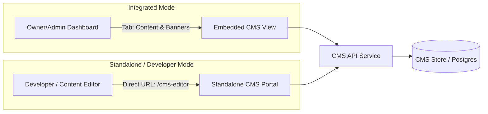

# Module Specification: Content Management System (CMS) Engine

> **PURPOSE**: Provides dynamic content management capabilities for marketing pages, hero banners, blogs, FAQs, and SEO metadata — deployable either as an integrated dashboard tab or a standalone editor.

---

## 🏛️ 1. Architecture: Integrated vs. Standalone CMS



### Modes Breakdown:
1. **Integrated Dashboard CMS (Recommended for Business Owners)**:
   - Embedded directly in the `/dashboard/cms` navigation.
   - Simple forms for Owner to change hero headlines, update seasonal banners, post announcements, or edit FAQs.
2. **Standalone CMS (Recommended for Technical / Developer Management)**:
   - Isolated URL (`/cms` or `/editor`).
   - Raw markdown, JSON schema fields, SEO robots directives, and developer preview pipelines.

---

## 📄 2. Core Content Schemas

### 2.1 Dynamic Pages & Blog Posts Table
```sql
CREATE TABLE cms_posts (
    id VARCHAR(64) PRIMARY KEY,
    company_id VARCHAR(64) REFERENCES companies(id) ON DELETE CASCADE,
    slug VARCHAR(128) NOT NULL,
    title VARCHAR(255) NOT NULL,
    summary TEXT,
    content_markdown TEXT NOT NULL,
    featured_image_url VARCHAR(512),
    meta_title VARCHAR(128),
    meta_description VARCHAR(256),
    is_published BOOLEAN DEFAULT FALSE,
    published_at TIMESTAMP WITH TIME ZONE,
    created_at TIMESTAMP WITH TIME ZONE DEFAULT NOW(),
    updated_at TIMESTAMP WITH TIME ZONE DEFAULT NOW(),
    CONSTRAINT uq_tenant_slug UNIQUE (company_id, slug)
);
```

### 2.2 Global Announcements & Banners Table
```sql
CREATE TABLE cms_announcements (
    id VARCHAR(64) PRIMARY KEY,
    company_id VARCHAR(64) REFERENCES companies(id),
    title VARCHAR(255) NOT NULL,
    message TEXT NOT NULL,
    banner_type VARCHAR(32) DEFAULT 'INFO', -- 'INFO' | 'PROMO' | 'ALERT'
    cta_label VARCHAR(64),
    cta_url VARCHAR(256),
    is_active BOOLEAN DEFAULT TRUE,
    start_date TIMESTAMP WITH TIME ZONE DEFAULT NOW(),
    end_date TIMESTAMP WITH TIME ZONE
);
```

---

## 💻 3. Dynamic Rendering & SEO Revalidation

In Next.js App Router, dynamic CMS pages are rendered on the server with On-Demand Revalidation (`revalidatePath` / `revalidateTag`):

```typescript
// app/[slug]/page.tsx
import { notFound } from "next/navigation";
import { getCmsPostBySlug } from "@/lib/cms";
import type { Metadata } from "next";

interface Props {
  params: { slug: string };
}

export async function generateMetadata({ params }: Props): Promise<Metadata> {
  const post = await getCmsPostBySlug(params.slug);
  if (!post) return { title: "Page Not Found" };

  return {
    title: post.meta_title || post.title,
    description: post.meta_description || post.summary,
    openGraph: {
      title: post.title,
      description: post.summary,
      images: post.featured_image_url ? [post.featured_image_url] : [],
    },
  };
}

export default async function CMSDynamicPage({ params }: Props) {
  const post = await getCmsPostBySlug(params.slug);
  if (!post || !post.is_published) {
    notFound();
  }

  return (
    <article className="max-w-4xl mx-auto px-4 sm:px-6 py-12">
      <header className="mb-8 border-b border-slate-200 dark:border-white/10 pb-6">
        <h1 className="text-3xl sm:text-5xl font-extrabold tracking-tight text-slate-900 dark:text-white mb-3">
          {post.title}
        </h1>
        <p className="text-sm text-slate-500 dark:text-slate-400">
          Published on {new Date(post.published_at!).toLocaleDateString()}
        </p>
      </header>
      <div
        className="prose prose-slate dark:prose-invert max-w-none text-slate-700 dark:text-slate-300 leading-relaxed"
        dangerouslySetInnerHTML={{ __html: post.content_html }}
      />
    </article>
  );
}
```

---

## 🔒 4. CMS Permissions & Security
- Public visitors can only view records where `is_published == true`.
- Draft posts are only visible to `Owner`, `Admin`, or users with `cms:edit` permission.
- Deletion requires `cms:delete` permission.
