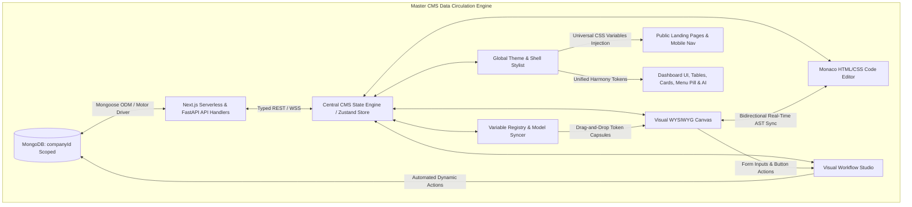
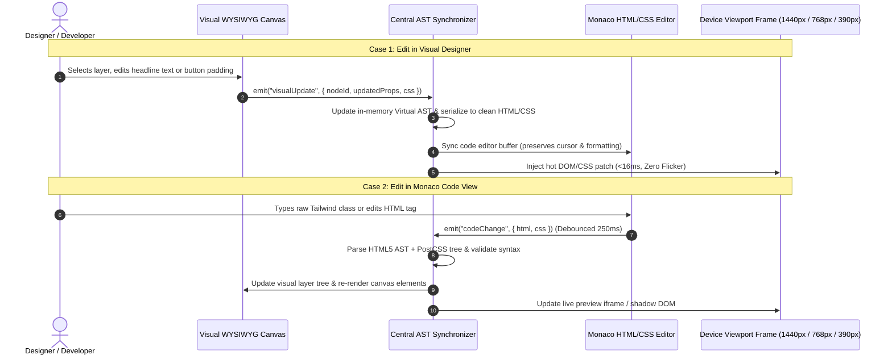
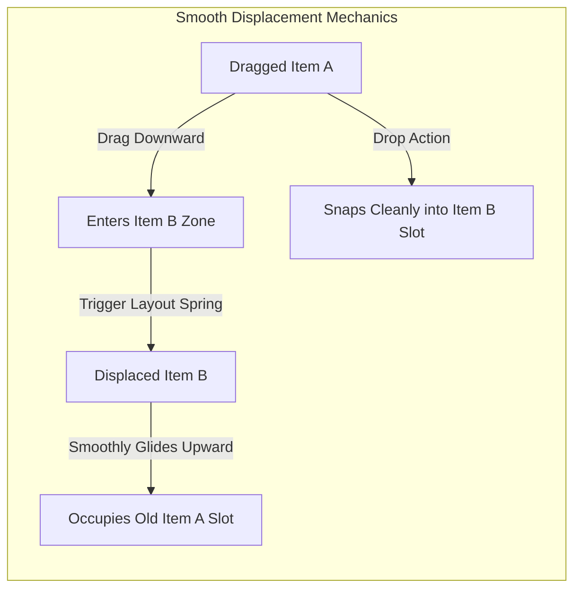
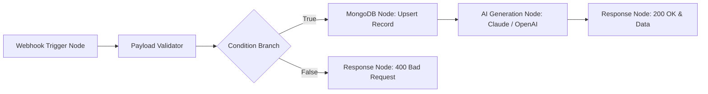
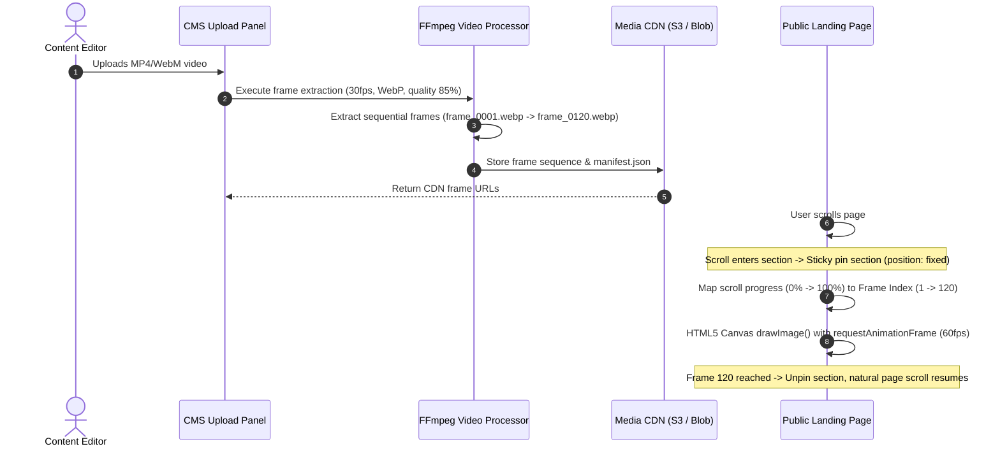
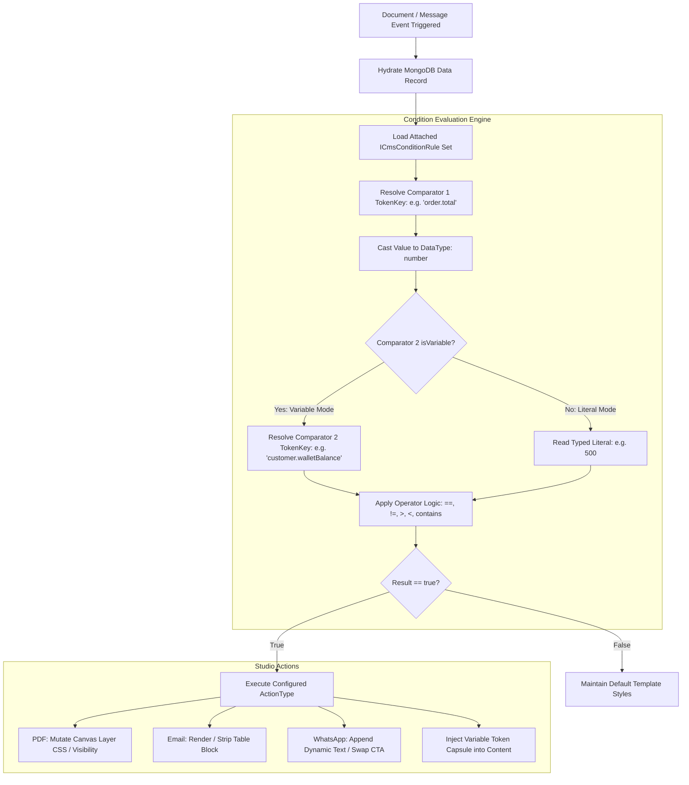
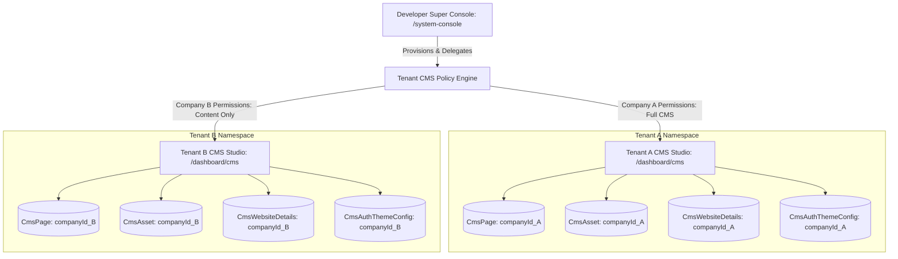
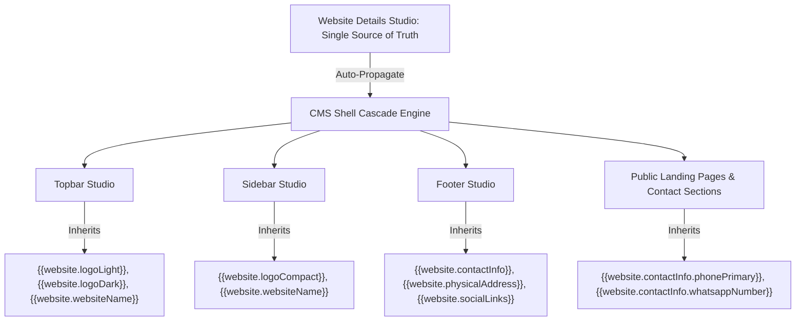
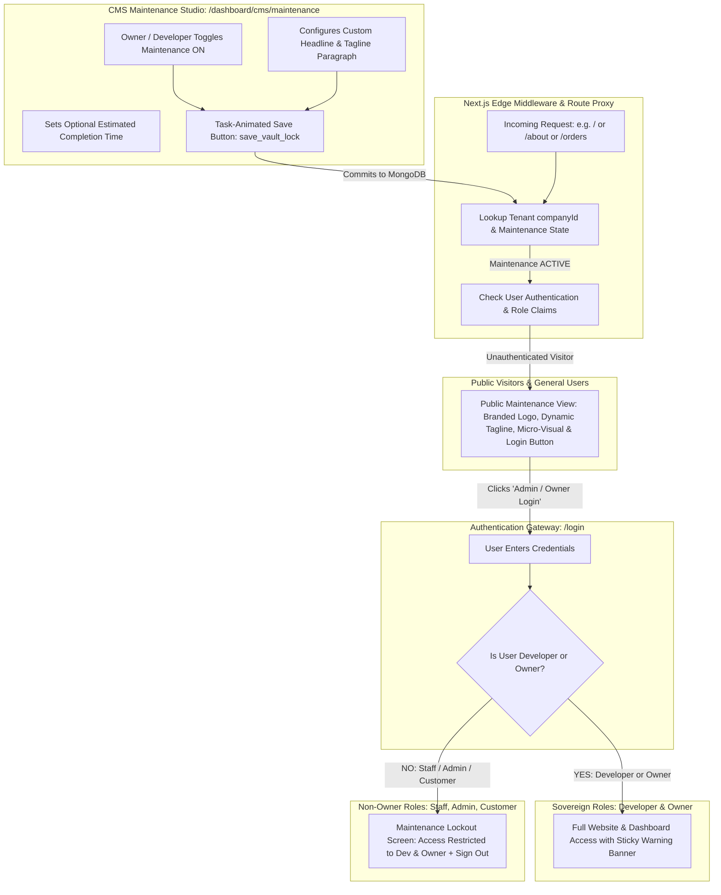
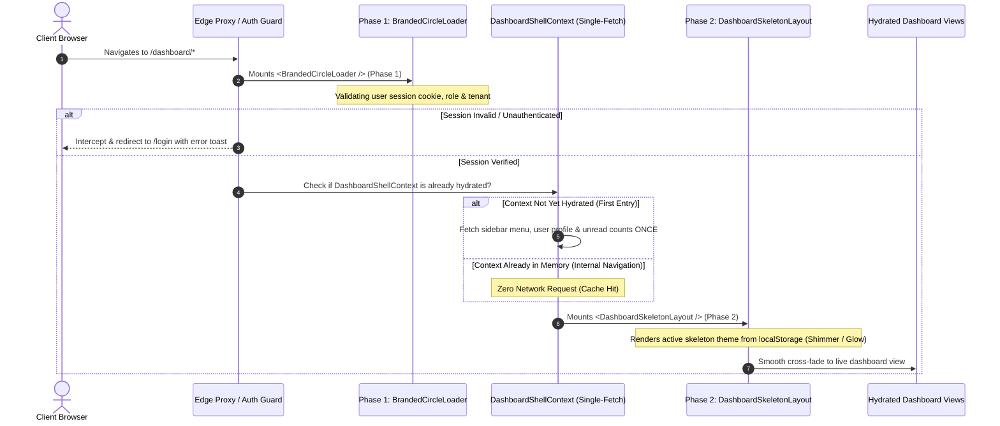

# Module Specification: Next-Gen Enterprise CMS & Visual Site Operating System

> **PURPOSE**: Provides an exhaustive, enterprise-grade Content Management System (CMS) & Visual Site Operating System for the entire application ecosystem. Governs public landing pages, navigation shells, footers, typography, dual-mode (Light/Dark) themes, skeleton loading animations, dynamic data binding via a **Variable Registry**, a node-based **Visual Workflow Studio** (zero third-party brand naming), a reusable physics-based **Drag-and-Drop system**, a **Section SDK** with a catalog of 100–200 modular sections, and an **FFmpeg-powered Scroll-Driven Video Hero Engine**.

---

## 🏛️ 1. Architecture & Master Data Circulation

The CMS functions as the centralized presentation and dynamic logic hub of the entire application. All configuration, layouts, pages, variables, and visual workflows persist in **MongoDB** collections strictly scoped to the tenant (`companyId: mongoose.Types.ObjectId`).



### 1.1 Core Content & Configuration Schemas (MongoDB / Mongoose)

#### A. Universal Layout & Theme Configuration Schema (`models/CmsLayoutConfig.ts`)
```typescript
import mongoose, { Schema, Document } from "mongoose";

export interface ICmsLayoutConfig extends Document {
  companyId: mongoose.Types.ObjectId;
  themeMode: "DUAL" | "LIGHT_ONLY" | "DARK_ONLY";
  
  // Independent Light and Dark Palettes
  lightTheme: {
    primary: string;
    secondary: string;
    accent: string;
    background: string;
    surface: string;
    card: string;
    border: string;
    muted: string;
    textPrimary: string;
    textSecondary: string;
    ring: string;
  };
  darkTheme: {
    primary: string;
    secondary: string;
    accent: string;
    background: string;
    surface: string;
    card: string;
    border: string;
    muted: string;
    textPrimary: string;
    textSecondary: string;
    ring: string;
  };
  
  // Skeleton Loading Stylist & Theme Presets
  skeleton: {
    activeTheme: "CLASSIC_SHIMMER" | "PULSE_WAVE" | "CYBER_NEON_GLOW" | "LIQUID_GLASS" | "MINIMAL_STATIC";
    speedSeconds: number; // 0.8s to 2.4s
    borderRadiusPx: number; // 0px to 9999px
    lightTint: string;
    darkTint: string;
    shimmerHighlightColor?: string; // e.g. "rgba(255, 255, 255, 0.15)"
    localStorageSyncKey: string; // "cms_skeleton_theme_config"
    newUserDefaultLoader: "BRANDED_CIRCLE_SPINNER"; // Default for fresh visitors
  };
  
  // Granular Typography Engine
  typography: {
    publicTopbarFont: string;
    publicSidebarFont: string;
    publicFooterFont: string;
    dashboardSidebarFont: string;
    dashboardPagesFont: string;
    bodyFont: string;
  };
  
  // Public Shell Configuration
  publicShell: {
    topbar: {
      logoUrl: string;
      logoText: string;
      showSearch: boolean;
      links: Array<{ id: string; label: string; href: string; order: number; isExternal: boolean }>;
      buttons: Array<{
        id: string;
        label: string;
        href: string;
        style: {
          bg: string;
          border: string;
          borderRadius: string;
          textDecoration: string;
          outline: string;
          boxShadow: string;
          hover: { bg: string; border: string; boxShadow: string };
          active: { bg: string; border: string; transform: string };
        };
      }>;
    };
    mobileNav: {
      enabled: boolean;
      primaryLinks: Array<{ id: string; label: string; href: string; icon: string; order: number }>;
      moreDrawerLinks: Array<{ id: string; label: string; href: string; icon: string }>;
    };
    footer: {
      logoUrl: string;
      brandParagraph: string;
      paragraphCss: string;
      copyrightText: string;
      links: Array<{ id: string; label: string; href: string; column: string; order: number }>;
      socialLinks: Array<{ id: string; platform: string; url: string; customSvgIcon?: string; hoverEffect: string; order: number }>;
      newsletter: {
        enabled: boolean;
        placeholder: string;
        buttonText: string;
        buttonStyle: Record<string, string>;
      };
      contactUs: {
        enabled: boolean;
        email: string;
        address: string;
        phone: string;
        phoneProtocol: "whatsapp" | "tel"; // Direct WhatsApp chat vs mobile tel: dialer
      };
    };
  };
  
  // Dashboard Shell Addons
  dashboardShell: {
    sidebar: {
      bg: string;
      activeItemBg: string;
      textActive: string;
      hoverGlow: boolean;
    };
    mobileMenuPill: {
      enabled: boolean;
      text: string;
      bg: string;
      textColor: string;
      ringColor: string;
      animation: "bounce" | "glow" | "subtle-float";
    };
    aiAssistant: {
      enabled: boolean;
      buttonBg: string;
      icon: string;
      pulseGlow: boolean;
      panelHeaderBg: string;
      panelBg: string;
      userBubbleBg: string;
      botBubbleBg: string;
    };
  };
}

const CmsLayoutConfigSchema = new Schema<ICmsLayoutConfig>(
  {
    companyId: { type: Schema.Types.ObjectId, ref: "Company", required: true, unique: true, index: true },
    themeMode: { type: String, enum: ["DUAL", "LIGHT_ONLY", "DARK_ONLY"], default: "DUAL" },
    lightTheme: { type: Object, default: {} },
    darkTheme: { type: Object, default: {} },
    skeleton: { type: Object, default: {} },
    typography: { type: Object, default: {} },
    publicShell: { type: Object, default: {} },
    dashboardShell: { type: Object, default: {} },
  },
  { timestamps: true }
);

export const CmsLayoutConfig =
  mongoose.models.CmsLayoutConfig ||
  mongoose.model<ICmsLayoutConfig>("CmsLayoutConfig", CmsLayoutConfigSchema);
```

#### B. Visual Page & Section Storage Schema (`models/CmsPage.ts`)
```typescript
import mongoose, { Schema, Document } from "mongoose";

export interface ICmsSectionInstance {
  instanceId: string;
  sdkType: string; // e.g. "hero-split-image", "pricing-3-tier", "custom-sdk-card"
  wrapperId?: string; // Optional parent div grouping id
  order: number;
  props: Record<string, any>;
  cssOverrides: {
    light: Record<string, string>;
    dark: Record<string, string>;
  };
  loopConfig?: {
    enabled: boolean;
    arrayVariableKey: string; // e.g. "products[]"
  };
  variableBindings: Record<string, string>; // Maps element id -> "{{user.username}}"
  workflowBindings: Record<string, string>; // Maps button id -> "wf_lead_capture"
}

export interface ICmsLayoutWrapper {
  wrapperId: string;
  name: string;
  layoutType: "FLEX_ROW" | "FLEX_COL" | "GRID";
  gridCols?: { sm: number; md: number; lg: number; xl: number };
  gapPx: number;
  paddingPx: number;
  cssClasses: string;
}

export interface ICmsPage extends Document {
  companyId: mongoose.Types.ObjectId;
  slug: string;
  title: string;
  metaTitle?: string;
  metaDescription?: string;
  sections: ICmsSectionInstance[];
  layoutWrappers: ICmsLayoutWrapper[];
  isPublished: boolean;
  publishedAt?: Date;
  version: number;
  createdAt: Date;
  updatedAt: Date;
}

const CmsPageSchema = new Schema<ICmsPage>(
  {
    companyId: { type: Schema.Types.ObjectId, ref: "Company", required: true, index: true },
    slug: { type: String, required: true, trim: true, lowercase: true },
    title: { type: String, required: true },
    metaTitle: { type: String, default: "" },
    metaDescription: { type: String, default: "" },
    sections: { type: [Object], default: [] },
    layoutWrappers: { type: [Object], default: [] },
    isPublished: { type: Boolean, default: false, index: true },
    publishedAt: { type: Date, default: null },
    version: { type: Number, default: 1 },
  },
  { timestamps: true }
);

CmsPageSchema.index({ companyId: 1, slug: 1 }, { unique: true });

export const CmsPage =
  mongoose.models.CmsPage || mongoose.model<ICmsPage>("CmsPage", CmsPageSchema);
```

#### C. Variable Registry Schema (`models/CmsVariableRegistry.ts`)
```typescript
import mongoose, { Schema, Document } from "mongoose";

export interface IVariableDefinition {
  tokenKey: string; // e.g. "{{user.username}}"
  displayName: string; // "Username"
  category: "USER" | "COMPANY" | "ORDER" | "CUSTOM" | "SYSTEM";
  dataType: "string" | "number" | "boolean" | "date" | "array" | "object";
  nestedFields?: string[];
  semanticIcon: string; // Lucide icon name
  sourceModel?: string; // "User", "Order", "Company"
  sampleValue: any;
}

export interface ICmsVariableRegistry extends Document {
  companyId: mongoose.Types.ObjectId;
  variables: IVariableDefinition[];
  lastSyncedAt: Date;
}

const CmsVariableRegistrySchema = new Schema<ICmsVariableRegistry>(
  {
    companyId: { type: Schema.Types.ObjectId, ref: "Company", required: true, unique: true, index: true },
    variables: { type: [Object], default: [] },
    lastSyncedAt: { type: Date, default: Date.now },
  },
  { timestamps: true }
);

export const CmsVariableRegistry =
  mongoose.models.CmsVariableRegistry ||
  mongoose.model<ICmsVariableRegistry>("CmsVariableRegistry", CmsVariableRegistrySchema);
```

#### D. Visual Workflow Studio Schema (`models/CmsWorkflow.ts`)
```typescript
import mongoose, { Schema, Document } from "mongoose";

export interface IWorkflowNode {
  id: string;
  type: "TRIGGER" | "CONDITION" | "MONGODB_CRUD" | "AI_PROMPT" | "JS_TRANSFORM" | "RESPONSE";
  position: { x: number; y: number };
  data: {
    label: string;
    config: Record<string, any>;
  };
}

export interface IWorkflowEdge {
  id: string;
  source: string;
  target: string;
  sourceHandle?: string; // "true" | "false" | "default"
  targetHandle?: string;
}

export interface ICmsWorkflow extends Document {
  companyId: mongoose.Types.ObjectId;
  workflowId: string;
  name: string;
  slug: string; // Exposed at POST /api/v1/workflows/:slug
  description: string;
  nodes: IWorkflowNode[];
  edges: IWorkflowEdge[];
  isActive: boolean;
  createdAt: Date;
  updatedAt: Date;
}

const CmsWorkflowSchema = new Schema<ICmsWorkflow>(
  {
    companyId: { type: Schema.Types.ObjectId, ref: "Company", required: true, index: true },
    workflowId: { type: String, required: true },
    name: { type: String, required: true },
    slug: { type: String, required: true, trim: true, lowercase: true },
    description: { type: String, default: "" },
    nodes: { type: [Object], default: [] },
    edges: { type: [Object], default: [] },
    isActive: { type: Boolean, default: true, index: true },
  },
  { timestamps: true }
);

CmsWorkflowSchema.index({ companyId: 1, slug: 1 }, { unique: true });

export const CmsWorkflow =
  mongoose.models.CmsWorkflow ||
  mongoose.model<ICmsWorkflow>("CmsWorkflow", CmsWorkflowSchema);
```

#### E. Dynamic Document & Messaging Template Schema (`models/CmsDocumentTemplate.ts`)
```typescript
import mongoose, { Schema, Document } from "mongoose";

export interface ICmsVariableToken {
  tokenKey: string; // e.g. "{{order.total}}" or "order.total"
  displayName: string; // Human-friendly display label, e.g. "Order Grand Total"
  scope: "ORDER" | "CUSTOMER" | "COMPANY" | "SYSTEM" | "PAYMENT" | "CUSTOM";
  dataType: "string" | "number" | "boolean" | "date" | "array" | "object";
  semanticIcon: string; // Lucide icon identifier e.g. "DollarSign", "Tag", "User", "CheckCircle", "Calendar"
  sampleValue?: string | number | boolean; // For preview/simulation testing
}

export interface ICmsConditionRule {
  id: string;
  name?: string; // Optional human label, e.g. "High-Value VIP Highlight"
  comparator1: ICmsVariableToken; // Strictly structured variable token with human-readable displayName
  operator: "==" | "!=" | ">" | "<" | ">=" | "<=" | "contains" | "startsWith" | "in" | "isEmpty" | "isNotEmpty";
  comparator2: {
    isVariable: boolean; // false = literal value, true = compare against another variable token
    variable?: ICmsVariableToken; // Secondary variable token with displayName for variable-to-variable comparison
    literalValue?: string | number | boolean; // Typed literal value (500, "PAID", true) if isVariable is false
  };
  actionType: "CSS_OVERRIDE" | "SHOW_ELEMENT" | "HIDE_ELEMENT" | "APPEND_TEXT" | "INJECT_VARIABLE";
  cssOverrides?: Record<string, string>; // e.g. { "color": "#10b981", "fontWeight": "bold", "backgroundColor": "rgba(16,185,129,0.1)" }
  customText?: string; // Custom text template for APPEND_TEXT
  injectedVariable?: ICmsVariableToken; // Variable token capsule to inject when actionType is INJECT_VARIABLE
}

export interface ICmsPdfElement {
  id: string;
  type: "TEXT" | "IMAGE" | "SHAPE" | "LINE" | "QR_CODE" | "TABLE";
  pageIndex: number;
  x: number; // Absolute left position (px / mm)
  y: number; // Absolute top position (px / mm)
  width: number;
  height: number;
  zIndex: number;
  content: string; // Text string with {{variables}} or image URL with {{variables}}
  qrUrlTemplate?: string; // e.g. "https://domain.com/verify/{{order._id}}"
  styles: Record<string, string>; // { "fontFamily": "Inter", "fontWeight": "bold", "color": "#000" }
  loopConfig?: {
    enabled: boolean;
    arrayVariableKey: string; // e.g. "order.items[]"
  };
  conditions?: ICmsConditionRule[];
}

export interface ICmsDocumentTemplate extends Document {
  companyId: mongoose.Types.ObjectId;
  templateType: "PDF" | "EMAIL" | "WHATSAPP";
  templateKey: string; // Predefined key, e.g. "INVOICE_STANDARD", "ORDER_CONFIRMATION"
  name: string;
  isActive: boolean; // Active template for this templateKey
  
  // PDF Sizing & Absolute Canvas Layers
  pdfConfig?: {
    pages: Array<{
      pageIndex: number;
      size: "A4" | "LETTER" | "LEGAL" | "RECEIPT_80MM" | "ID_CARD" | "CUSTOM";
      customWidthMm?: number;
      customHeightMm?: number;
      background: {
        type: "COLOR" | "GRADIENT" | "IMAGE";
        value: string;
      };
    }>;
    elements: ICmsPdfElement[];
  };

  // Email Config (Flow/Table layout, width, margin, padding, NO absolute positioning)
  emailConfig?: {
    subject: string;
    preheader: string;
    blocks: Array<{
      id: string;
      type: "HEADER" | "TEXT" | "IMAGE" | "BUTTON" | "DIVIDER" | "PRODUCT_CARD" | "FOOTER";
      content: string;
      styles: Record<string, string>; // width, margin, padding, textAlign, backgroundColor
      loopConfig?: { enabled: boolean; arrayVariableKey: string };
      conditions?: ICmsConditionRule[];
    }>;
  };

  // WhatsApp Config
  whatsappConfig?: {
    category: "MARKETING" | "UTILITY" | "AUTHENTICATION";
    language: string;
    headerType?: "NONE" | "TEXT" | "IMAGE" | "DOCUMENT";
    headerMediaUrl?: string;
    bodyText: string; // Formatted with *bold*, _italic_, ~strike~, `mono` and {{variables}}
    footerText?: string;
    buttons: Array<{
      type: "QUICK_REPLY" | "URL" | "PHONE_NUMBER";
      text: string;
      urlTemplate?: string; // e.g. "https://domain.com/orders/{{order._id}}"
      phoneNumber?: string;
    }>;
    conditions?: ICmsConditionRule[];
  };

  // Linked PDF Attachments (Hydrated & attached dynamically)
  attachedPdfTemplateKeys?: string[]; // e.g. ["INVOICE_STANDARD", "RETURN_SLIP"]

  createdAt: Date;
  updatedAt: Date;
}

const CmsDocumentTemplateSchema = new Schema<ICmsDocumentTemplate>(
  {
    companyId: { type: Schema.Types.ObjectId, ref: "Company", required: true, index: true },
    templateType: { type: String, enum: ["PDF", "EMAIL", "WHATSAPP"], required: true },
    templateKey: { type: String, required: true, trim: true },
    name: { type: String, required: true },
    isActive: { type: Boolean, default: false, index: true },
    pdfConfig: { type: Object, default: null },
    emailConfig: { type: Object, default: null },
    whatsappConfig: { type: Object, default: null },
    attachedPdfTemplateKeys: { type: [String], default: [] },
  },
  { timestamps: true }
);

// Compound Index: Enforces fast lookup for active templates per key per company
CmsDocumentTemplateSchema.index({ companyId: 1, templateKey: 1, isActive: 1 });

export const CmsDocumentTemplate =
  mongoose.models.CmsDocumentTemplate ||
  mongoose.model<ICmsDocumentTemplate>("CmsDocumentTemplate", CmsDocumentTemplateSchema);

#### F. Unified Digital Asset Management Schema (`models/CmsAsset.ts`)
```typescript
import mongoose, { Schema, Document } from "mongoose";

export interface ICmsAsset extends Document {
  companyId: mongoose.Types.ObjectId;
  title: string;
  originalFileName: string;
  fileType: "IMAGE" | "VIDEO" | "AUDIO" | "DOCUMENT" | "ICON" | "VECTOR" | "MODEL_3D";
  mimeType: string;
  sizeBytes: number;
  url: string; // CDN Storage URL (S3 / R2 / Supabase / Vercel Blob)
  storageKey: string;
  thumbnailUrl?: string;
  
  // Dimensions & Video Metadata
  dimensions?: {
    width: number;
    height: number;
    aspectRatio: string; // e.g. "16:9", "1:1", "4:3"
  };
  videoMetadata?: {
    durationSeconds: number;
    framerate: number;
    codec: string;
    resolutionsAvailable: string[]; // ["1080p", "720p", "4K"]
    hasAudio: boolean;
  };

  // 3D Model Metadata & WebGL/AR Specification
  model3dMetadata?: {
    format: "GLB" | "GLTF" | "USDZ" | "OBJ" | "FBX";
    meshCount?: number;
    triangleCount?: number;
    materialCount?: number;
    hasAnimations: boolean;
    animationClips?: string[]; // e.g. ["Idle", "Walk", "ExplodeView", "Rotate360"]
    hasMaterials: boolean;
    hasTextures: boolean;
    hasLightSources: boolean;
    hasDracoCompression: boolean;
    defaultCameraPosition?: [number, number, number]; // [x, y, z] e.g. [0, 1.5, 3]
    defaultFov?: number; // Field of view e.g. 45
    posterUrl?: string; // Auto-rendered static 2D WebP snapshot for instant initial load
    arUsdzUrl?: string; // Auto-converted USDZ asset for iOS Quick Look
  };

  // Ingestion Source Tracking (Where was this asset uploaded from?)
  source: {
    origin: "MANUAL_UPLOAD" | "PUBLIC_PAGE_SECTION" | "CAROUSEL" | "HERO_VIDEO" | "EMAIL_EDITOR" | "PDF_STUDIO" | "PRODUCT_IMAGE" | "PRODUCT_3D_MODEL" | "DASHBOARD_ENTITY";
    originPageSlug?: string;
    originSectionId?: string;
    originEntityId?: string; // e.g. productId or programId
  };

  // Reusable Reference System (Single Source of Truth)
  referenceToken: string; // e.g. "{{assets.brand_hero_video}}" or "{{assets.product_drone_3d}}"
  usageCount: number; // How many pages/sections/templates reference this asset
  tags: string[]; // Categorization e.g. ["logo", "hero", "marketing", "footer", "3d", "drone"]
  
  createdAt: Date;
  updatedAt: Date;
}

const CmsAssetSchema = new Schema<ICmsAsset>(
  {
    companyId: { type: Schema.Types.ObjectId, ref: "Company", required: true, index: true },
    title: { type: String, required: true, trim: true },
    originalFileName: { type: String, required: true },
    fileType: { 
      type: String, 
      enum: ["IMAGE", "VIDEO", "AUDIO", "DOCUMENT", "ICON", "VECTOR", "MODEL_3D"], 
      required: true 
    },
    mimeType: { type: String, required: true },
    sizeBytes: { type: Number, required: true },
    url: { type: String, required: true },
    storageKey: { type: String, required: true },
    thumbnailUrl: { type: String },
    dimensions: {
      width: Number,
      height: Number,
      aspectRatio: String,
    },
    videoMetadata: {
      durationSeconds: Number,
      framerate: Number,
      codec: String,
      resolutionsAvailable: [String],
      hasAudio: Boolean,
    },
    model3dMetadata: {
      format: { type: String, enum: ["GLB", "GLTF", "USDZ", "OBJ", "FBX"], default: "GLB" },
      meshCount: Number,
      triangleCount: Number,
      materialCount: Number,
      hasAnimations: { type: Boolean, default: false },
      animationClips: [String],
      hasMaterials: { type: Boolean, default: true },
      hasTextures: { type: Boolean, default: true },
      hasLightSources: { type: Boolean, default: false },
      hasDracoCompression: { type: Boolean, default: false },
      defaultCameraPosition: [Number],
      defaultFov: { type: Number, default: 45 },
      posterUrl: String,
      arUsdzUrl: String,
    },
    source: {
      origin: {
        type: String,
        enum: [
          "MANUAL_UPLOAD", 
          "PUBLIC_PAGE_SECTION", 
          "CAROUSEL", 
          "HERO_VIDEO", 
          "EMAIL_EDITOR", 
          "PDF_STUDIO", 
          "PRODUCT_IMAGE",
          "PRODUCT_3D_MODEL",
          "DASHBOARD_ENTITY"
        ],
        default: "MANUAL_UPLOAD",
      },
      originPageSlug: String,
      originSectionId: String,
      originEntityId: String,
    },
    referenceToken: { type: String, required: true },
    usageCount: { type: Number, default: 0 },
    tags: { type: [String], default: [] },
  },
  { timestamps: true }
);

CmsAssetSchema.index({ companyId: 1, fileType: 1, createdAt: -1 });
CmsAssetSchema.index({ companyId: 1, referenceToken: 1 }, { unique: true });
CmsAssetSchema.index({ companyId: 1, tags: 1 });

export const CmsAsset =
  mongoose.models.CmsAsset || mongoose.model<ICmsAsset>("CmsAsset", CmsAssetSchema);
```

#### G. Website Details & Brand Identity Schema (`models/CmsWebsiteDetails.ts`)
```typescript
import mongoose, { Schema, Document } from "mongoose";

export interface ICmsWebsiteDetails extends Document {
  companyId: mongoose.Types.ObjectId;
  
  // Basic Brand Identity
  websiteName: string;
  tagline?: string;
  canonicalBaseUrl: string; // e.g. "https://acme.com"
  
  // Logos & Media References (Points to CmsAsset reference tokens or URLs)
  faviconAssetId?: mongoose.Types.ObjectId;
  faviconUrl: string;
  logoLightAssetId?: mongoose.Types.ObjectId;
  logoLightUrl: string;
  logoDarkAssetId?: mongoose.Types.ObjectId;
  logoDarkUrl: string;
  logoCompactAssetId?: mongoose.Types.ObjectId; // Icon only for collapsed sidebar & mobile
  logoCompactUrl?: string;

  // Contact Information (Cascaded to Footers, Topbars, Contact Sections)
  contactInfo: {
    primaryEmail: string;
    supportEmail?: string;
    salesEmail?: string;
    phonePrimary: string;
    phoneSecondary?: string;
    whatsappNumber?: string;
    physicalAddress?: {
      street: string;
      suiteOrUnit?: string;
      city: string;
      stateProvince: string;
      postalCode: string;
      country: string;
    };
    operatingHours?: string; // e.g. "Mon-Fri: 9:00 AM - 6:00 PM EST"
  };

  // Social Channels & External Links
  socialLinks: Array<{
    platform: "TWITTER_X" | "LINKEDIN" | "INSTAGRAM" | "FACEBOOK" | "YOUTUBE" | "GITHUB" | "DISCORD" | "TIKTOK" | "CUSTOM";
    url: string;
    label: string;
    icon?: string;
  }>;

  // Global SEO & Metadata Defaults
  seoDefaults: {
    metaTitleTemplate: string; // e.g. "%s | Acme Industrial Solutions"
    defaultMetaDescription: string;
    ogImageDefaultUrl?: string;
    keywords: string[];
  };

  // Auto-Cascade Settings (Single Source of Truth)
  autoCascadeToShells: {
    topbar: boolean; // Propagates logo & site name to Topbar
    sidebar: boolean; // Propagates compact logo & site name to Sidebar
    footer: boolean; // Propagates contact info, address & social links to Footer
  };

  createdAt: Date;
  updatedAt: Date;
}

const CmsWebsiteDetailsSchema = new Schema<ICmsWebsiteDetails>(
  {
    companyId: { type: Schema.Types.ObjectId, ref: "Company", required: true, unique: true },
    websiteName: { type: String, required: true, trim: true },
    tagline: { type: String, trim: true },
    canonicalBaseUrl: { type: String, required: true },
    faviconAssetId: { type: Schema.Types.ObjectId, ref: "CmsAsset" },
    faviconUrl: { type: String, required: true },
    logoLightAssetId: { type: Schema.Types.ObjectId, ref: "CmsAsset" },
    logoLightUrl: { type: String, required: true },
    logoDarkAssetId: { type: Schema.Types.ObjectId, ref: "CmsAsset" },
    logoDarkUrl: { type: String, required: true },
    logoCompactAssetId: { type: Schema.Types.ObjectId, ref: "CmsAsset" },
    logoCompactUrl: { type: String },
    contactInfo: {
      primaryEmail: { type: String, required: true },
      supportEmail: String,
      salesEmail: String,
      phonePrimary: { type: String, required: true },
      phoneSecondary: String,
      whatsappNumber: String,
      physicalAddress: {
        street: String,
        suiteOrUnit: String,
        city: String,
        stateProvince: String,
        postalCode: String,
        country: String,
      },
      operatingHours: String,
    },
    socialLinks: [
      {
        platform: { type: String, required: true },
        url: { type: String, required: true },
        label: { type: String, required: true },
        icon: String,
      },
    ],
    seoDefaults: {
      metaTitleTemplate: { type: String, default: "%s | Company Portal" },
      defaultMetaDescription: { type: String, default: "" },
      ogImageDefaultUrl: String,
      keywords: { type: [String], default: [] },
    },
    autoCascadeToShells: {
      topbar: { type: Boolean, default: true },
      sidebar: { type: Boolean, default: true },
      footer: { type: Boolean, default: true },
    },
  },
  { timestamps: true }
);

export const CmsWebsiteDetails =
  mongoose.models.CmsWebsiteDetails ||
  mongoose.model<ICmsWebsiteDetails>("CmsWebsiteDetails", CmsWebsiteDetailsSchema);
```

#### H. Auth Pages Theme & Responsive Layout Schema (`models/CmsAuthThemeConfig.ts`)
```typescript
import mongoose, { Schema, Document } from "mongoose";

export interface IAuthPageSpecificConfig {
  layoutMode: "SPLIT_LEFT_FORM_RIGHT_MEDIA" | "SPLIT_RIGHT_FORM_LEFT_MEDIA" | "CENTERED_CARD_WITH_BG" | "FULL_MINIMAL_CARD";
  mediaType?: "IMAGE" | "GRADIENT" | "ABSTRACT_3D" | "VIDEO_BG";
  mediaAssetUrl?: string; // Reference to CmsAsset url
  gradientPreset?: string; // CSS gradient string
  headline?: string;
  subheadline?: string;
  showSocialLogins: boolean;
  
  // Custom Overrides (Optional - falls back to global theme if null)
  customLightColors?: {
    formBackground?: string;
    cardBorder?: string;
    inputBackground?: string;
    inputBorder?: string;
    inputText?: string;
    buttonBackground?: string;
    buttonText?: string;
  };
  customDarkColors?: {
    formBackground?: string;
    cardBorder?: string;
    inputBackground?: string;
    inputBorder?: string;
    inputText?: string;
    buttonBackground?: string;
    buttonText?: string;
  };
}

export interface ICmsAuthThemeConfig extends Document {
  companyId: mongoose.Types.ObjectId;
  themeFeatureEnabled: boolean; // When on, custom colors & layouts take effect
  
  // Master Defaults
  defaultLayout: "SPLIT_LEFT_FORM_RIGHT_MEDIA" | "SPLIT_RIGHT_FORM_LEFT_MEDIA" | "CENTERED_CARD_WITH_BG" | "FULL_MINIMAL_CARD";
  formCardWidthPx: number; // Standard 480px (never compressed on mobile)
  inputBorderRadiusPx: number; // 8px (rounded-lg)
  buttonStyle: {
    variant: "SOLID" | "GRADIENT" | "NEUMORPHIC" | "GLASSMORPHIC";
    primaryColorLight?: string;
    primaryColorDark?: string;
    borderRadiusPx: number;
    hoverAnimation: "SHINE" | "SCALE_UP" | "GLOW" | "SUBTLE_LIFT";
  };

  // Mobile Anti-Compression Safeguards
  mobileResponsiveRules: {
    collapseSplitToFullWidth: boolean; // Always true: collapses split to 100% width on < 768px
    minInputHeightPx: number; // 48px for comfortable touch targets
    inputFontSizePx: number; // 16px to prevent iOS auto-zoom
    hideMediaOnMobile: boolean; // true hides media; false converts to subtle top header banner
  };

  // Per-Page Dedicated Card Configurations (Cards Selector Hub)
  pages: {
    login: IAuthPageSpecificConfig;
    signup: IAuthPageSpecificConfig;
    forgotPassword: IAuthPageSpecificConfig;
    resetPassword: IAuthPageSpecificConfig;
    otpVerification: IAuthPageSpecificConfig;
  };

  createdAt: Date;
  updatedAt: Date;
}

const CmsAuthThemeConfigSchema = new Schema<ICmsAuthThemeConfig>(
  {
    companyId: { type: Schema.Types.ObjectId, ref: "Company", required: true, unique: true },
    themeFeatureEnabled: { type: Boolean, default: true },
    defaultLayout: {
      type: String,
      enum: ["SPLIT_LEFT_FORM_RIGHT_MEDIA", "SPLIT_RIGHT_FORM_LEFT_MEDIA", "CENTERED_CARD_WITH_BG", "FULL_MINIMAL_CARD"],
      default: "SPLIT_LEFT_FORM_RIGHT_MEDIA",
    },
    formCardWidthPx: { type: Number, default: 480 },
    inputBorderRadiusPx: { type: Number, default: 8 },
    buttonStyle: {
      variant: { type: String, enum: ["SOLID", "GRADIENT", "NEUMORPHIC", "GLASSMORPHIC"], default: "GRADIENT" },
      primaryColorLight: String,
      primaryColorDark: String,
      borderRadiusPx: { type: Number, default: 8 },
      hoverAnimation: { type: String, enum: ["SHINE", "SCALE_UP", "GLOW", "SUBTLE_LIFT"], default: "GLOW" },
    },
    mobileResponsiveRules: {
      collapseSplitToFullWidth: { type: Boolean, default: true },
      minInputHeightPx: { type: Number, default: 48 },
      inputFontSizePx: { type: Number, default: 16 },
      hideMediaOnMobile: { type: Boolean, default: true },
    },
    pages: {
      type: Object,
      default: {
        login: { layoutMode: "SPLIT_LEFT_FORM_RIGHT_MEDIA", mediaType: "GRADIENT", showSocialLogins: true },
        signup: { layoutMode: "SPLIT_LEFT_FORM_RIGHT_MEDIA", mediaType: "GRADIENT", showSocialLogins: true },
        forgotPassword: { layoutMode: "CENTERED_CARD_WITH_BG", mediaType: "GRADIENT", showSocialLogins: false },
        resetPassword: { layoutMode: "CENTERED_CARD_WITH_BG", mediaType: "GRADIENT", showSocialLogins: false },
        otpVerification: { layoutMode: "CENTERED_CARD_WITH_BG", mediaType: "GRADIENT", showSocialLogins: false },
      },
    },
  },
  { timestamps: true }
);

export const CmsAuthThemeConfig =
  mongoose.models.CmsAuthThemeConfig ||
  mongoose.model<ICmsAuthThemeConfig>("CmsAuthThemeConfig", CmsAuthThemeConfigSchema);
```
```

---

## ⚡ 2. Bidirectional Live Sync Engine (Visual Designer <--> Monaco HTML/CSS)

The CMS features a zero-latency bidirectional synchronization engine between the visual WYSIWYG canvas and the raw Monaco HTML/CSS code editor.



### 2.1 Synchronization Guardrails:
1. **Feedback Loop Elimination**: Unidirectional dispatch lock (`isCodeUpdating` vs `isVisualUpdating`). When the code editor triggers an AST change, outbound code editor updates are muted until the visual state reconciles.
2. **Device Viewport Switcher**:
   - **Desktop**: `1440px` (High-density presentation)
   - **Tablet**: `768px` (Touch responsive audit)
   - **Mobile**: `390px` (iPhone modern baseline)
3. **Syntax Validation**: If a user types malformed HTML in Monaco, a non-blocking toast warning appears and the visual designer remains stable on the last valid AST snapshot.

---

## 🎛️ 3. Dual-Shell Architecture: Integrated Dashboard vs. Standalone Portal

The CMS can run in either of two tailored operational modes:

### Mode A: Integrated Dashboard Mode (`/dashboard/cms`)
Recommended for business owners, store admins, and day-to-day content editors.

```
┌────────────────────────────────────────────────────────────────────────────────────────┐
│  DASHBOARD HEADER: Global Search, Theme Switcher, Notifications, User Profile          │
├───────────────────┬────────────────────────────────────────────────────────────────────┤
│  SIDEBAR:         │  CMS HUB (/dashboard/cms)                                          │
│  • Dashboard      │  ┌──────────────────────────────────────────────────────────────┐  │
│  • Orders         │  │ 🟢 LIVE STATUS REPORT                                        │  │
│  ▼ CMS (Active)   │  │ Active Theme: Obsidian Sky (Dark) | Published Pages: 12/14   │  │
│    ├─ Pages       │  │ Workflows Active: 6 APIs | Last Published: Today, 14:22      │  │
│    ├─ Nav & Header│  └──────────────────────────────────────────────────────────────┘  │
│    ├─ Footer      │                                                                    │
│    ├─ Theming     │  ┌──────────────────────────────────────────────────────────────┐  │
│    ├─ Templates   │  │ 🕒 RECENT CMS ACTIVITY FEED (Audit & Rollback)                │  │
│    ├─ Variables   │  │ • Hero Banner updated by Owner (12m ago)    [Rollback Button]│  │
│    ├─ Workflows   │  │ • New Promo Popup published by Admin (1h ago)[Rollback Button]│  │
│    └─ Video Scrub │  └──────────────────────────────────────────────────────────────┘  │
│  • Settings       │                                                                    │
│  • AI Assistant   │  OPTIONS CARD GRID (Quick Tools Access):                           │
│                   │  ┌──────────────┐ ┌──────────────┐ ┌──────────────┐ ┌────────────┐ │
│                   │  │ 🌐 Pages     │ │ 🧭 Nav/Header│ │ 🦶 Footer    │ │ 🎨 Theme   │ │
│                   │  └──────────────┘ └──────────────┘ └──────────────┘ └────────────┘ │
│                   │  ┌──────────────┐ ┌──────────────┐ ┌──────────────┐ ┌────────────┐ │
│                   │  │ 📐 30 Layouts│ │ 🏷️ Variables │ │ ⚡ Workflows │ │ 🎥 Video   │ │
│                   │  └──────────────┘ └──────────────┘ └──────────────┘ └────────────┘ │
└───────────────────┴────────────────────────────────────────────────────────────────────┘
```

- **Options Card Grid**: Direct visual entry cards with hover depth, glow rings, and micro-animations.
- **Sidebar Submenu Injection**: The main dashboard sidebar automatically expands with child links matching each card tool.
- **Live Status Report**: Instant overview of what is currently live on production.
- **Recent Activity Feed**: Timestamped changelog with one-click instant revision rollback.

---

### Mode B: Standalone Portal Mode (`/cms` or `/studio`)
Recommended for dedicated technical managers, design system leads, and power users.

- Full-screen distraction-free canvas with collapsible left navigation rail.
- **Bottom Status & Action Bar**:
  - `[ ← Back to Dashboard ]` (Quick escape route to main business hub).
  - `[ ↗ View Live Website ]` (Instant preview of production deployment).
- **Full Keyboard Shortcuts Integration**: Seamlessly connects to [`modules/SHORTCUT_KEYS_SYSTEM.md`](./SHORTCUT_KEYS_SYSTEM.md) (`Ctrl+S` Save Draft, `Ctrl+Z` Undo, `Ctrl+Y` Redo, `Ctrl+B` Toggle Sidebar, `Alt+T` Theme Switcher, `Alt+P` Preview).

---

### 3.3 Dedicated Public Pages Management List (`/dashboard/cms/pages`)

The CMS provides a dedicated Page Directory view before entering the visual canvas. This acts as the administrative launchpad for all public marketing pages and routes:

```
┌────────────────────────────────────────────────────────────────────────────────────────────────┐
│  PUBLIC PAGES DIRECTORY (/dashboard/cms/pages)                       [ + Create New Page ]     │
├────────────────────────────────────────────────────────────────────────────────────────────────┤
│  🔍 Search pages...               Filter: [ All Statuses ▼ ]       Sort: [ Recently Updated ▼ ] │
├────────────────────────────────────────────────────────────────────────────────────────────────┤
│  PAGE TITLE & ROUTE            STATUS         SECTIONS   LAST EDITED      PRIMARY ACTION       │
│  ────────────────────────────  ─────────────  ─────────  ───────────────  ──────────────────── │
│  🏠 Home Page                  🟢 Published   8 Sections Today, 14:10     [ ⚡ Open In Builder ]│
│     slug: /                    (Public Live)                              [••• Options Menu]   │
│                                                                                                │
│  💎 Pricing & Enterprise       🟢 Published   5 Sections Yesterday, 18:40 [ ⚡ Open In Builder ]│
│     slug: /pricing             (Public Live)                              [••• Options Menu]   │
│                                                                                                │
│  🚀 Product Launch 2026        🟡 Draft       6 Sections 2 days ago       [ ⚡ Open In Builder ]│
│     slug: /launch-v2           (Internal)                                 [••• Options Menu]   │
│                                                                                                │
│  🎃 Halloween Promo 2025       ⚪ Disabled    4 Sections Oct 12, 2025     [ ⚡ Open In Builder ]│
│     slug: /halloween-sale      (404 Active)                               [••• Options Menu]   │
└────────────────────────────────────────────────────────────────────────────────────────────────┘
```

#### Page Management Mechanics:
1. **Primary Launchpad**: Each page entry features a high-visibility button: **`[ ⚡ Open in Visual Builder ]`**. Clicking this directly launches the full-screen visual designer (`/cms/builder?pageId=...`).
2. **Page Row Actions (`•••` Options Menu)**:
   - **Duplicate Page**: Creates a deep-cloned draft with slug suffix `-copy`.
   - **Page Settings**: Drawer for SEO Meta Title, Meta Description, OpenGraph Preview Image, and Custom `<head>` Scripts.
   - **Disable Page (404 Interception)**: Instantly toggles `isPublished: false`.
   - **Delete Page**: Permanently removes the page with safety confirmation prompt.
3. **Automatic 404 Route Interception Contract**:
   - Whenever any page is **disabled** (`isPublished: false`) or **deleted**, any visitor navigating to its slug is automatically intercepted and served the **Universal 404 Interactive Game Page** ([`modules/NOT_FOUND_PAGE.md`](./NOT_FOUND_PAGE.md)).
   - Crawlers and search engines receive an instant `HTTP 404 Not Found` response.

---

## 🎨 4. Global Theming, Skeletons, & Dual Dark/Light Mode

### 4.1 Universal Theme Token Matrix
The theme engine applies color tokens across the entire application ecosystem with strict Light and Dark mode independence:

```css
/* Injectable Theme CSS Variables */
:root {
  --cms-primary: #0284c7;
  --cms-secondary: #0f172a;
  --cms-accent: #38bdf8;
  --cms-background: #ffffff;
  --cms-surface: #f8fafc;
  --cms-card: #ffffff;
  --cms-border: #e2e8f0;
  --cms-text-primary: #0f172a;
  --cms-text-secondary: #64748b;
  --cms-ring: rgba(2, 132, 199, 0.25);
}

.dark {
  --cms-primary: #38bdf8;
  --cms-secondary: #0f172a;
  --cms-accent: #0284c7;
  --cms-background: #020617;
  --cms-surface: #0b1120;
  --cms-card: #0f172a;
  --cms-border: rgba(255, 255, 255, 0.08);
  --cms-text-primary: #f8fafc;
  --cms-text-secondary: #94a3b8;
  --cms-ring: rgba(56, 189, 248, 0.25);
}
```

### 4.2 Skeleton Loading Stylist & Zero-Upper-Loading Mandate

> 🚫 **THE ZERO UPPER PROGRESS BAR LAW**:
> Under no circumstances should the application display a top progress bar, thin loading line, or top-edge spinner (e.g. NProgress) on the home page, public pages, or dashboard. Top loading lines look dated and cause visual disconnect.
>
> Instead, all async content loading MUST strictly render **Layout-Matching Skeleton UI Components** that mirror the exact physical geometry (cards, grids, table rows, hero headers) of the destination view, preventing layout shifts and delivering an instantaneous, high-performance perceived load time.

#### A. Skeleton Loading Theme Presets
The CMS allows administrators to select or customize the visual theme of skeletons:
1. **`CLASSIC_SHIMMER`**: Diagonal metallic light streak sweeping smoothly across placeholder blocks (`linear-gradient(90deg, transparent, rgba(255,255,255,0.08), transparent)`).
2. **`PULSE_WAVE`**: Sinusoidal opacity wave oscillating smoothly between `0.35` and `0.90` opacity.
3. **`CYBER_NEON_GLOW`**: Dark mode specialized theme with a breathing ambient neon edge glow (Sky Cyan / Electric Indigo tint).
4. **`LIQUID_GLASS`**: Translucent organic shimmer with `backdrop-filter: blur(8px)` and frosted gradient highlights.
5. **`MINIMAL_STATIC`**: Crisp, low-contrast solid placeholder blocks with subtle borders for high-density enterprise data tables.

#### B. Client-Side `localStorage` Persistence & Theme Synchronization
- When a skeleton theme or speed setting is configured in the CMS (`/dashboard/cms/themes`), it is propagated to the client and saved in `localStorage`:
  ```typescript
  // Synchronized in localStorage for immediate zero-flash rendering:
  localStorage.setItem("cms_skeleton_theme", "CLASSIC_SHIMMER");
  localStorage.setItem("cms_skeleton_config", JSON.stringify({
    speed: 1.2,
    borderRadius: 8,
    theme: "CLASSIC_SHIMMER"
  }));
  ```
- Before React hydrates or during fast client-side navigation, the UI reads `localStorage` to apply the exact CSS animation tokens immediately.

#### C. New User / First-Time Visitor Handshake (`<BrandedCircleLoader />`)
- **Default State for Fresh Visitors**:
  - When a user visits the platform for the very first time (before `localStorage` contains cached preferences or during cold boot of app assets), the system renders the default **Branded Circle Loading Spinner / Orbit Loader (`<BrandedCircleLoader />`)**.
  - Features an elegant dual-ring orbital spinner with subtle brand center glow.
  - As soon as the client handshake completes or a skeleton theme is stored in `localStorage`, all future loading states transition permanently to the configured Skeleton Loading System.

### 4.3 Unified Harmony Engine (Table + Card + Page)
When a theme is selected or tweaked, the Harmony Engine guarantees visual coherence:
- **Pages**: Adhere to `--cms-background` with subtle background noise or radial gradients.
- **Data Cards**: Inherit `--cms-card` with fine `--cms-border` and customized drop shadows.
- **Data Tables**: Inherit `--cms-card` background, `--cms-border` row separators, and `--cms-primary` selection rings.
*All three elements feel like they were crafted by the same designer.*

### 4.4 Dashboard Layout & Floating Addon Theming
1. **Dashboard Sidebar & Topbar**:
   - Custom active pill color, icon glow effects, and border divider opacity.
2. **Dashboard Mobile Menu Pill**:
   - Bottom-center floating trigger pill with frosted glass backdrop, badge ring, bounce animation, and cross icon toggle.
3. **Dashboard AI Assistant**:
   - Bottom-right floating trigger button (color, icon, pulse glow).
   - Opened chat window styling (header, messages container, user bubble, AI bubble, input field).

### 4.5 Granular Typography Engine
Enables assigning independent font families per component layer or inheriting a global family:
- Public Topbar Font: e.g. `Neofolio` / `Nexo Kora`
- Public Sidebar Font: e.g. `Plus Jakarta Sans`
- Public Footer Font: e.g. `Outfit`
- Dashboard Sidebar Font: e.g. `Inter`
- Dashboard Pages & Tables Font: e.g. `Plus Jakarta Sans`
- Body Text Font: e.g. `Outfit`

---

### 4.6 Advanced Aesthetic Themes & Figma Design Tokens

To transcend generic flat design, the CMS supports three ultra-modern design philosophies, complete with Figma-level design tokens and visual blueprints:

#### A. Liquid Glass & Organic Glassmorphism
Characterized by translucent frosted glass, fluid chromatic aberration edges, subtle prismatic sheen, and radiant neon highlights:

> **Reference image not included in the supplied ZIP:** `liquid_glass_nav_1792407386921.jpg` — Liquid Glass Navigation Reference. Restore the image into `design-system/assets/reference-images/` and update this note to a relative image link.

```css
/* Liquid Glass Tokens */
.theme-liquid-glass {
  background: rgba(15, 23, 42, 0.65);
  backdrop-filter: blur(28px) saturate(190%);
  -webkit-backdrop-filter: blur(28px) saturate(190%);
  border: 1px solid rgba(255, 255, 255, 0.14);
  box-shadow: 
    0 20px 40px -15px rgba(0, 0, 0, 0.5),
    inset 0 1px 1px 0 rgba(255, 255, 255, 0.25),
    inset 0 -1px 1px 0 rgba(0, 0, 0, 0.3);
}

.theme-liquid-glass-pill {
  background: linear-gradient(135deg, rgba(56, 189, 248, 0.25) 0%, rgba(129, 140, 248, 0.15) 100%);
  border: 1px solid rgba(56, 189, 248, 0.4);
  box-shadow: 0 0 20px rgba(56, 189, 248, 0.35);
}
```

#### B. Dark Neomorphism (Tactile Extrusions & Inset Grooves)
Provides tactile, physical depth with dual-tone soft highlights and cast shadows:

> **Reference image not included in the supplied ZIP:** `neomorphic_ui_1792407406200.jpg` — Neomorphic UI Control Panel Reference. Restore the image into `design-system/assets/reference-images/` and update this note to a relative image link.

```css
/* Dark Neomorphism Tokens */
.theme-neomorphic-card {
  background: #151b26;
  border-radius: 20px;
  box-shadow: 
    -10px -10px 24px rgba(255, 255, 255, 0.03),
    12px 12px 28px rgba(0, 0, 0, 0.7);
}

.theme-neomorphic-button-extruded {
  background: #18202e;
  border-radius: 12px;
  box-shadow: 
    -5px -5px 12px rgba(255, 255, 255, 0.04),
    6px 6px 14px rgba(0, 0, 0, 0.65);
}

.theme-neomorphic-button-pressed {
  background: #131924;
  box-shadow: 
    inset -4px -4px 10px rgba(255, 255, 255, 0.03),
    inset 5px 5px 12px rgba(0, 0, 0, 0.75);
}
```

#### C. Figma Design Specifications & Auto-Layout Tokens
To enable seamless designer-to-developer handover, all theme components strictly follow Figma Auto-Layout specifications:
- **Baseline Spacing Grid**: `8px` modular scale (`8px`, `16px`, `24px`, `32px`, `48px`, `64px`).
- **Stroke Weights**: `1px` for delicate structural dividers; `1.5px` for active focus rings and button outlines.
- **Corner Radius Scale**:
  - `radius-sm`: `8px` (Badges, tags, tooltips)
  - `radius-md`: `12px` (Inputs, dropdowns, buttons)
  - `radius-lg`: `18px` (Cards, dialogs, drawers)
  - `radius-xl`: `24px` (Parent container wrappers)
  - `radius-full`: `9999px` (Pill triggers, avatars, floating menu pills)
- **Typography Scale**: Display 1 (`72px/80px`), Display 2 (`56px/64px`), H1 (`40px/48px`), H2 (`32px/40px`), H3 (`24px/32px`), Body Large (`18px/28px`), Body Regular (`15px/24px`), Caption (`12px/16px`).

---

## 🧭 5. Public Shell & Navigation Studio

### 5.1 Public Desktop Topbar & Mobile Bottom Bar
- **Logo Configuration**: SVG logo upload, custom dimensions, text mark styling, and hover animations.
- **Search Bar**: Optional public search input with customizable placeholder and keyboard shortcut trigger (`/` or `Ctrl+K`).
- **Interactive Button Stylist**:
  - Buttons (e.g. "Get Started", "Sign In", "Book Demo") have granular styling across 3 states:
    1. **Static**: Background color, border color, border radius, text decoration, outline, box shadow.
    2. **Hover**: Hover background, border color, shadow elevation, scale up animation.
    3. **Active (Click)**: Pressed transform, active border, ripple effect.
- **Public Mobile Navigation**:
  - Bottom navigation bar with primary icons + "More" drawer for secondary routes.

### 5.2 Public Footer Studio
- **Branding Block**: Company logo + descriptive paragraph with custom typography, font size, and line height.
- **Social Media Hub**: Dynamic link organizer. Add platforms (Twitter/X, GitHub, LinkedIn, Instagram, Discord, YouTube, Facebook), enter destination URL, select platform SVG icon or upload custom SVG, and choose hover animation (Float, Scale, Glow).
- **Newsletter Subscription**: Email input container styling, placeholder text, submit button styling, and success toast configuration.
- **Contact Us Block**:
  - Toggle visibility on/off.
  - Physical office address.
  - Email address with `mailto:` link.
  - **Phone Protocol Selector**: Switch between `whatsapp:` (opens direct WhatsApp chat window) and `tel:` (triggers native mobile phone dialer).

---

## 🔀 6. Reusable Smooth Drag-and-Drop System

The CMS incorporates an ultra-smooth, physics-based drag-and-drop link and element reordering engine built on top of **Framer Motion spring physics** (`damping: 28`, `stiffness: 320`).



### Framework-Wide Reusability:
Designed as an autonomous component (`components/common/ReorderableList.tsx`) that can be deployed across:
1. CMS Public Navigation link management.
2. Footer social links sorting.
3. Dashboard metric widgets & card reordering.
4. Public form builder field sequencing.

---

## 📐 7. The 30 Default Public Templates Blueprint Catalog

The CMS ships with 30 pre-defined, fully designed architectural blueprints. Each blueprint defines the complete aesthetic vibe, typography pairings, dual color palettes, hero layout, and section composition:

| # | Template Name | Target Vibe / Industry | Typography Pairing | Color Aesthetic (Dark / Light) | Included Hero & Section Architecture |
|---|---|---|---|---|---|
| 1 | **HyperSaaS Prime** | B2B Cloud Software | Neofolio + Plus Jakarta Sans | Obsidian & Sky Cyan / Crisp Slate | Split Hero + Live Interactive Terminal + 4-Bento Grid + 3-Tier Pricing |
| 2 | **NeuroAI Studio** | Generative AI & LLM SaaS | Nexo Kora + Outfit | Deep Void & Violet Neon / Soft Lilac | Centered Glow Headline + Prompt Input Widget + Marquee AI Models + Metrics |
| 3 | **Apex Capital** | Fintech & Enterprise Banking | OSIRIS + Inter | Deep Emerald & Gold / Clean Ivory | Minimalist Split Hero + Animated Growth Graph + Security Badges + Comparison Table |
| 4 | **Aura Commerce** | Luxury Lifestyle Goods | Bierika + Syne | Midnight Charcoal & Warm Amber / Pearl | Fullscreen Editorial Image Hero + Parallax Product Showcase + Testimonial Quotes |
| 5 | **DevFlow Engine** | Developer Tools & CLI | JetBrains Mono + Plus Jakarta Sans | Matrix Black & Phosphor Green / Ghost White | Code Snippet Tabs + CLI Command Copy Box + Architecture Diagram + GitHub Stars |
| 6 | **Quantum Security** | Cybersecurity & Encryption | OSIRIS + Outfit | Midnight Blue & Cyber Cyan / Cool Steel | Radar Scan Hero Animation + Threat Detection Grid + Compliance Logos + Audit CTA |
| 7 | **Pulse Health** | Telehealth & Biotech | Plus Jakarta Sans + Inter | Deep Teal & Mint Glow / Pure White | Doctor Booking Widget Hero + Symptom Checker Bento + Trust Certifications |
| 8 | **Lumina Studio** | Digital Agency & Creative | Syne + Plus Jakarta Sans | Pitch Black & Electric Tangerine / Cream | Huge Typography Hero + Horizontal Work Reel + Award Accolades + Contact Drawer |
| 9 | **EtherWeb3** | Decentralized Crypto Protocol | Nexo Kora + Space Grotesk | Holographic Obsidian & Purple / Frost | 3D Coin Orbit Hero + TVL & Staking Stat Counters + Tokenomics Roadmap |
| 10 | **Estate Horizon** | Luxury Real Estate & Towers | Bierika + Outfit | Royal Navy & Champagne / Off-White | Video Scrubber Penthouse Tour + Property Specs Filter + Private Broker Booking |
| 11 | **Verve Fitness** | Athletic Performance & Gyms | Neofolio + Inter | Matte Carbon & Neon Volt / Stark White | High-Intensity Video Hero + Class Schedule Grid + Membership Calculator |
| 12 | **Horizon LMS** | EdTech & Online Universities | Plus Jakarta Sans + Outfit | Indigo Deep & Sky Blue / Warm Paper | Course Search Hero + Live Student Counters + Interactive Lesson Preview |
| 13 | **Savor Bistro** | High-End Hospitality & Dining | Playfair Display + Plus Jakarta Sans | Dark Espresso & Tuscan Gold / Linen | Mood Photography Hero + Digital Tasting Menu + OpenTable Reservation Form |
| 14 | **Nomad Travel** | Adventure & Global Tourism | Syne + Plus Jakarta Sans | Forest Pine & Sunset Coral / Desert Sand | Panoramic Destination Carousel + Trip Itinerary Timeline + Traveler Reviews |
| 15 | **Vogue Minimal** | High-Fashion Runway Brand | Bierika + Inter | Pitch Black & Stark White (Monochrome) | Stark Typography + Asymmetric Lookbook Grid + Instagram Live Reel |
| 16 | **Volt Mobility** | Electric Vehicles & Clean Tech | Neofolio + Outfit | Titanium Gray & Electric Blue / Pale Silver | Scroll-Driven 360 Vehicle Rotation + Battery Range Calculator + Test Drive CTA |
| 17 | **Broadcast Audio**| Podcasts & Media Networks | Nexo Kora + Plus Jakarta Sans | Deep Plum & Coral Neon / Soft Sand | Audio Waveform Player Hero + Episode Sticky Bar + Guest Host Directory |
| 18 | **Kindred Cause** | Non-Profit & Global Impact | Outfit + Inter | Ocean Navy & Sage Leaf / Cloud | Impact Counter Hero + Transparent Fund Progress Bar + Recurring Donation Form |
| 19 | **Titan Esports** | Gaming Arena & Hardware | OSIRIS + Space Grotesk | Pure Black & Crimson Blood / Ice Gray | Glitch Effect Hero + Tournament Bracket Tree + Sponsor Marquee + Twitch Stream |
| 20 | **Lexis Legal** | Corporate Law & Arbitrators | Merriweather + Plus Jakarta Sans | Dark Mahogany & Antique Gold / Parchment | Dignified Monogram Hero + Practice Areas Bento + Case Result Milestones |
| 21 | **Synapse Supply** | Logistics & Global Freight | Inter + Space Grotesk | Gunmetal & High-Vis Amber / Crisp White | Real-Time Container Tracker Hero + Global Fleet Map + Instant Freight Quote |
| 22 | **EcoTerra Green** | Renewable Solar & Sustainable | Outfit + Plus Jakarta Sans | Forest Moss & Sunflower / Pure Cotton | Carbon Offset Calculator Hero + Solar Panel ROI Estimator + Green Certs |
| 23 | **Velvet Glow** | Cosmetics & Clean Skincare | Syne + Outfit | Rose Dust & Warm Cocoa / Silk Cream | Serum Dropper Macro Video + Ingredient Accordion + Skin Quiz Matcher |
| 24 | **AppForge Mobile**| Native iOS/Android App Launch | Plus Jakarta Sans + Outfit | Midnight Slate & Gradient Peach / Ice Blue | Floating Dual iPhone Mockup Hero + App Store QR Code + Feature Swiper |
| 25 | **Sensory IoT** | Smart Home & Robotics Hardware | Neofolio + JetBrains Mono | Industrial Carbon & Laser Orange / Light Gray | Exploded Device CAD Diagram + Smart Sensor Integration Matrix + Specs Table |
| 26 | **Acoustic Studio**| Music Production & Instruments | Bierika + Plus Jakarta Sans | Dark Walnut & Burnished Brass / Off-White | Analog Mixer Texture Hero + Sound Sample Player Grid + Booking Calendar |
| 27 | **Curator Gallery**| Fine Art Exhibitions & Museums | Playfair Display + Inter | Gallery Charcoal & Pure White / Canvas | Virtual Exhibition Room Hero + Artist Biography Cards + Private Viewing RSVP |
| 28 | **Summit Mentor** | Executive Coaching & Speaking | OSIRIS + Plus Jakarta Sans | Deep Midnight & Brushed Platinum / Crisp Sky | Authority Keynote Video Hero + Client Enterprise Logos + Mastermind Tiers |
| 29 | **Metropolis Co** | Architecture & Urban Planning | Neofolio + Space Grotesk | Concrete Gray & Signal Red / Pure White | Blueprint Wireframe Overlay Hero + Before/After Project Slider + Floorplans |
| 30 | **DataMesh Cloud** | Cloud Data Lake & Analytics | Nexo Kora + Inter | Obsidian & Azure Glow / Snow White | Live Query Pipeline Visualization + Latency SLA Badges + Enterprise Contact |

---

## 🏷️ 8. Dynamic Data Foundations: Variable Registry & Visual Workflow Studio

### 8.1 Variable Registry Engine
Enables injecting real-time dynamic data tokens into any text, link, badge, or image attribute on public pages.
- **Syntax**: `{{model.field}}` or nested `{{model.subfield.prop}}`.
- **Supported Data Types**: `String`, `Number`, `Boolean`, `Date`, `Array`, `Object`.
- **"Sync Models" Automated Engine**:
  - Introspects backend Mongoose / Motor schemas (`User`, `Company`, `Order`, `CmsPost`, `SystemSetting`).
  - Auto-registers model attributes into the variable catalog with human-readable display names, data type pills, and semantic Lucide icons.
  - Example Tokens:
    - `{{user.username}}` (String, "Username")
    - `{{company.name}}` (String, "Company Name")
    - `{{order.total}}` (Number, "Order Total")
    - `{{products[].title}}` (Array String, "Product Title")

---

### 8.2 Visual Workflow Studio (Pipeline Automator)
> **MANDATORY BRANDING PRINCIPLE**: The node-based automation engine is strictly branded as **"Visual Workflow Studio"** (or **"Pipeline Automator"** / **"Action Canvas"**). The name "n8n" is **never** shown in the CMS or user interface.



- **Canvas Experience**: Infinite drag-canvas with smooth zoom (`10%` to `200%`), pan navigation, fullscreen toggle, and minimap.
- **Node Catalog**:
  1. **Webhook Trigger Node**: Exposes custom API routes at `/api/v1/workflows/:slug`. Accepts payload JSON schema definitions.
  2. **Condition / Branch Node**: Logic evaluator with True/False wire outputs (supports `==`, `!=`, `>`, `<`, `contains`, `regex`).
  3. **MongoDB Node**: Executes tenant-scoped document actions (`Find One`, `Find Many`, `Insert`, `Update`, `Delete`) without writing raw backend endpoints.
  4. **AI Generation Node**: Calls configured AI providers with dynamic system prompts, variable interpolation, and fallback key redundancy.
  5. **JavaScript Transform Node**: Sandboxed JS block for bespoke payload manipulation.
  6. **Response / Output Node**: Configures final HTTP status code and JSON response envelope `{ success: true, data: ... }`.

---

## 🧱 9. Section Builder, Custom Section SDK & 100–200 Section Catalog

### 9.1 Modular Section Architecture & Container Layout Wrappers
Pages are an ordered array of modular Section instances. 
- **Container `<div layout>` Wrappers**: Users can select multiple sections in the page tree and wrap them in a parent Container `<div>`.
- **Container Layout Controls**: Flex Row, Flex Column, or CSS Grid (1 to 12 columns) with responsive breakpoint overrides (`sm`, `md`, `lg`, `xl`).

### 9.2 Advanced Custom Section SDK (`lib/cms/sectionSdk.ts`)

The Custom Section SDK empowers developers and design systems to create production-ready React sections with full CMS integration:

```typescript
// lib/cms/sectionSdk.ts
export interface SectionField {
  name: string;
  label: string;
  type: "text" | "richtext" | "color" | "image" | "array" | "boolean" | "variable";
  defaultValue: any;
  description?: string;
}

export interface SectionDefinition<T = any> {
  id: string;
  name: string;
  category: "HERO" | "FEATURES" | "TESTIMONIALS" | "PRICING" | "MEDIA" | "CTA" | "STATS" | "FAQ";
  supportedVariables: {
    singleValues?: string[]; // e.g. ["user.username", "company.name"]
    arrayRepeaters?: string[]; // e.g. ["products[]", "reviews[]"]
  };
  scopedCss?: string;
  customFonts?: string[]; // e.g. ["Syne", "Outfit"]
  schema: Record<string, SectionField>;
  render: React.FC<{
    props: T;
    variables: Record<string, any>;
    isEditor: boolean;
  }>;
}

export function defineSection<T = any>(config: SectionDefinition<T>) {
  return config;
}
```

#### SDK Studio Developer Tools:
1. **"Copy AI Design Prompt" Action Button**:
   - Inside the SDK studio, clicking **`[ 📋 Copy AI Design Prompt ]`** copies an optimized prompt pre-filled with the active design system tokens, Tailwind guidelines, TypeScript props schema, and variable slot rules.
   - Developers can paste this prompt directly into Claude, ChatGPT, or Antigravity to generate instant custom section components matching the codebase perfectly.
2. **React TSX Template Upload & Code Sandbox**:
   - Developers can upload a `.tsx` file or paste component code into the built-in Monaco sandbox.
   - Hot-reloads in an isolated iframe sandbox with error boundary protection.
3. **Variable Mapping & Loop Target Declaration**:
   - Declare single value tokens (`{{company.name}}`) and array tokens (`{{products[]}}`).
   - Specify the loop target element so that when an array variable is assigned, only that sub-element loops dynamically.
4. **Interactive Test Inputs Sandbox**:
   - The SDK view includes an interactive mock data drawer where developers can enter test strings, numbers, and mock JSON array items to preview how the section behaves with short text, overflowing text, or empty states.
5. **Scoped CSS & Custom Fonts**:
   - Every custom section can include its own scoped CSS module and custom Google/bespoke fonts, completely isolated from global style pollution.

---

### 9.3 Array Loops & Dynamic Repeater
- When binding an array variable (e.g. `{{products[]}}`), the designer requires styling **only a single item** (1 Card or 1 Table Row).
- At render time, the CMS automatically loops through the array data and repeats that single template item for every record.

---

### 9.4 100–200 Section Catalog Taxonomy
- **Heroes (30 concepts)**: Split text + image, centered headline + video badge, 3D model canvas, terminal preview, dual CTAs, tilted mockup.
- **Interactive 3D Showcases (15 concepts)**: Fullscreen 3D Hero with cursor parallax, Split Product 3D Showcase with interactive feature hot-spots, 360 Orbit Viewer with lighting presets, Exploded-view mechanical demonstrator, Dynamic E-Commerce 3D Canvas bound to `{{product.model3dUrl}}`, AR "View in Your Space" quick-look section.
- **Bento & Feature Grids (30 concepts)**: 3-column cards, 4-bento asymmetric grid, interactive tabbed features, hover-reveal cards.
- **Social Proof & Testimonials (25 concepts)**: Marquee logo ribbon, masonry review cards, avatar quote carousel, video testimonial modals.
- **Pricing Tables (20 concepts)**: 3-tier cards with monthly/annual switch, sticky comparison matrix, per-seat slider calculator.
- **Stats & Metrics (15 concepts)**: Number counters with scroll trigger, horizontal milestone timelines, KPI cards.
- **Media & Video Showcases (15 concepts)**: Video modal lightbox, FFmpeg scroll-driven video container, before/after image slider.
- **Content & FAQs (25 concepts)**: Accordion FAQs with JSON-LD schema, 3-column blog card grid, release changelog.
- **CTAs & Forms (20 concepts)**: Floating banner CTA, email capture with variable drop zone, multi-step contact form.

---

### 9.5 Rich Media Elements & Custom In-House Media Viewers (Video, PDF & 3D WebGL)

Browser default media players look clunky and native 3D support requires specialized WebGL rendering. The CMS embeds bespoke, in-house custom viewers:

#### A. Custom Frosted Glass HTML5 Video Player (`components/media/CustomVideoPlayer.tsx`)
- **No Native Browser Controls**: Completely custom floating frosted glass control pill.
- **Interactive Scrubber**: Timeline scrub bar with buffered cache visualizer and hover thumbnail preview.
- **Precision Speed Controls**: Smooth playback rate selector (`0.5x`, `1.0x`, `1.25x`, `1.5x`, `2.0x`).
- **Volume & Audio Slider**: Smooth horizontal volume bar with instant click-to-mute toggle.
- **Picture-in-Picture & Fullscreen**: Custom PiP trigger button and native fullscreen toggle with keyboard shortcut (`F`).

#### B. Custom In-House PDF Viewer (`components/media/CustomPdfViewer.tsx`)
- **Virtualized Document Canvas**: Page-by-page smooth virtualized scrolling using PDF.js.
- **Zoom & Fit Slider**: Continuous zoom slider (`50%` to `250%`) + "Fit to Width" / "Fit to Page" buttons.
- **Sidebar Thumbnail Navigation Rail**: Collapsible left thumbnail drawer for jumping between pages.
- **In-Document Search**: High-speed text search bar with real-time term highlighting in the document canvas.
- **Reading Contrast Modes**: Light paper mode, Dark high-contrast mode, and Sepia night mode.
- **Native Action Buttons**: Sleek frosted glass `[ Download PDF ]` and `[ Print Document ]` buttons.

#### C. Custom Interactive 3D Model Viewer (`components/media/CustomModelViewer.tsx`)
- **WebGL / Three.js / Model-Viewer Engine**: Ultra-fast GPU-accelerated 3D rendering with Google Draco mesh compression support.
- **Dual Model Source Architecture**:
  - **Option 1: Static DAM Asset**: Pick any `.glb`, `.gltf`, `.usdz`, or `.obj` model stored in the Central Asset Library (`CmsAsset`).
  - **Option 2: Dynamic Variable Binding**: Bind any entity variable capsule (e.g. `{{product.model3dUrl}}`, `{{program.asset3d}}`). Dynamically resolves the active product or entity model at runtime!
- **Interactive OrbitControls & Touch Navigation**:
  - Smooth 360-degree rotation, pinch-to-zoom, and dual-finger pan with damping inertia.
  - Optional auto-rotate toggle with configurable speed (`0.5 RPM` to `5.0 RPM`).
  - Orbit Control Gizmo in top-right displaying 3D XYZ axis orientation.
- **Lighting & Atmosphere Presets**:
  - Instant studio-grade environment presets: `Studio Clean`, `Warm Sunset`, `Cyber Neon`, `Natural Daylight`, `Neutral Transparent`.
  - Ambient rim lighting that automatically adapts to the active website theme (Light / Dark).
- **Animation Clips Player**:
  - If the 3D model contains embedded animation tracks (e.g., `"Idle"`, `"Walk"`, `"ExplodeView"`, `"Rotate360"`), a sleek animation dropdown selector and play/pause controls appear.
- **Mobile AR (Augmented Reality) Quick-Look**:
  - One-tap **`[ 📱 View in Your Space (AR) ]`** button.
  - Automatically loads native Quick Look on iOS (`.usdz`) and Google Scene Viewer / WebXR on Android, allowing customers to project products directly into their room.
- **Instant Poster Snapshot Fallback**:
  - Renders a lightweight, high-fidelity WebP snapshot poster image while the full 3D geometry streams in, ensuring zero Cumulative Layout Shift (CLS) and instant perceived load.

---

## 🔍 10. Visual Layer Inspector, Form Wiring & Variable Drop Zones

### 10.1 Click-to-Inspect Electric Bounding Box
- Clicking any element on the preview canvas highlights its layer with an electric bounding box and displays the layer hierarchy breadcrumb (`Section > Container > Card > Headline`).
- Side panel instantly opens showing full CSS controls (margins, paddings, colors, borders, shadows, typography).

### 10.2 Visual Variable Drop Zones & Dynamic 3D Model Binding
- Elements that accept variables feature interactive drop slots (rendered as sleek token boxes/divs that look like sleek pill inputs).
- Content managers drag a variable pill from the Variable Registry drawer and drop it directly into the slot. The slot renders an interactive token capsule displaying its human-readable label ("Username").
- **Dynamic 3D Model Drop Slot**:
  - When configuring a 3D Model Section, the **Model Source** setting provides a dedicated variable drop zone.
  - Dropping `{{product.model3dUrl}}` or `{{entity.3dModel}}` binds the 3D canvas directly to the dashboard entity.
  - On public product landing pages (`/products/:slug`), the 3D canvas dynamically queries the active product's uploaded 3D model, allowing one universal section template to render unique 3D models for hundreds of different inventory items.


### 10.3 Form-to-Workflow Wiring
- Public form input elements define variable keys (e.g. `form.email`, `form.name`).
- The form submit button action is set to "Trigger Workflow".
- A wire connector visually links the form input variables to the required webhook body payload fields.

---

## 🎥 11. Scroll-Driven Video Hero Engine with FFmpeg

Enables cinematic, Apple-style scroll-scrubbed video animations on landing pages.



### 11.1 Video Processing Pipeline:
1. Video uploaded via CMS Media Manager.
2. FFmpeg extracts sequential high-quality WebP frames at 30fps (`ffmpeg -i input.mp4 -vf "fps=30,scale=1920:-1" -q:v 85 frame_%04d.webp`).
3. Frame assets and `manifest.json` are cached on the media storage CDN.

### 11.2 Scroll Scrubbing Mechanics:
1. **Section Pinning**: When the top of the video hero enters the viewport, the section sticky-pins (`position: sticky; top: 0; height: 300vh`).
2. **Smooth Frame Advance**: As the user scrolls through the 300vh scroll budget, scroll delta percentage is mapped to the frame index and drawn onto an HTML5 `<canvas>` via `requestAnimationFrame` for 60fps performance.
3. **Unpin & Release**: When the user scrolls past 100% of the section's scroll budget, the section unpins and natural vertical page flow resumes.

---

### 11.3 The 3-Phase Scroll Animation Lifecycle & Keyframe Choreographer Studio

Beyond video playback, modern high-engagement landing pages require orchestrating typography, image cards, 2D vector shapes, and 3D models directly along the user's scroll progression.

The **Scroll Animation Choreographer** provides a multi-track visual timeline (similar to Adobe After Effects or Premiere Pro) mapping any element to three distinct phases of scroll progress (`0%` to `100%`):

```
┌────────────────────────────────────────────────────────────────────────────────────────┐
│                        SCROLL PROGRESSION TIMELINE (0% ➔ 100%)                         │
├──────────────────────────┬─────────────────────────────┬───────────────────────────────┤
│    PHASE 1: ENTRANCE     │   PHASE 2: DURING / ACTIVE  │        PHASE 3: EXIT          │
│        (0% - 25%)        │         (25% - 65%)         │         (65% - 100%)          │
├──────────────────────────┼─────────────────────────────┼───────────────────────────────┤
│ • Kinetic Split-Text     │ • Persistent Float / Drift  │ • Kinetic Slide-Out to Dark   │
│ • Geometric Clip-Path In │ • Scrubbed Parallax Delta   │ • High-Velocity Blur Dissolve │
│ • 3D Depth Zoom In       │ • 3D Gyro Tilt / Rotation   │ • Masking Wipe Departure      │
│ • Fade-In with Stagger   │ • Glow Pulse & Hue Cycle    │ • 3D Camera Zoom-Through      │
└──────────────────────────┴─────────────────────────────┴───────────────────────────────┘
                                           │
                                           ▼
┌────────────────────────────────────────────────────────────────────────────────────────┐
│                SUCCESSION STACKING (ELEMENT A EXITS ➔ ELEMENT B ENTERS)                │
│ Track 1 [Headline A]:    [ Entrance: 0-15% ] ➔ [ During: 15-40% ] ➔ [ Exit: 40-50% ]  │
│ Track 2 [Card Showcase]:                      [ Entrance: 48-60% ] ➔ [ During: 60-85% ]│
│ Track 3 [2D Vector Art]: [ Entrance: 10-25% ] ──────────── [ Active Path Morph: 25-90% ]│
└────────────────────────────────────────────────────────────────────────────────────────┘
```

#### A. Phase 1: Entrance Animation Presets (Arrival / In)
Triggered as scroll enters the section's designated start threshold:
- **Kinetic Split-Text Reveal**: Text breaks into words or characters, cascading upwards with staggered easing (`y: 40px -> 0px`, `opacity: 0 -> 1`, `stagger: 0.03s`).
- **Geometric Clip-Path Unfold**: Reveals images or shapes through expanding geometric polygon masks (`clip-path: polygon(...)`).
- **3D Perspective Zoom**: Flips element into flat plane from a dramatic 3D angle (`rotateX: 45deg`, `scale: 0.85 -> 1.0`).
- **Elastic Rubber-Band In**: Arrives with a subtle physics spring overshoot.

#### B. Phase 2: During / Active Motion Phase (Persistent Presence)
While the element remains active in frame, it does not sit static; it responds continuously to scroll delta:
- **Continuous Scrubbed Parallax**: Moves along the Y or X axis at a customized velocity multiplier (`speed: 0.5x` or `1.5x`).
- **Gyroscope & 3D Tilt Motion**: Tilts along the X/Y axes in sync with scroll delta and cursor coordinates.
- **Dynamic Backdrop Blur Shift**: The element's glassmorphic surface animates its blur radius (`blur(10px) -> blur(30px)`) and opacity.
- **Ambient Breathing Float**: Slow sinusoidal floating oscillation (`Math.sin(time) * 6px`) layered on top of scroll velocity.
- **Dynamic Numeric Counter**: Binds numbers (e.g. `$0` to `$10,000,000` or `0%` to `99.9%`) and increments them strictly in proportion to scroll delta.

#### C. Phase 3: Exit Animation Presets (Departure / Out)
As scroll reaches the departure boundary of the element:
- **Kinetic Slide-Out**: Accelerates upwards or laterally off the canvas (`y: 0 -> -60px`, `opacity: 1 -> 0`).
- **High-Velocity Blur Dissolve**: Melts the element with progressive directional motion blur (`blur(24px)`, `scale: 1.08`, `opacity: 0`).
- **Camera Zoom-Through**: Scales up massively (`scale: 3.5x`) as if passing straight through the user's camera lens.
- **Clip-Path Shrink**: Collapses inward toward a single geometric focus point.

#### D. Succession Stacking (Multi-Track Sequence Choreography)
- The timeline supports an unlimited number of stacked element tracks:
  - `Track 1: Primary Headline`
  - `Track 2: Supporting Tagline & CTA`
  - `Track 3: Product 3D Canvas / Mockup Image`
  - `Track 4: 2D Vector Graphic Background Shapes`
- **Seamless Hand-Off**: When Headline 1 completes its Exit Phase at `45%` scroll progress, Headline 2 triggers its Entrance Phase on the exact subsequent frame (`46%`), creating a continuous narrative story as the user scrolls.

---

## 🔒 12. Security, Tenancy & RBAC Guardrails

1. **Multi-Tenant Isolation**: All CMS queries filter strictly by `companyId: ObjectId`. A tenant cannot view or alter another company's layouts, templates, or workflows.
2. **Draft vs Published Boundary**: Public visitors can only view records where `isPublished == true`. Draft changes are stored in draft state until published.
3. **Action-Level Permissions**:
   - `cms:edit`: Allows modifying visual layouts, styles, and variables.
   - `cms:publish`: Allows deploying drafts to production.
   - `cms:delete`: Restricted to `Owner` and `Admin`.
4. **Zero-Leak Workflow Execution**: Workflows run in sandboxed worker contexts with execution time limits (10s max) and payload size limits (10MB max).

---

## 📄 14. Dynamic PDF Studio & Canvas Editor

The PDF Studio operates as an in-browser visual design canvas (similar to Canva / Figma) engineered for dynamic, data-driven documents (invoices, shipping manifests, certificates, tickets, receipts):

> **Reference image not included in the supplied ZIP:** `pdf_canvas_studio_1792415711899.jpg` — PDF Canvas Studio UI Mockup. Restore the image into `design-system/assets/reference-images/` and update this note to a relative image link.

### 14.1 Template Key Registry & Active Toggle
- **Predefined Template Keys**: Templates are registered under universal business keys (`INVOICE_STANDARD`, `ORDER_CONFIRMATION`, `SHIPPING_MANIFEST`, `EVENT_TICKET_PASS`, `ID_BADGE`).
- **Active Production Flag**: A company can maintain multiple draft revisions or variants, but exactly one template is marked `isActive: true` per key. All automated backend triggers resolve this active key dynamically.

### 14.2 Absolute Positioning Mechanics & Canvas Interaction
Unlike flow-based HTML, PDF generation demands millimeter-exact positioning:
1. **Absolute Coordinate Geometry**: Every element on the canvas possesses `x`, `y`, `width`, `height`, and `zIndex` properties relative to the active page container.
2. **Interactive Transformation Handles**:
   - **Center Grab Anchor**: Grabbing the element center smoothly drags and moves it across the canvas with magnetic smart snap guides.
   - **Perimeter Bounding Handles**: 8-point outline handles allow interactive resizing of `width` and `height`.
   - **Precision Input Overrides**: The right-hand Inspector panel allows typing exact coordinate values (`x: 450px`, `y: 680px`, `width: 120px`, `height: 120px`).
3. **Layer Tree Panel**:
   - The left sidebar displays a hierarchical Layer Tree showing all canvas elements.
   - Smooth drag-and-drop handles allow reordering elements up or down, directly adjusting their visual `zIndex`.
4. **Custom CSS Styling**: Developers can apply granular CSS styles (`fontFamily`, `fontSize`, `fontWeight`, `color`, `border`, `borderRadius`, `opacity`, `transform: rotate(...)`).

### 14.3 Multi-Page Architecture & Custom Sizing
- A single template can contain multiple pages (Page 1 of 2, Page 2 of 2).
- **Independent Page Sizing**: Each page in the document can specify its own dimensions:
  - Default Presets: `A4` (210 x 297mm), `Letter` (8.5 x 11in), `Legal` (8.5 x 14in), `Receipt / Thermal 80mm`, `ID Card` (85.6 x 53.98mm).
  - Custom Sizing: Exact user-defined `width` and `height` in millimeters (`mm`) or pixels (`px`).
- **Page Backgrounds**: Solid color, CSS gradient, or high-resolution letterhead background image.

### 14.4 Supported Canvas Elements & Dynamic Data
1. **Text Blocks**: Typography controls with full variable interpolation (`Invoice #{{order.orderNumber}}`).
2. **Dynamic Images**: Static image upload OR dynamic URL interpolation (`{{order.customer.avatarUrl}}` or `{{company.logo}}`).
3. **Shapes & Dividers**: Rectangles, circles, accented divider lines, and background cards.
4. **Dynamic QR Code Generator**:
   - Renders high-density, vector-crisp scannable QR codes directly on the PDF.
   - Dynamic URL Templates: Encodes variables into the payload (e.g. `https://app.domain.com/verify/{{order._id}}?token={{order.securityHash}}`).
5. **Array Repeater Tables & Cards**:
   - Repeating line items (e.g. `{{order.items[]}}`).
   - Designers format a single template row with column bindings (`{{item.name}}`, `{{item.quantity}}`, `{{item.unitPrice}}`, `{{item.total}}`). At render time, the table expands automatically down the canvas.

### 14.5 Bidirectional WYSIWYG <--> HTML/CSS Synchronizer
- Features a top-bar **`[ HTML/CSS Sync ]`** toggle.
- Switching to Code view reveals the underlying HTML/CSS template markup.
- Edits made in the visual canvas update the code buffer in real time; raw CSS modifications in the code editor update canvas layers instantaneously.

### 14.6 Strict Missing-Data Elimination Filter
> **IRONCLAD RULE**: If a variable bound to an element resolves to `null`, `undefined`, or empty string (e.g. customer has no `vatNumber` or secondary phone), the element is **completely excluded** from the final rendered PDF. No ugly blank slots, raw curly braces `{{...}}`, or placeholder text ever leak to the client.

### 14.7 Element Conditional Formatting with Variable Display Name Capsules
- Every visual element on the canvas (Text, Image, Shape, Table, QR Code) features a dedicated **Conditions** inspector tab.
- **Zero Raw Strings**: All conditions are built using interactive **Variable Token Capsules** (e.g. `[ 🏷️ Order Grand Total ]`, `[ 💳 Payment Status ]`) with display names and semantic icons.
- **Dynamic Overrides**: When rules evaluate to `true`, the engine conditionally applies visual CSS styles (e.g., green border, bold highlight, opacity reduction, or rendering high-priority stamp watermarks).
- **Interactive Preview Toggle**: In the Studio canvas, an "Evaluate Test Rules" slider allows previewing the document in real time against sample test values.

---

## ✉️ 15. Responsive Email Template Editor

The Email Template Editor is optimized for bulletproof, cross-client rendering (Gmail, Apple Mail, Outlook, Yahoo Mail):

### 15.1 Flow & Table-Safe Layout Engine (No Absolute Positioning)
- Because email clients (especially desktop Outlook) strip or distort `position: absolute`, the Email Builder strictly enforces a **Structured Block Flow Layout**:
  - Container Blocks: Full-width outer sections, centered `600px` content wrapper tables.
  - Alignment Controls: `text-align: left | center | right`, flex-like column distributions via table cells, `margin`, `padding`, and background colors.
  - No floating absolute layers: Elements stack or align cleanly in linear responsive grids.
- **Visual Block Canvas <--> Clean HTML Sync**: Visual drag-and-drop block builder synced to inline-styled, email-safe HTML code.

### 15.2 Dynamic Variables & Repeater Loops
- Variables inject user, company, or transaction data (`Hi {{user.firstName}}, your order of {{order.total}} is confirmed!`).
- Line item loops (`{{order.items[]}}`) dynamically render responsive receipt cards or multi-column product tables.
- **Strict Missing-Data Omission**: Blocks or paragraphs with empty variables are cleanly omitted.

### 15.3 Block-Level Conditional Visibility & Variable Capsule Rules
- Every content block in the email layout (Promo Banner, Discount Callout, Reorder Button, VIP Greeting) can have attached conditional display rules.
- Editors select variables via human-readable **Display Name Capsules** (e.g. `[ 👑 Customer Tier ] == "PLATINUM"`).
- If the rule evaluates to `false`, the entire table container block is completely stripped from the final generated HTML string before SMTP dispatch, guaranteeing zero broken spacing or empty gaps in Outlook/Gmail.

---

## 💬 16. WhatsApp Message Template Studio

The WhatsApp Studio creates standardized, high-engagement messages compatible with the Meta WhatsApp Cloud API:

### 16.1 Formatted Message Composer
- Native text styling syntax supported:
  - Bold: `*text*`
  - Italic: `_text_`
  - Strikethrough: `~text~`
  - Monospace / Code: ````text````
- Dynamic variable tokens: Parameter placeholders (`{{1}}`, `{{2}}`, `{{3}}`) mapped directly to document fields (`{{user.name}}`, `{{order.id}}`, `{{order.total}}`).

### 16.2 Interactive Action Buttons
- **Quick Reply Buttons**: Up to 3 pre-configured reply pills (e.g. `[ Confirm Delivery ]`, `[ Cancel Order ]`, `[ Contact Support ]`).
- **Call-to-Action (CTA) Buttons**:
  - Direct Phone Call: Dial phone number.
  - Dynamic URL: Web address with variable path parameter (e.g. `https://domain.com/track/{{order._id}}`).
- **Media Header Support**: Configurable Header with Image, Video, or attached PDF Document.

### 16.3 Conditional Message Branching & Action Injections
- Because WhatsApp messages are linear text templates, conditions allow dynamic copy variants without maintaining duplicate templates:
- Rules evaluate Variable Token Capsules with Display Names:
  - E.g. If `[ 💳 Payment Status ] == "UNPAID"`, append text: `*Please complete payment before midnight to reserve your slot.*` and inject payment CTA.
  - E.g. If `[ 🏷️ Order Grand Total ] >= 1000`, inject VIP gratitude bonus snippet: `🎉 *You earned 500 VIP points on this order!*`.
- Actions also support `INJECT_VARIABLE` to insert dynamic variable capsules directly into conditional append buffers.

---

## ⚖️ 17. Dynamic Variable-Driven Conditional Logic Engine (PDF, Email, WhatsApp)

All three template engines (PDF, Email, WhatsApp) share a unified, ultra-refined **Conditional Logic Engine**. 

### 17.1 Zero Raw Text Variables — Human-Readable Display Name Policy
> 🌟 **CORE UX REQUIREMENT**: Users and designers **NEVER** write or view raw technical variable keys (such as `order.customer.walletBalance` or `{{order.total}}`) inside the condition builder. Raw unformatted text inputs degrade the user experience and lead to syntax errors.
>
> Instead, all condition operands are selected from the **Universal Variable Registry** and rendered as interactive **Variable Token Capsules** featuring:
> 1. **Semantic Lucide Icon**: Instantly conveys variable category (e.g., `DollarSign` 🏷️ for financial totals, `User` 👤 for customer details, `CheckCircle` 💳 for payment states).
> 2. **Human-Readable Display Name**: Clear, polished terminology (e.g., `Order Grand Total` instead of `order.total`; `Customer Wallet Balance` instead of `order.customer.walletBalance`).
> 3. **Data Type Pill**: Color-coded micro-badge indicating type (`num`, `str`, `bool`, `date`).
> 4. **Hover Tooltip**: Reveals underlying technical key (`{{order.total}}`) and current live simulation sample value (`$1,250.00`).
> 5. **Quick-Change Chevron & Dismiss**: Allows changing the variable via popover picker or clearing the operand.

```
┌────────────────────────────────────────────────────────────────────────────────────────────────────────┐
│  CONDITIONAL RULE INSPECTOR (Element: InvoiceSummaryCard)                             [ + Add Rule ]   │
├────────────────────────────────────────────────────────────────────────────────────────────────────────┤
│  Rule #1: High-Value Order VIP Styling                                                    [ Enabled ✓] │
│                                                                                                        │
│  ┌─ IF (Condition) ──────────────────────────────────────────────────────────────────────────────────┐ │
│  │  Comparator 1: [ 🏷️ Order Grand Total  | num ▼ ]                                                  │ │
│  │  Operator:     [ > Greater Than ▼ ]                                                                │ │
│  │  Comparator 2: [ Mode: 🏷️ Variable Token  |  ✍️ Literal Value ]                                     │ │
│  │                [ 💰 Customer Wallet Balance  | num ▼ ]  <-- (Variable-to-Variable Comparison!)     │ │
│  └───────────────────────────────────────────────────────────────────────────────────────────────────┘ │
│                                                                                                        │
│  ┌─ THEN ACTION ─────────────────────────────────────────────────────────────────────────────────────┐ │
│  │  Action Type:  [ 🎨 Apply CSS Overrides ▼ ]                                                        │ │
│  │  • border-color:        #10b981 (Emerald Green 500)                                                │ │
│  │  • background-color:    rgba(16, 185, 129, 0.08) (Subtle Neon Glow)                               │ │
│  │  • watermark-text:      "VIP ELITE PRIORITY"                                                       │ │
│  └───────────────────────────────────────────────────────────────────────────────────────────────────┘ │
├────────────────────────────────────────────────────────────────────────────────────────────────────────┤
│  Rule #2: Payment Stamp Visibility                                                       [ Enabled ✓] │
│                                                                                                        │
│  ┌─ IF (Condition) ──────────────────────────────────────────────────────────────────────────────────┐ │
│  │  Comparator 1: [ 💳 Payment Status  | str ▼ ]                                                      │ │
│  │  Operator:     [ == Equals ▼ ]                                                                     │ │
│  │  Comparator 2: [ Mode:  🏷️ Variable Token  |  ✍️ Literal Value ]                                    │ │
│  │                [ "PAID"                                        ]                                   │ │
│  └───────────────────────────────────────────────────────────────────────────────────────────────────┘ │
│                                                                                                        │
│  ┌─ THEN ACTION ─────────────────────────────────────────────────────────────────────────────────────┐ │
│  │  Action Type:  [ 👁️ Show Element ▼ ] -> Target: [ StampLayer_PaidSeal ]                             │ │
│  └───────────────────────────────────────────────────────────────────────────────────────────────────┘ │
├────────────────────────────────────────────────────────────────────────────────────────────────────────┤
│  Rule #3: Dynamic Variable Injection                                                     [ Enabled ✓] │
│                                                                                                        │
│  ┌─ IF (Condition) ──────────────────────────────────────────────────────────────────────────────────┐ │
│  │  Comparator 1: [ 👑 Customer Tier  | str ▼ ]                                                       │ │
│  │  Operator:     [ == Equals ▼ ]                                                                     │ │
│  │  Comparator 2: [ "PLATINUM"                                    ]                                   │ │
│  └───────────────────────────────────────────────────────────────────────────────────────────────────┘ │
│                                                                                                        │
│  ┌─ THEN ACTION ─────────────────────────────────────────────────────────────────────────────────────┐ │
│  │  Action Type:  [ 🏷️ Inject Variable Token ▼ ]                                                      │ │
│  │  Target Field: [ Header Subtitle Text ]                                                            │ │
│  │  Injected:     [ 🎁 VIP Exclusive Gift Voucher:  [ 🎫 Promo Voucher Code | str ] ]                │ │
│  └───────────────────────────────────────────────────────────────────────────────────────────────────┘ │
└────────────────────────────────────────────────────────────────────────────────────────────────────────┘
```

### 17.2 Variable Token Capsule Anatomy & CSS Token Specifications
Every variable token rendered inside the condition builder, text interpolator, and formula editor follows the strict design system specification:

```css
/* Variable Token Capsule Component Design Tokens */
.cms-variable-capsule {
  display: inline-flex;
  align-items: center;
  gap: 6px;
  padding: 4px 10px;
  border-radius: 9999px; /* Pill shape */
  font-family: 'Inter', -apple-system, sans-serif;
  font-size: 12.5px;
  font-weight: 500;
  cursor: pointer;
  user-select: none;
  transition: all 0.2s cubic-bezier(0.4, 0, 0.2, 1);
  backdrop-filter: blur(12px);
  -webkit-backdrop-filter: blur(12px);
}

/* Number Variable Token (Sky / Cyan Glass) */
.cms-variable-capsule[data-type="number"] {
  background: rgba(14, 165, 233, 0.10);
  border: 1px solid rgba(14, 165, 233, 0.35);
  color: #0284c7;
}
.cms-variable-capsule[data-type="number"]:hover {
  background: rgba(14, 165, 233, 0.18);
  border-color: rgba(14, 165, 233, 0.60);
  box-shadow: 0 0 12px rgba(14, 165, 233, 0.25);
}

/* String Variable Token (Emerald Glass) */
.cms-variable-capsule[data-type="string"] {
  background: rgba(16, 185, 129, 0.10);
  border: 1px solid rgba(16, 185, 129, 0.35);
  color: #059669;
}
.cms-variable-capsule[data-type="string"]:hover {
  background: rgba(16, 185, 129, 0.18);
  border-color: rgba(16, 185, 129, 0.60);
  box-shadow: 0 0 12px rgba(16, 185, 129, 0.25);
}

/* Boolean Variable Token (Amber Glass) */
.cms-variable-capsule[data-type="boolean"] {
  background: rgba(245, 158, 11, 0.10);
  border: 1px solid rgba(245, 158, 11, 0.35);
  color: #d97706;
}

/* Date Variable Token (Violet Glass) */
.cms-variable-capsule[data-type="date"] {
  background: rgba(168, 85, 247, 0.10);
  border: 1px solid rgba(168, 85, 247, 0.35);
  color: #7c3aed;
}

/* Data Type Micro-Badge inside Capsule */
.cms-variable-capsule .type-badge {
  font-size: 10px;
  text-transform: uppercase;
  padding: 1px 5px;
  border-radius: 4px;
  opacity: 0.85;
  font-weight: 600;
  letter-spacing: 0.04em;
  background: rgba(255, 255, 255, 0.4);
}
```

### 17.3 Universal Variable Registry & Scoped Catalog
The variable dropdown catalog is pre-loaded based on the template context, organized into intuitive tabs and scopes:

| Scope | Display Name | Technical Token Key | Data Type | Semantic Icon | Sample Live Value |
|---|---|---|---|---|---|
| **Order** | `Order Grand Total` | `{{order.total}}` | `number` | `DollarSign` 🏷️ | `$1,420.50` |
| **Order** | `Order Subtotal` | `{{order.subtotal}}` | `number` | `DollarSign` 🏷️ | `$1,350.00` |
| **Order** | `Tax Amount` | `{{order.taxAmount}}` | `number` | `Receipt` 🧾 | `$70.50` |
| **Order** | `Payment Status` | `{{order.paymentStatus}}` | `string` | `CreditCard` 💳 | `"PAID"` |
| **Order** | `Order Status` | `{{order.status}}` | `string` | `Package` 📦 | `"DELIVERED"` |
| **Order** | `Shipping Method` | `{{order.shippingMethod}}` | `string` | `Truck` 🚚 | `"EXPRESS_OVERNIGHT"` |
| **Order** | `Items Total Count` | `{{order.itemCount}}` | `number` | `Hash` 🔢 | `4` |
| **Customer** | `Customer Full Name` | `{{customer.fullName}}` | `string` | `User` 👤 | `"Sarah Jenkins"` |
| **Customer** | `Customer Email` | `{{customer.email}}` | `string` | `Mail` 📧 | `"sarah.j@acme.com"` |
| **Customer** | `Customer Phone` | `{{customer.phone}}` | `string` | `Phone` 📞 | `"+1 (555) 234-5678"` |
| **Customer** | `Customer Tier` | `{{customer.tier}}` | `string` | `Crown` 👑 | `"PLATINUM"` |
| **Customer** | `Customer Wallet Balance` | `{{customer.walletBalance}}`| `number` | `Wallet` 💰 | `$850.00` |
| **Customer** | `Total Orders Count` | `{{customer.lifetimeOrders}}`| `number` | `BarChart` 📊 | `18` |
| **Company** | `Company Legal Name` | `{{company.name}}` | `string` | `Building` 🏢 | `"Nexus Global Inc."` |
| **Company** | `Company Support Phone` | `{{company.supportPhone}}` | `string` | `PhoneCall` 📞 | `"+1 (800) 555-0199"` |
| **Company** | `VAT / Tax Identification` | `{{company.vatNumber}}` | `string` | `FileText` 📑 | `"US-948201948"` |
| **System** | `Current Date` | `{{system.currentDate}}` | `date` | `Calendar` 📅 | `"2026-10-19"` |
| **System** | `Invoice Number` | `{{system.invoiceNumber}}` | `string` | `FileDigit` 🧾 | `"INV-2026-9921"` |

### 17.4 Comparative Logic & Multi-Modal Operands
The engine supports both **Variable-to-Literal** comparisons and advanced **Variable-to-Variable** comparisons:

1. **Comparator 1 (Primary)**:
   - Always a structured `ICmsVariableToken` capsule with display name and icon.
   - Selected from the search-enabled Variable Catalog popover.

2. **Operator Matrix**:
   - `== Equals` / `!= Not Equals`: Strict typed equivalence.
   - `> Greater Than` / `< Less Than`: Numeric and chronological comparisons.
   - `>= Greater Than or Equal` / `<= Less Than or Equal`.
   - `contains`: Substring matching for strings; array membership for lists.
   - `startsWith`: Prefix matching.
   - `in`: Membership verification against comma-separated list or dynamic array.
   - `isEmpty` / `isNotEmpty`: Checks for `null`, `undefined`, empty string `""`, or empty array `[]`.

3. **Comparator 2 (Secondary Operand Switcher)**:
   - **Literal Mode (`isVariable: false`)**: Input field tailored to the data type of Comparator 1 (e.g. numeric stepper for `number`, date-picker for `date`, text input or preset dropdown for `string`).
   - **Variable Mode (`isVariable: true`)**: Allows comparing two dynamic document fields directly!
     - *Example*: Compare `[ 🏷️ Order Grand Total ]` `>` `[ 💰 Customer Wallet Balance ]`.
     - In the UI, Comparator 2 renders an identical interactive Variable Token Capsule displaying its human-friendly name (`Customer Wallet Balance`) and wallet icon.

4. **Action Pipeline on `True`**:
   - **`CSS_OVERRIDE`**: Overrides visual layer presentation (color, border, font, opacity, background glow).
   - **`SHOW_ELEMENT` / `HIDE_ELEMENT`**: Conditionally triggers element or section display.
   - **`APPEND_TEXT`**: Injects formatted copy snippets (useful for WhatsApp and Email discount or alert alerts).
   - **`INJECT_VARIABLE`**: Dynamically injects another variable token capsule into the active text element or notification message.

### 17.5 Condition Evaluation & Hydration Pipeline



---

## 📎 18. Cross-Template PDF Attachment Pipeline

Templates seamlessly interconnect so transactional notifications deliver generated PDF documents automatically:

```mermaid
graph TD
    Trigger[Order Placed / Status Changed Event] --> LoadTemplate[Load Email/WA Template: ORDER_CONFIRMATION]
    LoadTemplate --> CheckAttachments{Has attachedPdfTemplateKeys?}
    
    CheckAttachments -->|Yes: ['INVOICE_STANDARD', 'WARRANTY_CARD']| WorkerQueue[Dispatch to Background PDF Worker]
    WorkerQueue --> HydrateMongo[Query MongoDB Order: orderId]
    HydrateMongo --> RenderPDF1[Render PDF: INVOICE_STANDARD]
    HydrateMongo --> RenderPDF2[Render PDF: WARRANTY_CARD]
    
    RenderPDF1 --> PDFBuffers[Collect Binary PDF Buffers]
    RenderPDF2 --> PDFBuffers
    
    PDFBuffers --> DispatchEmail[Attach to Outgoing Email / WA Message]
    CheckAttachments -->|No| DispatchDirect[Dispatch Message Directly]
```

### Attachment Workflow:
1. When designing an Email or WhatsApp template, the editor can attach one or more active PDF template keys (e.g. `INVOICE_STANDARD`).
2. When the backend triggers an email or WhatsApp dispatch with a document ID (`orderId: ObjectId`):
   - The server queries the active PDF templates.
   - The data is hydrated into the PDF canvas layout.
   - The PDF generator produces the binary buffer in-memory.
   - The resulting PDF file (e.g. `Invoice_ORD-8941.pdf`) is attached to the email via Nodemailer/SES or uploaded as a WhatsApp media document.

---

## 🚀 19. High-Performance Backend Async Worker Architecture (Bulk & Single APIs)

To eliminate event loop blocking and guarantee sub-2-second generation times, all PDF rendering, email dispatching, and WhatsApp broadcasting run through a dedicated backend worker pool:

```mermaid
graph TD
    subgraph Client UI: Master Table / Cards
        UserSelect[User Selects 50 Orders in Table] --> ClickBulk[User Clicks: 'Bulk Download Invoices']
        ClickBulk --> SingleBatchAPI[POST /api/v1/bulk/pdf-download (Single API Request)]
    end

    subgraph Backend API Gateway
        SingleBatchAPI --> FastValidation[Payload Validation: documentIds: Array(50)]
        FastValidation --> WorkerPool[Parallel Worker Pool Controller]
    end

    subgraph Dedicated Async Worker Threads
        WorkerPool --> Worker1[Worker Thread 1: Documents 1-12]
        WorkerPool --> Worker2[Worker Thread 2: Documents 13-25]
        WorkerPool --> Worker3[Worker Thread 3: Documents 26-38]
        WorkerPool --> Worker4[Worker Thread 4: Documents 39-50]
    end

    Worker1 --> StreamCollector[Zip Stream / PDF Merge Collector]
    Worker2 --> StreamCollector
    Worker3 --> StreamCollector
    Worker4 --> StreamCollector

    StreamCollector --> StreamResponse[Stream in 1-2s: Invoices_Bulk.zip (200 OK)]
```

### 19.1 Server-Side PDF Rendering Engine: PDFKit / High-Fidelity Headless Pipeline
- **Layout Shift Elimination**: Packages like `pdf-lib` can introduce subtle coordinate drifts and lack rich typography features. The framework mandates using **PDFKit with TrueType/WOFF2 font embedding** OR an **optimized headless Chromium rendering worker (`@sparticuz/chromium` + Puppeteer in serverless/Node)** for 100% pixel-perfect fidelity matching the visual designer canvas.

### 19.2 The Single Batch API Standard (No 1-by-1 Frontend Calling)
> **MANDATE**: When a user selects multiple rows in a Master Data Table or Card Grid, the frontend must NEVER execute 50 or 100 individual API calls. All bulk operations execute through a single batch endpoint:

1. **Bulk PDF Generation**:
   `POST /api/v1/bulk/pdf-download`
   ```json
   {
     "templateKey": "INVOICE_STANDARD",
     "documentIds": ["6532a10b...", "6532a10c...", "6532a10d..."],
     "format": "ZIP" // "ZIP" or "MERGED_PDF"
   }
   ```
2. **Bulk Email Dispatch**:
   `POST /api/v1/bulk/email-send`
   ```json
   {
     "templateKey": "ORDER_CONFIRMATION",
     "documentIds": ["6532a10b...", "6532a10c..."],
     "attachPdfTemplateKey": "INVOICE_STANDARD"
   }
   ```
3. **Bulk WhatsApp Dispatch**:
   `POST /api/v1/bulk/whatsapp-send`
   ```json
   {
     "templateKey": "DELIVERY_ALERT",
     "documentIds": ["6532a10b...", "6532a10c..."],
     "attachPdfTemplateKey": "SHIPPING_MANIFEST"
   }
   ```

### 19.3 Parallel Worker Thread Execution & Queue Management
- **Concurrency**: Node.js `worker_threads` or asynchronous concurrency pools (via `p-limit` or BullMQ / Redis).
- **Execution Speed**: 50 PDFs are compiled concurrently across worker threads within **1 to 2 seconds**.
- **Memory Streaming**: Completed PDFs stream directly into an archival zip stream (`archiver`) or multi-page buffer; files are never written to physical disk, preventing storage leaks.
- **Push Notification Broadcast Workers**: High-capacity broadcast workers dispatch Web Push / Firebase Cloud Messaging alerts to thousands of subscribers concurrently without throttling API response latency.

---

## 🏢 21. Multi-Tenant CMS Isolation & Developer Delegation

In multi-tenant SaaS deployments, every tenant company operates its own isolated visual CMS and site configuration.



### 21.1 Multi-Tenant Data Isolation Guarantee
- Every single CMS collection (`CmsLayoutConfig`, `CmsPage`, `CmsAsset`, `CmsWebsiteDetails`, `CmsAuthThemeConfig`, `CmsWorkflow`, `CmsDocumentTemplate`) enforces strict tenant scoping via indexed `companyId: mongoose.Types.ObjectId`.
- Database query hooks and API middleware automatically inject the authenticated company ID filter. Tenant A can **never** view, query, or mutate Tenant B's visual assets, pages, or styling.

### 21.2 Developer Super-Admin Delegation Model
1. **Developer Sovereign Control (`/system-console/tenants/:id/cms`)**:
   - The platform Developer can inspect, configure, or directly edit any tenant's CMS instance.
   - The Developer decides which CMS capabilities are delegated to each tenant:
     - `enableVisualBuilder`: Allows visual canvas dragging and editing.
     - `enableCodeEditor`: Allows raw Monaco HTML/CSS editing (can be restricted for non-technical tenants to preserve layout integrity).
     - `enableCustomSectionSdk`: Allows uploading or registering React custom section templates.
     - `enableDocumentStudio`: Allows designing custom PDF, Email, and WhatsApp templates.
2. **Tenant Owner & Admin Management (`/dashboard/cms`)**:
   - Once permitted by the Developer, the tenant's `Owner` or authorized `Admin` roles manage their own website details, navigation shells, pages, assets, and auth themes directly from their dashboard.
   - Role-Based Access Control (RBAC) allows tenant owners to grant granular sub-permissions to staff (e.g. `cms:content_editor` vs `cms:designer`).

---

## 🖼️ 22. Centralized Digital Asset Management (DAM) & Universal Auto-Ingestion

The Central Asset Library functions as the single source of truth for all brand and content media across the tenant's ecosystem:

> **Reference image not included in the supplied ZIP:** `assets_dam_studio_1792416997482.jpg` — Central Assets DAM Studio UI Mockup. Restore the image into `design-system/assets/reference-images/` and update this note to a relative image link.

### 22.1 Universal Auto-Ingestion Pipeline
Whenever an editor uploads an image, video, SVG icon, PDF document, or interactive 3D model anywhere across the application:
1. **Upload Triggers**:
   - Carousel slide upload on a public landing page.
   - Video hero background upload in the Section Builder.
   - Interactive 3D model upload in a 3D Hero or Product Showcase section.
   - Brand logo or favicon upload in Website Details.
   - Product photo or 3D product model upload in the inventory/product catalog (`/dashboard/products`).
   - Header image upload in the Email Builder or PDF Studio.
2. **Auto-Ingestion Interceptor**:
   - The media file is uploaded to the tenant's configured storage bucket (S3, Cloudflare R2, Vercel Blob, Supabase).
   - An entry is automatically created in `CmsAsset` with:
     - `fileType`: Extracted MIME classification (`IMAGE`, `VIDEO`, `AUDIO`, `DOCUMENT`, `ICON`, `VECTOR`, `MODEL_3D`).
     - `dimensions`: Width, height, aspect ratio (for images/videos).
     - `videoMetadata`: Duration, framerate, available transcoded resolutions (`720p`, `1080p`, `4K`).
     - `model3dMetadata`: 3D format (`GLB`, `GLTF`, `USDZ`, `OBJ`), triangle count, mesh count, materials, animation tracks (`Idle`, `Walk`, `ExplodeView`), and Draco compression status.
     - `source.origin`: Tag indicating where it was first introduced (e.g., `CAROUSEL`, `PUBLIC_PAGE_SECTION`, `PRODUCT_3D_MODEL`, `DASHBOARD_ENTITY`).
     - `referenceToken`: Auto-generated unique identifier (e.g., `{{assets.hero_banner_autumn}}` or `{{assets.product_drone_3d}}`).
3. **Automated 3D Poster & AR Conversion Workers**:
   - **Headless Poster Generation**: A serverless WebGL worker renders a crisp, high-resolution 2D WebP snapshot poster of the 3D model at default camera angle (`[0, 1.5, 3]`), ensuring instant rendering before 3D geometry finishes streaming.
   - **USDZ Packaging for iOS AR**: For uploaded `.glb` files, an automated background conversion job generates a companion `.usdz` asset for Apple Quick Look Augmented Reality projection on iPhones and iPads.
4. **Instant Central Availability**:
   - The newly uploaded asset immediately appears in the central **Asset Library (`/dashboard/cms/assets`)**, complete with source origin badge, file size, dimensions/polycount, and usage counter.

### 22.2 In-House Full-Control Media Previewers
To eliminate reliance on uncontrolled third-party plugins or basic browser defaults, the CMS implements high-grade in-house previewers:

#### A. Interactive Video Player (`<CustomVideoPlayer />`)
- **Frosted Glass Floating HUD**: Ultra-smooth controls with `backdrop-filter: blur(16px)` and tactile hover effects.
- **Playback Controls**:
  - Precision Play/Pause with keyboard shortcuts (`Spacebar`, `K`).
  - Interactive scrub bar with hover thumbnail scrub preview and live timecode (`01:23 / 03:45`).
  - Volume slider with one-click Mute toggle (`M`).
  - Playback Speed Selector: `0.5x`, `1.0x`, `1.25x`, `1.5x`, `2.0x`.
  - Resolution Switcher: Dynamically toggle between `720p`, `1080p`, and `4K` streams.
  - Native Fullscreen (`F`) and Picture-in-Picture (`P`) support.
- **Video Metadata Drawer**:
  - Displays codec (`H.264`, `AV1`, `VP9`), file size (`1.45 GB`), aspect ratio (`16:9`), framerate (`60fps`), and source upload details.

#### B. High-Definition Image Inspector (`<CustomImageInspector />`)
- **Zoom & Pan Canvas**: Smooth zoom from `10%` to `500%` using mousewheel or gestures; click-and-drag pan.
- **Pixel Dimension Grid**: Overlay ruler displaying exact pixel boundaries and transparent alpha checkerboard.
- **Metadata Inspection**: File type (WebP, AVIF, PNG), raw byte size, upload date, and referencing pages count.

#### C. Interactive 3D Model Studio Inspector (`<CustomModelViewer />`)

> **Reference image not included in the supplied ZIP:** `cms_3d_model_studio_1792435717021.jpg` — 3D Model Asset Studio UI Mockup. Restore the image into `design-system/assets/reference-images/` and update this note to a relative image link.

- **Real-Time 3D WebGL Canvas**:
  - High-performance Three.js / React Three Fiber / `<model-viewer>` rendering pipeline.
  - Live performance stats overlay: Triangles count (e.g. `42,500`), Format (`GLB`), and real-time FPS benchmark (`60 FPS`).
  - Top-right 3D XYZ coordinate gizmo for intuitive orientation tracking.
- **OrbitControls & Navigation**:
  - Full 360-degree rotation, pinch/wheel zoom, and smooth panning with configurable inertia.
  - Camera View Angle Presets: Instant jump to `Isometric`, `Front`, `Top`, or `Perspective`.
- **Lighting & Atmosphere Controls**:
  - Instant lighting switcher: `Studio Clean`, `Warm Sunset`, and `Cyber Neon` (with theme-adaptive ambient rim glows).
  - Background toggle: Transparent canvas vs dark studio canvas.
- **Animation Track Scrubber**:
  - Detects embedded animation clips (e.g. `"Idle"`, `"Explode View"`, `"Rotate"`) with seamless loop playback.
- **Texture Maps & Material Inspector**:
  - Inspect individual PBR texture maps: `Base Color`, `Normal`, `Metallic/Roughness`, and `Emissive`.
- **Augmented Reality (AR) Studio Trigger**:
  - Built-in **`[ 📱 View in Your Space (AR) ]`** test button generating live QR codes for testing AR projection on mobile devices.
- **Model Source Dual Configuration**:
  - Toggle between **Static DAM Asset** and **Dynamic Variable Binding** (`{{product.model3dUrl}}`).

### 22.3 Reference-Based Media Architecture (Single Source of Truth)
> 🔒 **NO DATA DUPLICATION MANDATE**:
> Components across the platform (Topbar logo, Sidebar icon, Footer logo, Landing page heroes, 3D Product Canvas) **never** store separate duplicate binary copies or arbitrary disconnected URLs.
>
> Instead, they store a **Reference Token** (`referenceToken: "{{assets.product_drone_3d}}"`) or an `assetId: ObjectId`.
>
> - **The Cascade Benefit**: When an administrator updates a 3D model or logo in the Central Asset Library or Product Catalog, **every single referencing instance across the entire platform updates instantaneously without manual page-by-page editing**.

---

## 🌐 23. Website Details Studio & Global Brand Cascading

The **Website Details Studio (`/dashboard/cms/website-details`)** provides a centralized control center for foundational company identity, contact data, and SEO metadata.

### 23.1 Information Architecture & Field Registry
1. **Brand Identity**:
   - `websiteName`: Core company or site brand name (e.g., "Acme Industrial Motors").
   - `tagline`: Marketing sub-headline (e.g., "High-Efficiency Electric Drives & Systems").
   - `canonicalBaseUrl`: Root production domain URL (e.g., `https://www.acmemotors.com`).
2. **Logos & Visual Symbols**:
   - `favicon`: Browser tab icon (`.ico` / `.png`).
   - `logoLight`: Primary logo optimized for light surfaces.
   - `logoDark`: Inverted or high-contrast logo optimized for dark mode surfaces.
   - `logoCompact`: Icon-only / monogram mark used for collapsed sidebars and mobile bottom bars.
   *(All logo fields link directly to assets in the Central Asset Library via reference).*
3. **Contact Information & Global Support**:
   - `primaryEmail` & `supportEmail`: Customer support destinations.
   - `salesEmail`: Commercial inquiries.
   - `phonePrimary` & `phoneSecondary`: Standard telephone contact with country code.
   - `whatsappNumber`: Direct WhatsApp Business click-to-chat line.
   - `physicalAddress`: Complete street, suite, city, state/province, postal code, and country.
   - `operatingHours`: Business working hours (e.g., "Mon-Fri: 8:00 AM – 6:00 PM EST").
4. **Social & Community Links**:
   - Dynamic array of verified social channels (X / Twitter, LinkedIn, Instagram, Facebook, YouTube, GitHub, Discord).
5. **Global SEO Defaults**:
   - Title template (`%s | Acme Industrial Motors`), default meta description, default OpenGraph social sharing image, and global meta keywords.

### 23.2 Automatic Cascading Engine (Topbar, Sidebar, Footer)
By default, the `autoCascadeToShells` policy is active (`true`):



### 23.3 The Selective Override & Re-Link Mechanism
- **Inherited State (Default)**: In the Topbar Studio or Footer Studio, fields display a glowing green chain-link badge: `[ 🔗 Inherited from Website Details ]`.
- **Custom Shell Override**: If an administrator needs a custom variation for a specific shell (e.g. a specialized white footer logo or dedicated legal disclaimer address):
  - Clicking **"Detach / Custom Override"** unlinks that single property.
  - The administrator can upload or specify an independent value for that shell.
- **Re-Link to Source**: At any time, clicking **"Re-link to Website Details"** discards the local override and restores immediate dynamic synchronization with the global master record.

---

## 🔐 24. Auth Pages Theme & Layout Management Studio

The **Auth Pages Theme Customizer (`/dashboard/cms/auth-themes`)** empowers administrators to visually tailor the styling, responsive layout, and branding of all authentication touchpoints:

> **Reference image not included in the supplied ZIP:** `auth_pages_theme_studio_1792416954752.jpg` — Auth Pages Theme Studio UI Mockup. Restore the image into `design-system/assets/reference-images/` and update this note to a relative image link.

### 24.1 The 5-Cards Auth Selector Hub
At the top of the Studio, an interactive row of selector cards allows switching between the application's auth workflows:
1. 🚪 **Login Page** (`/login`): Standard credentials + silent background AI facelock probe + multi-account selector.
2. 📝 **Signup Flow** (`/signup`): Anti-enumeration email-first step + 6-box auto-check OTP verification + registration form.
3. 🔑 **Forgot Password** (`/forgot-password`): Anti-enumeration email reset request.
4. 🔄 **Reset Password** (`/reset-password`): Secure token verification with strong password policy meter.
5. 🛡️ **OTP Verification Box** (`/verify-otp`): The 6-box auto-verifying single-digit code verification container.

### 24.2 Dual-Mode Light & Dark Theme Customization
When `themeFeatureEnabled == true`, the designer can independently fine-tune colors for both modes with live visual preview:
- **Card Surface & Border**: Solid, frosted glass (`backdrop-filter: blur(14px)`), or tactile neomorphic bevels.
- **Form Inputs**:
  - Background color (clean white in Light mode; deep charcoal `#111827` in Dark mode).
  - Border & Focus Glow: Dynamic accent ring (`border-color: #06b6d4`, subtle cyan/violet box-shadow).
  - Floating label typography & placeholder muted tones.
- **Action Buttons**:
  - Button styling variant (`SOLID`, `GRADIENT`, `NEUMORPHIC`, `GLASSMORPHIC`).
  - Brand theme primary color defaults, with one-click custom color overrides.
  - Interactive hover state animation (`GLOW`, `SHINE`, `SCALE_UP`, `SUBTLE_LIFT`).

### 24.3 Layout Mode Switcher
For each auth page, designers select from 4 architectural layout modes:
1. **`SPLIT_LEFT_FORM_RIGHT_MEDIA`**:
   - Left side: Centered, comfortable 480px auth form.
   - Right side: Dynamic visual presentation (high-resolution brand photo from `CmsAsset`, animated mesh gradient, or interactive 3D canvas).
2. **`SPLIT_RIGHT_FORM_LEFT_MEDIA`**:
   - Left side: Brand hero media / promotional showcase.
   - Right side: Auth form.
3. **`CENTERED_CARD_WITH_BG`**:
   - Form card floats in the exact optical center of the viewport.
   - Fullscreen ambient backdrop (subtle dark pattern, letterhead watermark, or radial neon glow).
4. **`FULL_MINIMAL_CARD`**:
   - Ultra-clean, distraction-free minimalist layout focusing entirely on the input fields.

### 24.4 Mobile Anti-Compression & Touch Responsiveness Law
> 📱 **CRITICAL MOBILE USABILITY RULE**:
> Authentication forms must **NEVER** compress, shrink, or distort into cramped narrow columns on mobile viewports.
>
> 1. **Automatic Viewport Collapse (`< 768px`)**:
>    - Any split layout (`SPLIT_LEFT_FORM_RIGHT_MEDIA` or `SPLIT_RIGHT_FORM_LEFT_MEDIA`) automatically collapses into a 100% full-width single-column container on mobile.
>    - The secondary media side is either cleanly hidden or converted into a compact ambient header logo banner.
> 2. **Touch-Optimized Input Dimensions**:
>    - Minimum input height is strictly **48px (`h-12`)** to guarantee effortless finger taps without precision pinching.
>    - Base input font size is strictly **16px** (preventing iOS Safari from triggering disruptive auto-zoom behavior).
>    - Generous vertical spacing (`gap-4` / `16px`) between email, password, and CTA button.
> 3. **The 6-Box OTP Auto-Fit**:
>    - OTP digit boxes automatically scale down cleanly on small screens (`w-11 h-12` on mobile; `w-14 h-16` on desktop) with centered cursor alignment and auto-focus advance.

---

## 🚧 25. Website Maintenance Mode Studio & Sovereign Access Interceptor

The **Maintenance Mode Engine (`/dashboard/cms/maintenance`)** enables administrators to instantly place their public website and portals into a polished, branded maintenance state during system upgrades, server maintenance, or catalog overhaul.



### 25.1 Multi-Tenant Isolation & Sovereign Governance Rules
1. **Tenant-Isolated Maintenance Namespace**:
   - In a multi-tenant deployment, every organization controls its own independent maintenance profile scoped strictly by `companyId`.
   - When Company A turns Maintenance Mode ON from `/dashboard/cms/maintenance`, **only Company A's domain/subdomain** displays the maintenance screen. Company B and the Platform Root operate completely unaffected.
2. **Sovereign Privilege (Developer & Owner Bypass Only)**:
   - While maintenance mode is active, **ONLY the Platform Developer and the Company Owner** are authorized to access the live public site and dashboard.
   - All other authenticated roles (Staff, Sales Agents, Tech Leads, Admins, and Customers) are **STRICTLY BLOCKED** from accessing operational pages or sensitive data.
3. **Public Route Interception**:
   - All public URLs (`/`, `/about`, `/services`, `/programs`, `/contact`, `/pricing`, `/orders`, etc.) are intercepted by the Edge Middleware and render the **`<MaintenanceModeView />`**.
   - The `/login` route remains accessible so authorized personnel can authenticate.

---

### 25.2 MongoDB Data Schema (`models/CmsMaintenanceConfig.ts`)

```typescript
// models/CmsMaintenanceConfig.ts
import mongoose, { Schema, Document } from "mongoose";

export interface ICmsMaintenanceConfig extends Document {
  companyId: mongoose.Types.ObjectId;       // Strict tenant boundary
  isEnabled: boolean;                       // Master maintenance mode switch
  headline: string;                         // e.g. "We're Upgrading Our Systems"
  tagline: string;                          // Custom explanatory paragraph / message
  showEstimatedEndTime: boolean;
  estimatedEndTime?: Date;                  // Target completion timestamp
  supportEmail?: string;                    // Emergency contact support
  supportPhone?: string;                    // Emergency contact phone
  allowedBypassRoles: string[];             // Strictly ["Developer", "Owner"]
  customTheme: {
    accentColor: string;
    bgVariant: "CYBER_GRID" | "FROSTED_GLASS" | "MINIMAL_DARK" | "AMBIENT_AURORA";
  };
  updatedBy: mongoose.Types.ObjectId;       // User ID who toggled/updated mode
  updatedAt: Date;
}

const CmsMaintenanceConfigSchema = new Schema<ICmsMaintenanceConfig>(
  {
    companyId: {
      type: Schema.Types.ObjectId,
      ref: "Company",
      required: true,
      unique: true,
      index: true,
    },
    isEnabled: { type: Boolean, default: false, index: true },
    headline: {
      type: String,
      default: "Scheduled System Maintenance in Progress",
      trim: true,
    },
    tagline: {
      type: String,
      default:
        "We are currently performing routine infrastructure upgrades and feature enhancements to deliver a faster, more secure experience. Our platform will return shortly.",
      trim: true,
    },
    showEstimatedEndTime: { type: Boolean, default: false },
    estimatedEndTime: { type: Date },
    supportEmail: { type: String, trim: true, lowercase: true },
    supportPhone: { type: String, trim: true },
    allowedBypassRoles: {
      type: [String],
      default: ["Developer", "Owner"],
    },
    customTheme: {
      accentColor: { type: String, default: "#06b6d4" },
      bgVariant: {
        type: String,
        enum: ["CYBER_GRID", "FROSTED_GLASS", "MINIMAL_DARK", "AMBIENT_AURORA"],
        default: "CYBER_GRID",
      },
    },
    updatedBy: { type: Schema.Types.ObjectId, ref: "User" },
  },
  { timestamps: true }
);

export const CmsMaintenanceConfig =
  mongoose.models.CmsMaintenanceConfig ||
  mongoose.model<ICmsMaintenanceConfig>("CmsMaintenanceConfig", CmsMaintenanceConfigSchema);
```

---

### 25.3 CMS Maintenance Mode Studio UI (`components/cms/MaintenanceModeStudio.tsx`)

The Studio provides an intuitive, high-visibility management console inside `/dashboard/cms/maintenance`:

```tsx
// components/cms/MaintenanceModeStudio.tsx
"use client";

import React, { useState } from "react";
import { motion } from "framer-motion";
import { AlertTriangle, Power, Clock, Mail, Phone, Eye, ShieldCheck, Sparkles } from "lucide-react";
import { TaskAnimatedButton } from "@/components/animations/TaskAnimatedButton";
import { useMaintenance } from "@/context/MaintenanceContext";
import { toast } from "sonner";

export const MaintenanceModeStudio: React.FC = () => {
  const { config, updateMaintenanceConfig, isSaving } = useMaintenance();

  const [isEnabled, setIsEnabled] = useState(config?.isEnabled ?? false);
  const [headline, setHeadline] = useState(config?.headline ?? "Scheduled System Maintenance in Progress");
  const [tagline, setTagline] = useState(
    config?.tagline ??
      "We are currently performing routine infrastructure upgrades to enhance performance and security. We will be back online shortly."
  );
  const [showEstimatedEndTime, setShowEstimatedEndTime] = useState(config?.showEstimatedEndTime ?? false);
  const [estimatedEndTime, setEstimatedEndTime] = useState(
    config?.estimatedEndTime ? new Date(config.estimatedEndTime).toISOString().slice(0, 16) : ""
  );
  const [supportEmail, setSupportEmail] = useState(config?.supportEmail ?? "");
  const [supportPhone, setSupportPhone] = useState(config?.supportPhone ?? "");
  const [bgVariant, setBgVariant] = useState(config?.customTheme?.bgVariant ?? "CYBER_GRID");

  const handleSave = async () => {
    await updateMaintenanceConfig({
      isEnabled,
      headline,
      tagline,
      showEstimatedEndTime,
      estimatedEndTime: estimatedEndTime ? new Date(estimatedEndTime) : undefined,
      supportEmail,
      supportPhone,
      customTheme: {
        accentColor: "#06b6d4",
        bgVariant: bgVariant as any,
      },
    });
  };

  return (
    <div className="w-full max-w-5xl mx-auto p-6 space-y-8">
      {/* Header & Save Action */}
      <div className="flex flex-col md:flex-row md:items-center justify-between gap-4 border-b border-slate-800 pb-6">
        <div>
          <h1 className="text-2xl font-bold text-white flex items-center gap-3">
            <AlertTriangle className="w-7 h-7 text-amber-400" />
            Website Maintenance Mode Studio
          </h1>
          <p className="text-sm text-slate-400 mt-1">
            Toggle public maintenance interception and customize your brand's downtime message.
          </p>
        </div>

        <TaskAnimatedButton
          id="btn-save-maintenance"
          label="Save Configuration"
          activeLabel="Locking Maintenance Policy..."
          successLabel="Configuration Saved"
          presetKey="save_vault_lock"
          cycleDuration={1000}
          onClick={handleSave}
          onSuccessToast={() => {
            toast.success(
              isEnabled ? "Maintenance Mode is now LIVE" : "Maintenance Mode is now OFF",
              {
                description: isEnabled
                  ? "Public visitors will see the branded maintenance screen. Developer & Owner have bypass access."
                  : "All public pages and dashboards are now fully operational.",
              }
            );
          }}
        />
      </div>

      {/* Master Toggle Banner */}
      <div
        className={`p-6 rounded-3xl border transition-all duration-300 flex flex-col sm:flex-row items-start sm:items-center justify-between gap-4 ${
          isEnabled
            ? "bg-amber-500/10 border-amber-500/40 shadow-xl shadow-amber-500/5"
            : "bg-slate-900/60 border-slate-800"
        }`}
      >
        <div className="space-y-1">
          <div className="flex items-center gap-2.5">
            <span
              className={`inline-block w-3 h-3 rounded-full ${
                isEnabled ? "bg-amber-400 animate-ping" : "bg-slate-600"
              }`}
            />
            <h2 className="text-lg font-bold text-white">
              Maintenance State:{" "}
              <span className={isEnabled ? "text-amber-400" : "text-slate-400"}>
                {isEnabled ? "ACTIVE (PUBLIC ACCESS INTERCEPTED)" : "INACTIVE (PUBLIC SITE LIVE)"}
              </span>
            </h2>
          </div>
          <p className="text-xs text-slate-400 max-w-xl">
            {isEnabled
              ? "All public visitors are redirected to the Maintenance Screen. Only Developers and Business Owners can access this dashboard and the live website."
              : "Your public website is accessible to everyone normally."}
          </p>
        </div>

        <button
          type="button"
          onClick={() => setIsEnabled(!isEnabled)}
          className={`px-5 py-3 rounded-2xl font-semibold text-sm flex items-center gap-2.5 transition-all shadow-md ${
            isEnabled
              ? "bg-amber-500 text-black hover:bg-amber-400 shadow-amber-500/20"
              : "bg-slate-800 text-white hover:bg-slate-700 border border-slate-700"
          }`}
        >
          <Power className="w-4 h-4" />
          <span>{isEnabled ? "Turn OFF Maintenance" : "Turn ON Maintenance"}</span>
        </button>
      </div>

      {/* Studio Configuration Fields */}
      <div className="grid grid-cols-1 lg:grid-cols-3 gap-6">
        <div className="lg:col-span-2 space-y-6">
          {/* Headline */}
          <div className="p-6 rounded-2xl bg-slate-900/80 border border-slate-800 space-y-2">
            <label className="text-xs font-semibold text-slate-400 uppercase tracking-wider block">
              Main Headline
            </label>
            <input
              type="text"
              value={headline}
              onChange={(e) => setHeadline(e.target.value)}
              placeholder="e.g. Scheduled System Upgrade"
              className="w-full px-4 py-3 rounded-xl bg-slate-950 border border-slate-800 text-white placeholder-slate-600 focus:outline-none focus:ring-2 focus:ring-brand-500 text-sm font-medium"
            />
          </div>

          {/* Tagline / Paragraph */}
          <div className="p-6 rounded-2xl bg-slate-900/80 border border-slate-800 space-y-2">
            <div className="flex items-center justify-between">
              <label className="text-xs font-semibold text-slate-400 uppercase tracking-wider">
                Explanatory Paragraph / Tagline
              </label>
              <span className="text-xs text-slate-500">{tagline.length} characters</span>
            </div>
            <textarea
              rows={4}
              value={tagline}
              onChange={(e) => setTagline(e.target.value)}
              placeholder="Enter the customer-facing message explaining the maintenance reason and expected duration..."
              className="w-full px-4 py-3 rounded-xl bg-slate-950 border border-slate-800 text-white placeholder-slate-600 focus:outline-none focus:ring-2 focus:ring-brand-500 text-sm leading-relaxed resize-none"
            />
          </div>

          {/* Time & Support Contacts */}
          <div className="p-6 rounded-2xl bg-slate-900/80 border border-slate-800 space-y-4">
            <div className="flex items-center justify-between">
              <label className="text-xs font-semibold text-slate-400 uppercase tracking-wider flex items-center gap-2">
                <Clock className="w-4 h-4 text-brand-400" />
                Estimated Completion Time
              </label>
              <input
                type="checkbox"
                checked={showEstimatedEndTime}
                onChange={(e) => setShowEstimatedEndTime(e.target.checked)}
                className="w-4 h-4 rounded text-brand-500 focus:ring-brand-500"
              />
            </div>

            {showEstimatedEndTime && (
              <input
                type="datetime-local"
                value={estimatedEndTime}
                onChange={(e) => setEstimatedEndTime(e.target.value)}
                className="w-full px-4 py-3 rounded-xl bg-slate-950 border border-slate-800 text-white focus:outline-none focus:ring-2 focus:ring-brand-500 text-sm"
              />
            )}

            <div className="grid grid-cols-1 sm:grid-cols-2 gap-4 pt-2">
              <div className="space-y-1">
                <label className="text-xs text-slate-400 flex items-center gap-1.5">
                  <Mail className="w-3.5 h-3.5 text-slate-400" />
                  Emergency Support Email
                </label>
                <input
                  type="email"
                  value={supportEmail}
                  onChange={(e) => setSupportEmail(e.target.value)}
                  placeholder="support@company.com"
                  className="w-full px-3.5 py-2.5 rounded-xl bg-slate-950 border border-slate-800 text-white text-xs"
                />
              </div>

              <div className="space-y-1">
                <label className="text-xs text-slate-400 flex items-center gap-1.5">
                  <Phone className="w-3.5 h-3.5 text-slate-400" />
                  Emergency Support Phone
                </label>
                <input
                  type="text"
                  value={supportPhone}
                  onChange={(e) => setSupportPhone(e.target.value)}
                  placeholder="+1 (555) 019-2834"
                  className="w-full px-3.5 py-2.5 rounded-xl bg-slate-950 border border-slate-800 text-white text-xs"
                />
              </div>
            </div>
          </div>
        </div>

        {/* Live Visual Preview Panel */}
        <div className="space-y-4">
          <div className="p-6 rounded-2xl bg-slate-900/80 border border-slate-800 space-y-4">
            <h3 className="text-xs font-semibold text-slate-400 uppercase tracking-wider flex items-center gap-2">
              <Eye className="w-4 h-4 text-brand-400" />
              Live Visual Screen Preview
            </h3>

            {/* Scaled-down Mini Mockup */}
            <div className="w-full aspect-[4/5] rounded-2xl bg-slate-950 border border-slate-800 p-4 flex flex-col items-center justify-between text-center relative overflow-hidden">
              <div className="absolute inset-0 bg-[radial-gradient(ellipse_at_top,_var(--tw-gradient-stops))] from-amber-500/10 via-transparent to-transparent pointer-events-none" />

              {/* Status pill */}
              <div className="px-2.5 py-1 rounded-full bg-amber-500/10 border border-amber-500/30 text-[10px] text-amber-400 font-semibold flex items-center gap-1.5">
                <span className="w-1.5 h-1.5 rounded-full bg-amber-400 animate-pulse" />
                Under Maintenance
              </div>

              {/* Center message */}
              <div className="space-y-2 max-w-[240px]">
                <div className="w-8 h-8 mx-auto rounded-full bg-amber-500/20 flex items-center justify-center text-amber-400 font-bold">
                  ⚙️
                </div>
                <h4 className="text-xs font-bold text-white line-clamp-2">{headline}</h4>
                <p className="text-[10px] text-slate-400 line-clamp-3 leading-relaxed">{tagline}</p>
              </div>

              {/* Mock Login CTA */}
              <div className="w-full space-y-1.5">
                <div className="w-full py-2 rounded-xl bg-brand-500 text-slate-950 text-[11px] font-bold shadow-sm">
                  Admin & Owner Login
                </div>
                <p className="text-[9px] text-slate-500">Only authorized personnel can proceed</p>
              </div>
            </div>
          </div>

          {/* Access Rules Card */}
          <div className="p-4 rounded-2xl bg-slate-900/40 border border-slate-800 space-y-2">
            <h4 className="text-xs font-semibold text-white flex items-center gap-1.5">
              <ShieldCheck className="w-4 h-4 text-emerald-400" />
              Sovereign Access Rules
            </h4>
            <ul className="text-xs text-slate-400 space-y-1 list-disc list-inside">
              <li><strong className="text-emerald-400">Developer</strong>: Full site & console access</li>
              <li><strong className="text-emerald-400">Owner</strong>: Full site & dashboard access</li>
              <li><strong className="text-rose-400">Staff / Admin</strong>: Blocked from dashboard</li>
              <li><strong className="text-rose-400">Customers / Public</strong>: See maintenance page</li>
            </ul>
          </div>
        </div>
      </div>
    </div>
  );
};
```

---

### 25.4 The Public Maintenance View Component (`components/maintenance/MaintenanceModeView.tsx`)

Rendered on all public routes when maintenance is active:

```tsx
// components/maintenance/MaintenanceModeView.tsx
"use client";

import React from "react";
import Link from "next/link";
import { motion } from "framer-motion";
import { AlertTriangle, Lock, Mail, Phone, ArrowRight } from "lucide-react";
import { ICmsMaintenanceConfig } from "@/models/CmsMaintenanceConfig";
import { useWebsiteDetails } from "@/context/WebsiteDetailsContext";

interface MaintenanceModeViewProps {
  config: ICmsMaintenanceConfig;
}

export const MaintenanceModeView: React.FC<MaintenanceModeViewProps> = ({ config }) => {
  const { websiteDetails } = useWebsiteDetails();

  return (
    <div className="min-h-screen w-full bg-[#07090e] text-white flex flex-col items-center justify-between p-6 sm:p-12 relative overflow-hidden">
      {/* Background Cyber Glow & Radial Aura */}
      <div className="absolute top-1/4 left-1/2 -translate-x-1/2 -translate-y-1/2 w-[600px] h-[600px] bg-cyan-500/10 rounded-full blur-[140px] pointer-events-none" />
      <div className="absolute bottom-10 left-1/2 -translate-x-1/2 w-[500px] h-[250px] bg-amber-500/10 rounded-full blur-[120px] pointer-events-none" />

      {/* Top Header: Brand Logo & Status Pill */}
      <header className="w-full max-w-5xl flex items-center justify-between relative z-10">
        <div className="flex items-center gap-3">
          {websiteDetails?.logoLight ? (
            
          ) : (
            <span className="text-xl font-black tracking-tight text-white">
              {websiteDetails?.websiteName || "ACME PLATFORM"}
            </span>
          )}
        </div>

        <div className="px-3 py-1.5 rounded-full bg-amber-500/10 border border-amber-500/30 text-amber-400 text-xs font-semibold flex items-center gap-2">
          <span className="w-2 h-2 rounded-full bg-amber-400 animate-ping" />
          <span>System Maintenance</span>
        </div>
      </header>

      {/* Center Body: Atmospheric Message & Prominent Login Button */}
      <main className="max-w-2xl text-center space-y-8 relative z-10 my-auto py-12">
        {/* Animated Cyber Gear Illustration */}
        <motion.div
          initial={{ scale: 0.8, opacity: 0 }}
          animate={{ scale: 1, opacity: 1 }}
          transition={{ duration: 0.5, ease: [0.16, 1, 0.3, 1] }}
          className="w-20 h-20 mx-auto rounded-3xl bg-slate-900/90 border border-slate-800 shadow-2xl flex items-center justify-center text-amber-400 relative"
        >
          <AlertTriangle className="w-10 h-10 animate-bounce" />
          <div className="absolute -bottom-1 -right-1 w-6 h-6 rounded-full bg-cyan-500/20 border border-cyan-500/40 flex items-center justify-center text-[10px] text-cyan-300">
            ⚙️
          </div>
        </motion.div>

        {/* Dynamic Headline */}
        <motion.h1
          initial={{ y: 20, opacity: 0 }}
          animate={{ y: 0, opacity: 1 }}
          transition={{ delay: 0.1, duration: 0.5 }}
          className="text-3xl sm:text-5xl font-black text-white tracking-tight leading-tight"
        >
          {config.headline || "We're Upgrading Our Infrastructure"}
        </motion.h1>

        {/* Dynamic Tagline Paragraph */}
        <motion.p
          initial={{ y: 20, opacity: 0 }}
          animate={{ y: 0, opacity: 1 }}
          transition={{ delay: 0.2, duration: 0.5 }}
          className="text-base sm:text-lg text-slate-300 font-normal leading-relaxed max-w-xl mx-auto"
        >
          {config.tagline ||
            "Our platform is currently undergoing scheduled maintenance to bring you enhanced performance and security. We will be back online shortly."}
        </motion.p>

        {/* Estimated Completion Countdown */}
        {config.showEstimatedEndTime && config.estimatedEndTime && (
          <motion.div
            initial={{ opacity: 0 }}
            animate={{ opacity: 1 }}
            transition={{ delay: 0.3 }}
            className="inline-flex items-center gap-2 px-4 py-2 rounded-2xl bg-slate-900/80 border border-slate-800 text-xs text-slate-400 font-medium"
          >
            <span>Estimated completion:</span>
            <span className="text-cyan-400 font-semibold">
              {new Date(config.estimatedEndTime).toLocaleTimeString([], {
                hour: "2-digit",
                minute: "2-digit",
                hour12: true,
              })}{" "}
              ({new Date(config.estimatedEndTime).toLocaleDateString()})
            </span>
          </motion.div>
        )}

        {/* Prominent Login CTA for Owner & Developer */}
        <motion.div
          initial={{ y: 20, opacity: 0 }}
          animate={{ y: 0, opacity: 1 }}
          transition={{ delay: 0.35, duration: 0.5 }}
          className="pt-4 flex flex-col sm:flex-row items-center justify-center gap-4"
        >
          <Link
            href="/login"
            className="w-full sm:w-auto px-8 py-4 rounded-2xl bg-cyan-500 hover:bg-cyan-400 text-slate-950 font-bold text-sm transition-all duration-200 shadow-xl shadow-cyan-500/25 flex items-center justify-center gap-2.5 group"
          >
            <Lock className="w-4 h-4 text-slate-950 transition-transform group-hover:scale-110" />
            <span>Admin & Owner Login</span>
            <ArrowRight className="w-4 h-4 text-slate-950 transition-transform group-hover:translate-x-1" />
          </Link>
        </motion.div>
      </main>

      {/* Footer: Emergency Contact & Support */}
      <footer className="w-full max-w-5xl flex flex-col sm:flex-row items-center justify-between gap-4 border-t border-slate-800/80 pt-6 text-xs text-slate-500 relative z-10">
        <div>
          <span>© {new Date().getFullYear()} {websiteDetails?.websiteName || "Acme Platform"}. All rights reserved.</span>
        </div>

        <div className="flex items-center gap-6">
          {config.supportEmail && (
            <a
              href={`mailto:${config.supportEmail}`}
              className="flex items-center gap-1.5 hover:text-cyan-400 transition-colors"
            >
              <Mail className="w-3.5 h-3.5" />
              <span>{config.supportEmail}</span>
            </a>
          )}
          {config.supportPhone && (
            <a
              href={`tel:${config.supportPhone}`}
              className="flex items-center gap-1.5 hover:text-cyan-400 transition-colors"
            >
              <Phone className="w-3.5 h-3.5" />
              <span>{config.supportPhone}</span>
            </a>
          )}
        </div>
      </footer>
    </div>
  );
};
```

---

### 25.5 Sovereign Bypass Warning Banner (`components/maintenance/MaintenanceActiveBanner.tsx`)

Rendered at the top of the dashboard and public preview exclusively for **Developer and Owner** when maintenance mode is active:

```tsx
// components/maintenance/MaintenanceActiveBanner.tsx
"use client";

import React from "react";
import Link from "next/link";
import { AlertTriangle, Settings, ExternalLink } from "lucide-react";
import { useMaintenance } from "@/context/MaintenanceContext";
import { useAuth } from "@/hooks/useAuth";

export const MaintenanceActiveBanner: React.FC = () => {
  const { config } = useMaintenance();
  const { user } = useAuth();

  const isSovereign = user?.role === "Developer" || user?.role === "Owner";
  if (!config?.isEnabled || !isSovereign) return null;

  return (
    <aside
      aria-label="Maintenance mode notification"
      className="w-full bg-amber-500 text-slate-950 px-4 py-2 text-xs font-semibold flex items-center justify-between shadow-md z-50 sticky top-0"
    >
      <div className="flex items-center gap-2 max-w-3xl">
        <AlertTriangle className="w-4 h-4 shrink-0" />
        <span>
          <strong>MAINTENANCE MODE IS ACTIVE:</strong> Public visitors are currently viewing your
          maintenance screen. Only Developers and Business Owners can access this dashboard and live views.
        </span>
      </div>

      <div className="flex items-center gap-3">
        <Link
          href="/dashboard/cms/maintenance"
          className="flex items-center gap-1.5 px-3 py-1 rounded-lg bg-black/15 hover:bg-black/25 transition-colors text-slate-950 font-bold"
        >
          <Settings className="w-3.5 h-3.5" />
          <span>Manage in CMS</span>
        </Link>
      </div>
    </aside>
  );
};
```

---

### 25.6 Non-Owner Role Lockout Screen (`components/maintenance/MaintenanceLockoutScreen.tsx`)

Rendered if an authenticated non-owner user (Staff, Admin, Customer) logs in while maintenance is active:

```tsx
// components/maintenance/MaintenanceLockoutScreen.tsx
"use client";

import React from "react";
import { motion } from "framer-motion";
import { ShieldAlert, LogOut, ArrowLeft } from "lucide-react";
import { useAuth } from "@/hooks/useAuth";

export const MaintenanceLockoutScreen: React.FC = () => {
  const { user, logout } = useAuth();

  return (
    <div className="min-h-screen w-full bg-[#07090e] text-white flex items-center justify-center p-6">
      <motion.div
        initial={{ opacity: 0, scale: 0.95 }}
        animate={{ opacity: 1, scale: 1 }}
        className="w-full max-w-md p-8 rounded-3xl bg-slate-900 border border-slate-800 shadow-2xl text-center space-y-6"
      >
        <div className="w-16 h-16 mx-auto rounded-2xl bg-amber-500/10 border border-amber-500/30 flex items-center justify-center text-amber-400">
          <ShieldAlert className="w-8 h-8" />
        </div>

        <div className="space-y-2">
          <h1 className="text-xl font-bold text-white">Dashboard Temporarily Restricted</h1>
          <p className="text-xs text-slate-400 leading-relaxed">
            The platform is currently in maintenance mode. Access to operational dashboards and customer
            portals is strictly limited to <strong>Platform Developers</strong> and <strong>Business Owners</strong>.
          </p>
        </div>

        <div className="p-3.5 rounded-xl bg-slate-950 border border-slate-800 text-xs text-slate-400">
          Logged in as: <span className="text-white font-semibold">{user?.email}</span> (
          <span className="text-amber-400">{user?.role}</span>)
        </div>

        <div className="pt-2 flex flex-col gap-2">
          <button
            type="button"
            onClick={() => logout()}
            className="w-full py-3 rounded-xl bg-slate-800 hover:bg-slate-700 text-white font-semibold text-xs flex items-center justify-center gap-2 transition-colors"
          >
            <LogOut className="w-4 h-4 text-slate-400" />
            <span>Sign Out</span>
          </button>

          <a
            href="/"
            className="w-full py-2.5 rounded-xl text-slate-500 hover:text-slate-300 text-xs flex items-center justify-center gap-1.5 transition-colors"
          >
            <ArrowLeft className="w-3.5 h-3.5" />
            <span>Back to Maintenance Page</span>
          </a>
        </div>
      </motion.div>
    </div>
  );
};
```

---

## ⚡ 26. Two-Phase Dashboard Hydration Lifecycle & Hierarchical Single-Fetch Context Providers

To eliminate layout shifts, prevent redundant backend queries, and ensure instant navigation transitions, the application enforces a strict **Two-Phase Dashboard Hydration Lifecycle** paired with **URL-Scoped Single-Fetch Context Providers**.



### 26.1 The Two-Phase Dashboard Hydration Protocol

#### Phase 1: Session Verification Handshake (`<BrandedCircleLoader />`)
- When a user enters `/dashboard` (via direct URL entry or redirect):
  1. The layout immediately displays the centered **`<BrandedCircleLoader />`**.
  2. The Edge Proxy and client auth state verify the user's active session cookie, permissions, and tenant context.
  3. **No premature skeleton flashes**: The layout does *not* attempt to draw a skeleton layout before confirming if the user is authorized, preventing flash-of-unauthorized-content.
  4. If verification fails, the user is redirected to `/login` with an interception toast.

#### Phase 2: Post-Verification Layout Skeleton (`<DashboardSkeletonLayout />`)
- As soon as the user is verified, the Circle Loader smoothly fades out and the **`<DashboardSkeletonLayout />`** mounts:
  1. **Physical Layout Mirroring**: The skeleton mirrors the exact geometry of the dashboard:
     - **Sidebar Skeleton**: Profile avatar circle, brand logo pill, and 6–8 navigation item bars.
     - **Topbar Skeleton**: Breadcrumb pills, search input placeholder, notification bell circle, and user pill.
     - **Content Skeleton**: 4 metric summary cards, chart canvas shimmer block, and a 5-row striped table skeleton.
  2. **Active Skeleton Theme Application**: The skeleton dynamically renders the animation tokens saved in `localStorage` (`CLASSIC_SHIMMER`, `PULSE_WAVE`, `CYBER_NEON_GLOW`, `LIQUID_GLASS`, `MINIMAL_STATIC`).
  3. **Instant Cross-Fade**: As soon as page-specific data is hydrated, the skeleton transitions smoothly into the interactive UI using a Framer Motion cross-fade (`duration: 0.2s`).

### 26.2 Hierarchical Single-Fetch Context Providers (The "Fetch-Once" Law)

> 🔒 **THE SINGLE-FETCH CONTEXT MANDATE**:
> Shell and navigation data (sidebar menu items, company details, unread notification counters, user role permissions) **MUST FETCH EXACTLY ONCE** on mount into a persistent React Context / Zustand store.
>
> Navigating between internal dashboard pages (e.g. from `/dashboard` to `/dashboard/orders` to `/dashboard/cms`) **MUST NEVER RE-FETCH** the sidebar or layout shell data.

#### URL-Scoped Context Provider Hierarchy:
```tsx
// app/layout.tsx
<RootLayoutContext>            {/* Theme mode (Light/Dark), localStorage skeleton config, session state */}
  {isPublicRoute ? (
    <PublicShellContext>       {/* Public topbar, footer links, website details (Fetched ONCE for public) */}
      {children}
    </PublicShellContext>
  ) : (
    <DashboardShellContext>    {/* Sidebar items, tenant profile, notification badges (Fetched ONCE for dashboard) */}
      <RouteFeatureContext>    {/* Page-specific data (e.g. OrdersContext) with staleTime: Infinity */}
        {children}
      </RouteFeatureContext>
    </DashboardShellContext>
  )}
</RootLayoutContext>
```

#### Core Benefits of Scoped Contexts:
1. **Zero Redundant API Calls**: Switching tabs in the dashboard consumes `0` network requests for sidebar or navigation state.
2. **Zero Sidebar Re-Renders**: The sidebar remains completely static and smooth while only the inner page content swaps.
3. **Optimistic Updates**: Context actions (e.g. marking a notification read or updating company name) update the in-memory context immediately.

---

## 🔮 27. The 3D Model Engine & Dynamic Entity Variable Binding Architecture

Enterprise e-commerce, manufacturing, and tech applications frequently demand interactive 3D product representations. Rather than manually creating hundreds of static 3D landing pages, the **Dynamic Entity Variable Binding Architecture** bridges dashboard inventory management with the CMS visual section engine.

```mermaid
graph TD
    subgraph 1. Dashboard Inventory Studio [/dashboard/products]
        Admin[Product Manager / Admin] -->|Uploads .glb / .gltf 3D Model| ProductForm[Product Editor Form]
        ProductForm -->|Store in Cloud Storage| S3[(Cloud Storage: S3 / R2 / Blob)]
        ProductForm -->|Save model3dUrl & model3dAssetId| ProductDoc[(MongoDB: Product Collection)]
        ProductForm -->|Trigger Auto-Ingestion| AssetWorker[AssetIngestionWorker: Headless WebGL]
        AssetWorker -->|Generate Poster WebP & USDZ| CmsAssetDoc[(MongoDB: CmsAsset Collection)]
    end

    subgraph 2. Universal Variable Registry
        ProductDoc -.->|Expose Fields| VarRegistry[Universal Variable Registry]
        VarRegistry -->|Registered Token Capsule| TokenPill["{{product.model3dUrl}} 📦"]
    end

    subgraph 3. CMS Page Builder [/dashboard/cms/pages/:slug/builder]
        Designer[CMS Visual Designer] -->|Adds 3D Section| Section3D[Section3DModelViewer / Hero3D]
        Designer -->|Drag & Drop TokenPill into Source Slot| Section3DConfig[Section Model Source: Dynamic Variable]
    end

    subgraph 4. Public Runtime Hydration [/products/:slug]
        Visitor[Public Customer / Visitor] -->|Navigates to /products/aethel-drone-x1| PublicRoute[Dynamic Public Page]
        PublicRoute -->|Query Active Product| ProductDoc
        PublicRoute -->|Hydrate Variable: {{product.model3dUrl}}| ModelViewer[CustomModelViewer: WebGL 60 FPS]
        ModelViewer -->|Instant Zero-CLS Fallback| Poster[High-Res 2D WebP Poster Snapshot]
        ModelViewer -->|Mobile Tap| AR[iOS Quick Look / Android WebXR AR Engine]
    end
```

### 27.1 End-to-End Lifecycle & Dynamic Variable Binding

#### Stage 1: Dashboard Product Upload & Model Persistence
When managing catalog inventory in `/dashboard/products`:
1. The Product Editor form includes a dedicated **Interactive 3D Asset Dropzone** accepting `.glb`, `.gltf`, `.usdz`, `.obj`, and `.fbx` files up to 100MB.
2. Upon file drop:
   - File streams to the tenant's dedicated storage bucket (S3, Cloudflare R2, Vercel Blob, Supabase).
   - An automated headless worker (`POST /api/assets/3d/poster`) loads the model off-screen and renders a crisp, high-resolution 2D WebP snapshot (`posterUrl`).
   - A background converter creates an optimized `.usdz` asset for Apple AR Quick Look compatibility.
3. The `Product` document saves:
   ```typescript
   {
     _id: ObjectId("prod_drone_101"),
     title: "Aethel Tactical Recon Drone X-1",
     slug: "aethel-drone-x1",
     price: 2499,
     model3dUrl: "https://cdn.example.com/tenants/ten_1/3d/aethel_drone.glb",
     model3dPosterUrl: "https://cdn.example.com/tenants/ten_1/3d/aethel_drone_poster.webp",
     model3dArUsdzUrl: "https://cdn.example.com/tenants/ten_1/3d/aethel_drone.usdz",
     model3dAssetId: ObjectId("asset_3d_999")
   }
   ```
4. Auto-ingestion registers the model in `CmsAsset` with `fileType: "MODEL_3D"` and generates the reference token `{{assets.product_aethel_drone_x1}}`.

#### Stage 2: Variable Token Capsule Integration
- The `CmsVariableRegistry` syncs with the `Product` schema and declares:
  - Technical Token Key: `{{product.model3dUrl}}`
  - Display Name: `Product 3D Model URL`
  - Category: `Product Media`
  - Semantic Icon: `Box` / `Cuboid` 📦
  - Sample Value: `https://cdn.example.com/models/sample_drone.glb`

#### Stage 3: CMS Visual Section Wiring (Variable Drop Slot)
In the CMS Page Builder (`/dashboard/cms/pages/product-template/builder`):
1. The designer inserts the **3D Interactive Model Showcase** section.
2. In Section Settings:
   - **Model Source Mode**: Toggle set to **Dynamic Variable Binding** (versus Static DAM Asset).
   - **Source Slot**: The user drags and drops the `{{product.model3dUrl}}` pill into the slot.
   - **Viewer Settings**:
     - `cameraView`: `Isometric` (or `Perspective`, `Front`, `Top`).
     - `autoRotate`: `true` (Speed: `1.5 RPM`).
     - `lightingEnvironment`: `Studio Clean` (or `Cyber Neon`, `Warm Sunset`).
     - `allowZoom`: `true` | `allowPan`: `true`.
     - `enableAr`: `true` (Renders the `[ 📱 View in Your Space (AR) ]` button).
     - `backgroundMode`: `Transparent` (Integrates seamlessly with section theme background).

#### Stage 4: Public Runtime Hydration & Graceful Fallbacks
When a visitor views `/products/aethel-drone-x1`:
1. The page layout extracts the slug `aethel-drone-x1` and fetches product details.
2. The dynamic variable resolver replaces `{{product.model3dUrl}}` with the live CDN GLB URL.
3. **The Zero-CLS Instant Poster Technique**:
   - The `<CustomModelViewer />` immediately paints the lightweight 2D WebP poster (`model3dPosterUrl`).
   - The browser streams and compiles WebGL shaders and GLTF geometry asynchronously.
   - Once the first frame renders, the 3D model cross-fades over the poster in 150ms.
4. **Fallback Handling for Products Without 3D Assets**:
   - If a product does not have `model3dUrl` populated:
     - **Policy A (Image Fallback)**: The section automatically swaps to a high-definition image gallery rendering `{{product.featuredImage}}`.
     - **Policy B (Conditional Section Hide)**: If configured with `hideIfVariableEmpty: true`, the 3D section cleanly unmounts without rendering blank gaps or broken canvas errors.

---

### 27.2 TypeScript Architecture & Component Contract

```typescript
// components/cms/sections/Section3DModelViewer.tsx
import React, { useState, useEffect } from "react";
import { CustomModelViewer } from "@/components/media/CustomModelViewer";
import { useVariableResolver } from "@/hooks/useVariableResolver";

export interface ISection3DModelViewerProps {
  // Source Configuration
  sourceMode: "STATIC_DAM_ASSET" | "DYNAMIC_VARIABLE";
  staticAssetToken?: string; // e.g. "{{assets.brand_hero_3d}}"
  dynamicVariableKey?: string; // e.g. "{{product.model3dUrl}}"
  
  // Visual & Camera Settings
  headline?: string;
  tagline?: string;
  initialCameraView?: "Isometric" | "Front" | "Top" | "Perspective";
  autoRotate?: boolean;
  rotationSpeedRpm?: number;
  lightingEnvironment?: "Studio" | "Sunset" | "Neon" | "Daylight" | "Neutral";
  allowControls?: boolean;
  allowZoom?: boolean;
  enableArQuickLook?: boolean;
  heightPx?: number;
  
  // Fallbacks
  fallbackImageUrl?: string;
  hideIfEmpty?: boolean;
}

export const Section3DModelViewer: React.FC<{
  props: ISection3DModelViewerProps;
  contextVariables: Record<string, any>; // e.g. { product: activeProductData }
}> = ({ props, contextVariables }) => {
  const { resolveToken } = useVariableResolver(contextVariables);

  // 1. Resolve 3D Model URL based on Mode
  const modelUrl =
    props.sourceMode === "DYNAMIC_VARIABLE" && props.dynamicVariableKey
      ? resolveToken(props.dynamicVariableKey)
      : resolveToken(props.staticAssetToken || "");

  // 2. Resolve Poster Fallback URL
  const posterUrl =
    contextVariables?.product?.model3dPosterUrl ||
    contextVariables?.product?.featuredImage ||
    props.fallbackImageUrl;

  // 3. Graceful Empty State
  if (!modelUrl) {
    if (props.hideIfEmpty) return null;
    return (
      <div className="w-full py-16 flex flex-col items-center justify-center text-center">
        {posterUrl ? (
          
        ) : (
          <div className="h-64 w-full max-w-lg rounded-2xl border border-dashed border-white/10 flex items-center justify-center text-muted-foreground text-sm">
            Interactive 3D model currently being rendered.
          </div>
        )}
      </div>
    );
  }

  return (
    <section className="relative w-full py-12 px-4 md:px-8 overflow-hidden">
      <div className="max-w-6xl mx-auto flex flex-col items-center">
        {props.headline && (
          <h2 className="text-3xl md:text-5xl font-bold tracking-tight text-center mb-3">
            {resolveToken(props.headline)}
          </h2>
        )}
        {props.tagline && (
          <p className="text-muted-foreground text-center max-w-xl mb-8">
            {resolveToken(props.tagline)}
          </p>
        )}

        {/* 3D WebGL Canvas */}
        <div 
          className="w-full rounded-3xl bg-surface/50 border border-white/10 backdrop-blur-md overflow-hidden relative shadow-2xl"
          style={{ height: `${props.heightPx || 550}px` }}
        >
          <CustomModelViewer
            src={modelUrl}
            poster={posterUrl}
            iosSrc={contextVariables?.product?.model3dArUsdzUrl}
            autoRotate={props.autoRotate ?? true}
            rotationSpeed={props.rotationSpeedRpm ?? 1.5}
            cameraView={props.initialCameraView ?? "Isometric"}
            lighting={props.lightingEnvironment ?? "Studio"}
            allowControls={props.allowControls ?? true}
            allowZoom={props.allowZoom ?? true}
            enableAr={props.enableArQuickLook ?? true}
          />
        </div>
      </div>
    </section>
  );
};
```

---

## 🎨 28. The 2D Vector Shape & Path Studio (In-House Canvas Engine)

Beyond pre-rendered bitmap assets, modern landing pages and dashboard headers require custom geometric accents, sliced cards, glowing ribbons, and organic vector artwork created directly inside the browser.

The **2D Vector Shape & Path Studio** functions as a full-featured in-house vector design engine (similar to Figma or Illustrator vector tools) embedded directly into the CMS Visual Canvas.

```
┌────────────────────────────────────────────────────────────────────────────────────────┐
│                        2D VECTOR CANVAS TOOLBAR & GEOMETRY MODES                       │
├───────────────┬─────────────────┬───────────────────────────────┬──────────────────────┤
│  SELECT (V)   │  PEN / BEZIER   │     KNIFE / SLICE TOOL (K)    │   BOOLEAN ENGINE     │
│  Transform    │  Quadratic &    │  Slices any closed shape along│  • Union (Join)      │
│  & Move       │  Cubic Handles  │  drawn vector cut-line into   │  • Subtract (Diff)   │
│  Pivot Point  │  Node Snapping  │  two independent editable paths│  • Intersect / XOR  │
└───────────────┴─────────────────┴───────────────────────────────┴──────────────────────┘
```

### 28.1 Vector Drawing & Manipulation Tools
1. **Interactive Knife / Slice Tool (`K`)**:
   - The designer draws a cutting vector line across any existing closed shape (rectangle, polygon, circle, or custom path).
   - An in-house mathematical clipping algorithm (computing vector intersection coordinates via Bézier segment splitting) calculates the exact cross-points, automatically seals the path boundaries on both sides, and generates **two distinct, independently stylable vector objects**.
   - Perfect for split-card designs, diagonal section separators, and fractured geometric badge artwork.
2. **The Boolean Operations Engine**:
   - **Union (Join)**: Combines two or more overlapping shapes into one unified compound silhouette.
   - **Subtract (Difference)**: Cuts the geometry of the upper shape out of the lower shape (e.g. punching a circular lens hole through a bento card).
   - **Intersect**: Retains strictly the common overlapping boundary between selected shapes.
   - **Exclude (XOR)**: Merges exterior geometries while hollowing out their mutual intersection.
3. **Pen / Bézier Path Tool (`P`)**:
   - Enables drawing custom SVG vector paths with smooth quadratic and cubic Bézier tangent handles.
   - Supports magnetic grid snapping, node insertion, corner radius rounding, and path closing.
4. **Procedural Organic Blob Generator**:
   - Generates liquid, organic shape contours with interactive curvature sliders, complexity points (3 to 12), and randomization seeds.

### 28.2 Surface Optics, Gradients & Stroke Styling
- **Fills & Gradients**:
  - Solid HSL curated theme tokens (`primary`, `accent`, `surface`).
  - Multi-Stop Linear Gradients with angle picker (`0°` to `360°`).
  - Radial & Conic / Angular Gradients for futuristic radar and spotlight effects.
  - Procedural SVG Noise Grain overlay (`opacity: 0.05` to `0.20`) for rich tactile surfaces.
- **Borders, Strokes & Line Drawing Animations**:
  - Variable stroke thickness (`1px` to `32px`) with gradient stroke support.
  - Dashed & Dotted patterns (`stroke-dasharray`).
  - **Animated Stroke Drawing**: Binds `stroke-dashoffset` to the Scroll Timeline Choreographer (Section 11.3), creating dynamic neon line-drawing animations as the user scrolls down the page.
- **Optics & Glassmorphism**:
  - Dynamic backdrop blur (`backdrop-filter: blur(8px)` to `blur(40px)`).
  - Layer Blend Modes: `Screen`, `Multiply`, `Overlay`, `Color Dodge`, `Soft Light`.
  - Inner Glow and Multi-Layer Colored Box Shadows.

### 28.3 Universal Vector Canvas Target Surfaces (Auth, Skeletons, PDF & Email)
The 2D Vector Shape & Path Studio tools (Bézier pen, knife cut blade, Boolean geometry, procedural organic blobs, and multi-stop gradients) are universally active across **all design surfaces** in the CMS ecosystem:

1. **Authentication Pages Studio (`/dashboard/cms/auth`)**:
   - Create custom vector cutouts, diagonal split backgrounds, and floating organic glowing blobs behind the Login, Signup, Face Recognition, MFA, and Password Reset cards.
   - Design Bézier curve border accents and multi-layer mesh gradients that give auth cards a state-of-the-art cyber-glass aesthetic.
2. **Skeleton Loading Screens Studio (`/dashboard/cms/skeletons`)**:
   - Eliminates generic flat gray placeholder boxes. Designers draw bespoke SVG vector silhouettes matching exact bento card geometry, product card diagonal badges, and circular avatar clusters.
   - Configure custom animated vector shimmer waves (`linear-gradient(90deg, transparent, rgba(6, 182, 212, 0.15), transparent)`) with controllable sweep angles (`0°` to `45°`) and cycle durations.
3. **PDF Document Canvas Studio (`/dashboard/cms/templates/pdf`)**:
   - Complete in-house vector design engine for corporate document templates (Invoices, Receipts, Contracts, Certificates).
   - Use the Knife Tool (`K`) to draw diagonal colored header banners; use Boolean Union/Subtract to punch out custom vector badge stamps and watermarks; render razor-sharp vector letterheads that scale infinitely without pixelation.
4. **Email Template Canvas Studio (`/dashboard/cms/templates/email`)**:
   - Design email-client-compatible vector banners, diagonal card dividers, and gradient hero headers.
   - Vector shapes are automatically compiled into dual-format outputs: inline SVG for modern clients (Apple Mail, iOS) with automatic fallback to high-DPI pre-rendered PNG snippets for legacy clients (Outlook).

---

## 🎛️ 29. The Universal Component Decorator & Responsive Multi-Viewport Stylist

Content managers, tenant owners, and developers require the ability to customize and decorate **every single structural shell, authentication view, loading skeleton, document template, and data component** across both the public storefront and the private dashboard without touching raw CSS files.

The **Universal Component Decorator** provides an interactive visual stylist panel capable of targeting and decorating any component in the application ecosystem.

### 29.1 Comprehensive Component Customization Scope

```
┌────────────────────────────────────────────────────────────────────────────────────────┐
│                      UNIVERSAL COMPONENT DECORATOR TARGET REGISTRY                     │
├───────────────────────────────────┬────────────────────────────────────────────────────┤
│ 1. PUBLIC NAVIGATION SHELLS       │ • Public Topbar (Height, glass blur, border glow)  │
│                                   │ • Desktop Sidebar & Drawer                         │
│                                   │ • Mobile Fixed Bottom Navigation Bar               │
│                                   │ • Public Multi-Column Footer                       │
├───────────────────────────────────┼────────────────────────────────────────────────────┤
│ 2. DASHBOARD NAVIGATION SHELLS    │ • Dashboard Resizable Sidebar (Borders, glow pill) │
│                                   │ • Mobile Floating Menu Glass Pill (Menu / Close)   │
│                                   │ • Dashboard Header & Search Bar                    │
├───────────────────────────────────┼────────────────────────────────────────────────────┤
│ 3. DASHBOARD CORE DATA UI         │ • Bento & Metric Cards (Corner radius, hover lift) │
│                                   │ • Master Data Tables (Zebra striping, header glow) │
│                                   │ • Filter Bars, Tag Capsules & Dropdown Menus       │
│                                   │ • Pagination Controls (Pill radius, active glow)   │
│                                   │ • Chart & Graph Containers (Backdrop, gridlines)   │
├───────────────────────────────────┼────────────────────────────────────────────────────┤
│ 4. AUTHENTICATION PAGES           │ • Login, Signup, Face Recognition, MFA, Reset      │
│                                   │ • Split vector backgrounds, input focus glow rings │
│                                   │ • Frosted card backdrop opacity & border accents   │
├───────────────────────────────────┼────────────────────────────────────────────────────┤
│ 5. SKELETON LOADING SCREENS       │ • Custom vector silhouettes & card placeholder geometry│
│                                   │ • Shimmer gradient speed, sweep angle & glow color │
├───────────────────────────────────┼────────────────────────────────────────────────────┤
│ 6. PDF CANVAS TEMPLATES           │ • Invoice & contract vector headers, line accents  │
│                                   │ • Watermarks, stamp geometries, table borders      │
├───────────────────────────────────┼────────────────────────────────────────────────────┤
│ 7. EMAIL & WHATSAPP TEMPLATES     │ • Email hero banners, vector dividers, card radii  │
│                                   │ • WhatsApp preview bubbles, button pill themes     │
└───────────────────────────────────┴────────────────────────────────────────────────────┘
```

#### A. Public Navigation Shell Decoration:
- **Public Topbar**: Customize height (`56px` to `88px`), floating pill vs edge-to-edge mode, frosted glass blur (`blur(16px)`), bottom border glow, and logo sizing.
- **Mobile Fixed Bottom Bar**: Customize background transparency, active tab indicator glow, pill icon morphing, and drawer sheet styling.
- **Public Footer**: Configure background mesh gradient, column separator borders, copyright typography, and social icon hover effects.

#### B. Dashboard Navigation Shell Decoration:
- **Resizable Sidebar**:
  - Customize resting background (`surface/80`), border right accent line, and active item highlight pill.
  - Configure collapsible rail styling and brand glyph sizing.
- **Mobile Floating Menu Glass Pill**:
  - Decorate the bottom-center mobile glass pill: ambient cyan/amber aura, border thickness, morphing transition timing between `"Menu"` and `"Close"`.
- **Dashboard Header**: Customize breadcrumb pill background, search input border glow, and user profile avatar ring.

#### C. Dashboard Core Data UI Component Decoration:
- **Bento & Metric Cards**:
  - Adjust corner radiuses (`0px`, `12px`, `24px`, `32px`, `9999px`).
  - Configure gradient border strokes (`border-gradient`), frosted glass opacity, and interactive 3D perspective gyro hover lift.
- **Master Data Tables**:
  - Customize header row gradient and font weight.
  - Toggle zebra striping opacity and row separator border colors.
  - Customize table row hover glow and dustbin deletion integration styling.
- **Filter Bars & Pagination**:
  - Style search inputs (floating label padding, focus glow ring, clear button icon).
  - Decorate pagination pills (active page neon highlight, chevron hover scale).
- **Chart & Graph Containers**:
  - Configure card canvas backdrop blur, axis gridline opacity, and tooltip glass styling.

#### D. Auth Pages, Skeleton & Document Template Decoration:
- **Auth Pages Styling**:
  - Configure card corner radiuses, floating vector blob colors, cyber-glass blur levels, and input glow highlights.
- **Skeleton Loading Screen Stylist**:
  - Design custom shimmering placeholder shapes, pulse animations, and gradient sweeps for any page route.
- **PDF Canvas Document Stylist**:
  - Apply vector headers, invoice table border colors, watermark opacity, and brand accent geometry.
- **Email & WhatsApp Template Stylist**:
  - Customize email card borders, hero banners, button gradients, and mobile preview cards.

---

### 29.2 The Multi-Viewport Responsive Law (Desktop, Tablet & Mobile)

Every single decoration, padding, corner radius, and layout property configured in the Universal Component Decorator adheres strictly to the **Multi-Viewport Responsive Standard**:

1. **Instant Viewport Switcher**:
   - The Decorator header features a 3-way device preview toggle:
     - **Desktop Viewport**: `1440px` (Default multi-column layouts, full sidebars, high-density data tables).
     - **Tablet Viewport**: `768px` (2-column bento grids, collapsible toolbars).
     - **Mobile Viewport**: `390px` (iPhone standard: stacked single-column cards, mobile bottom nav, touch targets).
2. **Per-Viewport Style Overrides**:
   - Designers can customize properties independently per viewport (e.g. `Corner Radius: 24px` on Desktop, but `12px` on Mobile; `Padding: 32px` on Desktop, but `16px` on Mobile).
3. **Mobile Touch & Ergonomics Guarantee**:
   - All interactive touch targets (buttons, pagination pills, filter tags, menu toggles) automatically enforce a minimum **`44x44px`** bounding box on mobile.
   - **Zero Horizontal Overflow**: All canvas sections, tables (which morph into cards on mobile), and shells strictly forbid horizontal viewport scrollbars (`overflow-x: hidden`).

---

## 📝 30. Summary of Core Exported Symbols

- **Models**:
  - `CmsLayoutConfig`: Global dual-mode light/dark themes, skeletons, and typography.
  - `CmsPage`: Dynamic public landing pages and section trees.
  - `CmsVariableRegistry`: Dynamic variable catalog and models syncer.
  - `CmsWorkflow`: Visual node-based automation pipelines.
  - `CmsDocumentTemplate`: Multi-page PDF Canvas Studio, Email, and WhatsApp templates.
  - `CmsAsset`: Central Digital Asset Management (DAM) library with universal auto-ingestion, 3D model support (`MODEL_3D`), and reference tokens.
  - `CmsWebsiteDetails`: Global brand identity, logos, contact info, SEO, and shell auto-cascade rules.
  - `CmsMaintenanceConfig`: Website maintenance mode toggles, custom headline, tagline paragraph, and sovereign bypass rules.
  - `CmsAuthThemeConfig`: Auth pages theme stylist, layout switcher, and mobile anti-compression rules.
- **SDK & Hooks**:
  - `defineSection()`: Custom Section SDK definition helper.
  - `useCMS()`: Real-time CMS client state hook.
  - `useMaintenance()`: Access live maintenance configuration, status toggle, and bypass check.
  - `useWorkflow()`: Trigger automated visual workflows from client actions.
  - `useDocumentTemplate()`: Document and messaging template hydration engine.
  - `useAsset()`: Resolve asset reference tokens (`{{assets.logo}}`) to live CDN URLs.
  - `useWebsiteDetails()`: Access global site brand and contact information.
  - `useVariableResolver()`: Hydrates dynamic tokens (`{{product.model3dUrl}}`, `{{company.name}}`) against runtime route context.
  - `useScrollChoreographer()`: Maps scroll delta percentage to 3-phase animation tracks and element succession.
  - `useCmsAiCopilot()`: Embedded generative design hook for section creation, layout mutations, and instant visual diffing.
- **Components**:
  - `VisualCanvas`: Drag-and-drop WYSIWYG editor.
  - `MonacoEditor`: Bidirectional HTML/CSS code editor.
  - `PdfCanvasStudio`: Millimeter-exact absolute canvas document designer.
  - `EmailTemplateEditor`: Structured flow/table email builder.
  - `WhatsAppTemplateEditor`: Formatted WhatsApp composer with quick reply buttons.
  - `CmsAiCopilotAssistant`: Floating generative design copilot for public pages, shells, auth cards, and templates.
  - `CustomVideoPlayer`: Frosted glass video player with resolution switching and precision scrub bar.
  - `CustomImageInspector`: High-definition image inspector with pan/zoom and metadata inspection.
  - `CustomModelViewer`: WebGL / Three.js 3D model viewer with orbit controls, lighting presets, animation playback, and mobile AR Quick Look.
  - `Section3DModelViewer`: Modular CMS public section supporting static DAM models and dynamic product variable binding.
  - `ScrollTimelineChoreographer`: Multi-track visual timeline orchestrating Entrance, During, and Exit keyframe phases.
  - `VectorCanvasStudio`: In-house 2D vector drawing engine with Bézier pen, knife cutting blade, and Boolean operations (Union, Subtract, Intersect).
  - `UniversalComponentDecorator`: Multi-viewport responsive visual stylist for public shells, dashboard shells, bento cards, data tables, and pagination.
  - `AuthThemeStudio`: 5-cards auth customizer for Login, Signup, Forgot, Reset, and OTP.
  - `WebsiteDetailsStudio`: Central brand identity and contact management console.
  - `MaintenanceModeStudio`: Central maintenance toggle, tagline editor, time picker, and live visual preview.
  - `MaintenanceModeView`: The public branded maintenance view with cyber-gear animation and Admin/Owner login button.
  - `MaintenanceActiveBanner`: Sticky warning banner for Developer and Owner.
  - `MaintenanceLockoutScreen`: Lockout screen with Sign Out option for non-owner roles.
  - `AssetsStudio`: Centralized DAM grid supporting images, videos, documents, and 3D models with source origin badges and reference token copier.
- **Backend Services**:
  - `PdfRendererWorker`: High-speed server-side PDF compiler (50 PDFs in 1-2s).
  - `BulkBatchProcessor`: Single Batch API processor for downloads, emails, and WhatsApp.
  - `AssetIngestionWorker`: Universal upload interceptor, 2D thumbnail generator, and headless 3D WebGL poster snapshot renderer.
  - `ShellCascadeService`: Propagates website details to Topbar, Sidebar, and Footer.


