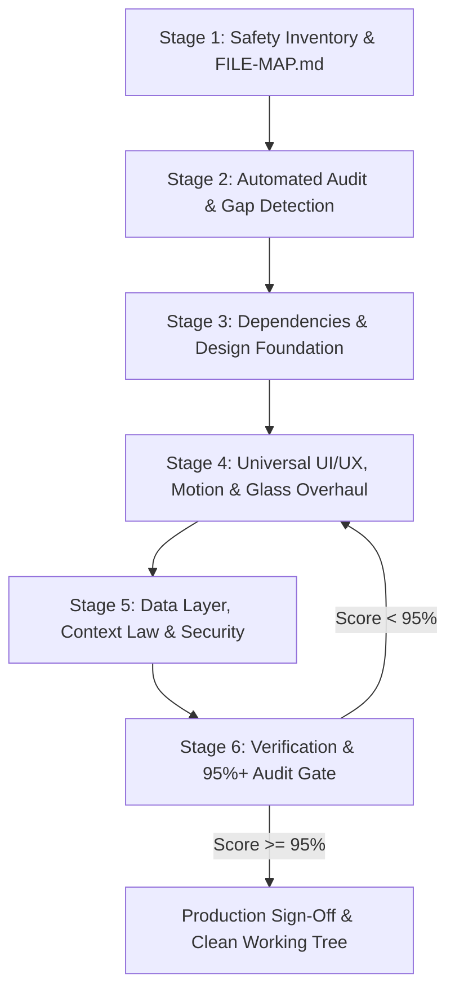

# Existing Project Retrofit & Modernization Engine
## Autonomous End-to-End Upgrade Protocol for Pre-Existing Repositories

> 🛡️ **THE CARDINAL DIRECTIVE FOR EXISTING CODEBASES**:  
> When instructed to *"complete this website according to the skill"*, *"modernize this existing site"*, or *"is website ko hamari skill ke mutabiq theek karo"*, the AI agent **MUST NOT** just make 1 or 2 cosmetic tweaks, leave components unstyled, or skip animations. The agent must execute this comprehensive 6-Stage Retrofit Protocol across the **ENTIRE** codebase, systematically auditing and upgrading every screen, component, and backend route until the repository achieves a **>= 95% compliance score** on the automated audit engine.

---

## 🎯 The Problem This Engine Solves

AI agents frequently fail when dropped into an existing codebase:
1. **Lazy Premature Exit**: The agent modifies a single file (like `page.tsx`), claims everything is finished, and leaves 90% of the website untouched, flat, and lifeless.
2. **Ignored Animations & Aesthetics**: The agent ignores motion physics, glassmorphism, and typography, leaving default browser elements and dull styling.
3. **Broken Features & Regressions**: The agent blindly replaces existing working state or routes without understanding the underlying business logic.
4. **Incomplete Subsystems**: Auth forms retain dangerous demo credentials or lack navigation links; direct API calls remain scattered across page components; Edge middleware is never configured.

This engine provides a deterministic, automated, and battle-tested procedure to elevate an existing application to the full standard of the **Website Builder Engine**.

---

## 🗺️ The 6-Stage Retrofit Execution Protocol



---

### 📦 Stage 1: Safety Inventory & Codebase Mapping
**Rule: Never touch code before mapping dependencies.**

1. **Perform Read-Only Codebase Survey**:
   - Inspect all folders, routes, components, and package manifests.
   - Identify existing business logic (forms, checkout, database models, payment routes).
2. **Generate / Update `FILE-MAP.md`**:
   - Create or update the living `FILE-MAP.md` at project root documenting:
     - Entry points (e.g. `app/layout.tsx`, `app/page.tsx`).
     - Primary routes and corresponding controller/context files.
     - Database models and external integrations.
   - Follow [`rules/SAFE_DEVELOPMENT_AND_FILE_MAP_RULES.md`](../rules/SAFE_DEVELOPMENT_AND_FILE_MAP_RULES.md).

---

### 🔍 Stage 2: Automated Audit & Gap Detection
**Rule: Quantify the gap with terminal evidence.**

1. Execute the automated Audit CLI script bundled with the global skill:
   ```bash
   node C:/Users/lenovo/.gemini/config/skills/website-builder-engine/scripts/audit-engine.js .
   ```
2. The script runs 30+ compliance checks across:
   - Root `/app` directory integrity (Zero `src/` wrapper).
   - Core dependency stack (`tailwindcss`, `framer-motion`, `lucide-react`, `clsx`, `tailwind-merge`).
   - Micro-animations, motion physics, glassmorphism, and dark mode support.
   - Floating label inputs.
   - Auth zero-demo compliance & bidirectional navigation links.
   - Root models, single-source-of-truth contexts, and Context Law compliance.
   - Edge Middleware route proxy (`middleware.ts`).
3. Save the failing checks as an explicit action checklist in `.project/RETROFIT_PLAN.md`.

---

### ⚡ Stage 3: Dependencies & Design Foundation Alignment
**Rule: Ensure modern primitives are installed before styling.**

1. **Package Harmonization**:
   If missing, install required modern dependencies:
   ```bash
   npm install framer-motion lucide-react clsx tailwind-merge
   ```
2. **Tailwind CSS & Token Verification**:
   - Ensure Tailwind CSS is configured.
   - Verify `tailwind.config.ts` or CSS root tokens support:
     - `darkMode: "class"` or modern CSS variables.
     - Fluid typography clamp scale per [`design-system/01_CSS_PROPERTIES_REFERENCE.md`](../design-system/01_CSS_PROPERTIES_REFERENCE.md).
     - Glassmorphism backdrop filter utilities.
3. **Class Utility `cn` Helper**:
   Ensure `lib/utils.ts` (or `lib/cn.ts`) is present:
   ```typescript
   import { clsx, type ClassValue } from "clsx";
   import { twMerge } from "tailwind-merge";

   export function cn(...inputs: ClassValue[]) {
     return twMerge(clsx(inputs));
   }
   ```

---

### 🎨 Stage 4: Universal UI/UX, Motion & Glass Overhaul
**Rule: No raw HTML, no lifeless cards, no missing animations.**

The agent must systematically upgrade **EVERY** existing page and component:

#### 1. Page Shell & Layout Transitions
- Wrap main page containers with Framer Motion entering transitions:
  ```tsx
  "use client";
  import { motion } from "framer-motion";

  export default function PageWrapper({ children }: { children: React.ReactNode }) {
    return (
      <motion.main
        initial={{ opacity: 0, y: 16 }}
        animate={{ opacity: 1, y: 0 }}
        transition={{ duration: 0.35, ease: "easeOut" }}
        className="min-h-screen bg-neutral-950 text-neutral-100 selection:bg-cyan-500/30"
      >
        {children}
      </motion.main>
    );
  }
  ```

#### 2. Glassmorphism & Depth Elevation
- Convert flat gray cards (`bg-gray-100`, `bg-neutral-800 border-gray-700`) into sleek frosted glass:
  ```tsx
  className="relative rounded-2xl border border-white/10 bg-neutral-900/60 p-6 backdrop-blur-xl shadow-2xl shadow-black/40 transition-all duration-300 hover:border-cyan-500/30 hover:shadow-cyan-500/10 hover:-translate-y-1"
  ```

#### 3. Interactive Motion & Micro-Interactions
- Add smooth feedback to buttons:
  ```tsx
  className="relative inline-flex items-center justify-center gap-2 rounded-xl bg-gradient-to-r from-cyan-500 to-blue-600 px-6 py-3 font-semibold text-white shadow-lg shadow-cyan-500/25 transition-all duration-200 hover:brightness-110 active:scale-[0.98] disabled:opacity-50"
  ```
- Stagger children grids/lists using `framer-motion` variants (`staggerChildren: 0.08`).

#### 4. Floating Label Form Inputs
- Replace raw `<input placeholder="Enter your name" />` with high-aesthetic Floating Label inputs per [`design-system/03_UI_COMPONENTS_LIBRARY.md`](../design-system/03_UI_COMPONENTS_LIBRARY.md).

#### 5. Mobile Ergonomics
- Public storefront pages: Implement fixed bottom navigation bar (`fixed bottom-0 left-0 right-0 z-50`) with 4 primary action icons and a `"More"` drawer.
- Dashboard views: Implement the floating bottom glass menu pill (`"Menu"` / `"Close"`) with dual-close controls per [`modules/MOBILE_NAVIGATION_AND_LAYOUT.md`](./MOBILE_NAVIGATION_AND_LAYOUT.md).

---

### 🔐 Stage 5: Data Layer, Context Law & Security Retrofit
**Rule: Eliminate dirty architecture, demo backdoors, and unauthenticated leaks.**

#### 1. Zero-Demo Auth Enforcement
- Open all login, signup, and reset forms.
- **Delete** all demo credentials, pre-filled values, and "Click to login as Admin/Owner" backdoor buttons.
- Initialize form state to `""`.
- Verify required bidirectional navigation links:
  - `/login`: Right-aligned `"Forgot password?"` above password field + `"Don't have an account? Sign up"` footer link.
  - `/signup`: `"Already have an account? Log in"` footer link.
  - `/forgot-password`: `"← Back to log in"` return link.

#### 2. Context Law Encapsulation
- Scan all `app/**/page.tsx` components.
- Identify direct `axios.get/post` or `fetch('/api/...')` calls.
- Migrate those API calls into dedicated domain Contexts (`context/OrderContext.tsx`, `context/AuthContext.tsx`).
- Components must consume data via `useOrder()`, `useAuth()`, ensuring reactive single-fetch state management.

#### 3. Edge Proxy Route Protection
- Create root `middleware.ts` if missing:
  - Guard protected paths (`/dashboard`, `/admin`, `/settings`, `/portal`).
  - Redirect unauthenticated users to `/login?redirect=...`.
  - Invalidate session caches on login/logout (`Cache-Control: no-store`).

---

### ✅ Stage 6: Universal Verification & 95%+ Audit Exit Gate
**Rule: You cannot claim completion until the audit script exits with Code 0.**

1. **Run the Audit Engine**:
   ```bash
   node C:/Users/lenovo/.gemini/config/skills/website-builder-engine/scripts/audit-engine.js .
   ```
2. **Evaluate the Verdict**:
   - If **Score < 95%** (Exit Code 1):  
     **THE AGENT MUST NOT STOP.** Read each failing item in the terminal output, locate the offending files, apply the remediation fixes, and re-run.
   - If **Score >= 95%** (Exit Code 0):  
     Compliance standard achieved!
3. **Execute Static Build Check**:
   ```bash
   npm run build
   ```
   Assert zero TypeScript or build errors.
4. **Synchronize `FILE-MAP.md`**:
   Update `FILE-MAP.md` with all new components, contexts, and modified routes.

---

## 📋 Retrofit Execution Checklist (Agent Prompt Card)

Whenever summoned to refactor or complete an existing site, execute:

- [ ] `[ ]` **Step 1**: Run `node <skill-path>/scripts/audit-engine.js .` to establish baseline failure score.
- [ ] `[ ]` **Step 2**: Create `.project/RETROFIT_PLAN.md` with every failing item categorized.
- [ ] `[ ]` **Step 3**: Install missing packages (`framer-motion`, `lucide-react`, `clsx`, `tailwind-merge`).
- [ ] `[ ]` **Step 4**: Upgrade all page shells with Framer Motion entry transitions and dark mode canvas.
- [ ] `[ ]` **Step 5**: Elevate cards, modals, and headers to glassmorphism (`backdrop-blur-xl border-white/10`).
- [ ] `[ ]` **Step 6**: Purge all demo login buttons from auth views; connect bidirectional auth links.
- [ ] `[ ]` **Step 7**: Migrate direct page component API calls into `/context/` domain providers.
- [ ] `[ ]` **Step 8**: Deploy `middleware.ts` for Edge route proxy and session protection.
- [ ] `[ ]` **Step 9**: Re-run `audit-engine.js` until compliance score reaches **>= 95%**.
- [ ] `[ ]` **Step 10**: Verify `npm run build` succeeds with zero errors; update `FILE-MAP.md`.
