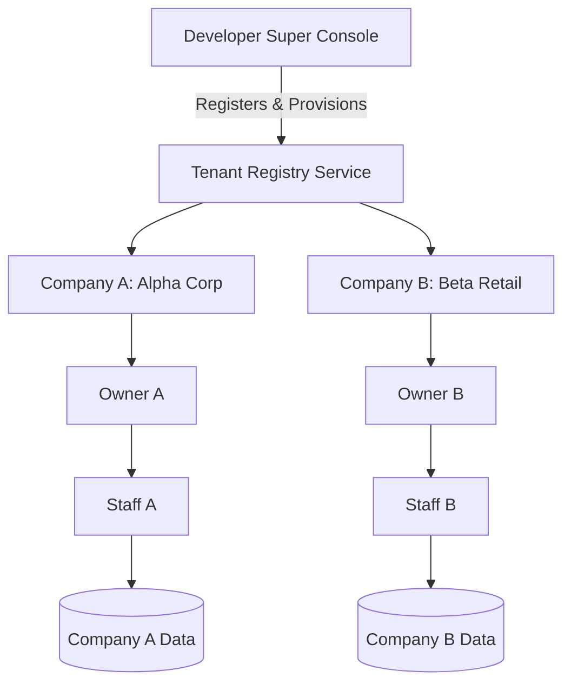

# Module Specification: Multi-Company & Multi-Tenant Architecture

> **PURPOSE**: Enables hosting multiple independent companies/tenants on a single application codebase while guaranteeing strict data isolation, custom domain resolution, and independent company management.

---

## 🏢 1. System Topology & Separation of Concerns



### Roles in Multi-Tenancy:
1. **Developer**: The platform operator. Onboards companies, sets tenant slugs, provisions database namespaces, and monitors global billing/uptime.
2. **Company Owner**: Sovereign master of their company. Onboards their own staff, configures their domain, runs their store/operations, and manages orders.
3. **Data Isolation**: A query executed by Company A's staff can **NEVER** return or mutate records belonging to Company B.

---

## 🌐 2. Domain & Routing Strategies

### 2.1 Supported Routing Models

| Strategy | URL Example | Best Use Case |
| :--- | :--- | :--- |
| **Subdomain** | `acme.platform.com` | Standard SaaS customer portals and public catalogs |
| **Custom Domain** | `www.acmestore.com` | White-label client brands via CNAME mapping |
| **Path / ID Based** | `platform.com/c/acme/orders` | Internal dashboards or low-tier shared plans |
| **Dedicated Tenant Root**| `platform.com/` (rewritten) | Single-tenant lookup / company portal switcher |

---

## 🔀 3. Next.js Edge Middleware Domain Resolver (`middleware.ts`)

Next.js App Router allows rewriting incoming requests based on the `Host` header:

```typescript
import { NextRequest, NextResponse } from "next/server";

export const config = {
  matcher: ["/((?!api/|_next/|_static/|[\\w-]+\\.\\w+).*)"],
};

export default async function middleware(req: NextRequest) {
  const url = req.nextUrl;
  const hostname = req.headers.get("host") || "";

  // 1. Define platform root domain
  const rootDomain = process.env.NEXT_PUBLIC_ROOT_DOMAIN || "platform.com";

  // 2. Identify if current request is Subdomain or Custom Domain
  let currentHost: string;
  if (process.env.NODE_ENV === "production") {
    currentHost = hostname.replace(`.${rootDomain}`, "");
  } else {
    // Local development (e.g. acme.localhost:3000)
    currentHost = hostname.replace(".localhost:3000", "");
  }

  // 3. Handle Platform Root Landing & Developer Console
  if (hostname === rootDomain || hostname === "localhost:3000") {
    if (url.pathname.startsWith("/system-console")) {
      return NextResponse.rewrite(new URL(`/system-console${url.pathname}`, req.url));
    }
    return NextResponse.next();
  }

  // 4. Handle Tenant Routing (Rewrite to /_tenants/[tenantSlug]/...)
  const tenantSlug = currentHost; // e.g. "acme" or "www.acmestore.com"
  return NextResponse.rewrite(
    new URL(`/_tenants/${tenantSlug}${url.pathname}${url.search}`, req.url)
  );
}
```

---

## 🗄️ 4. MongoDB Multi-Tenant Document Scoping & Collection Isolation

### Strategy A: Shared MongoDB Database with `companyId` Document Scoping (Recommended)
Every tenant-scoped MongoDB collection includes an indexed `companyId` (`ObjectId` reference to the `companies` collection):

```typescript
// models/Order.ts (Mongoose / MongoDB)
import mongoose, { Schema, Document } from "mongoose";

export interface IOrder extends Document {
  companyId: mongoose.Types.ObjectId;
  customerId: mongoose.Types.ObjectId;
  orderNumber: string;
  totalAmount: number;
  status: "PENDING" | "PROCESSING" | "SHIPPED" | "DELIVERED" | "CANCELLED";
  items: Array<{
    productId: mongoose.Types.ObjectId;
    name: string;
    quantity: number;
    price: number;
  }>;
  createdAt: Date;
  updatedAt: Date;
}

const OrderSchema = new Schema<IOrder>(
  {
    companyId: { type: Schema.Types.ObjectId, ref: "Company", required: true, index: true },
    customerId: { type: Schema.Types.ObjectId, ref: "User", required: true, index: true },
    orderNumber: { type: String, required: true },
    totalAmount: { type: Number, required: true },
    status: {
      type: String,
      enum: ["PENDING", "PROCESSING", "SHIPPED", "DELIVERED", "CANCELLED"],
      default: "PENDING",
      index: true,
    },
    items: [
      {
        productId: { type: Schema.Types.ObjectId, ref: "Product" },
        name: String,
        quantity: Number,
        price: Number,
      },
    ],
  },
  { timestamps: true }
);

// Compound Indexes for fast tenant-scoped queries
OrderSchema.index({ companyId: 1, createdAt: -1 });
OrderSchema.index({ companyId: 1, status: 1 });
OrderSchema.index({ companyId: 1, orderNumber: 1 }, { unique: true });

export const Order = mongoose.models.Order || mongoose.model<IOrder>("Order", OrderSchema);
```

#### Automatic Tenant Filtering (FastAPI / Motor Async MongoDB Dependency):
```python
from fastapi import Header, HTTPException, Depends
from bson import ObjectId
from app.db.mongo import get_mongo_db

async def get_tenant_company(
    x_tenant_id: str = Header(..., alias="X-Tenant-ID"),
    db = Depends(get_mongo_db)
):
    try:
        tenant_obj_id = ObjectId(x_tenant_id)
    except Exception:
        raise HTTPException(status_code=400, detail="Invalid Tenant ID format.")

    company = await db.companies.find_one({"_id": tenant_obj_id, "isActive": True})
    if not company:
        raise HTTPException(status_code=404, detail="Tenant organization not found or suspended.")
    return company

# All queries in routes inject this company filter automatically:
@router.get("/orders")
async def list_orders(company = Depends(get_tenant_company), db = Depends(get_mongo_db)):
    cursor = db.orders.find({"companyId": company["_id"]}).sort("createdAt", -1)
    return await cursor.to_list(length=100)
```

---

## 🛠️ 5. Developer Super Console Workflow

The Developer Super Console (`/system-console`) exposes:
1. **Tenant Registration**:
   - Company Name, Business Email, Slug (e.g. `acme`), Custom Domain.
   - Initial Owner provision (sends welcome setup link with temporary credentials).
2. **Subscription & Safeguard Status**:
   - Toggle active status, inspect storage usage, view `{ paymentClear: boolean }`.
3. **Audit Log & Health**:
   - Real-time error traces, database connection pool metrics, API throughput.

---

## ⚙️ 6. Tenant-Specific Settings Isolation & Developer Configuration Overrides

Cross-referenced with [`modules/SETTINGS_AND_FEATURE_FLAGS_SYSTEM.md`](./SETTINGS_AND_FEATURE_FLAGS_SYSTEM.md).

In multi-tenant architectures, settings and integration credentials must operate under strict tenant boundaries:
1. **Isolated Tenant Settings (`tenant_settings`)**:
   - Every tenant maintains an isolated configuration profile keyed by `company_id`.
   - Tenants can configure their own custom credentials (custom SMTP, dedicated WhatsApp Business number, isolated Cloudflare R2 / AWS S3 bucket, and custom AI API keys).
2. **Developer Super-Admin Override**:
   - The Developer can view, edit, or override any tenant's settings from `/system-console/tenants/:id/settings`.
   - The Developer can assign **Shared Platform Defaults** to new tenants or mandate **Tenant-Owned Custom Credentials** for enterprise tiers.
3. **Tenant-Level Feature Flags**:
   - The Developer can enable or disable feature modules per tenant (e.g., Enable AI Copilot & 3D Viewer for Tier 1 Enterprise tenants, but keep them completely hidden and unrendered for Starter tenants under the **Zero-Leak UI Elimination Law**).
   - **Tenant-Level Animation Engine (`feature:animations`)**: The Developer or Owner can toggle whether rich micro-animations (100 Hover presets, 100 Task loop animations, Canvas Dustbin 3D deletion) are active for that specific tenant. Tenants with `feature:animations === false` automatically run in clean Instant Fallback Mode with zero GPU overhead.
4. **Data Isolation Security**:
   - Database queries for credentials always inject `company_id` filter via middleware.
   - Tenant A can never inspect, decrypt, or access Tenant B's service credentials.

---

## 🎨 7. Tenant-Specific Visual CMS Provisioning & Developer Delegation

Cross-referenced with [`modules/CMS_ENGINE.md`](./CMS_ENGINE.md#21-multi-tenant-cms-isolation--developer-delegation).

In multi-tenant deployments, each company is provisioned with their own sovereign Visual Content Management System:

### 7.1 Independent Tenant CMS Space (`/dashboard/cms`)
- Every tenant operates an isolated CMS namespace storing their own:
  - **Public Pages & Section Trees** (`CmsPage` scoped by `companyId`).
  - **Digital Asset Library (DAM)** (`CmsAsset` with tenant bucket isolation).
  - **Website Details & Global Brand Identity** (`CmsWebsiteDetails` with logos, contact info, and shell auto-cascade).
  - **Auth Pages Theme & Layout Config** (`CmsAuthThemeConfig` with custom light/dark palettes and mobile anti-compression rules).
  - **Dynamic Document & Messaging Templates** (`CmsDocumentTemplate` for PDF canvas, Email blocks, and WhatsApp messages).

### 7.2 Developer Delegation & Governance Matrix
- **Developer Sovereign Console (`/system-console/tenants/:id/cms`)**:
  - The platform Developer retains ultimate authority over all tenant CMS instances.
  - The Developer toggles tenant-level CMS capabilities:
    - `enableVisualBuilder`: Visual drag-and-drop page editor.
    - `enableCodeEditor`: Direct Monaco HTML/CSS editing (can be locked to protect layout stability).
    - `enableCustomSectionSdk`: Access to the Section SDK for uploading custom React components.
    - `enableDocumentStudio`: Access to the PDF, Email, and WhatsApp studios.
- **Tenant Owner & Delegated Administration**:
  - Once granted by the Developer, the tenant Owner or Admin manages their website, assets, and branding independently from their dashboard, without developer intervention for day-to-day visual updates.

---

## 🛡️ 8. Tenant Role-Based Access Control (RBAC) & Sovereign Data Scoping

Cross-referenced with master specification [`modules/RBAC_SYSTEM.md`](./RBAC_SYSTEM.md).

Multi-tenant architectures require distinct boundary layers between platform operators, tenant business owners, staff members, and clients:

### 8.1 The 4-Tier Data Access Topology
1. **Developer Platform Boundary (Tier 0)**:
   - Developer data (platform infrastructure, master encryption keys, tenant registry, cross-tenant telemetry) is strictly untouchable. No tenant, owner, or staff member can access developer data.
   - Developer super-admins retain cross-tenant read/support visibility to diagnose platform issues.
2. **Tenant Company Owner Sovereignty (Tier 1)**:
   - Inside their tenant organization (`companyId`), the Company Owner is sovereign and sees 100% of company data.
   - The Owner assigns page access, button permissions, and data scopes to company staff roles.
3. **Staff-Client Referral & Attribution Flow (Tier 2)**:
   - When a staff member onboards a customer or client, the record stores `createdBy: staffUser._id`, `assignedStaffId: staffUser._id`, and optional `referralStaffId`.
   - When configured with the `OWN_ONLY` data scope, staff members seamlessly manage and create orders for their own clients, while records belonging to other staff members remain strictly invisible in both the UI and database queries.
4. **End-User Customer Portal (Tier 3)**:
   - End-user customers log into `/portal` to view only their own orders and invoices.

### 8.2 Strict Tenant Isolation for Role & User Pickers
- When the Owner configures `SELECTED_ROLES` or `SELECTED_USERS` in the RBAC Permission Studio, selector dropdowns **strictly execute queries scoped to `{ companyId: currentTenant.id }`**. Cross-tenant leakage is mathematically impossible.

---

## 🚧 9. Tenant Maintenance Mode Isolation & Sovereign Access Enforcement

Cross-referenced with master specification [`modules/CMS_ENGINE.md`](./CMS_ENGINE.md#25-website-maintenance-mode-studio--sovereign-access-interceptor) and [`modules/ROUTE_PROXY_AND_PROTECTION_SYSTEM.md`](./ROUTE_PROXY_AND_PROTECTION_SYSTEM.md#7-edge-middleware-maintenance-mode-interception--sovereign-bypass-handshake).

In a multi-tenant ecosystem, maintenance states must operate with complete company boundary isolation:

### 9.1 Tenant-Specific Maintenance Namespace (`companyId`)
1. **Independent Tenant Activation**:
   - Every tenant organization maintains its own isolated `CmsMaintenanceConfig` document scoped by `companyId`.
   - When Company A toggles Maintenance Mode **ON** from `/dashboard/cms/maintenance`, **only Company A's domain/subdomain is intercepted**. Company B, Company C, and the Platform Developer Console continue to operate normally with zero disruption.
2. **Dynamic Tenant Branding & Tagline Paragraph**:
   - The intercepted maintenance screen dynamically renders Company A's custom headline, explanatory message/tagline paragraph, emergency support contacts, and company logo from `CmsWebsiteDetails`.

### 9.2 Sovereign Access Rules in Multi-Tenancy
- **Developer Privilege**: The Platform Developer retains universal sovereign bypass across all tenants to diagnose server issues, run database migrations, or test releases.
- **Tenant Owner Privilege**: The Company Owner has full bypass access within their own tenant to verify store updates and inspect CMS pages.
- **Strict Staff & Customer Lockout**:
  - Staff members, operational employees, and customers belonging to that tenant **CANNOT access operational pages or dashboards** during maintenance.
  - The Edge Middleware intercepts their navigation and displays either the public `<MaintenanceModeView />` or post-login `<MaintenanceLockoutScreen />`.


