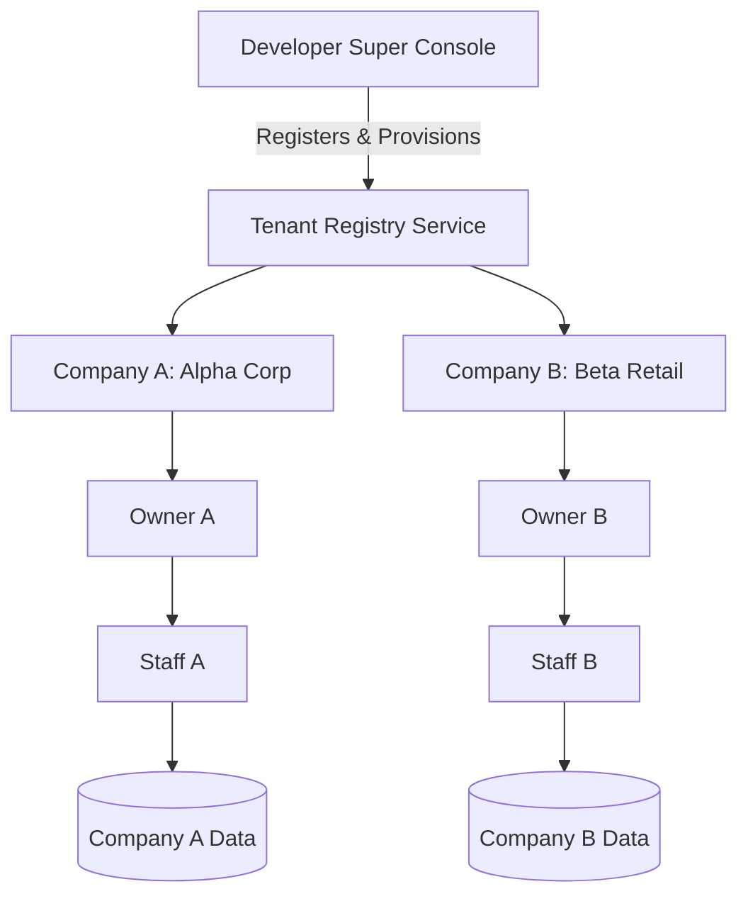

# Module Specification: Multi-Company & Multi-Tenant Architecture

> **PURPOSE**: Enables hosting multiple independent companies/tenants on a single application codebase while guaranteeing strict data isolation, custom domain resolution, and independent company management.

---

## 🏢 1. System Topology & Separation of Concerns



### Roles in Multi-Tenancy:
1. **Developer**: The platform operator. Onboards companies, sets tenant slugs, provisions database namespaces, and monitors global billing/uptime.
2. **Company Owner**: Sovereign master of their company. Onboards their own staff, configures their domain, runs their store/operations, and manages orders.
3. **Data Isolation**: A query executed by Company A's staff can **NEVER** return or mutate records belonging to Company B.

---

## 🌐 2. Domain & Routing Strategies

### 2.1 Supported Routing Models

| Strategy | URL Example | Best Use Case |
| :--- | :--- | :--- |
| **Subdomain** | `acme.platform.com` | Standard SaaS customer portals and public catalogs |
| **Custom Domain** | `www.acmestore.com` | White-label client brands via CNAME mapping |
| **Path / ID Based** | `platform.com/c/acme/orders` | Internal dashboards or low-tier shared plans |
| **Dedicated Tenant Root**| `platform.com/` (rewritten) | Single-tenant lookup / company portal switcher |

---

## 🔀 3. Next.js Edge Middleware Domain Resolver (`middleware.ts`)

Next.js App Router allows rewriting incoming requests based on the `Host` header:

```typescript
import { NextRequest, NextResponse } from "next/server";

export const config = {
  matcher: ["/((?!api/|_next/|_static/|[\\w-]+\\.\\w+).*)"],
};

export default async function middleware(req: NextRequest) {
  const url = req.nextUrl;
  const hostname = req.headers.get("host") || "";

  // 1. Define platform root domain
  const rootDomain = process.env.NEXT_PUBLIC_ROOT_DOMAIN || "platform.com";

  // 2. Identify if current request is Subdomain or Custom Domain
  let currentHost: string;
  if (process.env.NODE_ENV === "production") {
    currentHost = hostname.replace(`.${rootDomain}`, "");
  } else {
    // Local development (e.g. acme.localhost:3000)
    currentHost = hostname.replace(".localhost:3000", "");
  }

  // 3. Handle Platform Root Landing & Developer Console
  if (hostname === rootDomain || hostname === "localhost:3000") {
    if (url.pathname.startsWith("/system-console")) {
      return NextResponse.rewrite(new URL(`/system-console${url.pathname}`, req.url));
    }
    return NextResponse.next();
  }

  // 4. Handle Tenant Routing (Rewrite to /_tenants/[tenantSlug]/...)
  const tenantSlug = currentHost; // e.g. "acme" or "www.acmestore.com"
  return NextResponse.rewrite(
    new URL(`/_tenants/${tenantSlug}${url.pathname}${url.search}`, req.url)
  );
}
```

---

## 🗄️ 4. Database Isolation Strategies

### Strategy A: Shared Database with Row-Level Security (Recommended)
Every tenant-scoped table includes an indexed `company_id` (or `tenant_id`):

```sql
CREATE TABLE orders (
    id VARCHAR(64) PRIMARY KEY,
    company_id VARCHAR(64) NOT NULL REFERENCES companies(id) ON DELETE CASCADE,
    customer_id VARCHAR(64) NOT NULL,
    total_amount NUMERIC(10, 2) NOT NULL,
    status VARCHAR(32) NOT NULL DEFAULT 'PENDING',
    created_at TIMESTAMP WITH TIME ZONE DEFAULT NOW()
);

CREATE INDEX idx_orders_company_id ON orders(company_id);
```

#### Automatic Tenant Filtering (FastAPI / SQLAlchemy Dependency):
```python
from fastapi import Header, HTTPException, Depends
from sqlalchemy.orm import Session
from app.db.session import get_db

def get_tenant_company(
    x_tenant_id: str = Header(..., alias="X-Tenant-ID"),
    db: Session = Depends(get_db)
):
    company = db.query(Company).filter(Company.id == x_tenant_id, Company.is_active == True).first()
    if not company:
        raise HTTPException(status_code=404, detail="Tenant organization not found or suspended.")
    return company

# All queries in routes inject this company filter automatically:
@router.get("/orders")
def list_orders(company = Depends(get_tenant_company), db: Session = Depends(get_db)):
    return db.query(Order).filter(Order.company_id == company.id).all()
```

---

## 🛠️ 5. Developer Super Console Workflow

The Developer Super Console (`/system-console`) exposes:
1. **Tenant Registration**:
   - Company Name, Business Email, Slug (e.g. `acme`), Custom Domain.
   - Initial Owner provision (sends welcome setup link with temporary credentials).
2. **Subscription & Safeguard Status**:
   - Toggle active status, inspect storage usage, view `{ paymentClear: boolean }`.
3. **Audit Log & Health**:
   - Real-time error traces, database connection pool metrics, API throughput.
