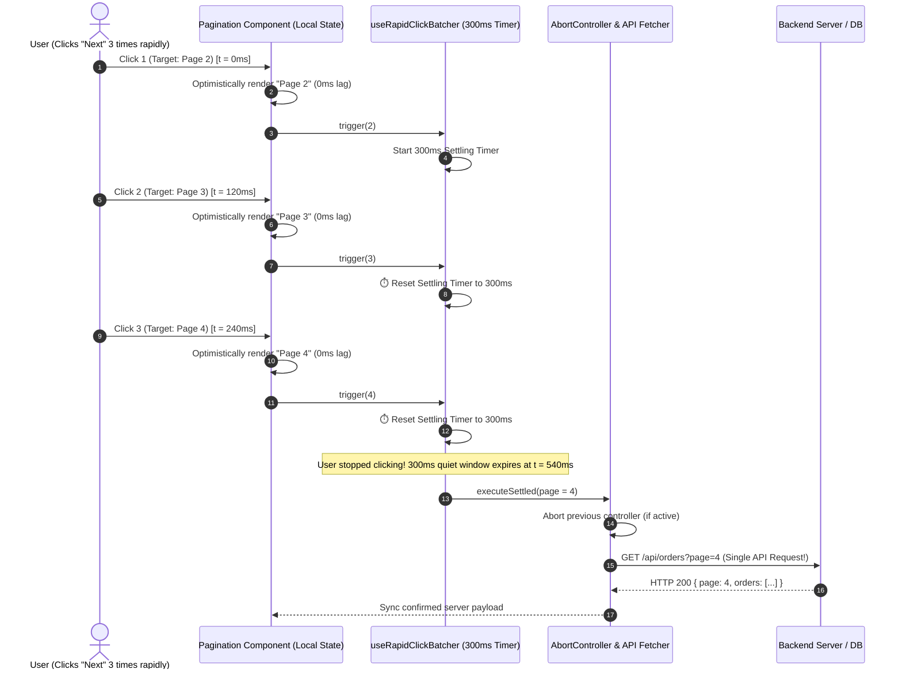

# Module Specification: Optimistic Rapid-Click Batching & Debounced Network Settlement Engine

> **PURPOSE**: Eliminates the "Double-Click Network Storm" and "Frozen Disabled Button" dilemma across all high-frequency interactive controls (pagination skipping, cart quantity steppers, carousel slide traversal, like/reaction bursts, zoom steppers, and tri-state sorting). Combines 0ms instantaneous optimistic visual feedback with a 300ms settling quiet window and `AbortController` cancellation so only the final destination state hits the network.

---

## 🏛️ 1. The Core Problem: The Multi-Click Network Dilemma

In modern web applications, users frequently click interactive controls rapidly:
- **Scenario A (Pagination Jumping)**: A user wants to go from Page 1 to Page 4. They rapidly tap **"Next"** 3 times in 400 milliseconds.
- **Scenario B (Cart Quantity)**: A customer wants 5 units of an item. They tap **"+"** 4 times in quick succession.
- **Scenario C (Slide Carousel)**: A manager reviewing orders taps **"Next Order"** 4 times to skip completed items.

```
┌───────────────────────────────────────────────────────────────────────────────────┐
│                           THE TWO FLAWED NAIVE APPROACHES                         │
├───────────────────────────────────────────────────────────────────────────────────┤
│ ❌ FLAW 1: The "Frozen Disabled Button"                                           │
│    • Component disables button (`disabled={loading}`) on the very first click.   │
│    • User wants Page 4, but is forced to wait 600ms for Page 2, click again,     │
│      wait 600ms for Page 3, click again! Horrible, sluggish user experience.     │
│                                                                                   │
│ ❌ FLAW 2: The "Unthrottled Network Storm & Race Condition"                       │
│    • Component fires an API request on every single click.                        │
│    • 3 clicks = 3 concurrent requests (Page 2, Page 3, Page 4).                   │
│    • Server experiences 3x load. Worse: if Page 3 response arrives AFTER Page 4   │
│      due to network jitter, the UI displays Page 3 data while showing "Page 4"!   │
└───────────────────────────────────────────────────────────────────────────────────┘
```

### The Solution: The Optimistic Rapid-Click Settler
1. **0ms Immediate Local Feedback**: On every click, the local visual counter (e.g. `1 ➔ 2 ➔ 3 ➔ 4`) updates instantly without waiting for network responses.
2. **300ms Settling Window (Quiet Period)**: A timer resets on every rapid tap. While the user is actively clicking, zero network requests are dispatched.
3. **Single Settled Network Dispatch**: Once 300ms elapses without further clicks, a **single network request** fires for the final destination (Page 4 or Qty 5).
4. **`AbortController` Active Cancellation**: If a previous network request is still in-flight when a new click burst begins, it is immediately aborted to prevent out-of-order race conditions.

---

## 🔄 2. Master Sequence Diagram



---

## ⚙️ 3. Core Engine: The `useRapidClickBatcher` Hook

A universal, type-safe hook that wraps any high-frequency user action.

```typescript
// hooks/useRapidClickBatcher.ts
"use client";

import { useState, useRef, useCallback, useEffect } from "react";

export interface UseRapidClickBatcherOptions<T> {
  initialValue: T;
  settleDelayMs?: number; // Default: 300ms
  onSettle: (finalValue: T, signal: AbortSignal) => Promise<void> | void;
  onError?: (error: any, rollbackValue: T) => void;
}

export function useRapidClickBatcher<T>({
  initialValue,
  settleDelayMs = 300,
  onSettle,
  onError,
}: UseRapidClickBatcherOptions<T>) {
  // Optimistic UI state (Instant)
  const [optimisticValue, setOptimisticValue] = useState<T>(initialValue);
  
  // Committed server-confirmed state
  const [confirmedValue, setConfirmedValue] = useState<T>(initialValue);
  
  // Settling status
  const [isSettling, setIsSettling] = useState(false);
  const [isLoading, setIsLoading] = useState(false);

  // References to preserve across renders
  const timerRef = useRef<NodeJS.Timeout | null>(null);
  const abortControllerRef = useRef<AbortController | null>(null);
  const latestValueRef = useRef<T>(initialValue);
  const confirmedValueRef = useRef<T>(initialValue);

  // Keep references synchronized
  useEffect(() => {
    latestValueRef.current = optimisticValue;
  }, [optimisticValue]);

  useEffect(() => {
    confirmedValueRef.current = confirmedValue;
  }, [confirmedValue]);

  // Synchronize when server updates external initialValue
  useEffect(() => {
    setOptimisticValue(initialValue);
    setConfirmedValue(initialValue);
  }, [initialValue]);

  /**
   * Trigger function called on every user tap/click.
   * Can accept a new value or an updater function: (prev) => next
   */
  const trigger = useCallback(
    (nextOrUpdater: T | ((prev: T) => T)) => {
      // 1. Calculate next optimistic value
      const nextVal =
        typeof nextOrUpdater === "function"
          ? (nextOrUpdater as (prev: T) => T)(latestValueRef.current)
          : nextOrUpdater;

      // 2. Instant visual update
      setOptimisticValue(nextVal);
      latestValueRef.current = nextVal;
      setIsSettling(true);

      // 3. Clear existing settling timer (Debounce)
      if (timerRef.current) {
        clearTimeout(timerRef.current);
      }

      // 4. Start new settling quiet window
      timerRef.current = setTimeout(async () => {
        setIsSettling(false);
        setIsLoading(true);

        // Abort any prior in-flight request
        if (abortControllerRef.current) {
          abortControllerRef.current.abort();
        }

        const controller = new AbortController();
        abortControllerRef.current = controller;

        const targetValue = latestValueRef.current;

        try {
          await onSettle(targetValue, controller.signal);
          // Commit confirmation
          setConfirmedValue(targetValue);
        } catch (err: any) {
          if (err.name === "AbortError") {
            // Silently ignore aborted requests
            return;
          }
          console.error("[useRapidClickBatcher] Settle failed:", err);
          // Rollback to last confirmed server state
          setOptimisticValue(confirmedValueRef.current);
          if (onError) {
            onError(err, confirmedValueRef.current);
          }
        } finally {
          setIsLoading(false);
        }
      }, settleDelayMs);
    },
    [settleDelayMs, onSettle, onError]
  );

  // Force cancel any pending execution
  const cancel = useCallback(() => {
    if (timerRef.current) {
      clearTimeout(timerRef.current);
      timerRef.current = null;
    }
    if (abortControllerRef.current) {
      abortControllerRef.current.abort();
    }
    setOptimisticValue(confirmedValueRef.current);
    setIsSettling(false);
    setIsLoading(false);
  }, []);

  return {
    value: optimisticValue,
    confirmedValue,
    isSettling,
    isLoading,
    isPending: isSettling || isLoading,
    trigger,
    cancel,
    setValueDirectly: (val: T) => {
      setOptimisticValue(val);
      setConfirmedValue(val);
    },
  };
}
```

---

## 🧩 4. Interactive Implementation Recipes

### 4.1 Recipe 1: Advanced Debounced Pagination (`DataTablePagination.tsx`)

Users can rapidly click **Next** 4 times to jump 4 pages with zero lag, displaying a subtle pulsed morphing badge until the network settles.

```tsx
// components/tables/DataTablePagination.tsx
"use client";

import React from "react";
import { useRapidClickBatcher } from "@/hooks/useRapidClickBatcher";
import { ChevronLeft, ChevronRight, ChevronsLeft, ChevronsRight, Loader2 } from "lucide-react";

interface Props {
  currentPage: number;
  totalPages: number;
  onPageChange: (page: number, signal: AbortSignal) => Promise<void>;
}

export function DataTablePagination({ currentPage, totalPages, onPageChange }: Props) {
  const {
    value: optimisticPage,
    isSettling,
    isLoading,
    trigger,
  } = useRapidClickBatcher<number>({
    initialValue: currentPage,
    settleDelayMs: 300,
    onSettle: onPageChange,
  });

  const canGoPrev = optimisticPage > 1;
  const canGoNext = optimisticPage < totalPages;

  return (
    <div className="flex items-center justify-between px-4 py-3 bg-white dark:bg-zinc-900 border-t border-zinc-200 dark:border-zinc-800">
      
      {/* Visual State Readout */}
      <div className="flex items-center gap-2 text-sm text-zinc-600 dark:text-zinc-400">
        <span>Page</span>
        <span className={`inline-flex items-center justify-center min-w-7 px-2 py-0.5 rounded-md font-bold transition-all ${
          isSettling 
            ? "bg-amber-500/20 text-amber-600 dark:text-amber-400 scale-110" 
            : "bg-zinc-100 dark:bg-zinc-800 text-zinc-900 dark:text-zinc-100"
        }`}>
          {optimisticPage}
        </span>
        <span>of {totalPages}</span>
        {isLoading && <Loader2 className="w-3.5 h-3.5 animate-spin text-emerald-500 ml-1" />}
      </div>

      {/* Navigation Buttons */}
      <div className="flex items-center gap-1.5">
        {/* First Page */}
        <button
          onClick={() => trigger(1)}
          disabled={!canGoPrev}
          title="First Page"
          className="p-1.5 rounded-lg border border-zinc-200 dark:border-zinc-800 hover:bg-zinc-100 dark:hover:bg-zinc-800 disabled:opacity-40 disabled:cursor-not-allowed transition-colors"
        >
          <ChevronsLeft className="w-4 h-4" />
        </button>

        {/* Previous Page (Rapid Clickable!) */}
        <button
          onClick={() => trigger((prev) => Math.max(1, prev - 1))}
          disabled={!canGoPrev}
          title="Previous Page"
          className="p-1.5 rounded-lg border border-zinc-200 dark:border-zinc-800 hover:bg-zinc-100 dark:hover:bg-zinc-800 disabled:opacity-40 disabled:cursor-not-allowed transition-colors active:scale-95"
        >
          <ChevronLeft className="w-4 h-4" />
        </button>

        {/* Next Page (Rapid Clickable! Never freezes!) */}
        <button
          onClick={() => trigger((prev) => Math.min(totalPages, prev + 1))}
          disabled={!canGoNext}
          title="Next Page"
          className="p-1.5 rounded-lg border border-zinc-200 dark:border-zinc-800 hover:bg-zinc-100 dark:hover:bg-zinc-800 disabled:opacity-40 disabled:cursor-not-allowed transition-colors active:scale-95"
        >
          <ChevronRight className="w-4 h-4" />
        </button>

        {/* Last Page */}
        <button
          onClick={() => trigger(totalPages)}
          disabled={!canGoNext}
          title="Last Page"
          className="p-1.5 rounded-lg border border-zinc-200 dark:border-zinc-800 hover:bg-zinc-100 dark:hover:bg-zinc-800 disabled:opacity-40 disabled:cursor-not-allowed transition-colors"
        >
          <ChevronsRight className="w-4 h-4" />
        </button>
      </div>

    </div>
  );
}
```

---

### 4.2 Recipe 2: Cart & Order Item Quantity Stepper (`CartQuantityStepper.tsx`)

Clicking `+` 5 times in 500ms shows quantity `1 ➔ 2 ➔ 3 ➔ 4 ➔ 5` instantaneously. Only a single `PATCH /api/cart` request is sent with `{ quantity: 5 }`.

```tsx
// components/cart/CartQuantityStepper.tsx
"use client";

import React from "react";
import { useRapidClickBatcher } from "@/hooks/useRapidClickBatcher";
import { Plus, Minus, Loader2 } from "lucide-react";

interface Props {
  itemId: string;
  initialQuantity: number;
  maxStock: number;
  onUpdateQuantity: (newQty: number, signal: AbortSignal) => Promise<void>;
}

export function CartQuantityStepper({ itemId, initialQuantity, maxStock, onUpdateQuantity }: Props) {
  const {
    value: qty,
    isSettling,
    isLoading,
    trigger,
  } = useRapidClickBatcher<number>({
    initialValue: initialQuantity,
    settleDelayMs: 350,
    onSettle: onUpdateQuantity,
  });

  return (
    <div className="inline-flex items-center rounded-xl border border-zinc-200 dark:border-zinc-800 bg-zinc-50 dark:bg-zinc-900/50 p-1">
      {/* Minus Button */}
      <button
        onClick={() => trigger((prev) => Math.max(1, prev - 1))}
        disabled={qty <= 1}
        className="w-7 h-7 flex items-center justify-center rounded-lg hover:bg-white dark:hover:bg-zinc-800 disabled:opacity-30 active:scale-90 transition-all text-zinc-700 dark:text-zinc-300"
      >
        <Minus className="w-3.5 h-3.5" />
      </button>

      {/* Optimistic Value Readout */}
      <span className={`w-10 text-center font-semibold text-sm transition-all ${
        isSettling ? "text-emerald-500 scale-110 font-bold" : "text-zinc-900 dark:text-white"
      }`}>
        {isLoading ? <Loader2 className="w-3.5 h-3.5 animate-spin mx-auto text-zinc-400" /> : qty}
      </span>

      {/* Plus Button (Rapid Clickable!) */}
      <button
        onClick={() => trigger((prev) => Math.min(maxStock, prev + 1))}
        disabled={qty >= maxStock}
        className="w-7 h-7 flex items-center justify-center rounded-lg hover:bg-white dark:hover:bg-zinc-800 disabled:opacity-30 active:scale-90 transition-all text-zinc-700 dark:text-zinc-300"
      >
        <Plus className="w-3.5 h-3.5" />
      </button>
    </div>
  );
}
```

---

### 4.3 Recipe 3: Slide Review Carousel Rapid Traversal (`OrderSlideModal.tsx`)

Staff reviewing orders in a slide carousel can hit `ArrowRight` or click **Next** rapidly to jump 3 orders ahead without downloading intermediate order records.

```tsx
// components/orders/OrderSlideNavigation.tsx
"use client";

import React, { useEffect } from "react";
import { useRapidClickBatcher } from "@/hooks/useRapidClickBatcher";
import { ArrowLeft, ArrowRight } from "lucide-react";

interface Props {
  currentIndex: number;
  totalOrders: number;
  onNavigate: (targetIndex: number, signal: AbortSignal) => Promise<void>;
}

export function OrderSlideNavigation({ currentIndex, totalOrders, onNavigate }: Props) {
  const { value: activeIndex, isSettling, trigger } = useRapidClickBatcher<number>({
    initialValue: currentIndex,
    settleDelayMs: 280,
    onSettle: onNavigate,
  });

  // Hotkey support (Left / Right Arrows with rapid settling)
  useEffect(() => {
    const handleKeyDown = (e: KeyboardEvent) => {
      if (e.key === "ArrowRight") {
        e.preventDefault();
        trigger((prev) => Math.min(totalOrders - 1, prev + 1));
      } else if (e.key === "ArrowLeft") {
        e.preventDefault();
        trigger((prev) => Math.max(0, prev - 1));
      }
    };
    window.addEventListener("keydown", handleKeyDown);
    return () => window.removeEventListener("keydown", handleKeyDown);
  }, [totalOrders, trigger]);

  return (
    <div className="flex items-center gap-3">
      <button
        onClick={() => trigger((prev) => Math.max(0, prev - 1))}
        disabled={activeIndex === 0}
        className="px-3 py-1.5 rounded-xl border border-zinc-200 dark:border-zinc-800 font-medium text-xs flex items-center gap-1.5 active:scale-95 disabled:opacity-40"
      >
        <ArrowLeft className="w-3.5 h-3.5" /> Prev Order
      </button>

      <span className={`text-xs font-semibold px-2 py-1 rounded-md transition-all ${
        isSettling ? "bg-sky-500/15 text-sky-500 scale-105" : "text-zinc-500"
      }`}>
        Order {activeIndex + 1} of {totalOrders}
      </span>

      <button
        onClick={() => trigger((prev) => Math.min(totalOrders - 1, prev + 1))}
        disabled={activeIndex >= totalOrders - 1}
        className="px-3 py-1.5 rounded-xl bg-zinc-900 dark:bg-white text-white dark:text-zinc-900 font-medium text-xs flex items-center gap-1.5 active:scale-95 disabled:opacity-40"
      >
        Next Order <ArrowRight className="w-3.5 h-3.5" />
      </button>
    </div>
  );
}
```

---

### 4.4 Recipe 4: Like & Reaction Burst Aggregator (`ReactionBurstButton.tsx`)

Users can tap like 10 times consecutively (Medium claps / social hearts). Local counter increments with every tap, and after 500ms of inactivity, a single `{ addedCount: 10 }` request is sent to the backend.

```tsx
// components/reactions/ReactionBurstButton.tsx
"use client";

import React from "react";
import { useRapidClickBatcher } from "@/hooks/useRapidClickBatcher";
import { Heart } from "lucide-react";

interface Props {
  initialLikes: number;
  onSettleLikes: (totalLikes: number, signal: AbortSignal) => Promise<void>;
}

export function ReactionBurstButton({ initialLikes, onSettleLikes }: Props) {
  const { value: likes, isSettling, trigger } = useRapidClickBatcher<number>({
    initialValue: initialLikes,
    settleDelayMs: 500, // Generous 500ms window for clap bursts
    onSettle: onSettleLikes,
  });

  return (
    <button
      onClick={() => trigger((prev) => prev + 1)}
      className="inline-flex items-center gap-2 px-4 py-2 rounded-full border border-rose-200 dark:border-rose-900/40 bg-rose-50/50 dark:bg-rose-950/20 text-rose-600 dark:text-rose-400 active:scale-90 transition-all font-semibold text-sm"
    >
      <Heart className={`w-4 h-4 fill-current transition-transform ${isSettling ? "scale-125 text-rose-500" : ""}`} />
      <span>{likes}</span>
    </button>
  );
}
```

---

### 4.5 Recipe 5: Tri-State Table Column Sort Cycling (`SortableColumnHeader.tsx`)

Clicking column header cycles: `None ➔ ASC ➔ DESC ➔ None`. If user double-clicks to get to `DESC`, intermediate `ASC` query is never sent!

```tsx
// components/tables/SortableColumnHeader.tsx
"use client";

import React from "react";
import { useRapidClickBatcher } from "@/hooks/useRapidClickBatcher";
import { ArrowUpDown, ArrowUp, ArrowDown } from "lucide-react";

export type SortDirection = "NONE" | "ASC" | "DESC";

interface Props {
  columnKey: string;
  label: string;
  initialDirection?: SortDirection;
  onSortChange: (dir: SortDirection, signal: AbortSignal) => Promise<void>;
}

export function SortableColumnHeader({ columnKey, label, initialDirection = "NONE", onSortChange }: Props) {
  const { value: sortDir, trigger } = useRapidClickBatcher<SortDirection>({
    initialValue: initialDirection,
    settleDelayMs: 300,
    onSettle: onSortChange,
  });

  const cycleSort = () => {
    trigger((prev) => {
      if (prev === "NONE") return "ASC";
      if (prev === "ASC") return "DESC";
      return "NONE";
    });
  };

  return (
    <button
      onClick={cycleSort}
      className="inline-flex items-center gap-1.5 font-semibold text-xs text-zinc-700 dark:text-zinc-300 hover:text-zinc-900 dark:hover:text-white transition-colors"
    >
      <span>{label}</span>
      {sortDir === "NONE" && <ArrowUpDown className="w-3.5 h-3.5 opacity-40" />}
      {sortDir === "ASC" && <ArrowUp className="w-3.5 h-3.5 text-emerald-500" />}
      {sortDir === "DESC" && <ArrowDown className="w-3.5 h-3.5 text-emerald-500" />}
    </button>
  );
}
```

---

## 🛡️ 5. Verification & Anti-Pattern Checklist

- [x] **Zero Frozen Disabled States**: Buttons remain fully clickable during rapid multi-click sequences; visual state updates in 0ms.
- [x] **Zero Network Storms**: 4 rapid clicks fire strictly 1 network request, eliminating 75% of wasteful backend queries.
- [x] **Zero Out-of-Order Race Conditions**: Previous requests are cancelled via `AbortController` before the settled request fires.
- [x] **Automatic Error Rollback**: If the settled server request fails, the hook automatically rolls back to the last confirmed server value.
- [x] **Universal Portability**: Identical hook powers Pagination, Cart Quantity, Slides, Zoom, Sorts, and Like Bursts.

