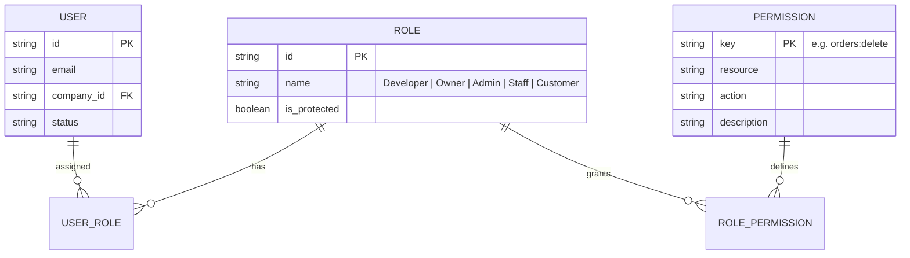

# Module Specification: Role-Based Access Control (RBAC) System

> **STATUS**: Ready for plug-and-play integration into any project requiring multi-user roles, action-level security, and dual-protection boundaries.

---

## 🏛️ 1. Architecture & Entity Relationship



---

## 🔑 2. Standard Permission Keys Catalog

| Resource | Action Keys | Description | Allowed Roles by Default |
| :--- | :--- | :--- | :--- |
| **Tenants / Companies** | `tenant:create`, `tenant:edit`, `tenant:delete`, `tenant:view_all` | Managing multi-company tenants | Developer |
| **System & Health** | `system:view_logs`, `system:run_migrations`, `system:configure` | Server & developer tooling | Developer |
| **Company Business** | `company:edit_profile`, `company:view_finances`, `company:manage_billing` | Business ownership operations | Owner |
| **Staff Management** | `staff:invite`, `staff:edit_role`, `staff:delete` | Onboarding & managing staff | Owner, Admin |
| **Orders** | `orders:view` | View orders list & slide review | Owner, Admin, Staff, Customer (Own) |
| **Orders** | `orders:create` | Create new order | Owner, Admin, Staff, Customer |
| **Orders** | `orders:edit` | Update order details & items | Owner, Admin, Staff |
| **Orders** | `orders:override_price` | Change item prices or add discount | Owner, Admin |
| **Orders** | `orders:change_status` | Advance order state (Shipped/Done) | Owner, Admin, Staff |
| **Orders** | `orders:delete` | Permanently remove an order | Owner, Admin *(Staff Disabled)* |
| **CMS** | `cms:publish`, `cms:edit`, `cms:delete` | Managing dynamic site content | Owner, Admin, Content Staff |

---

## 💻 3. Frontend Implementation Pattern

### 3.1 The `useRBAC` Hook (`hooks/useRBAC.ts`)

```typescript
import { useAuth } from "@/hooks/useAuth";

export function useRBAC() {
  const { user } = useAuth();

  const hasRole = (roles: string | string[]): boolean => {
    if (!user) return false;
    const roleList = Array.isArray(roles) ? roles : [roles];
    return roleList.includes(user.role);
  };

  const hasPermission = (permissionKey: string): boolean => {
    if (!user) return false;
    // Developer has root platform permissions
    if (user.role === "Developer" && permissionKey.startsWith("system:")) return true;
    if (user.role === "Developer" && permissionKey.startsWith("tenant:")) return true;
    
    // Check user's assigned permissions array
    return user.permissions?.includes(permissionKey) || false;
  };

  const canAny = (permissionKeys: string[]): boolean => {
    return permissionKeys.some(hasPermission);
  };

  const canAll = (permissionKeys: string[]): boolean => {
    return permissionKeys.every(hasPermission);
  };

  return { user, hasRole, hasPermission, canAny, canAll };
}
```

### 3.2 Action-Level Button Guards (`components/common/ActionGuard.tsx`)

```tsx
import React from "react";
import { useRBAC } from "@/hooks/useRBAC";

interface ActionGuardProps {
  permission: string;
  fallback?: React.ReactNode;
  children: React.ReactNode;
}

export const ActionGuard: React.FC<ActionGuardProps> = ({
  permission,
  fallback = null,
  children,
}) => {
  const { hasPermission } = useRBAC();

  if (!hasPermission(permission)) {
    return <>{fallback}</>;
  }

  return <>{children}</>;
};
```

---

## 🔒 4. Backend Route & Decorator Pattern (FastAPI)

```python
from fastapi import APIRouter, Depends, HTTPException, status
from app.models.user import User
from app.api.deps import get_current_active_user

router = APIRouter(prefix="/orders", tags=["Orders"])

def check_permission(permission_key: str):
    def permission_dependency(current_user: User = Depends(get_current_active_user)):
        if permission_key not in current_user.permissions:
            raise HTTPException(
                status_code=status.HTTP_403_FORBIDDEN,
                detail={
                    "code": "FORBIDDEN_ACTION",
                    "message": f"Action '{permission_key}' is not allowed for your role ({current_user.role})."
                }
            )
        return current_user
    return permission_dependency

@router.delete("/{order_id}", dependencies=[Depends(check_permission("orders:delete"))])
def delete_order(order_id: str):
    return {"success": True, "message": f"Order {order_id} deleted."}
```
