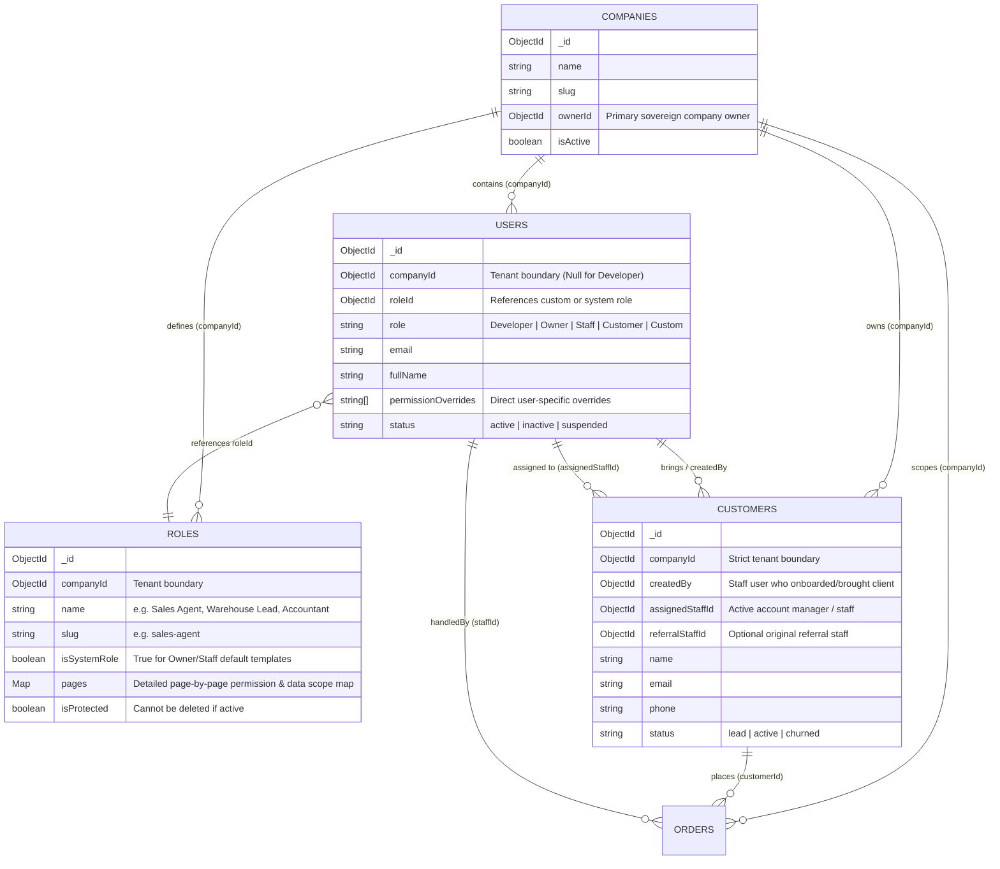
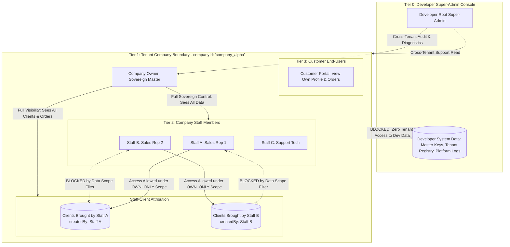

# Module Specification: Role-Based Access Control (RBAC) & Data Flow Governance System

> **STATUS**: Enterprise-Grade Specification — Ready for plug-and-play integration into multi-tenant SaaS architectures requiring granular role permissions, row-level data scoping, staff-client referral attribution, and zero-leak UI enforcement.

---

## 🏛️ 1. Architecture & Entity Relationship (MongoDB / NoSQL)



---

## 🌐 2. The 4-Tier Data Access & Isolation Hierarchy

In this architecture, data does not flow freely between roles. It follows strict sovereign boundaries and horizontal row-level filters:



### 2.1 Developer vs Owner Data Isolation Rules
1. **Developer Data is Untouchable (Strict Platform Isolation)**:
   - Platform infrastructure logs, master database credentials, tenant subscription records, global feature flag manifests, and developer console telemetry are **never readable or editable** by any company tenant, owner, admin, staff, or customer.
   - Any query attempting to access Developer-level entities without a verified `Developer` JWT token returns `403 Forbidden` (`DEVELOPER_RESOURCE_LOCKED`).
2. **Developer Cross-Tenant Governance Visibility**:
   - The platform Developer has cross-tenant audit access to assist tenants, inspect error logs, monitor storage quotas, and troubleshoot issues.
   - Developer queries bypass `companyId` filtering only when explicitly operating in the `/system-console` super-admin context.
3. **Company Owner Sovereignty (Tenant Master)**:
   - Inside their tenant organization (`companyId`), the **Company Owner** is sovereign.
   - The Owner has uninhibited access to all company data, including all staff records, clients, programs, orders, CMS pages, invoices, and settings.
   - The Owner has sole authority to create custom roles, assign permissions, and configure data visibility scopes for all staff members.

### 2.2 Staff-Client Referral & Attribution Flow
- **The Problem**: When Staff Member A brings a customer or client into the company, Staff Member A must be able to view, manage, create orders for, and service that customer, without other staff members snooping on or modifying their client.
- **The Attribution Architecture**:
  1. Every customer document records:
     - `createdBy: ObjectId` ➔ Set to the authenticated `user._id` of the staff member who onboarded the customer.
     - `assignedStaffId: ObjectId` ➔ Set initially to `createdBy`, or reassigned by the Owner to another staff member.
     - `referralStaffId?: ObjectId` ➔ Preserves original commission/referral tracking even if account management is reassigned.
  2. When Staff Member A opens the CRM or Customers page:
     - If their role has the **`OWN_ONLY`** data scope, the server query automatically filters:
       ```json
       {
         "companyId": "company_alpha",
         "$or": [
           { "createdBy": "staff_a_id" },
           { "assignedStaffId": "staff_a_id" }
         ]
       }
       ```
     - Staff Member A sees 100% of their own clients.
     - Staff Member B's clients are completely invisible to Staff A in both the UI and API responses.
  3. When Staff Member A creates an order or issues an invoice:
     - The customer picker dropdown is automatically filtered to clients within Staff A's authorized scope.
     - The resulting order inherits `assignedStaffId: staff_a_id` and `createdBy: staff_a_id`, preserving end-to-end attribution.

---

## 🛠️ 3. The Owner's 3-Tier Drill-Down Configuration UI & Governance Workflow

The Owner configures security through an intuitive, hierarchical 3-Tier Drill-Down interface:

```mermaid
stateDiagram-v2
    [*] --> Tier1_SelectRole: Owner opens Role List
    Tier1_SelectRole --> Tier2_PageList: Opens Specific Role (e.g., 'Sales Agent')
    
    state Tier2_PageList {
        [*] --> TogglePages: Enable / Disable Pages
        note right of TogglePages: If page is disabled:<br/>1. Hidden from Sidebar & Nav<br/>2. Blocked in RouteGuard (0 flash)
    }

    Tier2_PageList --> Tier3_PageDrilldown: Double-Click / Expand Allowed Page (e.g., 'Orders')
    
    state Tier3_PageDrilldown {
        state "Part A: Action Buttons" as PartA
        state "Part B: Data Scope Definition" as PartB
        state "Part C: Action-on-Scoped-Data Matrix" as PartC

        PartA: Toggle Action Buttons (Create, Edit, Delete, Export PDF, WhatsApp)
        note right of PartA: If button disallowed:<br/>Completely removed from DOM (null)
        
        PartB: Choose Data Visibility Scope:<br/>1. OWNER_ONLY<br/>2. OWN_ONLY (Self/Assigned)<br/>3. ALL_USERS<br/>4. SELECTED_ROLES<br/>5. SELECTED_USERS
        note right of PartB: Multi-Tenant Protected:<br/>Role & User pickers only show<br/>entities within current companyId
        
        PartC: Define Allowed Actions on Scoped Data:<br/>e.g. Can View & Export PDF on Selected Roles' data,<br/>but CANNOT Edit or Delete!
    }

    Tier3_PageDrilldown --> SaveAndSynchronize: Click 'Save Permissions'
    
    state SaveAndSynchronize {
        [*] --> TaskAnimation: Run 'save_vault_lock' Animation Loop
        TaskAnimation --> MinimumCycle: Guarantee min 1000ms cycle
        MinimumCycle --> ApiCommit: PUT /api/roles/:id/permissions
        ApiCommit --> SuccessMorph: Morph to Vault Locked Checkmark
        SuccessMorph --> ToastNotification: Fire Success Toast (Strictly After Motion)
    }
```

### 3.1 Tier 1: Role Selection
- The Owner navigates to `/dashboard/settings/roles`.
- Displays a list of company roles (e.g., `Sales Agent`, `Junior Associate`, `Warehouse Tech`, `Accountant`, `Customer Support`).
- Clicking on a role opens the **Role Permission Canvas**.

### 3.2 Tier 2: Page / Module Authorization
- The canvas displays all registered application pages and modules:
  - `Programs` (`/dashboard/programs`)
  - `Orders` (`/dashboard/orders`)
  - `Customers` (`/dashboard/customers`)
  - `Invoices` (`/dashboard/invoices`)
  - `CMS Engine` (`/dashboard/cms`)
  - `Company Settings` (`/dashboard/settings`)
- Each page features a master toggle switch: `[Allowed / Disallowed]`.
- **Strict UI Visibility Law**:
  - If a page is marked **Disallowed** for a role:
    1. The link is **completely stripped** from the desktop sidebar, mobile navigation bar, topbar quick links, and dashboard search palette.
    2. Direct URL navigation is intercepted by [`<RouteGuard />`](#64-route-level-access-guard-componentscommonrouteguardtsx) which immediately redirects to `/dashboard` without displaying even a single frame of page content (zero DOM flash).

### 3.3 Tier 3: Page Drill-down Configuration (Detailed Modal / Drawer)
When the Owner clicks "Configure" or expands an allowed page, a detailed modal opens with three sub-sections:

#### Part A: Action Button Permissions (Action-Level Security)
The Owner checks which action buttons this role is permitted to use on this page:
- `view`: Read page and list records.
- `create`: "+ New Record" primary button.
- `edit`: "Edit / Pencil" action button and form submit.
- `delete`: "Delete / Trash" button (triggers canvas dustbin sequence).
- `export_pdf`: "Download PDF" button.
- `send_email`: "Send Email" action.
- `send_whatsapp`: "Send WhatsApp Message" action.
- `bulk_delete`: Group multi-select delete.
- `change_status`: Status transition toggles.

**Strict Button Elimination Law**:
If a button is not allowed, it **MUST NOT be rendered in the DOM**. It is never shown as disabled, greyed-out, or hidden with `opacity-0`. `<ActionGuard />` returns `null` directly.

#### Part B: Data Scope Definition (Row-Level Security)
The Owner selects the row-level visibility scope that dictates which database records this role can see:

| Data Scope Key | Description | MongoDB Match Filter |
| :--- | :--- | :--- |
| **`OWNER_ONLY`** | Role can only see records created directly by the Company Owner. | `{ companyId, createdBy: company.ownerId }` |
| **`OWN_ONLY`** | Role can only see records created by or assigned to themselves (e.g., staff's own customers/leads). | `{ companyId, $or: [{ createdBy: user._id }, { assignedStaffId: user._id }] }` |
| **`ALL_USERS`** | Role can see all records belonging to any user in the company. | `{ companyId }` |
| **`SELECTED_ROLES`** | Role can see records created by or belonging to users with specific selected roles. | `{ companyId, createdBy: { $in: userIdsWithSelectedRoles } }` |
| **`SELECTED_USERS`** | Role can see records created by or assigned to specific individual users. | `{ companyId, $or: [{ createdBy: { $in: selectedUserIds } }, { assignedStaffId: { $in: selectedUserIds } }] }` |

> [!IMPORTANT]
> **Strict Multi-Tenant Dropdown Isolation**:
> When selecting `SELECTED_ROLES` or `SELECTED_USERS`, the dropdown options are **strictly queried with `{ companyId: currentTenant.id }`**. The Owner can never see or select roles or staff members from other tenant companies.

#### Part C: Action-on-Scoped-Data Permission Matrix
This is the ultimate enterprise safeguard: *When this role accesses data belonging to other users under their assigned scope (e.g. `ALL_USERS` or `SELECTED_ROLES`), what actions can they perform on that data?*

**Example Scenario**:
A "Junior Sales Agent" needs to view all company orders to avoid duplicate outreach, but must never edit or delete orders placed by Senior Account Managers:
- Global Page Actions: `view`, `create`, `edit`, `delete`, `export_pdf`.
- Data Scope: `ALL_USERS`.
- **Own Records**: The agent can `create`, `edit`, and `delete` their own orders.
- **Scope-Allowed Actions on Other Users' Records**:
  - `view`: **ALLOWED** (Can view other agents' orders in the table).
  - `export_pdf`: **ALLOWED** (Can print copies for shipping).
  - `edit`: **BLOCKED** (Cannot edit other agents' orders).
  - `delete`: **BLOCKED** (Cannot delete other agents' orders).

### 3.4 Tier 4: Task-Synchronized Save Animation
When the Owner clicks "Save Permissions":
1. The button triggers the **`save_vault_lock`** task animation preset (defined in [`design-system/PREMIUM_BUTTON_ANIMATION_SYSTEM.md`](../design-system/PREMIUM_BUTTON_ANIMATION_SYSTEM.md)).
2. An animated neon cyber-vault door swings shut and engages dual locking tumblers in a fluid 1000ms loop.
3. No generic spinning wheels are ever rendered.
4. If the API returns fast (e.g. 200ms), the animation **guarantees a full 1000ms cycle** to maintain visual rhythm.
5. On HTTP 200, the tumblers snap into a glowing emerald shield with checkmark.
6. The success toast fires **strictly after** the animation finishes.

---

## 🗄️ 4. MongoDB Database Schemas

### 4.1 Upgraded Role Model (`models/Role.ts`)

```typescript
// models/Role.ts
import mongoose, { Schema, Document } from "mongoose";

export type DataScopeType =
  | "OWNER_ONLY"
  | "OWN_ONLY"
  | "ALL_USERS"
  | "SELECTED_ROLES"
  | "SELECTED_USERS";

export interface IPageScopeConfig {
  dataScope: DataScopeType;
  selectedRoleIds: mongoose.Types.ObjectId[];
  selectedUserIds: mongoose.Types.ObjectId[];
  scopeAllowedActions: string[]; // Actions allowed on records belonging to other users under this scope
}

export interface IPagePermissionConfig {
  pageKey: string;              // e.g. "orders", "programs", "customers"
  isAllowed: boolean;           // Whether the page is accessible & visible in nav
  allowedActions: string[];     // Buttons allowed: ["create", "edit", "delete", "export_pdf", ...]
  scopeConfig: IPageScopeConfig; // Row-level data scoping rules
}

export interface IRole extends Document {
  companyId: mongoose.Types.ObjectId;
  name: string;
  slug: string;
  description?: string;
  isSystemRole: boolean;        // Protected if true (Owner, Developer)
  isProtected: boolean;
  pages: Record<string, IPagePermissionConfig>; // Keyed by pageKey for O(1) lookup
  createdAt: Date;
  updatedAt: Date;
}

const PageScopeConfigSchema = new Schema<IPageScopeConfig>(
  {
    dataScope: {
      type: String,
      enum: ["OWNER_ONLY", "OWN_ONLY", "ALL_USERS", "SELECTED_ROLES", "SELECTED_USERS"],
      default: "OWN_ONLY",
    },
    selectedRoleIds: [{ type: Schema.Types.ObjectId, ref: "Role" }],
    selectedUserIds: [{ type: Schema.Types.ObjectId, ref: "User" }],
    scopeAllowedActions: [{ type: String, default: ["view"] }],
  },
  { _id: false }
);

const PagePermissionConfigSchema = new Schema<IPagePermissionConfig>(
  {
    pageKey: { type: String, required: true },
    isAllowed: { type: Boolean, default: false },
    allowedActions: [{ type: String, default: ["view"] }],
    scopeConfig: { type: PageScopeConfigSchema, default: () => ({}) },
  },
  { _id: false }
);

const RoleSchema = new Schema<IRole>(
  {
    companyId: {
      type: Schema.Types.ObjectId,
      ref: "Company",
      required: true,
      index: true,
    },
    name: {
      type: String,
      required: [true, "Role name is required"],
      trim: true,
    },
    slug: {
      type: String,
      required: [true, "Role slug is required"],
      trim: true,
    },
    description: { type: String, trim: true },
    isSystemRole: { type: Boolean, default: false },
    isProtected: { type: Boolean, default: false },
    pages: {
      type: Map,
      of: PagePermissionConfigSchema,
      default: {},
    },
  },
  { timestamps: true }
);

RoleSchema.index({ companyId: 1, slug: 1 }, { unique: true });

export const Role = mongoose.models.Role || mongoose.model<IRole>("Role", RoleSchema);
```

### 4.2 Upgraded User Model (`models/User.ts`)

```typescript
// models/User.ts
import mongoose, { Schema, Document } from "mongoose";

export interface IUser extends Document {
  companyId?: mongoose.Types.ObjectId; // Null for Developer
  roleId: mongoose.Types.ObjectId;      // References Role collection
  role: "Developer" | "Owner" | "Staff" | "Customer" | "Custom";
  email: string;
  fullName: string;
  passwordHash: string;
  phone?: string;
  avatarUrl?: string;
  permissionOverrides: string[];       // Direct user-level overrides
  status: "active" | "inactive" | "suspended";
  lastLoginAt?: Date;
  createdAt: Date;
  updatedAt: Date;
}

const UserSchema = new Schema<IUser>(
  {
    companyId: {
      type: Schema.Types.ObjectId,
      ref: "Company",
      index: true,
    },
    roleId: {
      type: Schema.Types.ObjectId,
      ref: "Role",
      required: true,
      index: true,
    },
    role: {
      type: String,
      enum: ["Developer", "Owner", "Staff", "Customer", "Custom"],
      default: "Staff",
      index: true,
    },
    email: {
      type: String,
      required: true,
      unique: true,
      lowercase: true,
      trim: true,
    },
    fullName: { type: String, required: true, trim: true },
    passwordHash: { type: String, required: true },
    phone: String,
    avatarUrl: String,
    permissionOverrides: [{ type: String }],
    status: {
      type: String,
      enum: ["active", "inactive", "suspended"],
      default: "active",
      index: true,
    },
    lastLoginAt: Date,
  },
  { timestamps: true }
);

UserSchema.index({ companyId: 1, email: 1 });

export const User = mongoose.models.User || mongoose.model<IUser>("User", UserSchema);
```

### 4.3 Customer Attribution Model (`models/Customer.ts`)

```typescript
// models/Customer.ts
import mongoose, { Schema, Document } from "mongoose";

export interface ICustomer extends Document {
  companyId: mongoose.Types.ObjectId;
  createdBy: mongoose.Types.ObjectId;       // Staff member who onboarded client
  assignedStaffId: mongoose.Types.ObjectId; // Current staff account manager
  referralStaffId?: mongoose.Types.ObjectId;// Original referrer for commissions
  name: string;
  email: string;
  phone: string;
  companyName?: string;
  status: "lead" | "active" | "churned";
  metadata: Record<string, any>;
  createdAt: Date;
  updatedAt: Date;
}

const CustomerSchema = new Schema<ICustomer>(
  {
    companyId: {
      type: Schema.Types.ObjectId,
      ref: "Company",
      required: true,
      index: true,
    },
    createdBy: {
      type: Schema.Types.ObjectId,
      ref: "User",
      required: true,
      index: true,
    },
    assignedStaffId: {
      type: Schema.Types.ObjectId,
      ref: "User",
      required: true,
      index: true,
    },
    referralStaffId: {
      type: Schema.Types.ObjectId,
      ref: "User",
      index: true,
    },
    name: { type: String, required: true, trim: true },
    email: { type: String, required: true, lowercase: true, trim: true },
    phone: { type: String, required: true, trim: true },
    companyName: String,
    status: {
      type: String,
      enum: ["lead", "active", "churned"],
      default: "lead",
      index: true,
    },
    metadata: { type: Schema.Types.Mixed, default: {} },
  },
  { timestamps: true }
);

CustomerSchema.index({ companyId: 1, createdBy: 1 });
CustomerSchema.index({ companyId: 1, assignedStaffId: 1 });
CustomerSchema.index({ companyId: 1, email: 1 }, { unique: true });

export const Customer =
  mongoose.models.Customer || mongoose.model<ICustomer>("Customer", CustomerSchema);
```

---

## 🔍 5. Universal MongoDB Scoping Query Generator

This universal query pipeline runs on the server (Node.js or Python FastAPI) before executing any find/aggregate operation. It guarantees that users receive **only records authorized by their data scope**:

### 5.1 TypeScript / Node.js Implementation (`lib/rbac/buildDataScopeFilter.ts`)

```typescript
// lib/rbac/buildDataScopeFilter.ts
import mongoose from "mongoose";
import { IUser } from "@/models/User";
import { Role, IRole, IPagePermissionConfig } from "@/models/Role";
import { Company } from "@/models/Company";

export async function buildDataScopeFilter(
  user: IUser,
  pageKey: string,
  targetAction: string = "view"
): Promise<Record<string, any>> {
  // 1. Developer Role has cross-tenant audit visibility
  if (user.role === "Developer") {
    return user.companyId ? { companyId: user.companyId } : {};
  }

  // 2. Strict Company Isolation for all tenant users
  if (!user.companyId) {
    throw new Error("UNAUTHORIZED_ACCESS: Missing company context.");
  }

  const baseFilter: Record<string, any> = { companyId: user.companyId };

  // 3. Company Owner has full sovereign visibility over all company records
  if (user.role === "Owner") {
    return baseFilter;
  }

  // 4. Load the user's role and page permission configuration
  const role = (await Role.findById(user.roleId).lean()) as IRole | null;
  if (!role) {
    throw new Error("FORBIDDEN: User has no valid role assigned.");
  }

  const pageConfig: IPagePermissionConfig | undefined = role.pages?.[pageKey];
  if (!pageConfig || !pageConfig.isAllowed) {
    throw new Error(`PAGE_ACCESS_DENIED: Access to '${pageKey}' is not permitted.`);
  }

  // Check if the requested action is allowed at all
  if (!pageConfig.allowedActions.includes(targetAction)) {
    throw new Error(`ACTION_DENIED: Action '${targetAction}' is not permitted on '${pageKey}'.`);
  }

  const { dataScope, selectedRoleIds, selectedUserIds } = pageConfig.scopeConfig;

  // 5. Build Row-Level Data Scope Filter
  switch (dataScope) {
    case "ALL_USERS":
      // User can view all records in the company
      return baseFilter;

    case "OWNER_ONLY": {
      const company = await Company.findById(user.companyId).select("ownerId").lean();
      return {
        ...baseFilter,
        createdBy: company?.ownerId,
      };
    }

    case "OWN_ONLY":
      // User can only see records created by or assigned to themselves (e.g. Staff's own clients)
      return {
        ...baseFilter,
        $or: [{ createdBy: user._id }, { assignedStaffId: user._id }],
      };

    case "SELECTED_ROLES": {
      // Find all user IDs belonging to the selected roles within THIS company
      const targetUsers = await mongoose.model("User").find({
        companyId: user.companyId,
        roleId: { $in: selectedRoleIds },
      }).select("_id").lean();

      const targetUserIds = targetUsers.map((u: any) => u._id);
      return {
        ...baseFilter,
        $or: [
          { createdBy: { $in: targetUserIds } },
          { assignedStaffId: { $in: targetUserIds } },
          { createdBy: user._id }, // Always include own records
        ],
      };
    }

    case "SELECTED_USERS":
      return {
        ...baseFilter,
        $or: [
          { createdBy: { $in: selectedUserIds } },
          { assignedStaffId: { $in: selectedUserIds } },
          { createdBy: user._id }, // Always include own records
        ],
      };

    default:
      // Fallback safe default: Own records only
      return {
        ...baseFilter,
        $or: [{ createdBy: user._id }, { assignedStaffId: user._id }],
      };
  }
}
```

### 5.2 Record Mutation Guard (Action-on-Scoped-Data Verification)

When updating or deleting an existing record:
```typescript
// lib/rbac/verifyRecordMutation.ts
export async function verifyRecordMutation(
  user: IUser,
  pageKey: string,
  record: { createdBy: mongoose.Types.ObjectId; assignedStaffId?: mongoose.Types.ObjectId },
  action: "edit" | "delete"
): Promise<boolean> {
  if (user.role === "Developer" || user.role === "Owner") return true;

  const role = await Role.findById(user.roleId).lean();
  const pageConfig = role?.pages?.[pageKey];
  if (!pageConfig || !pageConfig.isAllowed || !pageConfig.allowedActions.includes(action)) {
    return false;
  }

  // If the record is the user's OWN record, allow it
  const isOwn =
    record.createdBy.toString() === user._id.toString() ||
    record.assignedStaffId?.toString() === user._id.toString();

  if (isOwn) return true;

  // If it belongs to someone else, check scopeAllowedActions
  return pageConfig.scopeConfig.scopeAllowedActions.includes(action);
}
```

---

## 💻 6. Frontend Implementation Pattern

### 6.1 The `useRBAC` Hook (`hooks/useRBAC.ts`)

```typescript
// hooks/useRBAC.ts
import { useAuth } from "@/hooks/useAuth";
import { useRole } from "@/context/RoleContext";

export function useRBAC() {
  const { user } = useAuth();
  const { currentRole } = useRole();

  const isDeveloper = user?.role === "Developer";
  const isOwner = user?.role === "Owner";

  const canAccessPage = (pageKey: string): boolean => {
    if (!user) return false;
    if (isDeveloper || isOwner) return true;
    return currentRole?.pages?.[pageKey]?.isAllowed ?? false;
  };

  const canExecuteAction = (
    pageKey: string,
    actionKey: string,
    record?: { createdBy?: string; assignedStaffId?: string }
  ): boolean => {
    if (!user) return false;
    if (isDeveloper || isOwner) return true;

    const page = currentRole?.pages?.[pageKey];
    if (!page || !page.isAllowed) return false;
    if (!page.allowedActions.includes(actionKey)) return false;

    // If no specific record is tested (e.g. "create" button), allow
    if (!record) return true;

    // Check if this record is owned by the user
    const isOwn =
      record.createdBy === user._id || record.assignedStaffId === user._id;

    if (isOwn) return true;

    // Record belongs to another user in scope: check scopeAllowedActions
    return page.scopeConfig.scopeAllowedActions.includes(actionKey);
  };

  const getDataScope = (pageKey: string) => {
    if (isDeveloper || isOwner) return { dataScope: "ALL_USERS" as const };
    return currentRole?.pages?.[pageKey]?.scopeConfig ?? { dataScope: "OWN_ONLY" as const };
  };

  return {
    user,
    isDeveloper,
    isOwner,
    canAccessPage,
    canExecuteAction,
    getDataScope,
  };
}
```

### 6.2 Action-Level Button Guard (`components/common/ActionGuard.tsx`)

> **Strict Zero-Leak Enforcement**: Disallowed buttons return `null`. They are **never rendered** in the DOM.

```tsx
// components/common/ActionGuard.tsx
"use client";

import React from "react";
import { useRBAC } from "@/hooks/useRBAC";

interface ActionGuardProps {
  page: string;
  action: string;
  record?: { createdBy?: string; assignedStaffId?: string };
  fallback?: React.ReactNode;
  children: React.ReactNode;
}

export const ActionGuard: React.FC<ActionGuardProps> = ({
  page,
  action,
  record,
  fallback = null,
  children,
}) => {
  const { canExecuteAction } = useRBAC();

  if (!canExecuteAction(page, action, record)) {
    return <>{fallback}</>; // Returns null by default - zero DOM clutter
  }

  return <>{children}</>;
};
```

### 6.3 Dynamic Navigation Item Filter (`components/layout/SidebarNav.tsx`)

```tsx
// components/layout/SidebarNav.tsx
"use client";

import React from "react";
import Link from "next/link";
import { usePathname } from "next/navigation";
import { useRBAC } from "@/hooks/useRBAC";

const NAV_ITEMS = [
  { pageKey: "programs", label: "Programs", href: "/dashboard/programs", icon: "GraduationCap" },
  { pageKey: "orders", label: "Orders", href: "/dashboard/orders", icon: "ShoppingBag" },
  { pageKey: "customers", label: "Customers", href: "/dashboard/customers", icon: "Users" },
  { pageKey: "invoices", label: "Invoices", href: "/dashboard/invoices", icon: "Receipt" },
  { pageKey: "cms", label: "Visual CMS", href: "/dashboard/cms", icon: "LayoutTemplate" },
  { pageKey: "settings", label: "Settings", href: "/dashboard/settings", icon: "Settings" },
];

export const SidebarNav: React.FC = () => {
  const pathname = usePathname();
  const { canAccessPage } = useRBAC();

  // Strict UI Elimination: Filter out disallowed pages entirely
  const visibleItems = NAV_ITEMS.filter((item) => canAccessPage(item.pageKey));

  return (
    <nav className="flex flex-col gap-1 px-3 py-4">
      {visibleItems.map((item) => {
        const isActive = pathname.startsWith(item.href);
        return (
          <Link
            key={item.pageKey}
            href={item.href}
            className={`flex items-center gap-3 px-3.5 py-2.5 rounded-xl font-medium text-sm transition-all duration-200 ${
              isActive
                ? "bg-brand-500/10 text-brand-400 font-semibold shadow-sm"
                : "text-slate-400 hover:text-white hover:bg-slate-800/50"
            }`}
          >
            <span>{item.label}</span>
          </Link>
        );
      })}
    </nav>
  );
};
```

### 6.4 Route-Level Access Guard (`components/common/RouteGuard.tsx`)

```tsx
// components/common/RouteGuard.tsx
"use client";

import React, { useEffect } from "react";
import { useRouter, usePathname } from "next/navigation";
import { useRBAC } from "@/hooks/useRBAC";
import { toast } from "sonner";

interface RouteGuardProps {
  pageKey: string;
  children: React.ReactNode;
}

export const RouteGuard: React.FC<RouteGuardProps> = ({ pageKey, children }) => {
  const { user, canAccessPage } = useRBAC();
  const router = useRouter();
  const pathname = usePathname();

  const isAllowed = canAccessPage(pageKey);

  useEffect(() => {
    if (!user) return;

    if (!isAllowed) {
      toast.error("Access Restricted", {
        description: `Your role does not have authorization to access '${pathname}'.`,
      });
      router.replace(user.role === "Customer" ? "/portal" : "/dashboard");
    }
  }, [user, isAllowed, pathname, router]);

  // Zero-flash prevention: Do NOT render children if disallowed
  if (!user || !isAllowed) {
    return null;
  }

  return <>{children}</>;
};
```

---

## 🎨 7. The Owner Permission Studio Component (`components/rbac/OwnerPermissionStudio.tsx`)

This complete, production-ready React component implements the full 3-Tier Drilldown UI with task-synchronized animation and company-isolated data pickers:

```tsx
// components/rbac/OwnerPermissionStudio.tsx
"use client";

import React, { useState } from "react";
import { motion, AnimatePresence } from "framer-motion";
import { Shield, Lock, Eye, Plus, Edit2, Trash2, FileText, MessageSquare, ChevronRight, Check } from "lucide-react";
import { TaskAnimatedButton } from "@/components/animations/TaskAnimatedButton";
import { useRole } from "@/context/RoleContext";
import { toast } from "sonner";

const AVAILABLE_PAGES = [
  { key: "programs", label: "Training Programs", icon: "GraduationCap" },
  { key: "orders", label: "Orders & Sales", icon: "ShoppingBag" },
  { key: "customers", label: "Customers & Leads", icon: "Users" },
  { key: "invoices", label: "Billing & Invoices", icon: "Receipt" },
  { key: "cms", label: "Visual CMS & DAM", icon: "Layout" },
];

const STANDARD_ACTIONS = [
  { key: "view", label: "View Records", icon: Eye },
  { key: "create", label: "Create New", icon: Plus },
  { key: "edit", label: "Edit Records", icon: Edit2 },
  { key: "delete", label: "Delete Records", icon: Trash2 },
  { key: "export_pdf", label: "Export PDF", icon: FileText },
  { key: "send_whatsapp", label: "WhatsApp Direct", icon: MessageSquare },
];

export const OwnerPermissionStudio: React.FC = () => {
  const { activeRole, updateRolePermissions, companyStaff, companyRoles } = useRole();
  const [selectedPageKey, setSelectedPageKey] = useState<string | null>(null);

  // Local draft state for the active role's permissions
  const [permissionDraft, setPermissionDraft] = useState(activeRole?.pages || {});

  const handleTogglePage = (pageKey: string) => {
    setPermissionDraft((prev) => ({
      ...prev,
      [pageKey]: {
        ...prev[pageKey],
        isAllowed: !prev[pageKey]?.isAllowed,
        allowedActions: prev[pageKey]?.allowedActions || ["view"],
        scopeConfig: prev[pageKey]?.scopeConfig || {
          dataScope: "OWN_ONLY",
          selectedRoleIds: [],
          selectedUserIds: [],
          scopeAllowedActions: ["view"],
        },
      },
    }));
  };

  const handleActionToggle = (pageKey: string, actionKey: string) => {
    setPermissionDraft((prev) => {
      const currentActions = prev[pageKey]?.allowedActions || [];
      const updated = currentActions.includes(actionKey)
        ? currentActions.filter((a) => a !== actionKey)
        : [...currentActions, actionKey];

      return {
        ...prev,
        [pageKey]: { ...prev[pageKey], allowedActions: updated },
      };
    });
  };

  const handleScopeChange = (pageKey: string, dataScope: any) => {
    setPermissionDraft((prev) => ({
      ...prev,
      [pageKey]: {
        ...prev[pageKey],
        scopeConfig: {
          ...prev[pageKey].scopeConfig,
          dataScope,
        },
      },
    }));
  };

  const handleScopeActionToggle = (pageKey: string, actionKey: string) => {
    setPermissionDraft((prev) => {
      const currentScopeActions = prev[pageKey]?.scopeConfig?.scopeAllowedActions || [];
      const updated = currentScopeActions.includes(actionKey)
        ? currentScopeActions.filter((a) => a !== actionKey)
        : [...currentScopeActions, actionKey];

      return {
        ...prev,
        [pageKey]: {
          ...prev[pageKey],
          scopeConfig: {
            ...prev[pageKey].scopeConfig,
            scopeAllowedActions: updated,
          },
        },
      };
    });
  };

  const activePageConfig = selectedPageKey ? permissionDraft[selectedPageKey] : null;

  return (
    <div className="w-full max-w-6xl mx-auto p-6 space-y-8">
      {/* Header */}
      <div className="flex items-center justify-between border-b border-slate-800 pb-5">
        <div>
          <h1 className="text-2xl font-bold text-white flex items-center gap-3">
            <Shield className="w-7 h-7 text-brand-400" />
            Owner Permission Governance Studio
          </h1>
          <p className="text-sm text-slate-400 mt-1">
            Configure page access, button visibility, and row-level data scoping for role:{" "}
            <span className="text-brand-300 font-semibold">{activeRole?.name}</span>
          </p>
        </div>

        {/* Task-Synchronized Save Button with Minimum Cycle Animation */}
        <TaskAnimatedButton
          id="btn-save-permissions"
          label="Save Permissions"
          activeLabel="Engaging Vault Security..."
          successLabel="Permissions Locked"
          presetKey="save_vault_lock"
          cycleDuration={1000}
          onClick={async () => {
            if (!activeRole) return;
            await updateRolePermissions(activeRole._id, permissionDraft);
          }}
          onSuccessToast={() => {
            toast.success("Security Policy Updated", {
              description: `Permissions for '${activeRole?.name}' successfully committed to MongoDB.`,
            });
          }}
        />
      </div>

      {/* Tier 2: Page Access Grid */}
      <div className="grid grid-cols-1 md:grid-cols-2 lg:grid-cols-3 gap-4">
        {AVAILABLE_PAGES.map((page) => {
          const isAllowed = permissionDraft[page.key]?.isAllowed || false;
          return (
            <div
              key={page.key}
              className={`p-5 rounded-2xl border transition-all duration-300 ${
                isAllowed
                  ? "bg-slate-900/90 border-brand-500/30 shadow-lg shadow-brand-500/5"
                  : "bg-slate-950/60 border-slate-800 opacity-70"
              }`}
            >
              <div className="flex items-center justify-between mb-4">
                <span className="font-semibold text-white">{page.label}</span>
                <button
                  type="button"
                  onClick={() => handleTogglePage(page.key)}
                  className={`relative inline-flex h-6 w-11 items-center rounded-full transition-colors ${
                    isAllowed ? "bg-brand-500" : "bg-slate-700"
                  }`}
                >
                  <span
                    className={`inline-block h-4 w-4 transform rounded-full bg-white transition-transform ${
                      isAllowed ? "translate-x-6" : "translate-x-1"
                    }`}
                  />
                </button>
              </div>

              {isAllowed ? (
                <button
                  type="button"
                  onClick={() => setSelectedPageKey(page.key)}
                  className="w-full flex items-center justify-between px-3 py-2 text-xs font-medium text-brand-300 bg-brand-500/10 hover:bg-brand-500/20 rounded-xl transition-colors"
                >
                  <span>Configure Actions & Data Scope</span>
                  <ChevronRight className="w-4 h-4" />
                </button>
              ) : (
                <p className="text-xs text-slate-500">Page hidden from role navigation</p>
              )}
            </div>
          );
        })}
      </div>

      {/* Tier 3: Page Drilldown Modal / Drawer */}
      <AnimatePresence>
        {selectedPageKey && activePageConfig && (
          <div className="fixed inset-0 z-50 flex items-center justify-center p-4 bg-black/70 backdrop-blur-sm">
            <motion.div
              initial={{ opacity: 0, scale: 0.95, y: 20 }}
              animate={{ opacity: 1, scale: 1, y: 0 }}
              exit={{ opacity: 0, scale: 0.95, y: 20 }}
              className="w-full max-w-3xl bg-slate-900 border border-slate-700 rounded-3xl p-6 shadow-2xl space-y-6 max-h-[90vh] overflow-y-auto"
            >
              <div className="flex items-center justify-between border-b border-slate-800 pb-4">
                <h2 className="text-lg font-bold text-white flex items-center gap-2">
                  <Lock className="w-5 h-5 text-brand-400" />
                  Configure Page: <span className="text-brand-300">{selectedPageKey.toUpperCase()}</span>
                </h2>
                <button
                  type="button"
                  onClick={() => setSelectedPageKey(null)}
                  className="px-3 py-1 text-sm text-slate-400 hover:text-white rounded-lg bg-slate-800"
                >
                  Done
                </button>
              </div>

              {/* Part A: Action Buttons */}
              <div>
                <label className="text-xs font-semibold text-slate-400 uppercase tracking-wider block mb-3">
                  Part A: Allowed Action Buttons (Zero-DOM If Disallowed)
                </label>
                <div className="grid grid-cols-2 sm:grid-cols-3 gap-3">
                  {STANDARD_ACTIONS.map((action) => {
                    const isChecked = activePageConfig.allowedActions?.includes(action.key);
                    return (
                      <button
                        key={action.key}
                        type="button"
                        onClick={() => handleActionToggle(selectedPageKey, action.key)}
                        className={`flex items-center gap-2 px-3 py-2.5 rounded-xl border text-xs font-medium transition-all ${
                          isChecked
                            ? "bg-brand-500/20 border-brand-500/50 text-white"
                            : "bg-slate-800/40 border-slate-700/60 text-slate-400 hover:border-slate-600"
                        }`}
                      >
                        <action.icon className="w-4 h-4 text-brand-400" />
                        <span>{action.label}</span>
                        {isChecked && <Check className="w-3.5 h-3.5 ml-auto text-brand-400" />}
                      </button>
                    );
                  })}
                </div>
              </div>

              {/* Part B: Data Scope Definition */}
              <div className="border-t border-slate-800 pt-5">
                <label className="text-xs font-semibold text-slate-400 uppercase tracking-wider block mb-3">
                  Part B: Row-Level Data Scope Filtering
                </label>
                <div className="space-y-2">
                  {[
                    { key: "OWN_ONLY", label: "Own & Assigned Data Only", desc: "User only sees records they created or were assigned to (e.g. staff's own clients)" },
                    { key: "OWNER_ONLY", label: "Owner Data Only", desc: "User only sees records created directly by Company Owner" },
                    { key: "ALL_USERS", label: "All Users Data", desc: "User can see all records within this company" },
                    { key: "SELECTED_ROLES", label: "Selected Roles Data", desc: "User can see records belonging to specific selected roles in this company" },
                    { key: "SELECTED_USERS", label: "Selected Users Data", desc: "User can see records belonging to specific individual staff members" },
                  ].map((scope) => (
                    <label
                      key={scope.key}
                      className={`flex items-start gap-3 p-3.5 rounded-xl border cursor-pointer transition-all ${
                        activePageConfig.scopeConfig?.dataScope === scope.key
                          ? "bg-brand-500/10 border-brand-500/50 text-white"
                          : "bg-slate-800/20 border-slate-800 text-slate-400 hover:border-slate-700"
                      }`}
                    >
                      <input
                        type="radio"
                        name="dataScope"
                        checked={activePageConfig.scopeConfig?.dataScope === scope.key}
                        onChange={() => handleScopeChange(selectedPageKey, scope.key)}
                        className="mt-1 text-brand-500 focus:ring-brand-500"
                      />
                      <div>
                        <div className="text-sm font-semibold">{scope.label}</div>
                        <div className="text-xs text-slate-400">{scope.desc}</div>
                      </div>
                    </label>
                  ))}
                </div>
              </div>

              {/* Part C: Action-on-Scoped-Data Matrix */}
              <div className="border-t border-slate-800 pt-5">
                <label className="text-xs font-semibold text-slate-400 uppercase tracking-wider block mb-2">
                  Part C: Actions Allowed On Other Users' Scoped Data
                </label>
                <p className="text-xs text-slate-400 mb-3">
                  When viewing records created by other users within the selected scope, what can this role do?
                </p>
                <div className="grid grid-cols-2 sm:grid-cols-4 gap-2">
                  {["view", "edit", "delete", "export_pdf"].map((actionKey) => {
                    const isChecked = activePageConfig.scopeConfig?.scopeAllowedActions?.includes(actionKey);
                    return (
                      <button
                        key={actionKey}
                        type="button"
                        onClick={() => handleScopeActionToggle(selectedPageKey, actionKey)}
                        className={`px-3 py-2 rounded-xl text-xs font-medium border capitalize transition-all ${
                          isChecked
                            ? "bg-emerald-500/20 border-emerald-500/50 text-emerald-300"
                            : "bg-slate-800/40 border-slate-700 text-slate-500"
                        }`}
                      >
                        {actionKey} Allowed
                      </button>
                    );
                  })}
                </div>
              </div>
            </motion.div>
          </div>
        )}
      </AnimatePresence>
    </div>
  );
};
```

---

## 🔒 8. Backend FastAPI Route Guard Decorator

```python
from fastapi import APIRouter, Depends, HTTPException, status
from app.models.user import User
from app.api.deps import get_current_active_user
from app.db.mongo import get_mongo_db

def check_action_permission(page_key: str, action_key: str):
    async def permission_dependency(
        current_user: User = Depends(get_current_active_user),
        db = Depends(get_mongo_db)
    ):
        # Developer & Owner bypass checks within company context
        if current_user.role in ["Developer", "Owner"]:
            return current_user

        role = await db.roles.find_one({
            "_id": current_user.role_id,
            "companyId": current_user.company_id
        })

        if not role:
            raise HTTPException(status_code=status.HTTP_403_FORBIDDEN, detail="ROLE_NOT_FOUND")

        page_cfg = role.get("pages", {}).get(page_key)
        if not page_cfg or not page_cfg.get("isAllowed"):
            raise HTTPException(
                status_code=status.HTTP_403_FORBIDDEN,
                detail=f"PAGE_LOCKED: Access to '{page_key}' is restricted for your role."
            )

        if action_key not in page_cfg.get("allowedActions", []):
            raise HTTPException(
                status_code=status.HTTP_403_FORBIDDEN,
                detail=f"ACTION_FORBIDDEN: Action '{action_key}' is not allowed on '{page_key}'."
            )

        return current_user
    return permission_dependency
```
