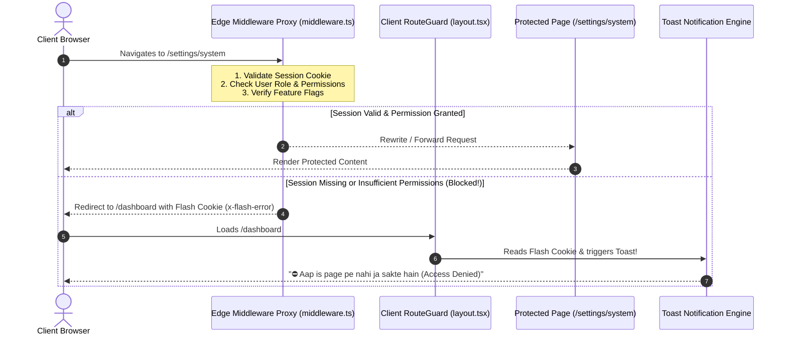
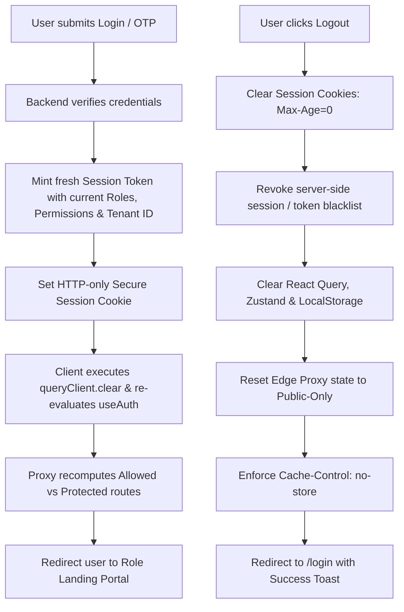

# Module Specification: Route Protection, Edge Proxy & Interception System

> **PURPOSE**: Establishes a production-grade dual-layer route protection engine (Next.js Edge Middleware Proxy + Client-Side Route Guard), instant toast notifications upon unauthorized route access ("Aap is page pe nahi ja sakte hain"), and mandatory proxy session cache invalidation & re-evaluation on every login and logout.

---

## 🏛️ 1. Architecture & Dual-Shield Topology

To guarantee that protected routes can **NEVER be accessed by unauthorized users**, the system implements a **Dual-Shield Route Proxy Architecture**:



### The Two Shields:
1. **Shield 1: Server-Side Edge Proxy Middleware (`middleware.ts`)**:
   - Executes at the network edge **before any React component or page HTML is rendered**.
   - Inspects the request headers, session cookies, user role claims, and target URL.
   - If unauthorized, prevents request execution and immediately redirects to the safe landing route with a one-time flash error cookie or query parameter.
2. **Shield 2: Client-Side Route Guard (`RouteGuard.tsx`)**:
   - Intercepts client-side SPA navigations (`next/link`, `router.push`).
   - Checks the local authenticated user state against the target route before DOM transition.
   - Prevents visual flickering and triggers immediate toast feedback.

### 1.2 Two-Phase Loading Handshake During Route Verification
Cross-referenced with [`modules/CMS_ENGINE.md`](./CMS_ENGINE.md#26-two-phase-dashboard-hydration-lifecycle--hierarchical-single-fetch-context-providers).

To completely eliminate page jumps, flash-of-unauthorized-content, and ugly top progress lines:
1. **Phase 1: Session Verification Handshake (`<BrandedCircleLoader />`)**:
   - While the client RouteGuard and proxy cookies confirm whether the user has access to `/dashboard/*`, the screen displays the centered, dual-ring **`<BrandedCircleLoader />`**.
   - No skeleton is rendered before auth is confirmed.
2. **Phase 2: Post-Verification Layout Skeleton (`<DashboardSkeletonLayout />`)**:
   - Once the user is verified, the Circle Loader seamlessly cross-fades into the **Dashboard Skeleton Layout** mirroring the sidebar, topbar, metric cards, and data table.
   - The skeleton uses the theme stored in `localStorage` (`CLASSIC_SHIMMER`, `PULSE_WAVE`, `CYBER_NEON_GLOW`, `LIQUID_GLASS`, `MINIMAL_STATIC`).
3. **The Zero Upper Progress Bar Law**:
   - Strictly **NO TOP PROGRESS BARS / NPROGRESS** anywhere on public pages or dashboard. All loading uses layout-matching skeletons.
4. **Single-Fetch Context Guarantee**:
   - The dashboard shell context (sidebar, user profile, unread counters) fetches **EXACTLY ONCE** on mount and persists across all child page navigations.

---

## 🗺️ 2. Dynamic Route Protection Matrix

Routes are categorized into 4 security tiers:

| Tier | Route Path Pattern | Allowed Actors | Failure Behavior |
| :--- | :--- | :--- | :--- |
| **Tier 0: Public** | `/`, `/login`, `/signup`, `/forgot-password`, `/reset-password` | Everyone (Unauthenticated & Authenticated) | If already logged in, redirect away from `/login` to `/dashboard`. |
| **Tier 1: Authenticated Base** | `/dashboard`, `/profile`, `/settings/general`, `/notifications` | Any Authenticated User (Customer, Staff, Admin, Owner, Dev) | If unauthenticated: Redirect to `/login?returnUrl=<target>`. |
| **Tier 2: Role-Guarded** | `/orders`, `/inventory`, `/finance`, `/staff` | Requires specific Role or Action Permission (`orders:view`, `finance:view`) | If insufficient role: Redirect to `/dashboard` + Flash Error Toast. |
| **Tier 3: Platform Super** | `/system-console`, `/settings/system` | Developer *(Delegatable to Owner; Always Owner if no Dev)* | If unauthorized: Redirect to `/dashboard` + Flash Error Toast. |
| **Tier 4: Feature-Flagged**| Any route whose feature is toggled OFF (e.g. `/3d-models`, `/ai-studio`) | Disabled by Feature Flag | **Strict Zero-Leak**: Clean 404 Not Found (Page does not exist). |
| **Tier 5: Maintenance Mode**| Entire tenant website & dashboard (when toggled ON in CMS) | **Developer & Owner ONLY** | Unauthenticated ➔ `<MaintenanceModeView />`<br/>Staff/Admin/Customer ➔ `<MaintenanceLockoutScreen />`. |

---

## 🔔 3. The Unauthorized Interception & Toast Notification Engine

When a user attempts to enter a protected route without authorization:
1. **The Navigation is Blocked**: The user is NEVER allowed to see even 1 millisecond of the protected screen.
2. **Safe Fallback Redirect**:
   - **Unauthenticated Users**: Redirected to `/login?returnUrl=/target-path`.
   - **Unauthorized Authenticated Users**: Redirected back to their safe dashboard (or previous page).
3. **Instant Toast Notification ("Aap is page pe nahi ja sakte hain")**:
   - The user is notified immediately via an animated top-right/top-center toast (using Sonner or Framer Motion Toast).
   - The message clearly informs the user of the access denial.

### Localized Toast Alert Messages:
```
┌────────────────────────────────────────────────────────────────────────┐
│ ⛔ Access Denied / Ijazat Nahi Hai                                     │
├────────────────────────────────────────────────────────────────────────┤
│ "Aap is page pe nahi ja sakte hain. Is section tak rasai ke liye       │
│  makhsoos permission darkar hai."                                      │
│                                                                        │
│ [English]: "Access Denied: You do not have permission to access        │
│ this page."                                                            │
└────────────────────────────────────────────────────────────────────────┘
```

### Flash Cookie Communication Bridge:
Because Next.js Edge Middleware runs on the server before the client loads, it communicates the blocked attempt to the client via a **short-lived HTTP cookie (`x-flash-error`)**:
1. Middleware sets: `res.cookies.set('x-flash-error', 'unauthorized_access', { path: '/', maxAge: 5 })`.
2. When the destination page (`/dashboard`) mounts, the `FlashToastProvider` detects the cookie, fires the toast, and instantly clears the cookie.

---

## 🔄 4. Mandatory Login & Logout Proxy Session Refresh Engine

> **THE FRESH EVALUATION LAW**:  
> A static or stale route cache is a critical security vulnerability.  
> **On EVERY login and EVERY logout, the proxy session, route permission cache, and auth cookies MUST be invalidated and re-evaluated from scratch.**



### 4.1 On Every Login:
1. **Invalidate Old Session**: Clear any previously stored tokens, user profile, or cached permission lists.
2. **Fetch Fresh Permissions**: The login response returns the current user profile, assigned roles, granular action permissions array, tenant ID, and active company feature flags.
3. **Mint Fresh Proxy Token**: Write an HTTP-only, Secure, `SameSite=Lax` session cookie (`auth_session`).
4. **Recompute Route Whitelist**: The client auth store (`useAuthStore`) and Edge Proxy recalculate exactly which routes this user can and cannot access.
5. **Intelligent Role Routing**:
   - **Developer** ➔ `/system-console`
   - **Owner / Admin** ➔ `/dashboard`
   - **Staff** ➔ `/orders` (or assigned operational view)
   - **Customer** ➔ `/portal`
6. **Return URL Honor**: If a `returnUrl` parameter was present (and the user holds permission for it), redirect to `returnUrl`.

### 4.2 On Every Logout:
1. **Expire Session Cookies**: Set `auth_session` and related cookies to `Max-Age=0; Path=/; Expires=Thu, 01 Jan 1970 00:00:00 GMT`.
2. **Server Revocation**: Call backend `/api/v1/auth/logout` to invalidate the refresh token in Redis/Database.
3. **Wipe Client Memory**:
   - `queryClient.clear()`: Wipes TanStack React Query memory.
   - `useAuthStore.getState().logout()`: Resets user object to `null`.
   - Clear `localStorage` and `sessionStorage`.
4. **Reset Proxy State**: The Edge Proxy immediately blocks any further access to protected routes.
5. **Browser History & Back-Button Protection (`Cache-Control: no-store`)**:
   - All protected routes must serve the HTTP response header:  
     `Cache-Control: no-store, no-cache, must-revalidate, proxy-revalidate`.
   - This ensures that clicking the browser's "Back" button after logout **CANNOT render a cached snapshot of confidential data**, instantly redirecting to `/login`.
6. **Logout Toast**: Trigger a clean feedback toast: *"Logged out successfully."*

---

## 💻 5. Production Implementation Blueprints

### 5.1 Next.js Edge Middleware Proxy (`middleware.ts`)

```typescript
import { NextRequest, NextResponse } from "next/server";

// Define Route Access Rules
const ROUTE_RULES: { pattern: RegExp; roles?: string[]; requiredPermission?: string }[] = [
  { pattern: /^\/system-console(\/.*)?$/, roles: ["Developer"] },
  { pattern: /^\/settings\/system(\/.*)?$/, requiredPermission: "settings:view_system" },
  { pattern: /^\/finance(\/.*)?$/, roles: ["Owner", "Admin"] },
  { pattern: /^\/staff(\/.*)?$/, roles: ["Owner", "Admin"] },
  { pattern: /^\/orders(\/.*)?$/, roles: ["Developer", "Owner", "Admin", "Staff", "Customer"] },
  { pattern: /^\/dashboard(\/.*)?$/, roles: ["Developer", "Owner", "Admin", "Staff"] },
  { pattern: /^\/settings(\/.*)?$/ }, // Any authenticated user
];

const PUBLIC_ROUTES = ["/", "/login", "/signup", "/forgot-password", "/reset-password"];

export async function middleware(req: NextRequest) {
  const { pathname } = req.nextUrl;

  // 1. Skip static assets, Next internal files, and public files
  if (
    pathname.startsWith("/_next") ||
    pathname.startsWith("/api") ||
    pathname.includes(".") // static files like favicon.ico, images
  ) {
    return NextResponse.next();
  }

  // 2. Read Session Cookie
  const sessionToken = req.cookies.get("auth_session")?.value;
  const isPublicRoute = PUBLIC_ROUTES.includes(pathname);

  // --- CASE A: Unauthenticated User Trying to Access Protected Route ---
  if (!sessionToken && !isPublicRoute) {
    const loginUrl = new URL("/login", req.url);
    loginUrl.searchParams.set("returnUrl", pathname);
    
    const response = NextResponse.redirect(loginUrl);
    // Set flash error cookie for toast on login page
    response.cookies.set("x-flash-error", "auth_required", { path: "/", maxAge: 10 });
    return response;
  }

  // --- CASE B: Authenticated User Visiting /login or /signup ---
  if (sessionToken && isPublicRoute && pathname !== "/") {
    const dashboardUrl = new URL("/dashboard", req.url);
    return NextResponse.redirect(dashboardUrl);
  }

  // --- CASE C: Authenticated User Route Authorization Check ---
  if (sessionToken) {
    try {
      // Decode user claims from session payload (e.g., JWT claims or Edge-cached session)
      const userClaims = parseSessionToken(sessionToken);

      // Check matched route rule
      const matchedRule = ROUTE_RULES.find((r) => r.pattern.test(pathname));

      if (matchedRule) {
        let isAuthorized = true;

        // 1. Check Role restriction
        if (matchedRule.roles && !matchedRule.roles.includes(userClaims.role)) {
          // Check if system settings delegated to Owner
          if (
            pathname.startsWith("/settings/system") &&
            userClaims.role === "Owner" &&
            userClaims.permissions?.includes("settings:view_system")
          ) {
            isAuthorized = true;
          } else {
            isAuthorized = false;
          }
        }

        // 2. Check granular permission
        if (
          isAuthorized &&
          matchedRule.requiredPermission &&
          !userClaims.permissions?.includes(matchedRule.requiredPermission)
        ) {
          isAuthorized = false;
        }

        // --- ACCESS DENIED HANDLER ---
        if (!isAuthorized) {
          // Determine safe fallback redirect
          const fallbackUrl = new URL(
            userClaims.role === "Customer" ? "/portal" : "/dashboard",
            req.url
          );
          
          const response = NextResponse.redirect(fallbackUrl);
          // Set flash cookie for instant toast notification
          response.cookies.set("x-flash-error", "access_denied", {
            path: "/",
            maxAge: 10,
            httpOnly: false, // Accessible to client JavaScript
          });
          response.cookies.set("x-blocked-path", pathname, {
            path: "/",
            maxAge: 10,
            httpOnly: false,
          });
          return response;
        }
      }
    } catch (err) {
      // Corrupt token: Clear cookie and redirect to login
      const response = NextResponse.redirect(new URL("/login", req.url));
      response.cookies.delete("auth_session");
      return response;
    }
  }

  // --- CASE D: Add Security & Anti-Cache Headers on Protected Pages ---
  const response = NextResponse.next();
  if (!isPublicRoute) {
    response.headers.set("Cache-Control", "no-store, no-cache, must-revalidate, proxy-revalidate");
    response.headers.set("Pragma", "no-cache");
  }
  return response;
}

export const config = {
  matcher: ["/((?!_next/static|_next/image|favicon.ico).*)"],
};

function parseSessionToken(token: string): { role: string; permissions: string[] } {
  try {
    const payloadBase64 = token.split(".")[1];
    return JSON.parse(Buffer.from(payloadBase64, "base64").toString("utf-8"));
  } catch {
    return { role: "Customer", permissions: [] };
  }
}
```

---

### 5.2 Flash Toast Notification Listener (`components/common/FlashToastListener.tsx`)

This component mounts inside root `layout.tsx` to automatically display the alert toast whenever the proxy redirects an unauthorized user:

```tsx
"use client";

import { useEffect } from "react";
import { toast } from "sonner"; // Or bespoke Framer Motion Toast

export function FlashToastListener() {
  useEffect(() => {
    // 1. Inspect cookies for flash messages
    const getCookie = (name: string) => {
      const value = `; ${document.cookie}`;
      const parts = value.split(`; ${name}=`);
      if (parts.length === 2) return parts.pop()?.split(";").shift();
      return null;
    };

    const flashError = getCookie("x-flash-error");
    const blockedPath = getCookie("x-blocked-path");

    if (flashError) {
      if (flashError === "access_denied") {
        toast.error("Aap is page pe nahi ja sakte hain!", {
          description: blockedPath 
            ? `Aap ke pas '${blockedPath}' par jane ki ijazat nahi hai.` 
            : "Access Denied: You do not have permission to view this section.",
          duration: 5000,
          id: "flash-access-denied",
        });
      } else if (flashError === "auth_required") {
        toast.warning("Login Darkar Hai", {
          description: "Is page ko dekhne ke liye pehle apna account login karein.",
          duration: 4000,
          id: "flash-auth-required",
        });
      }

      // 2. Consume & clear the flash cookies immediately
      document.cookie = "x-flash-error=; path=/; max-age=0;";
      document.cookie = "x-blocked-path=; path=/; max-age=0;";
    }
  }, []);

  return null;
}
```

---

### 5.3 Client-Side Route Guard Component (`components/common/RouteGuard.tsx`)

Wrap protected layouts to intercept client-side transitions and prevent unrendered flashes:

```tsx
"use client";

import React, { useEffect } from "react";
import { usePathname, useRouter } from "next/navigation";
import { useRBAC } from "@/hooks/useRBAC";
import { toast } from "sonner";

interface RouteGuardProps {
  requiredRole?: string | string[];
  requiredPermission?: string;
  children: React.ReactNode;
}

export const RouteGuard: React.FC<RouteGuardProps> = ({
  requiredRole,
  requiredPermission,
  children,
}) => {
  const { user, hasRole, hasPermission } = useRBAC();
  const router = useRouter();
  const pathname = usePathname();

  useEffect(() => {
    if (!user) return; // Edge middleware handles unauthenticated redirects

    let authorized = true;

    if (requiredRole && !hasRole(requiredRole)) {
      authorized = false;
    }

    if (requiredPermission && !hasPermission(requiredPermission)) {
      authorized = false;
    }

    if (!authorized) {
      toast.error("Aap is page pe nahi ja sakte hain!", {
        description: `Access denied for '${pathname}'. Insufficient privileges.`,
      });
      router.replace(user.role === "Customer" ? "/portal" : "/dashboard");
    }
  }, [user, pathname, requiredRole, requiredPermission, hasRole, hasPermission, router]);

  if (!user) {
    return null; // Silent until authenticated
  }

  if (requiredRole && !hasRole(requiredRole)) {
    return null; // Block render
  }

  if (requiredPermission && !hasPermission(requiredPermission)) {
    return null; // Block render
  }

  return <>{children}</>;
};
```

---

### 5.4 Auth Service: Login & Logout Cache Refresh (`lib/auth/authService.ts`)

```typescript
import { queryClient } from "@/lib/queryClient";
import { useAuthStore } from "@/stores/useAuthStore";
import { toast } from "sonner";

export async function handleLoginSuccess(authResponse: {
  token: string;
  user: any;
  returnUrl?: string;
}) {
  // 1. Invalidate previous stale cache
  queryClient.clear();

  // 2. Update client auth store with fresh user & permissions
  useAuthStore.getState().setUser(authResponse.user);

  // 3. Set cookie for Edge Middleware proxy
  document.cookie = `auth_session=${authResponse.token}; path=/; SameSite=Lax; Secure; max-age=86400`;

  // 4. Determine destination portal based on fresh role
  let targetUrl = authResponse.returnUrl || "/dashboard";
  if (!authResponse.returnUrl) {
    if (authResponse.user.role === "Developer") targetUrl = "/system-console";
    else if (authResponse.user.role === "Customer") targetUrl = "/portal";
    else targetUrl = "/dashboard";
  }

  toast.success(`Welcome back, ${authResponse.user.name || "User"}!`);
  window.location.href = targetUrl; // Full reload to guarantee fresh Edge Proxy evaluation
}

export async function handleLogout() {
  try {
    // 1. Notify backend server to invalidate token/session
    await fetch("/api/v1/auth/logout", { method: "POST" });
  } catch (err) {
    console.warn("Server logout ping failed, continuing local cleanup.");
  }

  // 2. Clear Edge Proxy session cookie
  document.cookie = "auth_session=; path=/; max-age=0; expires=Thu, 01 Jan 1970 00:00:00 GMT";
  document.cookie = "x-flash-error=; path=/; max-age=0;";

  // 3. Wipe client application cache & storage
  queryClient.clear();
  useAuthStore.getState().logout();
  localStorage.removeItem("auth_token");
  sessionStorage.clear();

  // 4. Redirect to login with fresh proxy state
  toast.info("Aap kamiyabi se logout ho chuke hain.");
  window.location.href = "/login";
}
```

---

## 🛡️ 6. Verification & Acceptance Checklist

Before completing Route Protection and Proxy verification on any build, verify:

1. [ ] **Unauthenticated Redirection**: Manually navigating to `/dashboard` or `/orders` while logged out immediately redirects to `/login?returnUrl=...`.
2. [ ] **Unauthorized Interception with Toast**:
   - [ ] Log in as a `Staff` or `Customer` user.
   - [ ] Attempt direct navigation to `/settings/system` or `/finance`.
   - [ ] Verified that the user is immediately redirected to `/dashboard` (or `/portal`).
   - [ ] Verified that the toast notification pops up: `"⛔ Aap is page pe nahi ja sakte hain"`.
3. [ ] **Login Proxy Refresh Verified**:
   - [ ] Logging in as `Developer` routes directly to `/system-console`.
   - [ ] Logging in as `Staff` routes to `/orders` or `/dashboard`, with `/system-console` strictly blocked.
   - [ ] No stale permissions from a prior session persist.
4. [ ] **Logout Proxy Invalidation & Back-Button Audit**:
   - [ ] Clicking Logout clears `auth_session` cookie and wipes TanStack Query cache.
   - [ ] Clicking the browser "Back" button does NOT display the previously cached dashboard view; the user is redirected to `/login`.
5. [ ] **Zero-Leak on Feature-Flagged Routes**:
   - [ ] If `feature:3d_models` is toggled OFF, navigating to `/products/3d-view` returns a clean 404 page with zero UI hint.
6. [ ] **Maintenance Mode Interception & Sovereign Bypass**:
   - [ ] Toggle Maintenance Mode ON in `/dashboard/cms/maintenance`.
   - [ ] In an incognito window, navigate to `/` or `/about`: verify that the branded `<MaintenanceModeView />` renders with dynamic tagline, logo, and the "Admin & Owner Login" CTA button.
   - [ ] Log in as `Staff`: verify that dashboard is BLOCKED and renders `<MaintenanceLockoutScreen />`.
   - [ ] Log in as `Owner` or `Developer`: verify that full dashboard and website access is granted with the sticky `<MaintenanceActiveBanner />` displayed at the top.

---

## 🚧 7. Edge Middleware Maintenance Mode Interception & Sovereign Bypass Handshake

Cross-referenced with master specification [`modules/CMS_ENGINE.md`](./CMS_ENGINE.md#25-website-maintenance-mode-studio--sovereign-access-interceptor).

### 7.1 The Maintenance Edge Interception Logic (`middleware.ts`)

```typescript
// middleware.ts (Maintenance Mode Interception Slice)
import { NextRequest, NextResponse } from "next/server";
import { verifyJwtSession } from "@/lib/auth/edgeJwt";
import { getTenantMaintenanceState } from "@/lib/cms/edgeMaintenanceResolver";

export async function handleMaintenanceInterception(
  req: NextRequest,
  tenantSlug: string,
  pathname: string
): Promise<NextResponse | null> {
  // 1. Static files, API routes, and auth paths are exempt from maintenance interception
  if (
    pathname.startsWith("/_next") ||
    pathname.startsWith("/api/auth") ||
    pathname.includes(".") ||
    pathname === "/login" ||
    pathname === "/verify-otp"
  ) {
    return null; // Proceed to standard routing
  }

  // 2. Fetch tenant-scoped maintenance configuration from Edge Redis / In-Memory Cache
  const maintenance = await getTenantMaintenanceState(tenantSlug);
  if (!maintenance || !maintenance.isEnabled) {
    return null; // Maintenance inactive, proceed normally
  }

  // 3. Inspect Session Cookie for Sovereign Privilege
  const sessionToken = req.cookies.get("auth_session")?.value;
  const user = sessionToken ? await verifyJwtSession(sessionToken) : null;

  // --- CASE A: Unauthenticated Visitor or Public User ---
  if (!user) {
    // Rewrite request to the Public Maintenance Screen
    const maintenanceUrl = new URL(`/_tenants/${tenantSlug}/maintenance`, req.url);
    const response = NextResponse.rewrite(maintenanceUrl);
    response.headers.set("x-maintenance-active", "true");
    response.headers.set("Cache-Control", "no-store, max-age=0");
    return response;
  }

  // --- CASE B: Sovereign Bypass (Developer & Owner ONLY) ---
  const isSovereign = user.role === "Developer" || user.role === "Owner";
  if (isSovereign) {
    // Allow access to requested route and inject maintenance indicator header
    const response = NextResponse.next();
    response.headers.set("x-maintenance-active", "true");
    response.headers.set("x-sovereign-bypass", "true");
    return response;
  }

  // --- CASE C: Non-Owner Authenticated Role (Staff, Admin, Customer) ---
  // Block operational dashboard and customer portal access
  const lockoutUrl = new URL(`/_tenants/${tenantSlug}/maintenance-lockout`, req.url);
  const response = NextResponse.rewrite(lockoutUrl);
  response.headers.set("x-maintenance-lockout", "true");
  response.headers.set("Cache-Control", "no-store, max-age=0");
  return response;
}
```

### 7.2 Client-Side RouteGuard Handshake (`RouteGuard.tsx`)

In addition to Edge Middleware, the client-side `<RouteGuard />` enforces the **Zero-Leak Law**:

```tsx
// components/common/RouteGuard.tsx (Maintenance Handshake)
if (maintenanceConfig?.isEnabled) {
  const isSovereign = user?.role === "Developer" || user?.role === "Owner";

  if (!isSovereign) {
    // If user is logged in as Staff or Customer during maintenance, render lockout immediately
    return <MaintenanceLockoutScreen />;
  }
}
```

