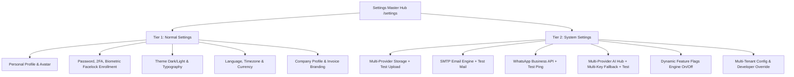
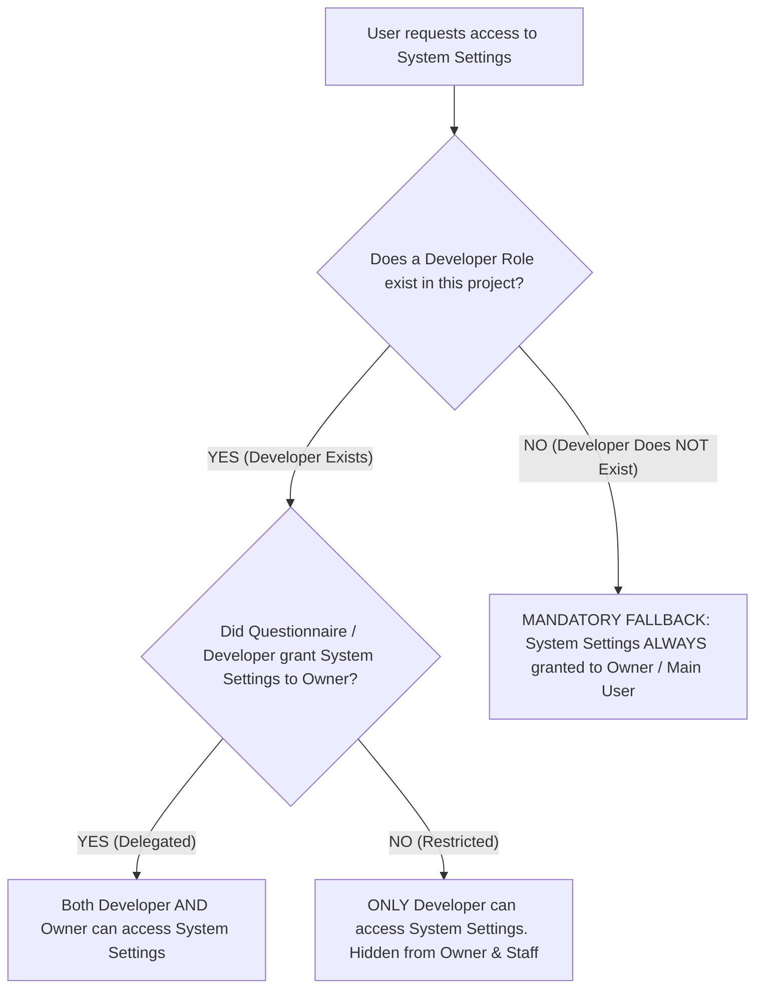
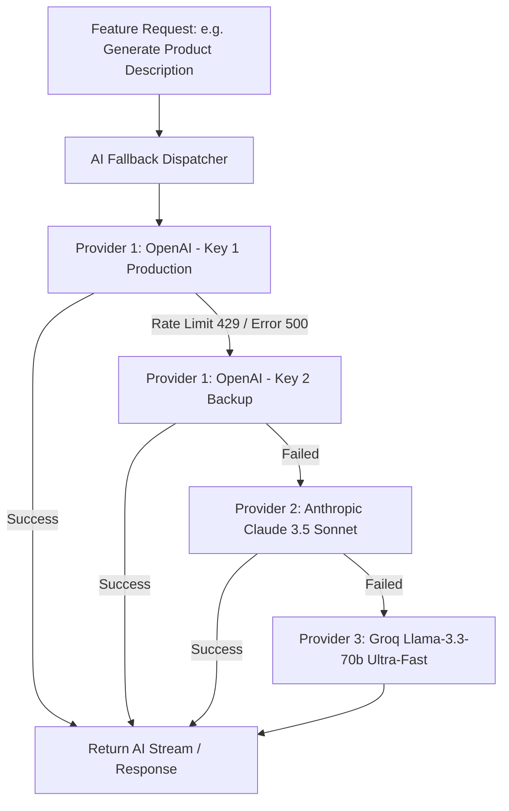
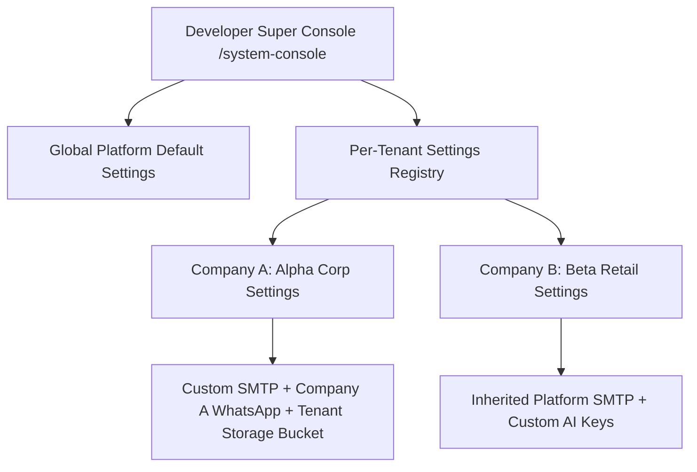
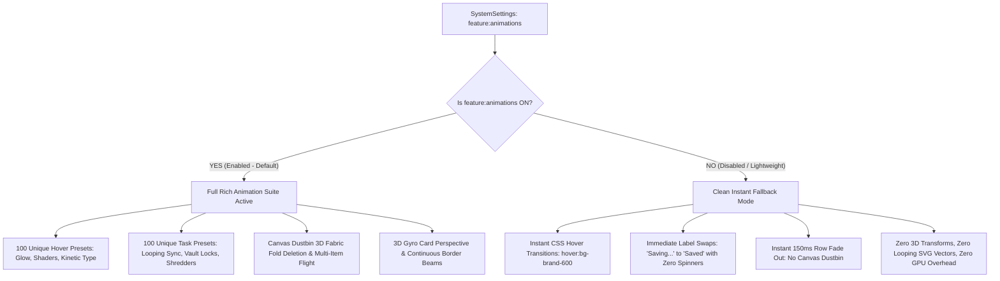

# Module Specification: Settings System & Dynamic Feature Flags

> **PURPOSE**: Establishes a mandatory dual-tier settings architecture (Normal Settings vs. System Settings), credentials management with live test verification for third-party services (SMTP, WhatsApp, Multi-Provider Storage, Multi-Key AI with Fallbacks), multi-tenant settings isolation, and a dynamic feature-flagging engine with strict Zero-Leak UI elimination.

---

## 🏛️ 1. Architecture & Dual-Tier Separation

Every web application built under this framework **MUST provide a dedicated Settings page**. Settings are divided into two strictly isolated tiers:



### The Two Tiers Defined:
1. **Tier 1: Normal Settings (User & Business Operations)**:
   - Configures personal preferences, account security, theme appearance, regional localization, and company branding.
   - Accessible to regular roles (Owner, Admin, Staff, Customer) subject to RBAC.
2. **Tier 2: System Settings (Infrastructure, Integrations & Feature Flags)**:
   - Configures platform credentials, API keys, storage buckets, AI fallback models, and enables/disables site-wide feature modules.
   - Governed by strict RBAC ownership rules.

---

## 👑 2. System Settings Access & RBAC Ownership Rules

### 2.1 The Discovery Questionnaire Rule
During project onboarding, [`DISCOVERY_QUESTIONNAIRE.md`](../DISCOVERY_QUESTIONNAIRE.md) **MUST ask the user**:  
*"Should System Settings be delegated to the Owner role, or restricted strictly to the Developer (Super Admin)?"*

### 2.2 Role Hierarchy Decision Matrix:


### Protection Invariants:
1. **Developer Precedence**: When a Developer role is present, the Developer determines whether the Owner receives System Settings access.
2. **Mandatory Fallback (No Developer Role)**: If the application does NOT include a Developer role (e.g. an internal enterprise tool or single-tier SaaS), **System Settings is ALWAYS granted to the Owner / Main User role**. System credentials and integrations must never become orphaned or inaccessible.
3. **Staff & Customers**: Under no circumstances can Staff or Customer roles access System Settings.

---

## ⚙️ 3. Tier 1: Normal Settings Specification

The Normal Settings panel (`/settings` or `/settings/general`) contains:

| Section | Target Role | Controllable Items |
| :--- | :--- | :--- |
| **Personal Profile** | All Authenticated Users | Display Name, Email, Phone Number, Avatar upload, Bio. |
| **Account Security** | All Authenticated Users | Password change, 2FA toggle, Active sessions list, Facelock biometric enrollment & re-calibration. |
| **Theme & Appearance** | All Authenticated Users | Dark Mode / Light Mode / System Auto-Sync, Accent Glow color preference. |
| **Regional & Locale** | All Authenticated Users | System Language (English, Urdu, Arabic, etc.), Timezone selection, Currency format (`$`, `PKR`, `EUR`, `AED`). |
| **Notification Preferences** | All Authenticated Users | Order status emails, WhatsApp alerts, In-app push notifications. |
| **Company Business Profile** | Owner, Admin | Company Name, Legal Registration ID, Tax/VAT Number, Support Email, Support WhatsApp, Invoice Header Logo & Terms. |

---

## 🔌 4. Tier 2: System Settings - Technical Integrations Suite

The System Settings panel (`/settings/system`) houses core platform integrations. **Every integration panel MUST feature a live "Test Connection" button** that executes a real end-to-end ping and reports instant status and latency.

```
┌────────────────────────────────────────────────────────────────────────┐
│ SYSTEM SETTINGS: PLATFORM INTEGRATIONS                                 │
├────────────────────────────────────────────────────────────────────────┤
│ [📧 SMTP Email]   [💬 WhatsApp]   [🗄️ Storage]   [🤖 AI Multi-Key]     │
├────────────────────────────────────────────────────────────────────────┤
│ Active Provider: Vercel Blob                                           │
│ Token: blob_sec_••••••••••••••••••••••••••••                            │
│                                                                        │
│ [💾 Save Credentials]     [🧪 Test Connection & Upload]  Status: 🟢 24ms│
└────────────────────────────────────────────────────────────────────────┘
```

---

### 4.1 Storage Integration (Multi-Provider Engine)

The system supports multiple cloud and local storage providers. The administrator can enter credentials for multiple providers and select the **Active Default Storage Provider**.

#### Supported Providers & Required Credentials:
1. **Vercel Blob**:
   - `BLOB_READ_WRITE_TOKEN`: Vercel Blob store token.
2. **Supabase Storage**:
   - `SUPABASE_URL`: Project API URL.
   - `SUPABASE_SERVICE_ROLE_KEY`: Service role secret key (bypasses RLS for admin uploads).
   - `SUPABASE_BUCKET`: Default bucket name (e.g. `media-uploads`).
   - `SUPABASE_PUBLIC_URL`: CDN base URL.
3. **Firebase Storage**:
   - `FIREBASE_PROJECT_ID`: Google Cloud / Firebase project ID.
   - `FIREBASE_SERVICE_ACCOUNT_JSON`: Service account JSON credential.
   - `FIREBASE_STORAGE_BUCKET`: `gs://<bucket-name>.appspot.com`.
4. **Local File Storage**:
   - `LOCAL_UPLOAD_DIR`: Server absolute filesystem directory (e.g. `/var/www/uploads` or `./public/uploads`).
   - `LOCAL_STATIC_URL`: Public prefix URL (e.g. `https://app.com/static/uploads`).
5. **Google Drive Storage**:
   - `GDRIVE_CLIENT_ID`: Google OAuth 2.0 Client ID.
   - `GDRIVE_CLIENT_SECRET`: Google OAuth Client Secret.
   - `GDRIVE_REFRESH_TOKEN`: Long-lived OAuth refresh token.
   - `GDRIVE_ROOT_FOLDER_ID`: Target parent folder ID.
6. **Cloudflare R2 / AWS S3 / MinIO (S3-Compatible)**:
   - `S3_ENDPOINT`: Endpoint URL (e.g. `https://<account_id>.r2.cloudflarestorage.com` or custom S3 endpoint).
   - `S3_ACCESS_KEY_ID`: Access Key ID.
   - `S3_SECRET_ACCESS_KEY`: Secret Access Key.
   - `S3_BUCKET_NAME`: Bucket identifier.
   - `S3_REGION`: Region identifier (e.g. `auto` for Cloudflare R2, `us-east-1` for AWS).
   - `S3_PUBLIC_CDN_DOMAIN`: Optional custom CDN domain (e.g. `https://cdn.mybrand.com`).

#### Live Verification Button ("Test Connection & Upload"):
- **Execution Flow**:
  1. Generates an in-memory 1-kilobyte dummy test payload: `storage-ping-<timestamp>.txt`.
  2. Uploads the file to the selected provider using entered credentials.
  3. Executes a `GET` request to verify the file is publicly readable (or signed URL works).
  4. Immediately deletes the test file (`DELETE`) to prevent storage clutter.
  5. Measures total roundtrip latency in milliseconds.
- **UI State**: Displays a spinning loader during upload -> changes to a green badge (`🟢 Connected (32ms)`) or opens an error inspection modal with raw server diagnostics upon failure.

---

### 4.2 SMTP Transactional Email Integration

#### Configuration Fields:
- `SMTP_HOST`: Mail server hostname (e.g. `smtp.resend.com`, `smtp.sendgrid.net`, `smtp.gmail.com`).
- `SMTP_PORT`: Port number (`465` for SSL, `587` for STARTTLS, `2525`).
- `SMTP_USER`: Authentication username.
- `SMTP_PASSWORD`: Secret password or API token (masked with show/hide toggle).
- `SMTP_ENCRYPTION`: `TLS` | `SSL` | `None`.
- `SMTP_FROM_EMAIL`: Default sender address (e.g. `no-reply@company.com`).
- `SMTP_FROM_NAME`: Friendly sender name (e.g. `Acme Notifications`).

#### Live Verification Button ("Send Test Email"):
- **UI Trigger**: Input field for recipient email + "Send Test Email" button.
- **Execution**: Sends a formatted transactional email template containing:
  - Subject: `[TEST] SMTP Connection Verified - Platform System`
  - Body: Diagnostic metadata (timestamp, server hostname, protocol).
- **Feedback**: Returns SMTP handshake response code (`250 OK`) or error logs.

---

### 4.3 WhatsApp Business API Integration

#### Supported Gateway Providers:
1. **Meta Cloud API (Official WhatsApp Graph API)**:
   - `WHATSAPP_TOKEN`: Permanent System User Access Token.
   - `WHATSAPP_PHONE_NUMBER_ID`: Business Phone Number ID.
   - `WHATSAPP_BUSINESS_ACCOUNT_ID`: Meta WABA ID.
   - `WHATSAPP_WEBHOOK_VERIFY_TOKEN`: Webhook signature verify token.
2. **Twilio WhatsApp API**:
   - `TWILIO_ACCOUNT_SID`, `TWILIO_AUTH_TOKEN`, `TWILIO_WHATSAPP_NUMBER`.
3. **UltraMsg / 3rd Party Webhook Gateway**:
   - `ULTRAMSG_INSTANCE_ID`, `ULTRAMSG_TOKEN`.
4. **Baileys / Custom Node Gateway**:
   - `CUSTOM_GATEWAY_URL`, `GATEWAY_AUTH_KEY`.

#### Live Verification Button ("Send Test WhatsApp Message"):
- **UI Trigger**: Phone number input with international country code prefix + "Send Test WhatsApp" button.
- **Execution**: Sends a test WhatsApp message:  
  `"✅ System Test: WhatsApp API connection verified successfully at <timestamp>."`
- **Feedback**: Displays message status (`sent` / `delivered`) with WhatsApp message ID.

---

### 4.4 AI Integrations Engine (Multi-Provider, Multi-Key & Fallback System)

The AI integration engine allows configuring **multiple AI providers, multiple API keys per provider, automated fallback chains, and feature placement mapping**.



#### Supported AI Providers:
- **OpenAI**: `gpt-4o`, `gpt-4o-mini`, `o1`, `o3-mini`, `text-embedding-3-small`.
- **Anthropic Claude**: `claude-3-5-sonnet`, `claude-3-5-haiku`, `claude-3-opus`.
- **OpenRouter**: Unified gateway for 200+ models with universal fallback.
- **Google Gemini**: `gemini-1.5-pro`, `gemini-1.5-flash`, `gemini-2.0-flash`.
- **Groq**: Ultra-low-latency LPU inference (`llama-3.3-70b-versatile`, `mixtral-8x7b-32768`).
- **Mistral AI**: `mistral-large-latest`, `codestral-latest`.
- **Perplexity AI**: `sonar-pro`, `sonar` (live web browsing models).
- **DeepSeek**: `deepseek-chat` (DeepSeek-V3), `deepseek-reasoner` (DeepSeek-R1).
- **Ollama / Local LLM**: Custom base URL (e.g. `http://localhost:11434/v1`).
- **Custom OpenAI-Compatible Endpoint**: Custom Base URL + API Key + Model string.

#### Multi-Key Management per Provider:
- Administrators can register **multiple keys for any provider** (e.g., Key A, Key B, Key C).
- Each key is assigned:
  - Custom Label (e.g. *"Main Production"*, *"Reserve Team Key"*).
  - Priority Tier (1 = Primary, 2 = Secondary, 3 = Cold Standby).
  - Monthly Token Budget / Soft Cap.

#### Automatic Fallback Chains:
- When a key or provider encounters:
  - HTTP `429 Too Many Requests` (Rate limit or quota exhaustion).
  - HTTP `500 / 502 / 503` (Provider outage).
  - Network timeout (>15 seconds).
- The dispatcher **immediately and transparently catches the failure and rotates to the next key or fallback provider** in the configured sequence without dropping user requests.

#### Live Verification Button ("Test AI Connection"):
- Each key and provider row features a dedicated **"Test Key"** button.
- **Execution**: Dispatches a minimal ping prompt: `{"prompt": "Ping. Respond only with PONG and your exact model name."}`.
- **Feedback**: Measures roundtrip latency (ms), displays active model name, token count, and verified status badge.

#### AI Placement & Feature Allocation Matrix:
System Settings allows the administrator to decide **where AI is enabled throughout the website**:

```markdown
| AI Placement Touchpoint | Enabled | Default Model | Fallback Model |
| :--- | :---: | :--- | :--- |
| **Customer AI Chatbot & Assistant** | [x] | `claude-3-5-sonnet` | `gemini-1.5-flash` |
| **Product Description & SEO Copywriter** | [x] | `gpt-4o` | `claude-3-5-haiku` |
| **Financial Analytics & Executive PDF Summarizer** | [x] | `deepseek-reasoner` | `gpt-4o` |
| **Document, Receipt & Invoice OCR** | [x] | `gemini-1.5-pro` (Vision)| `gpt-4o` |
| **3D Asset & Texture Prompt Generator** | [ ] | `gpt-4o-mini` | `groq-llama-3` |
| **AI Image & Banner Generator** | [ ] | `dall-e-3` | `openrouter:flux-1` |
```

---

## 🏢 5. Multi-Tenant Settings Architecture

When an application is configured as Multi-Tenant ([`modules/MULTI_TENANT_SYSTEM.md`](./MULTI_TENANT_SYSTEM.md)):



### 5.1 Isolation & Independence Rules:
1. **Isolated Tenant Credentials**: Each company/tenant stores its own settings in a tenant-isolated database row (`tenant_settings` table indexed by `company_id`).
2. **Developer Super Console Oversight**:
   - The Developer can view all tenant settings profiles.
   - The Developer can toggle whether a tenant uses **Platform-Provided Global Credentials** (shared SMTP/Storage/AI) or **Tenant-Owned Custom Credentials**.
   - The Developer can inspect connection health and override credentials if a tenant encounters configuration errors.
3. **Zero Cross-Tenant Leakage**: Tenant A can NEVER read or modify Tenant B's credentials or storage buckets. Row-Level Security (RLS) is enforced on all settings queries.

---

## 🎛️ 6. Dynamic Feature Flags Engine & Strict Zero-Leak Law

The application features a centralized **Feature Flags Matrix** accessible to the **Developer** (or the **Owner** if no Developer role exists).

### 6.1 Controllable Feature Modules Catalog:
- `feature:ai_engine`: Enables/disables all AI capabilities across the platform.
- `feature:whatsapp_automation`: Enables/disables WhatsApp notifications and chatbot.
- `feature:3d_models`: Enables/disables 3D GLTF model uploads and interactive 3D WebGL viewers (e.g. for products or dashboard widgets).
- `feature:facelock_auth`: Enables/disables biometric AI face recognition login.
- `feature:barcode_scanner`: Enables/disables camera barcode & QR code scanning.
- `feature:customer_portal`: Enables/disables dedicated public customer storefront and self-service account.
- `feature:vendor_portal`: Enables/disables supplier & vendor portal.
- `feature:cms_engine`: Enables/disables dynamic banner, blog, and announcement CMS.
- `feature:multi_account_switcher`: Enables/disables fast multi-user account switching from topbar.
- `feature:animations`: Enables/disables rich UI animations (100 Hover presets, 100 Task loop animations, 3D Canvas Dustbin deletion, 3D card tilt) per tenant or website.

---

### 6.2 The Strict Zero-Leak UI Elimination Law ("Jo Off Hai Us Ko Bilkul Bhi Show Nahi Karna")

> **CRITICAL ARCHITECTURAL MANDATE**:  
> When a functional feature flag is set to **OFF (`false`)**, the feature **MUST COMPLETELY DISAPPEAR** from the user experience.  
> **Zero disabled buttons. Zero grayed-out teaser menus. Zero "Coming Soon" banners. Zero route traces.**

```
┌────────────────────────────────────────────────────────────────────────┐
│ ❌ FORBIDDEN UI ANTI-PATTERNS (Strictly Prohibited):                   │
├────────────────────────────────────────────────────────────────────────┤
│ 1. Showing a grayed-out "3D Model View" button with a lock icon.       │
│ 2. Showing a disabled "AI Assist" sidebar tab saying "Upgrade to unlock"│
│ 3. Leaving an inactive WhatsApp button that gives a "Not enabled" alert.│
│ 4. Allowing direct URL navigation to /dashboard/3d-models.             │
└────────────────────────────────────────────────────────────────────────┘

┌────────────────────────────────────────────────────────────────────────┐
│ ✅ MANDATORY ZERO-LEAK BEHAVIOR:                                       │
├────────────────────────────────────────────────────────────────────────┤
│ 1. Sidebar menu items for disabled features are 100% UNMOUNTED.        │
│ 2. Topbar quick actions and Cmd+K search palette OMIT disabled tools.  │
│ 3. Action buttons in tables and slide carousels are completely HIDDEN. │
│ 4. Direct route navigation triggers a clean 404 NOT FOUND page.        │
│ 5. Backend API endpoints return HTTP 404 Not Found or 403 Forbidden.   │
└────────────────────────────────────────────────────────────────────────┘
```

---

### 6.3 The Animation Engine Feature Flag (`feature:animations`) & Instant Fallback Contract

Cross-referenced with master specification [`rules/PREMIUM_BUTTON_ANIMATION_SYSTEM.md`](../rules/PREMIUM_BUTTON_ANIMATION_SYSTEM.md) and [`rules/ROW_CARD_DELETE_DUSTBIN_ANIMATION.md`](../rules/ROW_CARD_DELETE_DUSTBIN_ANIMATION.md).

The **`feature:animations`** flag allows platform developers and tenant owners to govern whether rich interactive micro-animations are permitted on a given tenant's website or dashboard:



#### Dual-State Behavioral Specifications:
1. **When Enabled (`feature:animations === true`)**:
   - The application runs the full enterprise motion architecture.
   - All 100 Hover presets and 100 Task-synchronized button animations run with guaranteed minimum cycles.
   - Row and card deletions trigger the Mac-like 3D Fabric Fold into the right-sliding Canvas Dustbin.
   - Dynamic 3D gyro tilt and Framer Motion shared layout tabs are active.
2. **When Disabled (`feature:animations === false`)**:
   - **Zero Complex Transforms**: No WebGL shaders, no Canvas overlays, no 3D perspective calculations.
   - **Accessible Instant Fallback**:
     - Buttons swap labels cleanly: Idle ➔ Submitting ("Saving...") ➔ Settled ("Saved"). No generic spinning wheels are ever rendered.
     - Hover states use standard, lightweight Tailwind transitions (`transition-colors duration-150`).
     - Row and card deletions skip the canvas dustbin entirely, removing the item from the React Context state array with a crisp 150ms opacity fade.
   - **Ideal For**: Ultra-low-latency enterprise environments, clients on low-spec corporate hardware, or customers who mandate a strict minimalist, distraction-free aesthetic.


---

## 💻 7. Production Code Implementation Blueprints

### 7.1 Database Models & Schemas (MongoDB / Mongoose)

```typescript
// 1. Global / Tenant Settings Schema (`models/SystemSettings.ts`)
import mongoose, { Schema, Document } from "mongoose";

export interface ISystemSettings extends Document {
  companyId?: mongoose.Types.ObjectId | null; // null for platform global settings
  category: "storage" | "smtp" | "whatsapp" | "ai" | "features";
  config: Record<string, any>;
  isActive: boolean;
  createdAt: Date;
  updatedAt: Date;
}

const SystemSettingsSchema = new Schema<ISystemSettings>(
  {
    companyId: {
      type: Schema.Types.ObjectId,
      ref: "Company",
      default: null,
      index: true,
    },
    category: {
      type: String,
      required: true,
      enum: ["storage", "smtp", "whatsapp", "ai", "features"],
    },
    config: {
      type: Schema.Types.Mixed,
      default: {},
    },
    isActive: {
      type: Boolean,
      default: true,
    },
  },
  { timestamps: true }
);

// Compound Unique Index: One config category per company (or global)
SystemSettingsSchema.index({ companyId: 1, category: 1 }, { unique: true });

export const SystemSettings =
  mongoose.models.SystemSettings ||
  mongoose.model<ISystemSettings>("SystemSettings", SystemSettingsSchema);


// 2. AI Keys & Fallback Schema (`models/AiProviderKey.ts`)
export interface IAiProviderKey extends Document {
  companyId?: mongoose.Types.ObjectId | null;
  provider: "openai" | "claude" | "openrouter" | "gemini" | "groq" | "mistral" | "perplexity" | "deepseek" | "ollama" | "custom";
  keyLabel: string;
  apiKeyEncrypted: string;
  baseUrl?: string;
  defaultModel?: string;
  priority: number; // 1 = Primary, 2 = Secondary fallback
  isActive: boolean;
  lastTestedAt?: Date;
  lastPingLatencyMs?: number;
  createdAt: Date;
  updatedAt: Date;
}

const AiProviderKeySchema = new Schema<IAiProviderKey>(
  {
    companyId: {
      type: Schema.Types.ObjectId,
      ref: "Company",
      default: null,
      index: true,
    },
    provider: {
      type: String,
      required: true,
      index: true,
    },
    keyLabel: { type: String, required: true },
    apiKeyEncrypted: { type: String, required: true },
    baseUrl: { type: String, default: "" },
    defaultModel: { type: String, default: "" },
    priority: { type: Number, default: 1, index: true },
    isActive: { type: Boolean, default: true, index: true },
    lastTestedAt: { type: Date, default: null },
    lastPingLatencyMs: { type: Number, default: null },
  },
  { timestamps: true }
);

AiProviderKeySchema.index({ companyId: 1, provider: 1, priority: 1 });

export const AiProviderKey =
  mongoose.models.AiProviderKey ||
  mongoose.model<IAiProviderKey>("AiProviderKey", AiProviderKeySchema);
```

---

### 7.2 Frontend Feature Flag Guard (`components/common/FeatureFlagGuard.tsx`)

```tsx
"use client";

import React from "react";
import { useFeatureFlags } from "@/hooks/useFeatureFlags";

interface FeatureFlagGuardProps {
  featureKey: string;
  fallback?: React.ReactNode;
  children: React.ReactNode;
}

/**
 * Strict Zero-Leak Feature Gate:
 * If the feature is disabled, renders fallback (default null) with zero trace in DOM.
 */
export const FeatureFlagGuard: React.FC<FeatureFlagGuardProps> = ({
  featureKey,
  fallback = null,
  children,
}) => {
  const { isEnabled, isLoading } = useFeatureFlags();

  if (isLoading) {
    return null; // Silent load to prevent UI flash
  }

  if (!isEnabled(featureKey)) {
    return <>{fallback}</>;
  }

  return <>{children}</>;
};
```

---

### 7.3 Frontend Hook for Feature Flags (`hooks/useFeatureFlags.ts`)

```typescript
"use client";

import { useQuery } from "@tanstack/react-query";

export interface FeatureFlagsMap {
  [key: string]: boolean;
}

export function useFeatureFlags() {
  const { data: flags = {}, isLoading } = useQuery<FeatureFlagsMap>({
    queryKey: ["feature-flags"],
    queryFn: async () => {
      const res = await fetch("/api/v1/system/features");
      if (!res.ok) return {};
      return res.json();
    },
    staleTime: 5 * 60 * 1000, // Cache 5 minutes
    refetchOnWindowFocus: false,
  });

  const isEnabled = (key: string): boolean => {
    return Boolean(flags[key]);
  };

  return { flags, isEnabled, isLoading };
}
```

---

### 7.4 Multi-Key AI Fallback Client (`lib/ai/aiDispatcher.ts`)

```typescript
interface AiChatOptions {
  prompt: string;
  systemPrompt?: string;
  preferredProvider?: string;
  maxTokens?: number;
}

interface ProviderKeyRecord {
  provider: string;
  apiKey: string;
  baseUrl?: string;
  defaultModel: string;
}

export async function callAiWithFallback(options: AiChatOptions): Promise<string> {
  // 1. Fetch prioritized active keys from backend / cache
  const activeKeys: ProviderKeyRecord[] = await getActiveAiKeysPrioritized();

  if (!activeKeys || activeKeys.length === 0) {
    throw new Error("No active AI provider keys configured in System Settings.");
  }

  let lastError: Error | null = null;

  // 2. Iterate through fallback chain
  for (const keyConfig of activeKeys) {
    try {
      const response = await dispatchToProvider(keyConfig, options);
      if (response) {
        return response; // Successful response
      }
    } catch (err: any) {
      console.warn(`[AI Hub] ${keyConfig.provider} (${keyConfig.defaultModel}) failed: ${err.message}. Rotating to next fallback.`);
      lastError = err;
      continue; // Attempt next key in fallback chain
    }
  }

  throw new Error(`All AI providers in fallback chain failed. Last error: ${lastError?.message}`);
}
```

---

### 7.5 Backend Route Guard & API Protection (FastAPI Example)

```python
from fastapi import APIRouter, Depends, HTTPException, status
from app.api.deps import get_current_company_features

router = APIRouter(prefix="/3d-models", tags=["3D Models"])

def require_feature(feature_key: str):
    def dependency(features = Depends(get_current_company_features)):
        if not features.get(feature_key, False):
            # Strict Zero-Leak: Return 404 to mimic non-existent route
            raise HTTPException(
                status_code=status.HTTP_404_NOT_FOUND,
                detail="Feature endpoint not found or disabled by platform administrator."
            )
        return True
    return dependency

@router.post("/upload", dependencies=[Depends(require_feature("feature:3d_models"))])
def upload_3d_model(file_data: dict):
    return {"success": True, "message": "3D Model uploaded successfully."}
```

---

## 🛡️ 8. Verification & Acceptance Checklist

Before completing Settings and Feature Flag implementation on any project, verify:

1. [ ] **Dual-Tier Layout Verified**: Normal Settings (`/settings`) and System Settings (`/settings/system`) are distinct routes and interfaces.
2. [ ] **Questionnaire Adherence**: Discovery interview asked user whether System Settings belongs to Developer or Owner.
3. [ ] **Fallback Invariant**: If no Developer role exists, System Settings is 100% accessible to the Owner / Main User.
4. [ ] **Live Testing Buttons Functional**:
   - [ ] SMTP "Send Test Email" delivers real email and reports status.
   - [ ] WhatsApp "Send Test Ping" sends message to entered phone number.
   - [ ] Storage "Test Connection & Upload" uploads dummy file, verifies read, deletes file, and displays latency (ms).
   - [ ] AI "Test Key" sends minimal prompt, measures latency, and returns model confirmation.
5. [ ] **Multi-Key Fallback Tested**: Disabling or simulating rate limit on Key 1 automatically routes traffic to Key 2 or secondary provider without user-visible errors.
6. [ ] **Strict Zero-Leak UI Audit**:
   - [ ] Disabling `feature:3d_models` removes all 3D upload buttons and viewers from product forms and dashboards.
   - [ ] Disabling `feature:whatsapp_automation` eliminates WhatsApp icons and action triggers.
   - [ ] Disabling `feature:ai_engine` hides all AI prompt bars, chatbots, and generation buttons.
   - [ ] Disabling `feature:facelock_auth` hides biometric face scan options from login and settings.
   - [ ] Direct route access to disabled features returns clean 404 Not Found.
