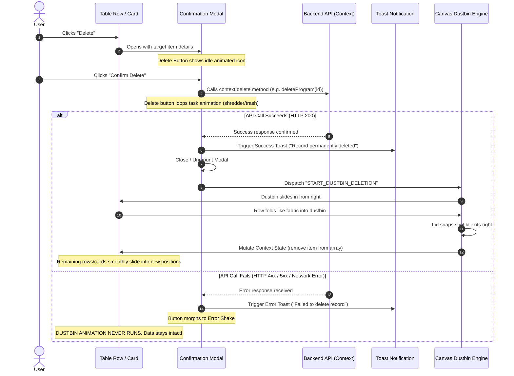
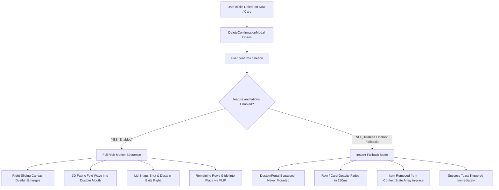

# Master Architecture: Table Row & Card Deletion Orchestration (Fabric-Fold & Dustbin System)

> **CORE MANDATE**: When a table row or card is deleted, it must NEVER simply vanish, blink out of existence, or play a generic in-place fade. 
> 
> Instead, the application executes a **choreographed physical micro-story**:
> 1. A sleek, high-tech **Dustbin** emerges from the right side of the screen.
> 2. The deleted table row or card folds from its right end like **flowing silk/fabric** (origami wave & suction curl) and glides directly into the mouth of the dustbin.
> 3. The dustbin lid snaps closed with a tactile latch, and the dustbin retreats back offscreen to the right.
> 4. All remaining rows and cards glide smoothly into their new positions using Framer Motion FLIP layout transitions.
>
> 👑 **THE STRICT TIMING & STATE INTEGRITY LAWS**:
> - **Confirmation Modal First**: Clicking delete always prompts a Confirmation Modal.
> - **In-Modal Processing Loop**: The modal's Delete button plays its task-specific animation while awaiting the backend API.
> - **Strict Success Gate**: If the API call fails, the Dustbin animation **MUST NEVER RUN**. Error toast displays, and data stays intact.
> - **Toast -> Modal Close -> Dustbin Sequence**: Upon API confirmation, the Success Toast fires, the modal dismisses, and the Dustbin Fabric-Fold animation initiates.
> - **Bulk Deletion Together**: When deleting multiple rows/cards, all selected items lift and enter the dustbin **simultaneously**, never one by one.
> - **Zero-Duplicate-Variable Law**: Backend updates mutate the existing React Context array in-place. All subscribed views update instantly, and future new records seamlessly render in the same state.

---

## 🎭 1. Visual Mechanics: The "Fabric Fold into Dustbin" Animation

### 1.1 The Visual Narrative
Traditional web apps delete data abruptly. This system treats UI cards and table rows as tangible digital surfaces:
- **Phase 1: Dustbin Arrival (0ms – 250ms)**:
  - An obsidian/metallic dustbin cylinder with an articulated swinging lid slides in from the right edge of the viewport (`translateX(100%) -> translateX(0)`), positioning its open mouth aligned with the deleted row or table container.
  - The dustbin lid pops open at a 45-degree angle.
- **Phase 2: The Fabric Fold & Suction Glide (200ms – 650ms)**:
  - The deleted row or card elevates slightly on the Z-axis (`scale: 1.02, shadow-2xl`).
  - Beginning from its right edge, the element undergoes a non-linear 3D origami wave:
    - Right edge curls inward (`rotateY: -25deg`, `skewY: -4deg`).
    - The body compresses horizontally (`scaleX: 1.0 -> 0.05`, `originX: 1.0`).
    - The element pulls rightward toward the mouth of the dustbin as if being drawn into a vacuum suction funnel.
- **Phase 3: Lid Snap & Departure (650ms – 900ms)**:
  - The instant the card/row vanishes into the dustbin interior, the dustbin lid snaps shut (`rotate: 0deg`) with an elastic micro-rebound.
  - The dustbin accelerates offscreen to the right (`translateX(0) -> translateX(120%)`).
- **Phase 4: Automatic Layout Collapse (700ms – 1000ms)**:
  - As the row collapses in height (`height: 0, opacity: 0, margin: 0`), all rows/cards underneath glide upward smoothly via Framer Motion's `layout` engine with zero layout jump.

```
[ Row Content: Program #104 | Active | $1,200 ]  ──> [ Dustbin emerges from right ]
       │
       ▼  (Right-edge fabric curl)
[ Row Content: Program ~~~~~~~\ ]               ──> [ Dustbin Lid Open: \___/ ]
       │
       ▼  (Horizontal fold & suction)
[                     ~~~~==> ]                  ──> [ Enters mouth of Dustbin ]
       │
       ▼  (Lid snaps shut & departs)
[ (Space smoothly collapses)  ]                  ──> [ Dustbin exits right ──> ]
```

### 1.2 Execution Constraints
- **Single-Run Only**: The Dustbin Fabric-Fold animation executes **EXACTLY ONCE** per deletion event. It NEVER loops.
- **Duration**: Total choreography takes **750ms – 900ms**, remaining snappy and professional without delaying the user.

---

## 🛑 2. The Confirmation Modal & Two-Phase Button Lifecycle

Every destructive deletion must be safeguarded by a two-phase confirmation protocol:



### 2.1 Confirmation Modal States
1. **Modal Mount**:
   - The modal appears with high-depth glassmorphism (`backdrop-blur-2xl bg-slate-950/80`).
   - The Delete button inside the modal displays in **Idle State**:
     - Icon: Minimalist trash/shredder glyph.
     - Label: `"Yes, Permanently Delete"`.
     - Styling: `bg-rose-600 hover:bg-rose-700 text-white shadow-lg shadow-rose-950/50`.
2. **In-Flight Processing**:
   - When the user clicks `"Yes, Permanently Delete"`:
     - The button immediately enters its **Processing State**, running the task-specific shredder micro-animation in a continuous loop via `useTaskAnimationSync`.
     - The modal's Cancel button is disabled to prevent duplicate submissions.
3. **Success Handshake**:
   - The API completes successfully.
   - The button plays a brief 300ms success morph.
   - **Step A**: The Success Toast is triggered immediately.
   - **Step B**: The Confirmation Modal animates closed (`opacity: 0, scale: 0.95`).
   - **Step C**: The deleted row/card on the underlying page initiates the Dustbin Fabric-Fold sequence.
4. **Error Safeguard**:
   - If the backend rejects the deletion (e.g. 403 Forbidden, 409 Conflict, network failure):
     - The modal's delete button shakes with an error alert icon.
     - The Error Toast is fired: `"Unable to delete record: Dependent relations exist."`
     - The modal remains open or can be dismissed by the user.
     - **The row/card remains 100% visible and active. The Dustbin animation NEVER fires.**

---

## 📦 3. Bulk Deletion Orchestration (Simultaneous Multi-Item Flight)

When a user selects 5, 20, or 100 rows/cards via checkboxes or marquee drag and triggers Bulk Delete:

### 3.1 The Anti-Pattern: Sequential Animation Ban
> ⚠️ **STRICT PROHIBITION**:
> Never animate bulk-deleted items one by one sequentially! (e.g. Item 1 folds, then Item 2 folds, then Item 3 folds...). Doing so causes tedious 10-second delays that ruin the user experience.

### 3.2 The Group-Flight Standard
1. **Confirmation Modal**:
   - Modal shows total count: `"Permanently delete 14 selected records?"`.
   - Lists preview chips of selected titles.
2. **Synchronous Lift & Flight**:
   - Upon API confirmation, the Dustbin emerges from the right side of the screen, scaling slightly larger to represent bulk capacity.
   - **All 14 selected rows/cards simultaneously**:
     - Lift with elevation shadows (`scale: 1.03`, `shadow-2xl`, `zIndex: 50`).
     - Begin folding from their right edges like layered fabric sheets.
     - Glide along parabolic trajectory curves directly into the open mouth of the dustbin.
3. **Simultaneous Departure**:
   - The dustbin lid snaps shut with an authoritative metallic sound and dual smoke particles.
   - Dustbin slides offscreen right.
   - The Context array filters out all 14 IDs at once.
   - All unselected rows/cards smoothly slide together into a compact list.

---

## 🔄 4. Backend Data & Context State Synchronization

Cross-referenced with [`rules/MODELS_AND_CONTEXTS_ARCHITECTURE.md`](./MODELS_AND_CONTEXTS_ARCHITECTURE.md).

### 4.1 The Single Variable Mandate (Zero Duplicate State)
```tsx
// ❌ WRONG: Creating local state duplicates causes split-brain desynchronization
const [localRows, setLocalRows] = useState(programs);

// ✅ CORRECT: Consume context state directly
const { programs, deleteProgram, bulkDeletePrograms } = useProgram();
```

### 4.2 Synchronization Sequence & State Cleanup
To guarantee zero visual flicker:
1. **Visual Hold during Animation**:
   - When the deletion starts, the orchestrator sets `deletingIds: Set<string>`.
   - The items remain in the React Context array for the ~750ms duration of the fabric-fold animation so Framer Motion can render their folding motion.
2. **Context Array Mutation**:
   - The exact millisecond the dustbin lid snaps shut and the items are inside, the context method commits the immutable filter:
     ```tsx
     setPrograms((prev) => prev.filter((item) => !deletingIds.has(item._id)));
     ```
3. **Seamless Handling of Subsequent Records**:
   - Because `programs` remains the single canonical state variable:
     - Any new records created via `createProgram(payload)` prepend or append directly to this same array.
     - Fresh server-side refetches update this exact array.
     - Deleted records **NEVER flash back or reappear**.
     - All subscribed components (Table view, Mobile card view, metrics badges, counters) automatically re-render in perfect unison.

---

## 💻 5. Complete Production React Implementation

### 5.1 The Deletion Orchestrator Hook (`useDeleteOrchestrator.ts`)

```typescript
// src/hooks/useDeleteOrchestrator.ts
import { useState, useCallback } from 'react';

export interface DeleteTarget {
  id: string;
  title: string;
  type: 'single' | 'bulk';
  bulkIds?: string[];
}

export function useDeleteOrchestrator<TData = any>(
  onPerformDelete: (target: DeleteTarget) => Promise<TData>,
  onSuccessCleanup: (target: DeleteTarget) => void
) {
  const [modalTarget, setModalTarget] = useState<DeleteTarget | null>(null);
  const [isModalOpen, setIsModalOpen] = useState(false);
  const [animatingDeleteIds, setAnimatingDeleteIds] = useState<string[]>([]);
  const [isDustbinActive, setIsDustbinActive] = useState(false);

  // 1. Trigger confirmation modal
  const requestDelete = useCallback((target: DeleteTarget) => {
    setModalTarget(target);
    setIsModalOpen(true);
  }, []);

  const closeModal = useCallback(() => {
    setIsModalOpen(false);
    setModalTarget(null);
  }, []);

  // 2. Execute deletion upon modal confirmation
  const confirmDelete = useCallback(async () => {
    if (!modalTarget) return;

    // Call backend API
    await onPerformDelete(modalTarget);

    // API succeeded: Close modal
    setIsModalOpen(false);

    // Determine target IDs
    const targetIds = modalTarget.type === 'bulk' && modalTarget.bulkIds 
      ? modalTarget.bulkIds 
      : [modalTarget.id];

    // Trigger Canvas Dustbin & Fabric Fold Animation
    setAnimatingDeleteIds(targetIds);
    setIsDustbinActive(true);

    // Wait for fabric fold into dustbin + lid snap (750ms)
    await new Promise((resolve) => setTimeout(resolve, 750));

    // Commit state cleanup in Context
    onSuccessCleanup(modalTarget);

    // Wait for dustbin to exit offscreen (250ms)
    await new Promise((resolve) => setTimeout(resolve, 250));

    // Reset orchestrator state
    setAnimatingDeleteIds([]);
    setIsDustbinActive(false);
    setModalTarget(null);
  }, [modalTarget, onPerformDelete, onSuccessCleanup]);

  return {
    modalTarget,
    isModalOpen,
    animatingDeleteIds,
    isDustbinActive,
    requestDelete,
    closeModal,
    confirmDelete,
  };
}
```

---

### 5.2 The Confirmation Modal Component (`<DeleteConfirmationModal />`)

```tsx
// src/components/ui/DeleteConfirmationModal.tsx
import React from 'react';
import { motion, AnimatePresence } from 'framer-motion';
import { AlertTriangle, Trash2, X } from 'lucide-react';
import { TaskAnimatedButton } from './TaskAnimatedButton';
import { DeleteTarget } from '@/hooks/useDeleteOrchestrator';

interface DeleteConfirmationModalProps {
  isOpen: boolean;
  target: DeleteTarget | null;
  onClose: () => void;
  onConfirm: () => Promise<any>;
  onSuccessToast: () => void;
  onErrorToast: (error: any) => void;
}

export const DeleteConfirmationModal: React.FC<DeleteConfirmationModalProps> = ({
  isOpen,
  target,
  onClose,
  onConfirm,
  onSuccessToast,
  onErrorToast,
}) => {
  if (!target) return null;

  const isBulk = target.type === 'bulk';
  const itemCount = isBulk ? target.bulkIds?.length || 0 : 1;

  return (
    <AnimatePresence>
      {isOpen && (
        <div className="fixed inset-0 z-50 flex items-center justify-center p-4">
          {/* Backdrop */}
          <motion.div
            initial={{ opacity: 0 }}
            animate={{ opacity: 1 }}
            exit={{ opacity: 0 }}
            onClick={onClose}
            className="fixed inset-0 bg-slate-950/80 backdrop-blur-md"
          />

          {/* Modal Card */}
          <motion.div
            initial={{ opacity: 0, scale: 0.92, y: 16 }}
            animate={{ opacity: 1, scale: 1, y: 0 }}
            exit={{ opacity: 0, scale: 0.95, y: 8 }}
            transition={{ type: 'spring', damping: 25, stiffness: 300 }}
            className="relative w-full max-w-lg overflow-hidden rounded-2xl border border-rose-500/20 bg-slate-900/95 p-6 shadow-2xl shadow-rose-950/40 backdrop-blur-2xl z-10"
          >
            {/* Header */}
            <div className="flex items-start gap-4">
              <div className="flex h-12 w-12 flex-shrink-0 items-center justify-center rounded-xl bg-rose-500/10 text-rose-400 border border-rose-500/20">
                <AlertTriangle className="h-6 w-6" />
              </div>
              <div className="flex-1">
                <h3 className="text-lg font-bold text-white tracking-tight">
                  {isBulk ? `Delete ${itemCount} Records?` : `Delete "${target.title}"?`}
                </h3>
                <p className="mt-1 text-sm leading-relaxed text-slate-400">
                  {isBulk
                    ? `This will permanently delete ${itemCount} selected records from the database. This action cannot be undone.`
                    : `Are you sure you want to delete this record? This action will permanently remove it from the database.`}
                </p>
              </div>
              <button
                onClick={onClose}
                className="text-slate-400 hover:text-white transition-colors cursor-pointer"
              >
                <X className="w-5 h-5" />
              </button>
            </div>

            {/* Actions */}
            <div className="mt-6 flex items-center justify-end gap-3">
              <button
                type="button"
                onClick={onClose}
                className="px-4 py-2.5 rounded-xl border border-slate-700 bg-slate-800/80 hover:bg-slate-700 text-sm font-semibold text-slate-200 transition-colors cursor-pointer"
              >
                Cancel
              </button>

              {/* Task-Animated Confirm Button */}
              <TaskAnimatedButton
                id="btn-confirm-delete"
                label={isBulk ? `Delete ${itemCount} Items` : "Yes, Delete"}
                activeLabel="Deleting Record..."
                successLabel="Deleted!"
                variant="destructive"
                idleIcon={<Trash2 className="w-4 h-4" />}
                animatingVector={<ShredderBladesVector />}
                cycleDuration={850}
                onClick={onConfirm}
                onSuccessToast={onSuccessToast}
                onErrorToast={onErrorToast}
              />
            </div>
          </motion.div>
        </div>
      )}
    </AnimatePresence>
  );
};

// Shredder Vector Micro-Animation
const ShredderBladesVector = () => (
  <motion.div
    animate={{ rotate: 360 }}
    transition={{ repeat: Infinity, duration: 0.85, ease: 'linear' }}
    className="w-4 h-4 border-2 border-dashed border-white rounded-full flex items-center justify-center"
  >
    <div className="w-1.5 h-1.5 bg-white rounded-full" />
  </motion.div>
);
```

---

### 5.3 The Right-Sliding Canvas Dustbin (`<DustbinPortal />`)

```tsx
// src/components/ui/DustbinPortal.tsx
import React from 'react';
import { motion, AnimatePresence } from 'framer-motion';

interface DustbinPortalProps {
  isActive: boolean;
  itemCount?: number;
}

export const DustbinPortal: React.FC<DustbinPortalProps> = ({ isActive, itemCount = 1 }) => {
  return (
    <AnimatePresence>
      {isActive && (
        <motion.div
          key="dustbin-portal"
          initial={{ x: 180, opacity: 0 }}
          animate={{ x: 0, opacity: 1 }}
          exit={{ x: 220, opacity: 0 }}
          transition={{ type: 'spring', damping: 20, stiffness: 220 }}
          className="fixed right-6 top-1/2 -translate-y-1/2 z-40 flex flex-col items-center pointer-events-none"
        >
          {/* Suction Vortex Glow */}
          <div className="absolute -inset-8 bg-rose-500/20 blur-2xl rounded-full animate-pulse" />

          {/* High-Tech Metallic Dustbin */}
          <div className="relative w-28 h-36 flex flex-col items-center">
            {/* Animated Lid */}
            <motion.div
              initial={{ rotate: 0, y: 0 }}
              animate={{
                rotate: [-45, -45, 0], // Open, hold during entry, snap shut
                y: [-8, -8, 0],
              }}
              transition={{
                times: [0, 0.7, 1],
                duration: 0.75,
                ease: 'easeInOut',
              }}
              className="origin-bottom-right w-24 h-5 rounded-t-lg bg-gradient-to-r from-slate-700 via-slate-600 to-slate-800 border-t border-slate-500 shadow-md flex items-center justify-center"
            >
              <div className="w-8 h-1 rounded-full bg-slate-400" />
            </motion.div>

            {/* Dustbin Body */}
            <div className="relative w-24 flex-1 rounded-b-2xl bg-gradient-to-b from-slate-900 via-slate-950 to-black border border-slate-700 shadow-2xl overflow-hidden flex flex-col items-center justify-center p-2">
              {/* Internal Suction Funnel Light */}
              <div className="absolute inset-0 bg-gradient-to-b from-rose-500/15 via-transparent to-black" />

              {/* Vertical Fluted Metal Grooves */}
              <div className="flex gap-1.5 opacity-30">
                <div className="w-1 h-16 bg-slate-400 rounded-full" />
                <div className="w-1 h-16 bg-slate-400 rounded-full" />
                <div className="w-1 h-16 bg-slate-400 rounded-full" />
                <div className="w-1 h-16 bg-slate-400 rounded-full" />
              </div>

              {/* Multi-Item Badge (Shown during Bulk Delete) */}
              {itemCount > 1 && (
                <div className="absolute bottom-2 px-2 py-0.5 rounded-full bg-rose-500 text-[10px] font-bold text-white shadow-lg">
                  {itemCount} Items
                </div>
              )}
            </div>
          </div>
        </motion.div>
      )}
    </AnimatePresence>
  );
};
```

---

### 5.4 The Fabric-Fold Table Row Wrapper (`<FabricFoldRow />`)

```tsx
// src/components/ui/FabricFoldRow.tsx
import React, { ReactNode } from 'react';
import { motion } from 'framer-motion';

interface FabricFoldRowProps {
  id: string;
  isDeleting: boolean;
  children: ReactNode;
  className?: string;
}

export const FabricFoldRow: React.FC<FabricFoldRowProps> = ({
  id,
  isDeleting,
  children,
  className = '',
}) => {
  return (
    <motion.tr
      layout
      key={id}
      data-row-id={id}
      initial={false}
      animate={
        isDeleting
          ? {
              // The 3D Fabric Folding Wave into the Right-Side Dustbin
              scaleX: [1, 0.85, 0.35, 0],
              scaleY: [1, 1.05, 0.6, 0],
              rotateY: [0, -18, -35, -50],
              skewY: [0, -3, -8, -12],
              x: [0, 40, 160, 320],      // Pulls rightward into dustbin mouth
              opacity: [1, 0.9, 0.6, 0],
              filter: ['blur(0px)', 'blur(0px)', 'blur(1px)', 'blur(4px)'],
              transition: {
                duration: 0.7,
                ease: [0.32, 0, 0.67, 0], // Cubic bezier vacuum suction curve
              },
            }
          : {
              scaleX: 1,
              scaleY: 1,
              rotateY: 0,
              skewY: 0,
              x: 0,
              opacity: 1,
              filter: 'blur(0px)',
            }
      }
      style={{ originX: 1.0, transformStyle: 'preserve-3d' }}
      className={`border-b transition-colors ${className}`}
    >
      {children}
    </motion.tr>
  );
};
```

---

### 5.5 The Fabric-Fold Card Wrapper (`<FabricFoldCard />`)

```tsx
// src/components/ui/FabricFoldCard.tsx
import React, { ReactNode } from 'react';
import { motion } from 'framer-motion';

interface FabricFoldCardProps {
  id: string;
  isDeleting: boolean;
  children: ReactNode;
  className?: string;
  onClick?: () => void;
}

export const FabricFoldCard: React.FC<FabricFoldCardProps> = ({
  id,
  isDeleting,
  children,
  className = '',
  onClick,
}) => {
  return (
    <motion.div
      layout
      key={id}
      data-card-id={id}
      onClick={onClick}
      initial={false}
      animate={
        isDeleting
          ? {
              // The 3D Fabric Folding Wave for Mobile Cards
              scaleX: [1, 0.8, 0.3, 0],
              scaleY: [1, 1.08, 0.5, 0],
              rotateY: [0, -22, -45, -60],
              skewY: [0, -4, -10, -15],
              x: [0, 50, 180, 350],
              opacity: [1, 0.9, 0.5, 0],
              boxShadow: [
                '0 4px 6px -1px rgba(0, 0, 0, 0.1)',
                '0 20px 25px -5px rgba(244, 63, 94, 0.3)',
                '0 10px 15px -3px rgba(244, 63, 94, 0.1)',
                'none',
              ],
              transition: {
                duration: 0.7,
                ease: [0.32, 0, 0.67, 0],
              },
            }
          : {
              scaleX: 1,
              scaleY: 1,
              rotateY: 0,
              skewY: 0,
              x: 0,
              opacity: 1,
            }
      }
      style={{ originX: 1.0, transformStyle: 'preserve-3d' }}
      className={`relative overflow-hidden rounded-2xl border transition-all ${className}`}
    >
      {children}
    </motion.div>
  );
};
```

---

## 🔗 6. Integration Blueprint in Data Table & Mobile Cards

Below is the verified pattern showing how `useProgram()` context, `useDeleteOrchestrator`, `<DustbinPortal />`, `<DeleteConfirmationModal />`, and `<FabricFoldRow />` / `<FabricFoldCard />` combine seamlessly:

```tsx
// src/components/programs/ProgramTableAndCardsView.tsx
import React, { useState } from 'react';
import { useProgram } from '@/context/ProgramContext';
import { useDeleteOrchestrator } from '@/hooks/useDeleteOrchestrator';
import { DeleteConfirmationModal } from '@/components/ui/DeleteConfirmationModal';
import { DustbinPortal } from '@/components/ui/DustbinPortal';
import { FabricFoldRow } from '@/components/ui/FabricFoldRow';
import { FabricFoldCard } from '@/components/ui/FabricFoldCard';
import { toast } from 'react-hot-toast';

export const ProgramTableAndCardsView: React.FC = () => {
  const { programs, deleteProgram, bulkDeletePrograms, setPrograms } = useProgram();
  const [selectedIds, setSelectedIds] = useState<string[]>([]);

  // Initialize Delete Orchestrator
  const {
    modalTarget,
    isModalOpen,
    animatingDeleteIds,
    isDustbinActive,
    requestDelete,
    closeModal,
    confirmDelete,
  } = useDeleteOrchestrator(
    // 1. Perform backend deletion via Context
    async (target) => {
      if (target.type === 'bulk' && target.bulkIds) {
        return await bulkDeletePrograms(target.bulkIds);
      }
      return await deleteProgram(target.id);
    },
    // 2. Commit immutable state update in Context (Zero duplicate variable)
    (target) => {
      const idsToRemove = new Set(
        target.type === 'bulk' && target.bulkIds ? target.bulkIds : [target.id]
      );
      setPrograms((prev) => prev.filter((p) => !idsToRemove.has(p._id)));
      setSelectedIds([]); // Clear selection
    }
  );

  return (
    <div className="relative w-full">
      {/* 1. Dustbin Portal (Emerges from right during deletion) */}
      <DustbinPortal
        isActive={isDustbinActive}
        itemCount={animatingDeleteIds.length}
      />

      {/* 2. Confirmation Modal */}
      <DeleteConfirmationModal
        isOpen={isModalOpen}
        target={modalTarget}
        onClose={closeModal}
        onConfirm={confirmDelete}
        onSuccessToast={() => toast.success("Record permanently removed from database.")}
        onErrorToast={(err) => toast.error(err?.message || "Failed to delete record.")}
      />

      {/* 3. Desktop Master Table */}
      <div className="hidden lg:block overflow-x-auto">
        <table className="w-full text-left">
          <tbody>
            {programs.map((prog) => {
              const isDeleting = animatingDeleteIds.includes(prog._id);
              return (
                <FabricFoldRow
                  key={prog._id}
                  id={prog._id}
                  isDeleting={isDeleting}
                >
                  <td className="p-4">{prog.title}</td>
                  <td className="p-4">{prog.code}</td>
                  <td className="p-4 font-bold">${prog.price}</td>
                  <td className="p-4">
                    <button
                      onClick={() =>
                        requestDelete({ id: prog._id, title: prog.title, type: 'single' })
                      }
                      className="px-3 py-1.5 rounded-lg bg-rose-500/10 hover:bg-rose-500 text-rose-400 hover:text-white transition-all text-xs font-semibold cursor-pointer"
                    >
                      Delete
                    </button>
                  </td>
                </FabricFoldRow>
              );
            })}
          </tbody>
        </table>
      </div>

      {/* 4. Mobile Cards Grid */}
      <div className="grid grid-cols-1 gap-4 lg:hidden">
        {programs.map((prog) => {
          const isDeleting = animatingDeleteIds.includes(prog._id);
          return (
            <FabricFoldCard
              key={prog._id}
              id={prog._id}
              isDeleting={isDeleting}
              className="p-4 bg-slate-900 border-slate-800"
            >
              <div className="flex justify-between items-center">
                <div>
                  <h4 className="font-bold text-white">{prog.title}</h4>
                  <p className="text-xs text-slate-400">{prog.code}</p>
                </div>
                <button
                  onClick={() =>
                    requestDelete({ id: prog._id, title: prog.title, type: 'single' })
                  }
                  className="px-3 py-1.5 rounded-lg bg-rose-500/10 text-rose-400 text-xs font-semibold cursor-pointer"
                >
                  Delete
                </button>
              </div>
            </FabricFoldCard>
          );
        })}
      </div>
    </div>
  );
};
```

---

## 🎛️ 8. Animation Feature Flag Fallback Mode (`feature:animations === false`)

Cross-referenced with master specification [`modules/SETTINGS_AND_FEATURE_FLAGS_SYSTEM.md`](../modules/SETTINGS_AND_FEATURE_FLAGS_SYSTEM.md#63-the-animation-engine-feature-flag-featureanimations--instant-fallback-contract).

When a tenant or website has **`feature:animations` set to `false`**:



### Fallback Implementation in `useDeleteOrchestrator`:
```typescript
// src/hooks/useDeleteOrchestrator.ts (Feature Flag Check)
const { isEnabled } = useFeatureFlags();
const animationsEnabled = isEnabled("feature:animations") ?? true;

const executeDelete = async () => {
  if (!deleteTarget) return;

  setIsDeleting(true);
  try {
    await onDeleteConfirmed(deleteTarget.id);
    closeModal();
    onSuccessToast?.();

    if (!animationsEnabled) {
      // Instant Fallback: Commit removal immediately without Canvas Dustbin
      commitDeleteToContext(deleteTarget.id);
      setIsDeleting(false);
      setDeleteTarget(null);
      return;
    }

    // Rich Motion Sequence: Launch Canvas Dustbin & 3D Fabric Fold
    setIsDustbinActive(true);
    setFoldingItemIds(deleteTarget.ids || [deleteTarget.id]);

    setTimeout(() => {
      commitDeleteToContext(deleteTarget.id);
      setIsDustbinActive(false);
      setFoldingItemIds([]);
      setIsDeleting(false);
      setDeleteTarget(null);
    }, 750); // Exact 3D fabric fold timing
  } catch (err) {
    setIsDeleting(false);
    onErrorToast?.();
  }
};
```

---

## 🔒 9. Verification & Compliance Checklist

Before approving any table row or card deletion flow, audit against these 7 requirements:
1. [ ] **Confirmation Modal First**: Does clicking delete on a row or card open the modal without prematurely running the dustbin animation?
2. [ ] **In-Modal Task Loop**: Does the confirmation modal's delete button execute a task-specific loop while the API is processing?
3. [ ] **Error Immunity**: If the API call fails, is the dustbin animation suppressed completely, leaving the row/card visible in the table?
4. [ ] **Success Sequence**: Does the flow strictly follow: API Confirmed -> Success Toast -> Modal Close -> Dustbin slides in from right -> Fabric Fold -> Dustbin Lid Snap & Exit?
5. [ ] **Bulk Deletion Group Flight**: When multiple rows/cards are deleted, do they all lift and fold into the dustbin simultaneously?
6. [ ] **Context State Integrity (Zero Duplicates)**: Is the single canonical Context API array updated in-place, allowing subsequent new records to render seamlessly without phantom reappearance?
7. [ ] **Feature Flag Fallback Audit**: When `feature:animations` is toggled OFF, does row/card deletion bypass the canvas dustbin and remove the item with a clean 150ms opacity fade?

