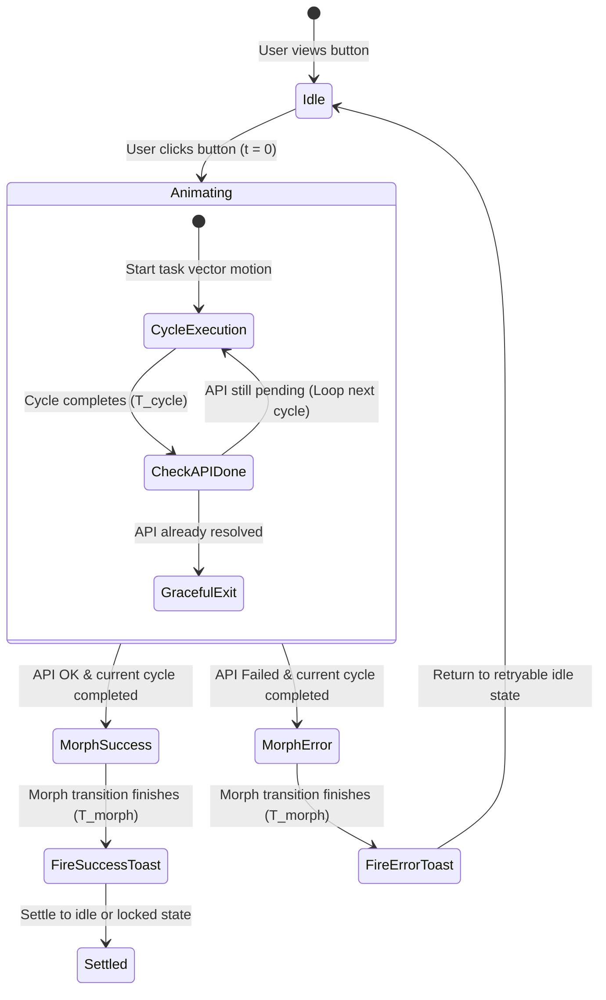

# Master Architecture: Task-Specific Animated Buttons System

> **EXPANDED MASTER SPECIFICATION**:  
> For the comprehensive enterprise catalog containing **100 Unique Hover Presets**, **100 Unique Task Presets**, the **9-State Finite State Machine**, and the central component architecture, see:  
> 🔗 **[`rules/PREMIUM_BUTTON_ANIMATION_SYSTEM.md`](./PREMIUM_BUTTON_ANIMATION_SYSTEM.md)**.
>
> **CORE MANDATE**: Generic, boring circle loading spinners (e.g. `animate-spin` circular borders) on action buttons are **STRICTLY PROHIBITED** across all applications—whether on Public Marketing Pages, CMS Studio, Dashboard Tables, Modals, or Drawers.
>
> Every interactive action button that triggers an asynchronous API call or complex client task MUST display a **Task-Specific Micro-Animation** directly representing the nature of that task.
>
> 👑 **THE SYNCHRONIZATION LAW**:
> 1. If the API response takes longer than the animation cycle, the animation **seamlessly loops** without stuttering.
> 2. If the API responds faster than the animation cycle (e.g. 150ms response on a 1000ms animation), the animation **MUST complete its full ongoing cycle gracefully** before transitioning.
> 3. Toast notifications **MUST ONLY trigger AFTER the animation and completion morph finish completely**—never mid-flight!

---

## 🚫 1. The Zero-Boring-Spinner Law ("No Generic Circular Loaders")

### 1.1 The UX Psychological Problem with Generic Spinners
Generic circle spinners provide zero task context:
- They make every action feel like a dull system lag rather than purposeful computation.
- They fail to reinforce user agency or give visual feedback on what the system is physically executing (e.g., printing an invoice, sealing an envelope, compressing a file, routing a webhook).
- When buttons simply show a spinning ring, users perceive the application as an off-the-shelf template.

### 1.2 The Task-Specific Animation Standard
Every button click must deliver a bespoke, delightfully animated micro-story:
- **Download PDF**: The document icon folds, passes under a laser scanline, and drops into a physical tray.
- **Send Email**: The envelope flaps open, folds into a sleek paper jet, and accelerates forward with a supersonic vapor trail.
- **Delete Record**: The trash bin lid flips open, the target record crumples into a ball, drops into the bin, and the lid snaps closed with a gentle shudder.
- **Pay Now / Checkout**: A miniature credit card dips into an obsidian chip reader, waves pulse outward, and a green verification beam illuminates the card edge.
- **Save Draft**: A quill pen dips in ink, scribes two glowing lines on parchment, and drops a warm wax seal.

---

## ⏱️ 2. The Animation Synchronization & Timing Contract

### 2.1 The Two-Phase Lifecycle & Minimum Cycle Math

Every animated button interaction operates on a strict mathematical timing contract governed by:
- $T_{cycle}$: The fundamental natural duration of one full animation loop (typically 800ms – 1200ms).
- $T_{api}$: The actual network latency and server response time.
- $T_{morph}$: The terminal success or error morph transition (typically 350ms – 500ms).



### 2.2 Case A: Slow API Response ($T_{api} > T_{cycle}$)
- The task-specific micro-animation loops smoothly with zero visual stutter at cycle seams.
- Loop count $N = \lceil T_{api} / T_{cycle} \rceil$.
- When the API resolves during cycle $N$, the animation continues running until the exact completion of cycle $N$.

### 2.3 Case B: Fast API Response ($T_{api} < T_{cycle}$)
- If the API call completes in 180ms, but $T_{cycle} = 1000\text{ms}$, the system calculates the remaining time:
  $$\Delta t_{\text{remainder}} = T_{cycle} - (T_{api} \pmod{T_{cycle}})$$
- The system **waits $\Delta t_{\text{remainder}}$** before triggering the success morph.
- **The animation is never abruptly cut off, snapped, or aborted.**

### 2.4 The Post-Animation Toast Trigger Guarantee
> ⚠️ **STRICT ARCHITECTURAL RULE**:
> Toast notifications (`toast.success()`, `toast.error()`, etc.) **MUST NEVER** be invoked inside the API promise callback immediately upon HTTP resolution.
>
> Doing so causes the toast to pop into view while the button is still in mid-animation, breaking the visual narrative and confusing the user.
>
> The toast trigger callback must be executed **strictly after**:
> 1. The full animation cycle has completed.
> 2. The terminal success/error morph animation ($T_{morph}$) has completed.

---

## 🛠️ 3. Reusable React Core Implementation

### 3.1 The Universal Synchronization Hook (`useTaskAnimationSync.ts`)

```typescript
// src/hooks/useTaskAnimationSync.ts
import { useState, useRef, useCallback } from 'react';

export type TaskStatus = 'idle' | 'animating' | 'success' | 'error';

interface TaskAnimationOptions<TData> {
  cycleDuration?: number;    // Duration of one complete animation loop in ms (default: 1000ms)
  morphDuration?: number;    // Duration of completion morph in ms (default: 400ms)
  onSuccess?: (data: TData) => void;
  onError?: (error: unknown) => void;
  onSuccessToast?: (data: TData) => void; // Guaranteed to fire AFTER animation finishes
  onErrorToast?: (error: unknown) => void;
}

export function useTaskAnimationSync<TData = any>(options: TaskAnimationOptions<TData> = {}) {
  const {
    cycleDuration = 1000,
    morphDuration = 400,
    onSuccess,
    onError,
    onSuccessToast,
    onErrorToast,
  } = options;

  const [status, setStatus] = useState<TaskStatus>('idle');
  const startTimeRef = useRef<number>(0);
  const isExecutingRef = useRef<boolean>(false);

  const execute = useCallback(
    async (taskPromise: Promise<TData>): Promise<TData | undefined> => {
      if (isExecutingRef.current) return;

      isExecutingRef.current = true;
      setStatus('animating');
      startTimeRef.current = performance.now();

      let taskResult: TData | undefined = undefined;
      let taskError: unknown = null;
      let isSuccess = false;

      try {
        taskResult = await taskPromise;
        isSuccess = true;
      } catch (err) {
        taskError = err;
        isSuccess = false;
      }

      // Compute elapsed execution time
      const elapsed = performance.now() - startTimeRef.current;
      
      // Calculate remaining duration required to complete the current cycle gracefully
      const remainderInCycle = cycleDuration - (elapsed % cycleDuration);
      const waitTime = remainderInCycle === cycleDuration ? 0 : remainderInCycle;

      // Allow the active animation cycle to complete 100%
      if (waitTime > 0) {
        await new Promise((resolve) => setTimeout(resolve, waitTime));
      }

      // Transition to terminal morph state
      setStatus(isSuccess ? 'success' : 'error');

      // Wait for the terminal morph transition to complete
      await new Promise((resolve) => setTimeout(resolve, morphDuration));

      // Trigger user-defined callbacks and STRICTLY DEFERRED toasts
      if (isSuccess) {
        onSuccess?.(taskResult as TData);
        onSuccessToast?.(taskResult as TData);
      } else {
        onError?.(taskError);
        onErrorToast?.(taskError);
      }

      // Reset execution lock
      isExecutingRef.current = false;
      
      return taskResult;
    },
    [cycleDuration, morphDuration, onSuccess, onError, onSuccessToast, onErrorToast]
  );

  const reset = useCallback(() => {
    setStatus('idle');
    isExecutingRef.current = false;
  }, []);

  return {
    status,
    isLoading: status === 'animating',
    isSuccess: status === 'success',
    isError: status === 'error',
    execute,
    reset,
  };
}
```

---

### 3.2 The Master Component Blueprint (`<TaskAnimatedButton />`)

```tsx
// src/components/ui/TaskAnimatedButton.tsx
import React, { ReactNode } from 'react';
import { motion, AnimatePresence } from 'framer-motion';
import { useTaskAnimationSync, TaskStatus } from '@/hooks/useTaskAnimationSync';
import { Check, AlertCircle } from 'lucide-react';

export interface TaskAnimatedButtonProps {
  id?: string;
  label: string;
  activeLabel?: string;
  successLabel?: string;
  errorLabel?: string;
  idleIcon: ReactNode;
  animatingVector: ReactNode; // Bespoke task-specific motion graphics
  successIcon?: ReactNode;
  onClick: () => Promise<any>;
  cycleDuration?: number;
  onSuccessToast?: (data: any) => void;
  onErrorToast?: (error: any) => void;
  variant?: 'primary' | 'secondary' | 'destructive' | 'glass' | 'emerald';
  className?: string;
  disabled?: boolean;
}

export const TaskAnimatedButton: React.FC<TaskAnimatedButtonProps> = ({
  id,
  label,
  activeLabel,
  successLabel = 'Completed',
  errorLabel = 'Failed',
  idleIcon,
  animatingVector,
  successIcon = <Check className="w-5 h-5 text-emerald-400" />,
  onClick,
  cycleDuration = 1000,
  onSuccessToast,
  onErrorToast,
  variant = 'primary',
  className = '',
  disabled = false,
}) => {
  const { status, isLoading, isSuccess, isError, execute } = useTaskAnimationSync({
    cycleDuration,
    onSuccessToast,
    onErrorToast,
  });

  const handleClick = async (e: React.MouseEvent) => {
    e.preventDefault();
    if (disabled || isLoading) return;
    await execute(onClick());
  };

  // Variant styling
  const variantStyles = {
    primary: 'bg-brand-500 hover:bg-brand-600 text-white shadow-glow-sky border-transparent',
    secondary: 'bg-slate-800 hover:bg-slate-700 text-slate-100 border-slate-700',
    destructive: 'bg-rose-600 hover:bg-rose-700 text-white shadow-lg shadow-rose-950/40 border-transparent',
    glass: 'bg-white/10 dark:bg-slate-900/40 backdrop-blur-xl border-white/20 text-white hover:bg-white/20',
    emerald: 'bg-emerald-600 hover:bg-emerald-700 text-white shadow-lg shadow-emerald-950/40 border-transparent',
  }[variant];

  return (
    <motion.button
      id={id}
      whileTap={{ scale: disabled || isLoading ? 1 : 0.97 }}
      onClick={handleClick}
      disabled={disabled || isLoading}
      className={`relative inline-flex items-center justify-center gap-3 px-6 py-3 rounded-xl font-semibold text-sm transition-all duration-300 border cursor-pointer overflow-hidden ${variantStyles} ${className} ${disabled ? 'opacity-50 cursor-not-allowed' : ''}`}
    >
      {/* Background Active Energy Pulse (Active when animating) */}
      <AnimatePresence>
        {isLoading && (
          <motion.div
            initial={{ opacity: 0 }}
            animate={{ opacity: 1 }}
            exit={{ opacity: 0 }}
            className="absolute inset-0 bg-gradient-to-r from-transparent via-white/15 dark:via-cyan-400/15 to-transparent pointer-events-none"
            style={{
              backgroundSize: '200% 100%',
              animation: `shimmerFlow ${cycleDuration}ms infinite linear`,
            }}
          />
        )}
      </AnimatePresence>

      {/* Dynamic Icon & Vector Representation */}
      <div className="relative w-5 h-5 flex items-center justify-center flex-shrink-0">
        <AnimatePresence mode="wait">
          {status === 'idle' && (
            <motion.div
              key="idle"
              initial={{ scale: 0.8, opacity: 0 }}
              animate={{ scale: 1, opacity: 1 }}
              exit={{ scale: 0.8, opacity: 0 }}
              transition={{ duration: 0.2 }}
            >
              {idleIcon}
            </motion.div>
          )}

          {status === 'animating' && (
            <motion.div
              key="animating"
              initial={{ scale: 0.8, opacity: 0 }}
              animate={{ scale: 1, opacity: 1 }}
              exit={{ scale: 0.8, opacity: 0 }}
              className="w-full h-full flex items-center justify-center"
            >
              {animatingVector}
            </motion.div>
          )}

          {status === 'success' && (
            <motion.div
              key="success"
              initial={{ scale: 0.5, rotate: -45, opacity: 0 }}
              animate={{ scale: 1.1, rotate: 0, opacity: 1 }}
              exit={{ scale: 0.8, opacity: 0 }}
              transition={{ type: 'spring', stiffness: 400, damping: 15 }}
            >
              {successIcon}
            </motion.div>
          )}

          {status === 'error' && (
            <motion.div
              key="error"
              initial={{ scale: 0.5, opacity: 0 }}
              animate={{ scale: 1, opacity: 1, x: [0, -4, 4, -4, 4, 0] }}
              exit={{ scale: 0.8, opacity: 0 }}
              transition={{ duration: 0.4 }}
            >
              <AlertCircle className="w-5 h-5 text-rose-400" />
            </motion.div>
          )}
        </AnimatePresence>
      </div>

      {/* Button Text Transition */}
      <span className="relative z-10 font-medium tracking-wide">
        {status === 'idle' && label}
        {status === 'animating' && (activeLabel || label)}
        {status === 'success' && successLabel}
        {status === 'error' && errorLabel}
      </span>
    </motion.button>
  );
};
```

---

## 🌟 4. The 30 Master Task-Specific Animated Button Specifications

Below are the 30 concrete, real-world task buttons designed across Public Marketing, Billing/Checkout, CMS Studio, Automations, Asset Management, and Dashboard Security.

---

### 📂 CATEGORY 1: Public Pages & Customer Journey (Examples 1–6)

#### Example 1: "Send Inquiry / Contact Us" (Paper Plane Takeoff & Jet Vapor Trail)
- **Surface / Context**: Public Contact Page & Lead Magnet Drawer.
- **Triggered Action**: Submits contact form payload via `usePublicInquiry().submitInquiry(formData)`.
- **Idle State**:
  - Icon: Minimalist diagonal paper plane (`lucide-react` `Send`).
  - Label: `"Send Message"`.
  - Style: Vibrant Brand Cyan button with soft outer glow.
- **Task-Specific Animation Mechanics**:
  - Vector: An SVG paper plane folds its wings downward (0ms–200ms), rotates 35 degrees upward (200ms–400ms), and accelerates across the button boundary to the top-right (400ms–800ms).
  - Trailing Effect: A segmented cyan vapor trail dots behind the fuselage and loops through a mini looping orbit if the API is delayed ($T_{cycle} = 900\text{ms}$).
  - Loop Seam: As the plane flies off the right edge, a second miniature supersonic dart emerges from the bottom-left to maintain unbroken motion until the network responds.
- **Fast vs. Slow API Handling**:
  - Fast response (120ms): Plane finishes its flight across the screen to 900ms.
  - Slow response (2400ms): Plane completes 2.66 loops; gracefully lands on loop 3 at 2700ms.
- **Completion Morph & Success State**:
  - The plane glides into a central bullseye target, collapsing into an emerald checkmark with a circular shockwave pulse.
  - Label morphs to `"Message Delivered!"`.
- **Post-Animation Toast Contract**:
  - Fired strictly AFTER the 900ms flight + 400ms target morph:
  - `toast.success("Inquiry received! Our team will contact you within 2 hours.", { icon: '✈️' })`.

---

#### Example 2: "Subscribe to Newsletter" (Envelope Seal & Postbox Slot Drop)
- **Surface / Context**: Public Footer & Blog Sidebar.
- **Triggered Action**: `useNewsletter().subscribe(email)`.
- **Idle State**:
  - Icon: Closed envelope (`Mail`).
  - Label: `"Subscribe"`.
- **Task-Specific Animation Mechanics**:
  - Vector: The envelope flap lifts up (0ms–300ms), a newsletter page with miniature text lines slides deep inside (300ms–600ms), and a golden wax seal drops and presses shut (600ms–1000ms, $T_{cycle} = 1000\text{ms}$).
  - Looping: If API is slow, the sealed letter glides into a brass mail slot, and another letter preps for sealing in rhythm.
- **Completion Morph & Success State**:
  - The envelope morphs into a green heart emblem with sparkling particles.
  - Label morphs to `"You're On The List!"`.
- **Post-Animation Toast Contract**:
  - Fired after 1000ms cycle:
  - `toast.success("Welcome aboard! Please verify your inbox.", { icon: '📬' })`.

---

#### Example 3: "Download Brochure / Whitepaper" (PDF Document Laser Scan & Tray Eject)
- **Surface / Context**: Enterprise Landing Page Hero / Product Features.
- **Triggered Action**: `useBrochure().downloadPdf(brochureId)`.
- **Idle State**:
  - Icon: Document with downward arrow (`FileDown`).
  - Label: `"Download Enterprise Deck"`.
- **Task-Specific Animation Mechanics**:
  - Vector: A crisp white PDF document card appears. An animated horizontal neon-blue laser line scans downward across the sheet from top to bottom (0ms–600ms), revealing blueprint technical diagrams.
  - At 600ms–1000ms ($T_{cycle} = 1000\text{ms}$), the scanned sheet slides downward into a physical document tray slot.
  - Looping: Laser oscillates up and down scanning continuous pages if network bandwidth is limited.
- **Completion Morph & Success State**:
  - The tray ejects a PDF badge with a glowing green checkmark.
  - Label morphs to `"Brochure Ready!"`.
- **Post-Animation Toast Contract**:
  - Fired after full scan cycle completes:
  - `toast.success("Enterprise Deck downloaded successfully.", { icon: '📄' })`.

---

#### Example 4: "Schedule Demo / Book Meeting" (Calendar Page Flip & Fast-Forward Clock)
- **Surface / Context**: SaaS Demo Booking Modal / Sales Funnel.
- **Triggered Action**: `useBooking().reserveSlot({ date, time, timezone })`.
- **Idle State**:
  - Icon: Calendar grid with clock badge (`CalendarClock`).
  - Label: `"Confirm Demo Slot"`.
- **Task-Specific Animation Mechanics**:
  - Vector: A dual-leaf desk calendar flips its front page smoothly over its ring binder (0ms–450ms). Inside, an analog clock face rotates its minute hand 360 degrees in rapid fast-forward motion (450ms–900ms, $T_{cycle} = 900\text{ms}$).
  - Looping: Calendar pages continue flipping gently like days passing in a time-lapse until calendar slot reservation locks in MongoDB.
- **Completion Morph & Success State**:
  - The calendar page pins firmly with a golden thumbtack and a checkmark stamp.
  - Label morphs to `"Slot Reserved!"`.
- **Post-Animation Toast Contract**:
  - Fired strictly after flip cycle:
  - `toast.success("Demo scheduled! Calendar invite dispatched to your email.", { icon: '🗓️' })`.

---

#### Example 5: "Add to Wishlist / Bookmark" (Heart Vector Pop & Sparkle Float)
- **Surface / Context**: Public Catalog Card & Course Detail Page.
- **Triggered Action**: `useWishlist().toggleBookmark(productId)`.
- **Idle State**:
  - Icon: Clean outline heart (`Heart`).
  - Label: `"Save to Wishlist"`.
- **Task-Specific Animation Mechanics**:
  - Vector: The heart contracts slightly to 85% scale (anticipation, 0ms–200ms), then explodes outward to 125% with glowing ruby-red fill (200ms–500ms).
  - Floating Effect: 4 tiny golden stars emit from the vertex of the heart and float upward with gentle physics sway (500ms–800ms, $T_{cycle} = 800\text{ms}$).
  - Looping: Stars orbit in an ethereal halo around the pulsating heart if network sync is delayed.
- **Completion Morph & Success State**:
  - The heart settles into solid crimson red with a miniature golden lock badge.
  - Label morphs to `"Saved!"`.
- **Post-Animation Toast Contract**:
  - Fired after 800ms:
  - `toast.success("Item saved to your private collection.", { icon: '💖' })`.

---

#### Example 6: "Submit Feedback / Rating" (Shooting Star Orbit & Gold Shimmer)
- **Surface / Context**: Net Promoter Score (NPS) Dialog & Public Review Bar.
- **Triggered Action**: `useReviews().submitRating({ score, comment })`.
- **Idle State**:
  - Icon: Empty star outline (`Star`).
  - Label: `"Post Review"`.
- **Task-Specific Animation Mechanics**:
  - Vector: A golden star shoots in from bottom-left, executing an elliptical 3D orbit around the button text (0ms–600ms).
  - As it orbits, it leaves a sparkling comet tail that coats the star in metallic molten gold (600ms–1000ms, $T_{cycle} = 1000\text{ms}$).
  - Looping: The comet continues orbiting fluidly without interruption.
- **Completion Morph & Success State**:
  - The star clicks into the center, bursting into five smaller stars that align horizontally.
  - Label morphs to `"Review Published!"`.
- **Post-Animation Toast Contract**:
  - Fired after orbit completes:
  - `toast.success("Thank you for your valuable feedback!", { icon: '⭐' })`.

---

### 💳 CATEGORY 2: E-Commerce, Billing & Checkout (Examples 7–12)

#### Example 7: "Pay Now / Complete Checkout" (Credit Card Chip Dip & Soundwave Terminal)
- **Surface / Context**: E-Commerce Checkout Drawer & Subscription Modal.
- **Triggered Action**: `usePayment().processStripeIntent(paymentMethodId)`.
- **Idle State**:
  - Icon: Credit card with chip graphic (`CreditCard`).
  - Label: `"Pay $149.00"`.
  - Style: Dark Obsidian Glass with ambient violet glow.
- **Task-Specific Animation Mechanics**:
  - Vector: A miniature 3D isometric credit card slides vertically down into an obsidian POS chip terminal slot (0ms–400ms).
  - As the chip makes contact, 3 concentric NFC radio wave arcs emanate from the terminal reader (400ms–1100ms, $T_{cycle} = 1100\text{ms}$).
  - Looping: Radio waves pulse rhythmically (ping... ping...) while Stripe/Bank 3D-Secure processes the transaction.
- **Fast vs. Slow API Handling**:
  - Fast authorization (300ms): NFC waves finish their full 1100ms cycle.
  - Slow authorization (3200ms): Completes 3 full wave pulses; resolves cleanly on cycle 3.
- **Completion Morph & Success State**:
  - An authentic emerald LED ring flashes on the POS terminal with a checkmark.
  - Label morphs to `"Payment Approved!"`.
- **Post-Animation Toast Contract**:
  - Fired strictly after 1100ms cycle + 400ms LED flash:
  - `toast.success("Transaction #9842 confirmed! Receipt emailed.", { icon: '💳' })`.

---

#### Example 8: "Apply Coupon Code" (Scissors Snipping Ticket Notch & Tag Bounce)
- **Surface / Context**: Cart Summary & Checkout Discount Box.
- **Triggered Action**: `useCart().applyPromoCode(code)`.
- **Idle State**:
  - Icon: Discount coupon tag (`Tag`).
  - Label: `"Apply Code"`.
- **Task-Specific Animation Mechanics**:
  - Vector: A pair of stainless steel scissors glides across a dotted discount coupon line, snipping the edge notch with a crisp 2-frame snip (0ms–400ms).
  - The detached ticket stub bounces joyfully on an elastic spring physics curve (400ms–900ms, $T_{cycle} = 900\text{ms}$).
  - Looping: Dotted lines reel continuously like a ticketing machine if server validates complex discount rules.
- **Completion Morph & Success State**:
  - Ticket transforms into a glowing badge displaying `"-20% APPLIED"`.
  - Label morphs to `"Discount Applied!"`.
- **Post-Animation Toast Contract**:
  - Fired after 900ms:
  - `toast.success("Promo code 'VIP20' applied: You saved $38.00!", { icon: '🏷️' })`.

---

#### Example 9: "Generate Invoice / Receipt" (Thermal Cash Register Printout Sliding Down)
- **Surface / Context**: Dashboard Billing History & Order Detail.
- **Triggered Action**: `useOrder().generateReceipt(orderId)`.
- **Idle State**:
  - Icon: Printer receipt (`Receipt`).
  - Label: `"Generate Tax Invoice"`.
- **Task-Specific Animation Mechanics**:
  - Vector: A stylized thermal cash register slot ejects a paper receipt sliding downward line-by-line with rhythmic micro-ratchets (0ms–700ms).
  - A serrated tear-line blade trims the top margin with a horizontal flash (700ms–1000ms, $T_{cycle} = 1000\text{ms}$).
  - Looping: Receipt paper feeds smoothly like a real printing press while server compiles PDF headers and tax totals.
- **Completion Morph & Success State**:
  - Receipt detaches cleanly, folding into a verified official invoice stamp.
  - Label morphs to `"Invoice Generated!"`.
- **Post-Animation Toast Contract**:
  - Fired strictly after print cycle:
  - `toast.success("Tax Invoice #INV-2026-88 ready for download.", { icon: '🧾' })`.

---

#### Example 10: "Refund Transaction" (Money Bag / Coin Orbit Reversing Flow)
- **Surface / Context**: Admin Dashboard Order Management & Dispute Drawer.
- **Triggered Action**: `useBilling().issueRefund(transactionId, amount)`.
- **Idle State**:
  - Icon: Undo currency symbol (`RotateCcw`).
  - Label: `"Issue Full Refund"`.
  - Style: Subtle Slate Amber border with dark backdrop.
- **Task-Specific Animation Mechanics**:
  - Vector: Two gold coins leave a central wallet and follow a counter-clockwise curved orbit back into a bank vault vault-portal (0ms–600ms).
  - A reverse spiral arrow trails behind the coins with glowing amber particles (600ms–1100ms, $T_{cycle} = 1100\text{ms}$).
  - Looping: Continuous reverse orbital flow while gateway initiates reversal handshake.
- **Completion Morph & Success State**:
  - The vault door locks shut with an amber padlock and checkmark.
  - Label morphs to `"Refund Issued!"`.
- **Post-Animation Toast Contract**:
  - Fired after 1100ms cycle:
  - `toast.success("$149.00 refunded back to customer's Visa.", { icon: '💸' })`.

---

#### Example 11: "Upgrade Subscription Tier" (Rocket Launch with Thruster Plume & Orbit Ring)
- **Surface / Context**: SaaS Pricing Table & Plan Switcher Modal.
- **Triggered Action**: `useSubscription().upgradeTier('enterprise')`.
- **Idle State**:
  - Icon: Rocket vessel (`Rocket`).
  - Label: `"Upgrade to Enterprise"`.
  - Style: Radiant Indigo-Cyan Gradient with dynamic border beam.
- **Task-Specific Animation Mechanics**:
  - Vector: A sleek space rocket tilts 45 degrees, ignites its dual plasma thrusters with animated orange-cyan flame particles (0ms–400ms).
  - The rocket launches upward out of the button, while an orbital ring traces around the button perimeter (400ms–1000ms, $T_{cycle} = 1000\text{ms}$).
  - Looping: Plasma flame oscillates and cosmic stars stream past the fuselage during Stripe billing prorations.
- **Completion Morph & Success State**:
  - The rocket hits warp speed, breaking into a shimmering diamond Crown icon.
  - Label morphs to `"Plan Upgraded!"`.
- **Post-Animation Toast Contract**:
  - Fired after 1000ms:
  - `toast.success("Welcome to Enterprise! Unlimited access unlocked.", { icon: '🚀' })`.

---

#### Example 12: "Connect Bank Account (Stripe/Plaid)" (Vault Wheel Spin & Interlocking Plugs)
- **Surface / Context**: Tenant Payout Settings & FinTech Onboarding.
- **Triggered Action**: `useBanking().linkPlaidAccount(publicToken)`.
- **Idle State**:
  - Icon: Bank pillars with link chain (`Landmark`).
  - Label: `"Link Business Bank"`.
- **Task-Specific Animation Mechanics**:
  - Vector: A high-security circular bank vault door wheel rotates 360 degrees with tactile clicking gears (0ms–500ms).
  - Two heavy industrial electrical cables glide from opposite sides and snap together with an electric cyan spark (500ms–1000ms, $T_{cycle} = 1000\text{ms}$).
  - Looping: Electrical pulse currents flow smoothly along the linked cable.
- **Completion Morph & Success State**:
  - The link locks into an emerald shield with verified checkmark.
  - Label morphs to `"Bank Account Connected!"`.
- **Post-Animation Toast Contract**:
  - Fired after 1000ms:
  - `toast.success("Chase Business Checking linked for instant payouts.", { icon: '🏦' })`.

---

### 🎨 CATEGORY 3: CMS Studio, Page Builder & Content (Examples 13–18)

#### Example 13: "Publish Live Page" (Satellite Dish Beam Pulsing to Cloud)
- **Surface / Context**: CMS Public Pages Studio & Section Editor Header.
- **Triggered Action**: `useCMS().publishPage(pageId)`.
- **Idle State**:
  - Icon: Globe with broadcast radio waves (`Globe`).
  - Label: `"Publish to Production"`.
  - Style: High-gloss Emerald / Brand Cyan with live status pill.
- **Task-Specific Animation Mechanics**:
  - Vector: A ground satellite dish tilts toward an illuminated cloud glyph (0ms–350ms).
  - A concentrated neon-green microwave beam shoots upward in 3 rhythmic laser pulses, lighting up the cloud's perimeter with edge highlights (350ms–1000ms, $T_{cycle} = 1000\text{ms}$).
  - Looping: Microwave pulses continuously stream data packets to the cloud while Edge CDN invalidates caches across global nodes.
- **Completion Morph & Success State**:
  - Cloud turns solid emerald with a green glowing dot and `"LIVE"` badge.
  - Label morphs to `"Page Published!"`.
- **Post-Animation Toast Contract**:
  - Fired after 1000ms cycle:
  - `toast.success("Page published worldwide across 320 CDN edge locations.", { icon: '🌐' })`.

---

#### Example 14: "Save Draft" (Quill Pen Inking Paper & Wax Seal Press)
- **Surface / Context**: CMS Blog Post & Email Template Designer.
- **Triggered Action**: `useCMS().saveDraft({ id, jsonContent })`.
- **Idle State**:
  - Icon: Traditional floppy disk with magnetic slider (`Save`).
  - Label: `"Save Draft"`.
- **Task-Specific Animation Mechanics**:
  - Vector: An old-world fountain pen dips into a glowing glass inkwell (0ms–300ms), moves across a parchment sheet writing 3 horizontal wavy script lines (300ms–700ms).
  - A warm circular wax seal stamps the bottom right corner with a gentle hydraulic squash (700ms–1000ms, $T_{cycle} = 1000\text{ms}$).
  - Looping: Quill pen continues scribing fine typographic lines smoothly.
- **Completion Morph & Success State**:
  - Parchment rolls into a tied scroll with a green ribbon knot.
  - Label morphs to `"Draft Saved!"`.
- **Post-Animation Toast Contract**:
  - Fired after 1000ms:
  - `toast.success("All changes autosaved to MongoDB draft revision #14.", { icon: '🖋️' })`.

---

#### Example 15: "Generate AI Section / Copy" (Magic Wand Sparkle Swirl & Neural Constellation)
- **Surface / Context**: CMS AI Copywriter & Section Generator Modal.
- **Triggered Action**: `useAI().generateSectionPrompt(promptParams)`.
- **Idle State**:
  - Icon: Sparkle wand with neural stars (`Sparkles`).
  - Label: `"Generate with AI"`.
  - Style: Iridescent Purple-Violet Gradient with starlight shimmer.
- **Task-Specific Animation Mechanics**:
  - Vector: A glowing crystal magic wand swivels in a circular figure-8 infinity arc (0ms–500ms).
  - As it traces, 5 neural constellation nodes illuminate and connect with energetic laser lines, pulsating like an organic brain network (500ms–1200ms, $T_{cycle} = 1200\text{ms}$).
  - Looping: Neural network pulses and redistributes node weights in real time while LLM streams output tokens.
- **Completion Morph & Success State**:
  - Constellation nodes converge into a brilliant gold starburst.
  - Label morphs to `"Section Generated!"`.
- **Post-Animation Toast Contract**:
  - Fired after 1200ms:
  - `toast.success("AI layout and marketing copy created successfully.", { icon: '✨' })`.

---

#### Example 16: "Download Custom PDF Template" (Blueprint Grid Unrolling & PDF Stamp Press)
- **Surface / Context**: CMS PDF Editor & Certificate Designer Studio.
- **Triggered Action**: `usePdfEditor().exportActiveTemplate(templateId)`.
- **Idle State**:
  - Icon: PDF document with stamp seal (`FileText`).
  - Label: `"Export PDF Template"`.
- **Task-Specific Animation Mechanics**:
  - Vector: A technical cyan blueprint grid roll unrolls horizontally across the button surface (0ms–400ms).
  - A heavy industrial brass stamp drops from above, imprinting `"PDF CERTIFIED"` onto the sheet with mechanical rebound (400ms–1000ms, $T_{cycle} = 1000\text{ms}$).
  - Looping: Stamp hovers and stamps rhythmic sheets while server compiles Puppeteer canvas rendering.
- **Completion Morph & Success State**:
  - Blueprint roll folds into a crisp red Adobe-style PDF icon with download arrow.
  - Label morphs to `"Template Exported!"`.
- **Post-Animation Toast Contract**:
  - Fired after 1000ms:
  - `toast.success("Custom PDF template exported with all active key bindings.", { icon: '📐' })`.

---

#### Example 17: "Deploy Site / Push to Production" (Vercel Container Crane & Freight Cargo Loading)
- **Surface / Context**: Global Settings & Tenant Release Management.
- **Triggered Action**: `useDeployment().triggerRelease(tenantId, 'production')`.
- **Idle State**:
  - Icon: Shipping container with up-arrow (`UploadCloud`).
  - Label: `"Deploy Production Release"`.
  - Style: Matte Obsidian with glowing hazard yellow accents.
- **Task-Specific Animation Mechanics**:
  - Vector: An overhead industrial gantry crane lowers a high-tech shipping container box marked `"BUILD 2.0"` onto a moving cargo deck (0ms–500ms).
  - Container locks into the deck with dual steam releases and twin yellow hazard beacon rotations (500ms–1100ms, $T_{cycle} = 1100\text{ms}$).
  - Looping: Gantry cranes load containers in continuous conveyor motion during webpack build and edge bundling.
- **Completion Morph & Success State**:
  - Hazard beacons turn emerald green with a rocket emblem.
  - Label morphs to `"Deployment Active!"`.
- **Post-Animation Toast Contract**:
  - Fired after 1100ms cycle:
  - `toast.success("Production deployment #release-419 is now live on custom domain.", { icon: '🚢' })`.

---

#### Example 18: "Duplicate Page / Clone Layout" (Dual Layers Splitting Apart & Stamping Clone)
- **Surface / Context**: CMS Public Pages List & Dashboard Template Selector.
- **Triggered Action**: `useCMS().duplicatePage(sourcePageId)`.
- **Idle State**:
  - Icon: Overlapping duplicate cards (`Copy`).
  - Label: `"Duplicate Page"`.
- **Task-Specific Animation Mechanics**:
  - Vector: A single UI page canvas card splits horizontally into two identical translucent glass sheets (0ms–400ms).
  - The second sheet elevates upward in 3D perspective and stamps down with an ink duplicate watermark (400ms–900ms, $T_{cycle} = 900\text{ms}$).
  - Looping: Layers hover and shuffle smoothly like a deck of playing cards during database cloning.
- **Completion Morph & Success State**:
  - Two crisp stacked cards settle side-by-side with emerald checkmarks.
  - Label morphs to `"Page Cloned!"`.
- **Post-Animation Toast Contract**:
  - Fired after 900ms:
  - `toast.success("Page duplicated as 'Home Page (Copy)' in your draft folder.", { icon: '📑' })`.

---

### 💬 CATEGORY 4: Communications, Messaging & Automations (Examples 19–22)

#### Example 19: "Send WhatsApp Broadcast" (Chat Bubble Wave & Double Blue Checkmark)
- **Surface / Context**: CMS WhatsApp Campaign Studio & Customer CRM.
- **Triggered Action**: `useWhatsApp().sendBroadcast({ campaignId, recipients })`.
- **Idle State**:
  - Icon: Official WhatsApp speech bubble (`MessageCircle`).
  - Label: `"Send WhatsApp Broadcast"`.
  - Style: Dark Forest Obsidian with emerald neon glow.
- **Task-Specific Animation Mechanics**:
  - Vector: An emerald speech bubble pulses outward with 2 concentric acoustic wave rings (0ms–400ms).
  - Inside the bubble, two faint grey checkmarks appear, slide diagonally, and illuminate into glowing WhatsApp cyan-blue double ticks (400ms–950ms, $T_{cycle} = 950\text{ms}$).
  - Looping: Soundwaves expand continuously across the bubble perimeter while Meta Cloud API confirms message delivery receipts.
- **Completion Morph & Success State**:
  - Double ticks glow bright cyan-blue with a delivered message ping.
  - Label morphs to `"Broadcast Sent!"`.
- **Post-Animation Toast Contract**:
  - Fired strictly after double-tick animation:
  - `toast.success("Broadcast dispatched to 1,420 verified WhatsApp numbers.", { icon: '💬' })`.

---

#### Example 20: "Send Email Campaign" (Airmail Envelope Jet Gliding Through Clouds)
- **Surface / Context**: CMS Email Studio & Marketing Broadcast Drawer.
- **Triggered Action**: `useEmail().sendCampaign(campaignId)`.
- **Idle State**:
  - Icon: Postcard with wings / send symbol (`SendHorizontal`).
  - Label: `"Launch Email Campaign"`.
  - Style: Brand Cyan / Indigo gradient.
- **Task-Specific Animation Mechanics**:
  - Vector: An airmail envelope with classic red and blue diagonal border stripes sprouts mini jet wings (0ms–300ms).
  - The envelope jet swoops horizontally through two soft white fluffy clouds, dipping and banking with dynamic inertia (300ms–1000ms, $T_{cycle} = 1000\text{ms}$).
  - Looping: Clouds drift by smoothly while the jet cruises effortlessly during SES batch dispatching.
- **Completion Morph & Success State**:
  - The jet soars into a mailbox target with a green checkmark.
  - Label morphs to `"Emails Dispatched!"`.
- **Post-Animation Toast Contract**:
  - Fired after 1000ms:
  - `toast.success("Email blast queued for 8,500 subscribers via Amazon SES.", { icon: '📧' })`.

---

#### Example 21: "Trigger Webhook / Zapier Flow" (Electric Lightning Along PCB Trace)
- **Surface / Context**: Developer Webhooks & API Integration Hub.
- **Triggered Action**: `useWebhooks().triggerTestPayload(endpointId)`.
- **Idle State**:
  - Icon: Lightning bolt with circuit node (`Zap`).
  - Label: `"Test Webhook Payload"`.
  - Style: Electric Yellow / Amber glow.
- **Task-Specific Animation Mechanics**:
  - Vector: A high-voltage electric spark ignites at the left node of a gold printed circuit board (PCB) trace line (0ms–300ms).
  - The lightning bolt races along the angular 90-degree circuit traces, pulsing through mini resistors and capacitors (300ms–900ms, $T_{cycle} = 900\text{ms}$).
  - Looping: Electricity arcs continuously in a high-tech energetic loop while awaiting remote HTTP 200 acknowledgment.
- **Completion Morph & Success State**:
  - The circuit endpoint lights up with a solid green LED and `"200 OK"` micro-badge.
  - Label morphs to `"Payload Delivered!"`.
- **Post-Animation Toast Contract**:
  - Fired after 900ms cycle:
  - `toast.success("Remote server responded: HTTP 200 OK (Roundtrip: 142ms).", { icon: '⚡' })`.

---

#### Example 22: "Sync Cloud Database" (Bi-Directional Spinning Helix Rings & Data Packets)
- **Surface / Context**: System Health Dashboard & Multi-Tenant Sync Center.
- **Triggered Action**: `useDatabase().syncReplicas(clusterId)`.
- **Idle State**:
  - Icon: Database cylinders with sync arrows (`DatabaseZap`).
  - Label: `"Sync Replica Clusters"`.
- **Task-Specific Animation Mechanics**:
  - Vector: Two cylindrical database nodes hover at opposite sides. Between them, two interlocking helical DNA-style rings rotate in opposite directions (0ms–600ms).
  - Glowing turquoise data packets leap across the helix rungs from primary to secondary nodes (600ms–1100ms, $T_{cycle} = 1100\text{ms}$).
  - Looping: Helix spins smoothly in unbroken 3D rotation while MongoDB replica set logs synchronize.
- **Completion Morph & Success State**:
  - Both database cylinders light up in solid synchronized emerald with a padlock.
  - Label morphs to `"Databases In Sync!"`.
- **Post-Animation Toast Contract**:
  - Fired after 1100ms:
  - `toast.success("All 3 replica nodes synchronized with zero replication lag.", { icon: '🔄' })`.

---

### 📁 CATEGORY 5: Asset & Media Management (Examples 23–26)

#### Example 23: "Upload High-Res Video / Image" (Cloud Suction Vortex Drawing File)
- **Surface / Context**: CMS Digital Asset Management (DAM) Studio & Media Gallery.
- **Triggered Action**: `useAssets().uploadFile(filePayload)`.
- **Idle State**:
  - Icon: Media card with upward arrow (`Upload`).
  - Label: `"Upload Asset to Cloud"`.
- **Task-Specific Animation Mechanics**:
  - Vector: A translucent media file card (showing a picture/video play icon) floats directly underneath an open cloud portal (0ms–350ms).
  - The cloud emits an upward gravitational suction cone (soft cyan gradient beam) that draws the media card smoothly upward into the cloud's center with progressive scale shrinkage (350ms–1000ms, $T_{cycle} = 1000\text{ms}$).
  - Looping: New files float into the tractor beam in rhythmic succession during chunked S3 multipart uploading.
- **Completion Morph & Success State**:
  - Cloud closes with a satisfying magnetic lock and bright emerald checkmark.
  - Label morphs to `"Upload Complete!"`.
- **Post-Animation Toast Contract**:
  - Fired after 1000ms:
  - `toast.success("Asset 'hero-banner-4k.mp4' uploaded and indexed.", { icon: '☁️' })`.

---

#### Example 24: "Compress & Optimize Image" (Hydraulic Vice Press Squeezing File Size)
- **Surface / Context**: Asset Detail Drawer & Image Compression Inspector.
- **Triggered Action**: `useAssets().optimizeImage(assetId, { format: 'webp', quality: 85 })`.
- **Idle State**:
  - Icon: Squeeze arrows pointing inward (`Minimize2`).
  - Label: `"Compress & Optimize"`.
- **Task-Specific Animation Mechanics**:
  - Vector: Two heavy industrial steel vice jaws slide inward from top and bottom toward an oversized image block marked `"12.4 MB"` (0ms–400ms).
  - The vice jaws squeeze tightly with an elastic clamp compression, compressing the file block into a razor-thin wafer displaying `"-78%"` in glowing cyan (400ms–950ms, $T_{cycle} = 950\text{ms}$).
  - Looping: Vice jaws pulse with hydraulic power pressure if sharp server-side image processing takes additional time.
- **Completion Morph & Success State**:
  - The thin wafer pops out as a lightweight feather icon with green checkmark.
  - Label morphs to `"Optimized (-78%)!"`.
- **Post-Animation Toast Contract**:
  - Fired after 950ms:
  - `toast.success("Image compressed from 12.4 MB to 2.7 MB with zero loss.", { icon: '🗜️' })`.

---

#### Example 25: "Extract Audio / Transcribe" (Waveform Equalizer Transforming into Text Scroll)
- **Surface / Context**: Video Asset Inspector & Subtitle Generator.
- **Triggered Action**: `useAssets().transcribeAudio(assetId)`.
- **Idle State**:
  - Icon: Audio soundwave bars (`AudioWaveform`).
  - Label: `"Generate AI Transcript"`.
- **Task-Specific Animation Mechanics**:
  - Vector: 5 vertical audio equalizer bars dance and jump up and down to an invisible rhythm (0ms–500ms).
  - At 500ms–1000ms ($T_{cycle} = 1000\text{ms}$), the vibrating soundwave peaks flatten and curl into a flowing papyrus text scroll with crisp miniature typography lines.
  - Looping: Soundwaves morph into words and back in a continuous fluid dance while Whisper AI transcribes speech chunks.
- **Completion Morph & Success State**:
  - Text scroll pins open with an emerald checkmark and timecode badge.
  - Label morphs to `"Transcript Ready!"`.
- **Post-Animation Toast Contract**:
  - Fired after 1000ms:
  - `toast.success("Full audio transcript and SRT subtitles ready for export.", { icon: '🎙️' })`.

---

#### Example 26: "Bulk Export Assets (ZIP Archive)" (Collapsing Folders & Zipper Clamping)
- **Surface / Context**: DAM Media Table Bulk Action Bar.
- **Triggered Action**: `useAssets().exportZipArchive(selectedAssetIds)`.
- **Idle State**:
  - Icon: Zip folder with padlock (`Archive`).
  - Label: `"Download All as ZIP"`.
- **Task-Specific Animation Mechanics**:
  - Vector: 3 colorful folder cards collapse into a unified stack (0ms–400ms).
  - A heavy metallic zipper slider glides diagonally across the stacked folders, interlocking heavy brass teeth together with mechanical clicks (400ms–1000ms, $T_{cycle} = 1000\text{ms}$).
  - Looping: Zipper teeth interlock in a continuous smooth loop during cloud compression of multi-gigabyte archives.
- **Completion Morph & Success State**:
  - Zipper pulls tightly shut, stamping a glowing gold `".ZIP"` emblem on the archive.
  - Label morphs to `"Archive Ready!"`.
- **Post-Animation Toast Contract**:
  - Fired after 1000ms:
  - `toast.success("48 media assets bundled into 'assets-bundle.zip' (1.4 GB).", { icon: '📦' })`.

---

### 🛡️ CATEGORY 6: Dashboard, RBAC & Security (Examples 27–30)

#### Example 27: "Delete Item / Trash Record" (Confirmation Modal + Canvas Dustbin Fabric-Fold)
- **Surface / Context**: Master Data Table Rows, Mobile Card Grid, CMS Content Rows, User Management.
- **Master Rule Reference**: Full orchestration specification documented in [`rules/ROW_CARD_DELETE_DUSTBIN_ANIMATION.md`](./ROW_CARD_DELETE_DUSTBIN_ANIMATION.md).
- **Triggered Action**: `useProgram().deleteProgram(programId)`.
- **Two-Phase Interaction Architecture**:
  1. **Phase 1: Confirmation Modal Handshake**:
     - Clicking "Delete" on a row or card opens `<DeleteConfirmationModal />`.
     - In the modal, the Delete button starts in idle with a clean trash icon.
     - When user clicks confirm in the modal, the button plays the rotary shredder micro-animation in a loop ($T_{cycle} = 850\text{ms}$) while awaiting backend confirmation.
     - Upon HTTP 200: Button morphs to checkmark, **Success Toast fires immediately**, and the modal dismisses smoothly.
  2. **Phase 2: Post-Confirmation Canvas Dustbin & Fabric Fold**:
     - As the modal closes, a high-tech obsidian **Dustbin emerges from the right side of the screen/viewport**.
     - The deleted row or card undergoes a **3D Fabric Folding Wave**: curling from its right edge like flowing silk, horizontally compressing (`scaleX: 1.0 -> 0.0`), and getting pulled into the open mouth of the dustbin.
     - The dustbin lid snaps shut with an elastic bounce, and the dustbin retreats offscreen to the right.
     - The item is removed from the existing Context state array (`programs`), and all remaining rows/cards glide seamlessly into their new positions using Framer Motion `layout` animation.
  3. **Strict Error Immunity**:
     - If backend API fails (HTTP 4xx/5xx/network error), Error Toast displays.
     - **The canvas dustbin animation NEVER executes**, and the item remains 100% visible and untouched.
- **Post-Animation Toast Contract**:
  - Success Toast is triggered upon API completion before modal unmount:
  - `toast.success("Program permanently deleted from MongoDB and search index.", { icon: '🗑️' })`.

---

#### Example 28: "Invite Team Member" (Silhouette Multiplying & Flying Ticket Invite)
- **Surface / Context**: RBAC Team Management & Workspace Settings.
- **Triggered Action**: `useTeam().inviteMember({ email, role: 'Editor' })`.
- **Idle State**:
  - Icon: User with plus badge (`UserPlus`).
  - Label: `"Send Workspace Invite"`.
- **Task-Specific Animation Mechanics**:
  - Vector: A single user silhouette avatar splits and multiplies into a collaborative group of 3 avatars (0ms–400ms).
  - From the group, a golden VIP ticket with an airplane stamp lifts into the air and glides toward the screen (400ms–950ms, $T_{cycle} = 950\text{ms}$).
  - Looping: Golden tickets take flight one-by-one if multiple team email invites are being batched.
- **Completion Morph & Success State**:
  - The ticket lands in a silver envelope sealed with an emerald checkmark.
  - Label morphs to `"Invite Dispatched!"`.
- **Post-Animation Toast Contract**:
  - Fired after 950ms:
  - `toast.success("Invitation link sent to sarah@company.com with Editor permissions.", { icon: '🎟️' })`.

---

#### Example 29: "Revoke API Key / Lock Tenant" (Padlock Shackle Snap & Red Security Shield)
- **Surface / Context**: API Security Dashboard & Tenant Emergency Lockdown.
- **Triggered Action**: `useSecurity().revokeApiKey(keyId)`.
- **Idle State**:
  - Icon: Open padlock with key (`ShieldAlert`).
  - Label: `"Revoke API Access"`.
  - Style: Dark Ruby Glass with pulsing danger outline.
- **Task-Specific Animation Mechanics**:
  - Vector: A heavy titanium padlock has its top shackle suspended open (0ms–300ms).
  - The shackle slams down into the lock body with high velocity, accompanied by a glowing crimson security forcefield barrier spreading outwards (300ms–900ms, $T_{cycle} = 900\text{ms}$).
  - Looping: Forcefield waves pulse around the lock while JWT tokens and Redis session caches are purged globally.
- **Completion Morph & Success State**:
  - Padlock glows solid protective obsidian-red with a slash across the keyway.
  - Label morphs to `"Access Revoked!"`.
- **Post-Animation Toast Contract**:
  - Fired after 900ms:
  - `toast.success("API key immediately invalidated. All active sessions terminated.", { icon: '🔒' })`.

---

#### Example 30: "Transfer Ownership / Handover Project" (Two Hands Exchanging Golden Key)
- **Surface / Context**: Workspace Danger Zone & Organization Settings.
- **Triggered Action**: `useOrganization().transferOwnership(newOwnerId)`.
- **Idle State**:
  - Icon: Key being passed / handshake (`KeyRound`).
  - Label: `"Transfer Ownership"`.
  - Style: Deep Amber / Bronze with gold shimmer border.
- **Task-Specific Animation Mechanics**:
  - Vector: Two elegant minimalist hand silhouettes appear from left and right edges (0ms–400ms).
  - An ornate antique golden master key floats in 3D perspective from the left hand and glides smoothly across the space into the palm of the right hand (400ms–1000ms, $T_{cycle} = 1000\text{ms}$).
  - Looping: The key gleams with light rays hovering in steady transit until 2FA authorization token is verified.
- **Completion Morph & Success State**:
  - The right hand closes securely around the key with a golden coronet crown.
  - Label morphs to `"Ownership Transferred!"`.
- **Post-Animation Toast Contract**:
  - Fired after 1000ms cycle:
  - `toast.success("Organization master ownership transferred to alex@acme.com.", { icon: '🔑' })`.

---

## 📊 Summary Matrix: 30 Task-Specific Animated Buttons

| # | Button Action | Domain | Core Vector Motion | Cycle ($T_{cycle}$) | Post-Animation Toast |
|---|---|---|---|---|---|
| **1** | Send Inquiry | Public Pages | Paper plane folding, takeoff & jet vapor trail | 900ms | `"Inquiry received! Our team will contact you..."` |
| **2** | Subscribe Newsletter | Public Pages | Letter sliding into envelope & wax seal drop | 1000ms | `"Welcome aboard! Please verify your inbox."` |
| **3** | Download Brochure | Public Pages | Blueprint laser scan & document tray eject | 1000ms | `"Enterprise Deck downloaded successfully."` |
| **4** | Schedule Demo | Public Pages | Calendar page flip & fast-forward clock hands | 900ms | `"Demo scheduled! Calendar invite dispatched..."` |
| **5** | Add to Wishlist | Public Pages | Heart expansion pop & floating starlight halo | 800ms | `"Item saved to your private collection."` |
| **6** | Submit Feedback | Public Pages | Shooting star orbit & gold comet shimmer | 1000ms | `"Thank you for your valuable feedback!"` |
| **7** | Complete Checkout | E-Commerce | Credit card chip dip & NFC soundwave pulse | 1100ms | `"Transaction #9842 confirmed! Receipt emailed."` |
| **8** | Apply Coupon | E-Commerce | Scissors snip ticket notch & spring tag bounce | 900ms | `"Promo code 'VIP20' applied: You saved $38!"` |
| **9** | Generate Invoice | Billing | Thermal register printout & serrated tear | 1000ms | `"Tax Invoice #INV-2026-88 ready for download."` |
| **10** | Refund Transaction | Billing | Coins in counter-clockwise reverse vault flow | 1100ms | `"$149.00 refunded back to customer's Visa."` |
| **11** | Upgrade Tier | SaaS Billing | Rocket launch with plasma thruster flame | 1000ms | `"Welcome to Enterprise! Unlimited access..."` |
| **12** | Link Bank Account | FinTech | Vault door wheel rotation & plug connection | 1000ms | `"Chase Business Checking linked for payouts."` |
| **13** | Publish Live Page | CMS Studio | Satellite dish beam pulsing to glowing cloud | 1000ms | `"Page published across 320 CDN edge locations."` |
| **14** | Save Draft | CMS Content | Quill fountain pen script & wax seal press | 1000ms | `"Draft autosaved to MongoDB revision #14."` |
| **15** | Generate AI Section | CMS Studio | Crystal wand infinity swirl & neural network | 1200ms | `"AI layout and marketing copy created."` |
| **16** | Export PDF Template | CMS Studio | Blueprint grid unrolling & brass PDF stamp | 1000ms | `"Custom PDF template exported with keys."` |
| **17** | Deploy Release | CMS / DevOps | Gantry crane lowering shipping cargo container | 1100ms | `"Production release #419 is now live."` |
| **18** | Duplicate Page | CMS Studio | UI canvas card splitting & copy watermark | 900ms | `"Page duplicated as 'Home Page (Copy)'."` |
| **19** | Send WhatsApp | Messaging | Speech bubble acoustic wave & blue double-tick | 950ms | `"Broadcast dispatched to 1,420 numbers."` |
| **20** | Send Email Campaign | Marketing | Airmail jet envelope gliding through clouds | 1000ms | `"Email blast queued for 8,500 subscribers."` |
| **21** | Trigger Webhook | Integrations | Lightning bolt tracing PCB circuit path | 900ms | `"Remote server responded: HTTP 200 OK."` |
| **22** | Sync Database | Architecture | Interlocking 3D DNA helix rings & data packet | 1100ms | `"All 3 replica nodes synchronized."` |
| **23** | Upload Asset | Media DAM | Gravitational cloud suction beam drawing file | 1000ms | `"Asset 'hero-banner-4k.mp4' uploaded."` |
| **24** | Compress Image | Media DAM | Hydraulic vice jaws squeezing file size block | 950ms | `"Image compressed from 12.4 MB to 2.7 MB."` |
| **25** | Transcribe Audio | Media DAM | Audio equalizer bars dancing into text scroll | 1000ms | `"Full audio transcript ready for export."` |
| **26** | Bulk ZIP Export | Media DAM | Stacked folders collapsing into metallic zipper | 1000ms | `"48 media assets bundled into .ZIP archive."` |
| **27** | Delete Record | Dashboard | Trash bin lid flip & rotary shredder teeth | 850ms | `"Record permanently deleted from MongoDB."` |
| **28** | Invite Team Member | RBAC Security | Avatar silhouette multiplying & flying VIP ticket | 950ms | `"Invite link sent to sarah@company.com."` |
| **29** | Revoke API Key | RBAC Security | Titanium padlock shackle slamming & red shield | 900ms | `"API key immediately invalidated."` |
| **30** | Transfer Ownership | Security | Two hands exchanging ornate golden master key | 1000ms | `"Organization ownership transferred to Alex."` |

---

## 🗑️ 6. The Delete Lifecycle & Canvas Dustbin Orchestration Contract

Cross-referenced with master specification [`rules/ROW_CARD_DELETE_DUSTBIN_ANIMATION.md`](./ROW_CARD_DELETE_DUSTBIN_ANIMATION.md).

### 6.1 Two-Phase Architecture (Modal Button -> Canvas Dustbin)
Unlike standard action buttons that resolve purely in-place, table row and card deletion follows an orchestrated **Two-Phase Lifecycle**:
1. **Phase 1: In-Modal Processing Loop**:
   - The user triggers deletion on a row or card.
   - `<DeleteConfirmationModal />` opens with the modal delete button in idle.
   - When the user confirms, the modal button executes `useTaskAnimationSync`, looping its shredder task animation during network transmission.
   - On HTTP 200 success: The button morphs to a checkmark, the **Success Toast triggers**, and the modal closes gracefully.
2. **Phase 2: Post-Confirmation Canvas Dustbin & Fabric Fold**:
   - As the modal dismisses, the **Canvas Dustbin emerges from the right side of the screen/viewport**.
   - The deleted row or card undergoes a **3D Fabric Folding Wave**: it curls from its right edge like silk fabric, horizontally collapses, and is suctioned directly into the dustbin mouth.
   - The dustbin lid snaps shut with an elastic bounce and retreats offscreen to the right.
   - The existing Context API state array filters out the record, and all remaining rows/cards glide seamlessly into their new positions using Framer Motion `layout` animation.

### 6.2 Bulk Deletion Multi-Item Synchronous Flight
- When multiple items are selected via checkboxes or marquee drag and deleted:
- All selected rows/cards lift simultaneously with elevation drop-shadows.
- All items fold and fly into the right-side emerging dustbin **together at the exact same time** (sequential deletion is strictly banned).
- The dustbin lid closes, exits right, and unselected items smoothly fill the space.

### 6.3 Strict Error Immunity
- If the backend API call fails:
  - Error Toast displays.
  - The canvas dustbin animation **NEVER EXECUTES**.
  - The item remains 100% visible and intact in the table/card grid.

---

## 🔒 7. Verification Checklist & Enforcement

Before approving any UI button implementation, audit against these 6 non-negotiable checks:
1. [ ] **No Generic Spinner**: Does the button use a task-specific vector motion instead of a spinning circle?
2. [ ] **Natural Looping**: If the network request is intentionally delayed (throttled to 3G / 3000ms), does the animation loop fluidly without jump cuts?
3. [ ] **Cycle Completion Integrity**: If the network request resolves instantaneously (e.g. 50ms mock), does the animation play to the full completion of its active cycle instead of instantly aborting?
4. [ ] **Post-Animation Toast**: Is the toast notification strictly delayed until after the animation cycle and terminal morph transition finish?
5. [ ] **Confirmation & Dustbin Sequence**: For table row/card deletions, does the flow strictly follow: Modal Confirm -> In-Modal Task Loop -> Success Toast -> Modal Close -> Dustbin slides in from right -> Fabric Fold -> State Cleanup?
6. [ ] **Context-First Integration**: Is the button action bound directly to its respective model context method (e.g. `useProgram().deleteProgram`), leaving component state clean and unified?
